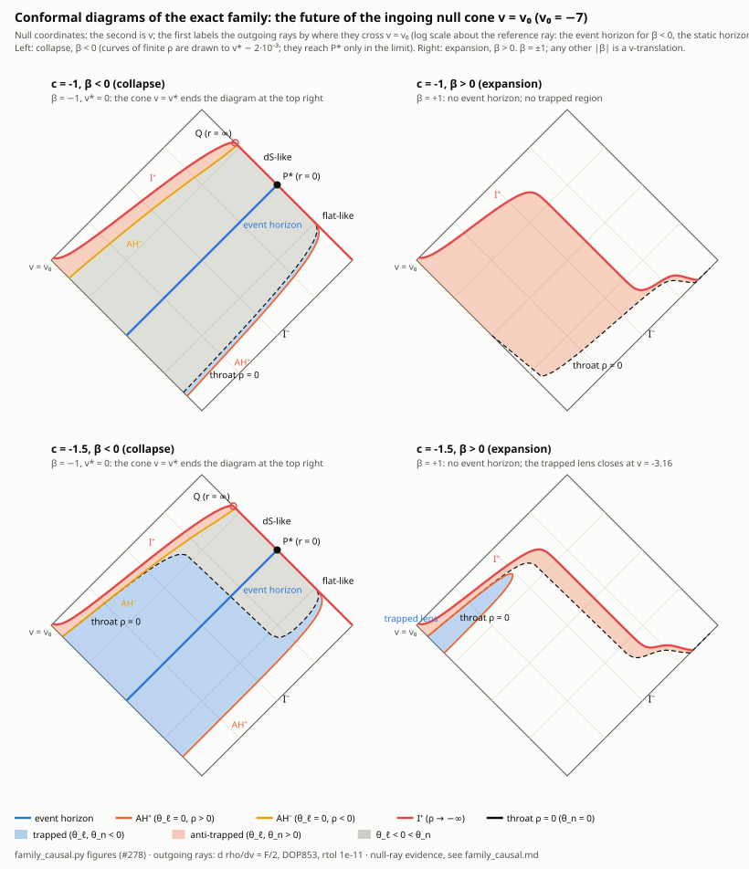

# The causal structure of the black universes' exact time-dependent family (#278)

Code [family_causal.py](family_causal.py), output of record [family_causal_output.txt](family_causal_output.txt) assembled from negative-mass-raw `I278-mac/runs`, figure [family_causal.svg](family_causal.svg); the criteria,
written before the runs of record (and amended once, before the second runs), are in `I278-mac/README.md`. Builds on #269 ([exact_mode.md](exact_mode.md)) and agrees with #277 (`planted_family.md` sec. 6). Status words as in
AGENTS.md: the closed forms are *checked symbolically*, the sign of A′ is *proved* (arctan x < x), the ray results are *numerical evidence*. No sentence here says a result is new (the literature was not searched).

## Answer

Family, member c (b = 1, K = −2c/π), ingoing null chart, v-translation maps β to βe^{Kδ} (check N8), so only the sign of β matters; β = ±1, L = 1, members c = −1 and c = −3/2:

```
ds² = −F dv² + 2 dv dρ + r² dΩ²,   r = λR,   F = A − 2ρλ′/λ + 1/λ² − 1,   λ² = 1 + s,   s = βe^{Kv},   A′ = 2K(1 − ρ arccot ρ) > 0
```

**1. The apparent horizons are in closed form.** With n = −∂_ρ, ℓ = ∂_v + (F/2)∂_ρ (g(ℓ, n) = −1): n(r) = −λρ/R, ℓ(r) = P/(2Rλ), (∇r)² = −2ℓ(r)n(r) = (ρ/R²) P, and

```
P = ρA + sR²A′/2 = (R²A′/2)(s − s_AH(ρ)),     s_AH(ρ) = −2ρA/(R²A′)
```

(S1–S4, *checked symbolically*; R²A′ = 2K + 2ρ(A − 1) is #269's first integral). The marginal surfaces are the throat ρ = 0 (n(r) = 0, ℓ(r) = sK/(2λ), the sign of β) and the curves s = s_AH(ρ).
The root of (∇r)² computed from the metric components equals the closed-form root to 1.5e-33 (bar 1e-12; 20 roots at c = −1, −3/2, N1). Signs: s_AH has the sign of −ρA, so the curves exist where ρA and s have opposite signs.
At s = −1, P = ρ − K: the branch ρ > 0 reaches v = v* at ρ₁ = K (0.636620 and 0.954930 in the table).

| | β < 0 | β > 0 |
|---|---|---|
| c = −1 | AH⁺ in ρ > 0, AH⁻ in ρ < 0, both from ρ = 0 at v → −∞; AH⁻ → −∞ at v* | no AH at any v: ℓ(r) > 0 for every ρ > 0 (N12); ρ < 0 anti-trapped |
| c = −3/2 | AH⁺ from ρ_h = 0.339617, AH⁻ from ρ = 0 | a lens between two roots, from (0, ρ_h) at v → −∞, closing at s_max = 0.0490368 (ρ = 0.176045, v = −3.15749 at β = 1): trapped points at 0.995 s_max, none at 1.005 s_max |

Regions at β < 0: ρ > ρ_AH⁺ untrapped (n(r) < 0 < ℓ(r)); 0 < ρ < ρ_AH⁺ trapped (both negative); ρ_AH⁻ < ρ < 0 has n(r) > 0 > ℓ(r); ρ < ρ_AH⁻ anti-trapped. Causal character, by a ray started on the curve (N7, three values of v each, both members):
AH⁺ timelike, AH⁻ spacelike; for the β > 0 lens (c = −3/2, v = −6, −4) the inner root spacelike, the outer timelike. The throat has F(v, 0) = c + 1/λ²: spacelike at every v for β > 0; for β < 0 timelike at c = −1,
and at c = −3/2 spacelike until the null point v = −1.150464 (λ² = −1/c, ray from ρ = 0 stands still to 1.8e-7), timelike after.

**2. β < 0 (collapse): the event horizon is the ray into P* = (v*, ρ = −1/K); the cone v = v\* is a null line with a vertex.** Outgoing rays end in four ways (c = −1 and −3/2 alike; start v₀ = −10, offsets d from the event horizon):

| ray | ends | r at the end | curvature at the end |
|---|---|---|---|
| ρ₀ above ρ_EH | on v = v\*, ρ → +∞ (1 + Kρ ≈ Cτ^{−1/2}, C > 0), τ = v\* − v | finite r_\* > 0, r_\*(d) = 1.51, 0.590, 0.116, 0.0134, 0.00136 for d = 1e-3 … 1e-7 (c = −1) | Ricci ∝ √τ → 0, Kretschmann ∝ τ → 0 (ratios 10.08 and 101.5 per 100 in τ): flat-like (N13) |
| ρ₀ = ρ_EH | at P*, ρ → −1/K | r → 0, r/√τ → √K R(−1/K) = 1.485738 (1.485722 at τ = 1e-5) | direction dependent: Kretschmann on the ray 67.25, on ρ = −1/K 69.98, diverging for other ρ (c = −1; 114.45, 123.96 at c = −3/2) |
| ρ_EH − d_crit < ρ₀ < ρ_EH | on v = v\*, ρ → −∞ (C < 0) | finite r_\*, r_\* → ∞ as d → d_crit (63.3 at d = d_crit(1 − 0.01), 371 at d_crit(1 − 0.001), c = −1) | Ricci → 12H², Kretschmann → 24H⁴, H² = −2c (24.0, 96.0 at c = −1; 36.03, 216.3 at c = −3/2): de Sitter-like |
| ρ₀ < ρ_EH − d_crit | at ρ = −∞ at v_b < v\* | r → ∞ | I⁺ |

d_crit(−10) = 5.150847e-05 at c = −1, 1.210547e-04 at c = −3/2 (N11); the fall time v\* − v_b → 0 as d ↓ d_crit (2.7e-3, 2.7e-5, 6.4e-9 at d = d_crit(1 + ε), ε = 0.1, 0.01, 0.001, c = −1). So I⁺ meets the cone at a point Q with r = ∞.
The cone v = v\* is one null line on which r runs ∞ (Q) → 0 (P\*) → ∞ (the corner where it meets I⁻), de Sitter-like on one side of P\* and flat-like on the other. **r → 0 at v\* holds at fixed ρ and not along the
outgoing rays**, as #277 found along its grid; the whole line {v = v\*, ρ finite} is the vertex: the label x = ρ₀ − ρ_EH(v₀) of the ray through (v\* − τ, ρ) is ∝ √τ for every ρ (`dev8_vertex.py` in the raw folder, not in the script), so the curves of finite ρ, the throat and AH⁺ among them, converge
to P\* (in the figure AH⁻ runs to Q). The divergence of the Ricci scalar at fixed ρ (#269) is the approach to P\* along curves of finite ρ; both sides of the cone have bounded curvature.

The event horizon is defined as the boundary of the past of the set of rays that end at ρ = +∞ on the cone (the past of I⁺ does not apply: they reach v\* at finite r). It has no closed form; it is the C = 0 ray.
Backward integration from τ = 1e-7 along 1 + Kρ = −(K A(−1/K)/3)τ agrees with the forward bisection separatrix to 9.4e-12 (bar 1e-8, N4). Its positions (table):

| v | −10 | −5 | −3 | −1 | −0.1 |
|---|---|---|---|---|---|
| c = −1: ρ_AH⁻, ρ_EH, ρ_AH⁺ | −0.0297, −0.0078, 0.0290 | −0.1543, −0.0958, 0.1374 | −0.3188, −0.2453, 0.2525 | −0.8349, −0.6911, 0.4645 | −2.9679, −1.4018, 0.6165 |
| c = −3/2 | −0.0001, 0.3342, 0.3397 | −0.0156, 0.2611, 0.3529 | −0.0919, 0.1203, 0.4153 | −0.4864, −0.2970, 0.6615 | −2.0716, −0.9057, 0.9165 |

ρ_AH⁻ < ρ_EH < ρ_AH⁺ at 55 values of v (smallest gaps 0.0219 and 0.0368 at c = −1; 0.1753 and 0.0055 at c = −3/2, N5). At c = −1 the event horizon stays in ρ < 0, the throat ρ = 0 (timelike) outside it at every v; at c = −3/2
it crosses the throat at v = −2.14617. It starts inside the static horizon (ρ_EH(−10) = −0.0078 against ρ_h = 0, s = −0.0017) and ends on the spacelike line ρ = −1/K (F = A = −5.68, −4.76 there).
The trapped region 0 < ρ < ρ_AH⁺ is not contained in the region behind the event horizon: a ray from a trapped point above ρ_EH starts with r decreasing along both null directions and still reaches the cone on the flat-like side.

**Control (N4).** The throat, the static horizon ρ_h, AH⁺ and AH⁻ are each claimed as the horizon at v₀ = −10, −5, −2, with rays at ±1e-3: for each, the ray on one side reaches the wrong end (for example rays just inside AH⁺ escape and rays just outside AH⁻ fall); the event horizon alone separates. Mutation `eh_shift` (the claimed horizon displaced by 5e-3) fires N4, N6, N11.

**3. β > 0 (expansion): no event horizon.** 72 outgoing rays (c = −1, −3/2; v₀ = −10, −3, 0, 2; ρ₀ from −30 to 1e8) all fall to ρ = −∞ at finite v with r > 10⁶; none reaches ρ = +∞ (N3). The fall time rises with ρ₀
(c = −1: v = −1.77 at ρ₀ = 0, 25.32 at 1000, 61.47 at 10⁸; c = −3/2: −8.05, 16.88, 40.98), so I⁺ is spacelike and reached only in the corner as ρ₀ → ∞. At late v the 2D metric is static,
F → −KR² arccot ρ < 0 at every ρ (to 3.6e-16 at v = 60). Trapped region: none at c = −1; the lens above at c = −3/2. Everything after v_max is untrapped (ρ > 0) or anti-trapped (ρ < 0), with ℓ(r) = sK/(2λ) > 0 on the throat.

**4. Ends and lines.** ρ → +∞ at fixed v is Minkowski to leading order: with A → 1 the (v, ρ) part is exactly −dT² + 2 dT dr, T = ∫dv/λ, r = λρ (S5). ρ → −∞ is the de Sitter-like I⁺ (H² = −2c): reached at finite v,
at infinite affine length (the affine parameter grows linearly in |ρ|: λ_aff(−1e6)/λ_aff(−1e3) = 1002.00 for c = −1, −3/2 and both signs, N10), and ρ is affine on the ingoing rays (S6). The line ρ = −1/K has F = A for every v (S4).

## Diagrams



The future of the ingoing cone v = v₀ (v₀ = −7); the outgoing rays are labeled by where they cross it, on a log scale about the reference ray (the event horizon for β < 0, the static horizon for β > 0): any monotone
relabeling is a conformal diagram, so positions carry no claim. Left column β < 0: I⁺ from the corner v₀ up to Q, the cone from Q through P\* to the right corner, the event horizon as the null line into P\*, AH⁺, AH⁻, the throat,
shading by sign of (n(r), ℓ(r)). Right column β > 0: I⁺ to the top corner, the throat, the lens at c = −3/2. Curves of finite ρ are drawn to v\* − 2·10⁻³ and reach P\* only in the limit.

## Checks (derive: S0–S6; check: N0–N13; mutations: 17)

| id | what | result |
|---|---|---|
| S0–S6 | (∇r)² of the static member (planted) and of the family; R²A′ identity, A′ > 0; ℓ(r), n(r); P = (R²A′/2)(s − s_AH), F(v, 0), F(v, −1/K); Minkowski limit; ρ affine | all zero |
| N0 | planted: static horizons c = −1, −3/2, −3/10 by the ray separatrix; Ellis c = 0, β = ±1 against exact rays 1 − βρ = C(1 + βv)^{−1/2} and separatrix ρ = −1 | 3.3e-16; 1.3e-12 (bar 1e-9) |
| N1 | root of (∇r)² against the closed form | 1.5e-33 (bar 1e-12) |
| N2 | labels, ℓ(r) = P/(2Rλ), dr/dv along rays, 264 points | signs equal; 6.9e-14; 1.5e-4 (bars 1e-9, 1e-3) |
| N3 | β > 0: 72 rays all fall; I⁺ spacelike; late F | 0 escape; 3.6e-16 |
| N4 | ray into P* against bisection; controls | 9.4e-12 (bar 1e-8); as declared |
| N5, N8 | AH bracket the EH; v-translation | strict at 55 v; 1.4e-13 (bar 1e-8) |
| N6 | slope −A(−1/K)/3 and r/√τ at P*; r_\* falls with d | 1.894441 against 1.894464, 1.485722 against 1.485738 (c = −1) |
| N7 | throat and AH character by rays | 0 disagreements |
| N10 | affine length of I⁺ | 1002.00 (bar 1000 ± 2%) |
| N11 | the left side of the cone, Q | d_crit as above |
| N12 | β > 0: trapped region | as above |
| N13 | curvature on the cone | as above |

Seventeen mutations, each with the checks it must fire declared before the runs of record: the fired sets equal the declared ones (17 of 17; `family_causal_output.txt`). The first runs of record (code 90a9277: 7 + 12 checks, 16 mutations)
gave the same results; N13 and `ds_h` were added after #277's note (README, Amendment 1). N9 prints information only (Kretschmann near P\*).
Mistakes caught in development: a classifier that took the left rays that reach v\* for the AF side (N4 failed at 9e-3, then at 1.5e-8 with the sign of ρ in place of the sign of 1 + Kρ); `rate_ray` fired nothing until N2
integrated with the mutated family against the metric.

## Proposed text (the files are not touched here)

`exact_mode.md` Sec. 5, table, β < 0 row, areal radius: *r → 0 at every fixed ρ as λ² → 0; along the outgoing null rays r tends to a positive constant, and v = v\* is a null line with the single singular point P\* ([family_causal.md](family_causal.md)).*
Sec. 8, second bullet, replace by: *The causal structure is in family_causal.md (#278): event horizon, apparent horizons, the cone v = v\*, the ends. Not shown: an extension past v\*, L ≠ 1, members with ρ_h < 0.*

`README.md` Sec. 5, after the Update from #269: *Update from #278 ([family_causal.md](family_causal.md)): the apparent horizons of the exact family are (∇r)² = (ρ/R²)[ρA + sR²A′/2] = 0, that is ρ = 0 and s = −2ρA/(R²A′) (checked symbolically).
For β < 0 the event horizon (of the rays reaching ρ = +∞ on v = v\*) is the ray into the point where r → 0 on v = v\* at ρ = −1/K, and lies between the two apparent-horizon branches; the cone v = v\* has curvature → 0 on one side of that point and → de Sitter on the other. For
β > 0 no outgoing ray reaches ρ = +∞: there is no event horizon, and for c < −1 the trapped region closes at finite v. Numerical evidence for the ray statements.*

Paper IV (`paper/4-black-universes/main.tex`), replacing "For $\beta<0$ the areal radius vanishes at the finite $v_*=-K^{-1}\ln|\beta|$ with a diverging Ricci scalar; for $\beta>0$ it grows as $e^{Kv/2}$." (paper signature):

```latex
For $\beta<0$ the areal radius vanishes at fixed $\rho$ as $v\to v_*=-K^{-1}\ln|\beta|$, with a diverging Ricci scalar, but the outgoing null rays reach $v=v_*$ at $\rho\to\pm\infty$ with finite radius and bounded curvature:
$v=v_*$ is a null line whose vertex is the only singular point, and the event horizon of the asymptotic end is the ray into that vertex (numerical evidence, \#278).
For $\beta>0$ the radius grows as $e^{Kv/2}$, no outgoing ray reaches the asymptotic end, and the trapped region, present for $c<-1$ at early $v$, closes at finite $v$.
```

## What this does not show

- Whether the metric extends past v = v\*, or what P\* is in a larger spacetime. Both sides of the cone have bounded curvature (N13), but no extension was built; the limit at P\* depends on the direction of approach.
- The event horizon under any other definition. For β < 0 there is no I⁺ on the AF side (the rays reach v\* at finite r); the definition used is stated above.
- L ≠ 1, members with ρ_h < 0 (−1 < c < 0) or other members of c < −1; only c = −1 and −3/2 were run. Other |β| are a v-translation (N8).
- Positions in the diagrams (a log scale), and the diagrams beyond the future of v = v₀ (the left exterior and the past of the cone v = v₀ are not in the chart).
- Anything about asymptotically flat data: the family is not asymptotically flat for β ≠ 0 (#250 stays open).
- The ray results have the precision of float64 integrations at rtol 1e-11; the ratios in N6, N13 are read at τ = 1e-5 … 1e-8.

## Recommended tasks

1. **Extension of the family past v = v\* on the AF side.** *What:* build (T, r) coordinates on the flat-like side of the cone, T = ∫dv/λ, and test whether the metric components are analytic in λ through λ = 0 at fixed r. *Why:* r → r_\* > 0 there, the curvature is bounded, and S5 makes the leading order Minkowski; the singularity may be the vertex alone. *Acceptance:* the components in (T, r) agree with their series in λ/r to O(λ⁶) at 40 digits for c = −1, −3/2; the sign mutation λ → −λ fails. *Depends on:* #278.
2. **The same diagrams for −1 < c < 0 and L ≠ 1.** *What:* rerun N0–N13 at c = −3/10 (ρ_h < 0, a cosmological horizon on the far side of the throat) and L = 3/2. *Why:* the issue named one member with c ≠ −1; the ordering AH⁻ < EH < AH⁺ and the cone may change when ρ_h < 0. *Acceptance:* every check passes, or a failure is reported with its cause; the 17 mutations fire as declared. *Depends on:* #278.
3. **The mass along the horizons.** *What:* the Misner–Sharp mass r(1 − (∇r)²)/2 along AH⁺, AH⁻ and the event horizon in closed form, and its sign of change in v. *Why:* AH⁺ is timelike and lies outside the event horizon; the mass flux would say whether the family radiates or absorbs. *Acceptance:* dm/dv along AH⁺ in closed form against a ray-integrated value to 1e-8; a sign mutation of the scalar's ε fails. *Depends on:* #278.

## Reproduce

From this directory, `~/Source/negative-mass/.venv/bin/python`, one thread:

```
family_causal.py derive [--mutate=...]          # S0 - S6, 1 s
family_causal.py check [--only=N4,N13] [--mutate=ah_coef|ah_sign|ell_sign|throat|eh_shift|pstar|beta_sign|rate_ray|hz_shift|inv_k|ellis|aff_sign|kA|r_scale|f2|gpp|ds_h]   # N0 - N13, 35 s
family_causal.py table                          # the numbers quoted above, 3 s
family_causal.py figures [OUTDIR]               # family_causal.svg, 25 s
family_causal.py mutations DIR PREFIX           # fired sets of stored logs DIR/PREFIX<name>.log against the declared ones
```

`family_causal_output.txt` is `derive` and `check` of run 2 (code 068953c), `table` (code 5ba41d8) and the `mutations` report of the runs of record (`I278-mac/runs`), in that order. The checks are identical in the two commits; the first runs of
record (code 90a9277) are `runs/*_run1.log`.
