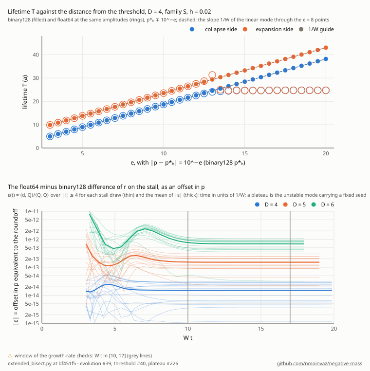

# The roundoff floor of the Ellis threshold, in binary128 (#227)

Driver: [extended_bisect.py](extended_bisect.py), importing #39's `dn.py`, #40's `threshold.py` and #226's `constraint_plateau.py` unchanged. Output of record:
[extended_bisect_output.txt](extended_bisect_output.txt) (`scripts/make_output.sh` of the raw folder, exit 0: 7 controls and 37 checks pass). Raw output, with the criteria written before the runs of record:
negative-mass-raw `I227-rpi5` (README with the criteria, the planted cases and the mutation effects; `dev/`, `runs/`, `mut/`, `scripts/`). Status words as in AGENTS.md: every number is *numerical evidence*.
No sentence here says a result is new. `np.longdouble` is IEEE binary128 on aarch64 Linux only; the script refuses other machines (`need_binary128`).



The figure is drawn by `python3 extended_bisect.py graph --raw=<negative-mass-raw>/I227-rpi5 --out=extended_bisect.svg`.

## Answer

**The floor is the float64 evolution's roundoff.** In binary128 the fate of family S at D = 4, h = 0.02 is monotone down to |p − p*ₕ| = 1e-20 (70 of 70 series points on their side, p*ₕ bisected to 5.3e-25) and T is a log law over
the eight decades the double run could not reach, with slope 0.845980 ± 0.000255 against 1/W = 0.846045 (−7.8e-5). The double-precision p*ₕ is 1.7e-14 (rms 1.85e-14, 16 brackets) above the binary128 p*ₕ of its own inputs, and the
float64 − binary128 difference of r on the stall is the unstable mode carrying a seed: it grows at W (−0.5 %, −0.01 %, +0.2 % at D = 4, 5, 6) as an offset in p of 1.85e-14, 1.7e-13, 7.5e-13, which agrees with the measured offsets
of the double bisections within factors 1.00, 0.82 and 0.77. So the floor in p* is 2e-14 at D = 4, 2e-13 at D = 5 and 1e-12 at D = 6, not 1e-12 at every D.

| acceptance (issue #227 and #226's request) | verdict | numbers |
|---|---|---|
| D = 4, S, h = 0.02 in binary128, fate monotone to \|p − p*ₕ\| = 1e-20, or the first failure | **met** (FM-E, FM-F, TM) | 70 of 70 points on their side, T never decreases, e = 3 … 20; p*ₕ(E) = 4.7527725276423075264e-05, hi − lo = 5.3e-25, 77 runs |
| its p*ₕ agrees with the double one to the double floor | **met** (A2-E, A2-F) | float64 − binary128: +1.70e-14 (F, rms 1.85e-14, max 4.3e-14), +8.17e-14 (E, rms 8.2e-14, max 1.1e-13), K = 16; bar 1e-11 |
| the series is a log law over the decades the double run could not reach | **met** (LL1 to LL3) | [1e-20, 1e-12]: 0.845980 ± 0.000255 (n = 34), −7.8e-5 from 1/W, inside the fit spread [0.8432, 0.8480]; [1e-11, 1e-3]: 0.846642 ± 0.000380; residual 0.0140 against the row spacing 0.0283 |
| planted perturbation of the data at 1e-16 relative moves p*ₕ by the predicted amount | **met** (P1, P2) | amplitude × (1 ± 1e-16): −4.7525e-21, +4.7528e-21 against ∓4.7528e-21 (differences 2.8e-25, 4.7e-26, bar 1.5e-24); bump in r: κ = −0.215729 from 1e-8 and 1e-10 predicts the shift at ±1e-16 to 1.5e-8 and 3.5e-9 |
| #226: the growth rate of \|r_f64 − r_b128\| on the stall against W within 2 % | **met** (S1) | −5.4e-3 (D = 4), −8.7e-5 (D = 5), +2.3e-3 (D = 6), W t in [10, 17], 16 draws each |
| #226: the floor in p* predicted from the seed within a factor 3 of the measured one | **met** (S2, S3) | predicted rms 1.85e-14, 1.70e-13, 7.46e-13; measured 1.85e-14, 2.07e-13, 9.72e-13; ratios 1.00, 0.82, 0.77; the means have the measured sign |

37 checks and 7 controls in the output, 0 fail. The first-failure rule of the issue did not apply: nothing failed to e = 20. Where a check could have failed and did not is in the mutations (below): 19 mutations, each fires its declared set.

## What was run

- **Engine.** The anti-diagonal sweep of `dn.cell_np` in `np.longdouble`, about 5 µs per cell, with the events of `dn.evolve(stop=True)`. In float64 it reproduces the numba row kernel's fate, event cell and T at 20 of 20 amplitudes (K1).
  A binary128 fate run at |p − p*ₕ| = 1e-20 (T = 43, 1.5e3 rows) takes 15 to 20 s; the series of 35 runs per side 3.5 to 4.8 min; a bisection from [−0.01, 0.01] to 1e-24 (77 runs) 13.5 min.
- **Data in binary128.** The algorithm of `dn.ellis_rays` with every number in binary128: the static Ellis solution from a Taylor series (closed form at D = 4 to 2e-32, first integral at D = 5, 6 to 8e-33: K2),
  the Gaussian pulses, the RK4 constraint solve. **Two variants.** E (exact static solution) and F (the float64 dense solution `dn.ellis_dense`, rtol 1e-13, cast to binary128, as the double run reads it). They differ
  because #40's data are not the exact wormhole: the float64 static solution is off by 7.6e-14 in r and 5.4e-13 in φ at 1200 nodes (K3), which moves p*ₕ by p*ₕ(E) − p*ₕ(F) = −6.5e-14 (4.7527725276423075264e-05 and 4.7527725341106454458e-05).
  Variant F isolates roundoff: the two precisions differ by arithmetic only.
- **Float64 side.** 16 float64 bisections (`threshold.bisect`, `threshold.point`, numba, tolerance 1e-16) from 16 different brackets; k = 0 is #40's bracket; at #40's tolerance 1e-14 (development) it gives #40's p*ₕ bit for bit (4.7527725346299125e-05 to 4.752772535539407e-05).
  The float64 series at the same amplitudes (rounded to float64).
- **Stall.** At p = p*ₕ(F) ∓ δ_k, δ_k = 1e-10 (1 + 0.0731 k), 8 pairs: the float64 and the binary128 run of the same float64 amplitude to t = 17, 11, 8.5 at D = 4, 5, 6 (h = 0.02, 0.00707, 0.005, #40's coarsest D = 6 member
  and the D = 4, 5 members of #40's table). On each node diagonal over |l| ≤ 4: d = r_f64 − r_b128, the pair's profile Q = ∂r/∂p, and the projection ε = ⟨d, Q⟩/⟨Q, Q⟩.
  A float64 run at p is the binary128 run at p + ε, so p*_f64 − p*_binary128 = −ε. The binary128 p*ₕ(F) at D = 5, 6 are 2.884790369233e-04 and 1.115514800962e-03 (24 runs each, tolerance 1e-16).

## The binary128 series

T at p*ₕ ∓ 10^−e (E; the series of F is equal to it event by event, 70 of 70 points: T, fate and event cell, although p*ₕ differs by 6.5e-14):

| e | 3 | 6 | 9 | 12 | 14 | 16 | 18 | 20 |
|---|---|---|---|---|---|---|---|---|
| T, collapse side | 4.9922 | 10.9036 | 16.7301 | 22.5850 | 26.4882 | 30.3632 | 34.2664 | 38.1696 |
| T, expansion side | 9.8854 | 15.7402 | 21.5668 | 27.4216 | 31.2965 | 35.1998 | 39.1030 | 43.0062 |
| float64 (F), collapse | 4.9922 | 10.9036 | 16.7301 | 22.5850 | 25.4983 | 26.2337 | 25.9508 | 25.9508 |
| float64 (F), expansion | 9.8854 | 15.7402 | 21.5668 | 27.4216 | **fate −1**, 27.3933 | **−1**, 25.7528 | **−1**, 25.9508 | **−1**, 25.9508 |

- **A log law to 1e-20.** T grows by 1.9516 per decade between e = 18 and 20 on both sides (1/W · ln 10 = 1.9482), the residuals of the fit over [1e-20, 1e-12] are the row lattice (rms 0.0080, uniform quantization 0.0082, largest 0.0140). The slope over
  [1e-20, 1e-12] and over #40's window [1e-11, 1e-3] agree to −7.8e-4 (0.845980, 0.846642), and over both windows it is 0.846141 (+1.1e-4 from 1/W). E and F have the same T at every e.
- **The double run leaves the series where the offset says.** The float64 series about the binary128 p* equals the binary128 one to e = 12 (F), differs in its event from e = 12.5 (F; 10.5 for E, whose p* is 8e-14 from float64's) and puts the first point on
  the wrong side at e = 14.0 (F; 13.5 for E): −log10 of the largest offset is 13.4 and 13.0. From e = 14 the float64 run collapses on both sides, and from e = 18 at T = 25.9508 whatever p is.
- **The noise test.** `--mutate=noise_f64` adds uniform relative noise 2⁻⁵² to every node of the binary128 evolution (the model of #226). It brings the floor back in kind: p*ₕ moves by +3.2e-15, six series points land on the wrong side from e = 15, T decreases at four places, the slope over [1e-20, 1e-12] falls to 0.20
  (FM, TM, LL1 to LL3 fire). The offset is 6 times smaller than float64's own (1.9e-14): this noise model is not a quantitative model of float64's roundoff, which also rounds the data.

## The roundoff seed on the stall (#226's request)

| D | h | W | growth of rms \|r_f64 − r_b128\| against W, W t in [10, 17] | size extrapolated to t = 0 (rms) | offset in p equivalent: rms, mean | measured: rms of float64 − binary128 p*ₕ, mean (K) | ratio rms |
|---|---|---|---|---|---|---|---|
| 4 | 0.02 | 1.18197 | −5.4e-3 | 1.3e-16 | 1.85e-14, −7.4e-15 | 1.85e-14, +1.70e-14 (16) | 1.00 |
| 5 | 0.00707 | 1.72770 | −8.7e-5 | 3.9e-16 | 1.70e-13, +1.45e-13 | 2.07e-13, −2.02e-13 (8) | 0.82 |
| 6 | 0.005 | 2.16486 | +2.3e-3 | 5.3e-16 | 7.46e-13, +6.93e-13 | 9.72e-13, −9.69e-13 (8) | 0.77 |

- The difference is the unstable mode. After the projection on Q the residual falls to 0.01 to 0.03 of the difference (0.00 at the latest times in the development runs), and ε settles to a constant after W t ≈ 9: the roundoff made in the first
  few e-foldings is amplified at W, and the later roundoff, made when the mode is already large, adds little. The seed extrapolated to t = 0 is 0.6 to 2.4 · 2⁻⁵² in r, about one rounding of r at the throat.
- The profile Q itself grows at W to −1.7e-5, +1.2e-3, +1.3e-2 (the discrete rate at h = 0.005, #40's coarsest D = 6 member), so the window is in the linear regime. A window earlier than W t = 10 gave −3 %, +1 %, −1 % in development; the declared window is W t in [10, 17].
- **The sign of the mean is predicted.** The double bisections' p* is above the binary128 one at D = 4 (+1.7e-14) and below it at D = 5, 6 (−2.0e-13, −9.7e-13), as −ε says (+7.4e-15, −1.45e-13, −6.93e-13); the mean is a bias from the rounding of the data
  (the same for every p: pulses and RK4 in float64), the scatter about it is the noise (sd 7.6e-15, 4.5e-14, 7.7e-14).
- **Against #40's 1e-11.** The rms offsets are 0.002, 0.02 and 0.1 of 1e-11. 1e-11 is where #40's log law is verified (T within the row lattice); roundoff moves an event cell once ε/δ is a few percent, so T jitters from δ ≈ 10 ε
  (e ≈ 12.5 at D = 4, where the float64 and binary128 events first differ in F; the same scaling of ε puts it near 1e-11 at D = 6, not measured: there is no D = 6 series here) and points land on the wrong side from δ ≈ ε (e = 14 at D = 4).

## Planted truth

K1 to K4 and PL1 to PL3 (negative-mass-raw `I227-rpi5/logs/controls.log`) pass before the real data are analyzed. PL1: a planted fate function with a known 34-digit threshold and a log-law T, through the same `threshold.bisect`, series and `fit_joint`, is recovered to
5.9e-26. PL2: the perturbation analysis on a planted linear response. PL3: a planted threshold floor of rms 3e-14 puts the first wrong-side point at e = 14 to 14.5 in 8 of 8 draws, so FM can report a floor of that size.

The planted perturbation of the data at 1e-16 relative is P1 and P2 (the criteria of the issue's third bullet, both declared):
- **P1** scales the pulse amplitude of the data by 1 ± 1e-16, for which p*ₕ(η) = p*ₕ/(1 + η) exactly: a shift of ∓4.75e-21, below the spacing of float64 near p*ₕ (6.8e-21). The bisection (bracket 5e-25) finds −4.7525e-21 and +4.7528e-21.
- **P2** plants a relative bump η exp(−((s − 5)/0.5)²) in r on both rays. Its response κ = Δp*/η = −0.215729 is measured at η = 1e-8 and 1e-10 (agreement 1.1e-7, where float64 also resolves it: the shifts are 2e-9 and 2e-11) and predicts the shift at ±1e-16
  (−2.1573e-17, +2.1573e-17) to 1.5e-8 and 3.5e-9 relative.
- Float64 cannot see either at 1e-16: its p*ₕ moves by 2e-14 (rms) between runs, 1e3 to 1e6 times the shifts.

## Mutations and what each check can fail on

Each mutation was run in the development set before it was declared (raw README); the table below is the effect in the runs of record (`mut/` of the raw folder; the development effects are the same, with these differences: the record has the full series and both scale runs, so `pstar_off` and `bisect_loose` also fire TM and P1-scaleM16).

| mutation | what it breaks | checks that fire |
|---|---|---|
| `diag_S` | the sweep takes S from the wrong diagonal | K1 |
| `taylor_order` | the static Taylor series at order 8 | K2 |
| `ellis_charge` (dn's) | the float64 data's charge × 1.1 | K3 |
| `quad_h` | the step of the binary128 sweep × 1.01 | K4 (as a run-level mutation the job fails: T = 1.09 at every amplitude, #40's JOB class) |
| `float_cast` | the amplitude passes through float64 inside the binary128 run | PL1; on the real run P1-scaleP16 (measured −6.776e-21 against −4.753e-21: the float grid) |
| `pert_sign` | the sign of the predicted shift | PL2, P1 (both), P2 |
| `floor_off` | the planted floor removed | PL3 |
| `time_unit` (threshold's) | T × √2 in the fits | LL1, LL3 (E and F) |
| `pstar_off` | p* shifted by 1e-18 in the analysis | FM, TM, LL1, LL2, LL3 (E and F), P1 (both), P2 |
| `bisect_loose` | the bisection stopped at 1e-14 | BR, FM, TM, LL1, LL2, LL3 (E and F), P1 (both), P2 |
| `drop_point` | one series point dropped | SR (E and F) |
| `evc_shift` | event cells shifted by 10 | EVC (E and F) |
| `offsets_scaled` | the float64 offsets × 1e-4 | FS (E and F), S2 and S3 at D = 4, 5, 6 |
| `drop_k` | 4 of the 16 float64 brackets kept | KF |
| `t_unit` | stall time × √2 | S0, S1 at D = 4, 5, 6 |
| `seed_scale` | the predicted seed × 10 | S2, S3 at D = 4, 5, 6 |
| `noise_f64` | noise 2⁻⁵² on every node of the binary128 evolution (run) | FM, TM, LL1, LL2, LL3 |
| `h_wrong` | the whole problem at 1.01 h (run; p*ₕ + 2.0 %, A2: float64 − binary128 = −9.55e-7) | A2-E |
| `eta_dropped` | the amplitude perturbation not applied to the data (run) | P1-scaleP16 |

The clean analysis fires nothing. Two checks never fire in the real data and are shown only through their mutations: SR (the series is complete) and EVC (the column cap of the sweep does not bind).

## What `threshold.md`, `constraint_plateau.md` and Paper V should now say (proposals for the coordinator, none applied)

**`threshold.md`, "Roundoff floor"** (replace the paragraph; recommended task 3 is done by #227):

> T(p) is a log law for |p − p*ₕ| ≥ 1e-11 at D = 4, 5, 6 in float64 (#40). In binary128 (#227, `extended_bisect.md`; *numerical evidence*) the same problem at D = 4, S, h = 0.02 is monotone to |p − p*ₕ| = 1e-20: 70 of 70 points
> p*ₕ ∓ 10^−e (e = 3 … 20) on their side, T a log law over [1e-20, 1e-12] with slope 0.84598 ± 0.00026 against 1/W = 0.84605. The floor of the float64 series is the evolution's roundoff: p*ₕ of the double run is 1.7e-14
> (rms 1.9e-14, 16 brackets) above the binary128 p*ₕ of its own inputs; the float64 series leaves the binary128 one at e = 12.5 and puts a point on the wrong side at e = 14; noise of 2⁻⁵² per node added to the binary128 evolution brings the floor back.
> The float64 − binary128 difference of r on the stall grows at W (−0.5 %, −0.01 %, +0.2 % at D = 4, 5, 6) as an offset in p of 1.9e-14, 1.7e-13 and 7.5e-13, which matches the measured offsets of the double bisections (ratios 1.0, 0.8, 0.8).
> So p*ₕ is determined by roundoff to 2e-14, 2e-13 and 1e-12 at D = 4, 5, 6 (h = 0.02, 0.00707, 0.005), not to 1e-12 at every D; the bisection to 1e-14 is at D = 4 about the floor and at D = 6 below it.
> The static data of the double run differ from the exact wormhole (the dense solution's rtol of 1e-13: 7.6e-14 in r, 5.4e-13 in φ at 1200 nodes), which moves p*ₕ by 6.5e-14 at D = 4.

**`constraint_plateau.md`**, the paragraph after the cause (the sentence "That growth is the roundoff seed of the unstable mode; it bears on #227's floor.") and recommended task 2: replace the rough comparison "a factor 1700 for 3.5 time units against e^{W·3.5} = 1950" by
*"On the stall the rms of r_float64 − r_binary128 over |l| ≤ 4 grows at W to −0.5 %, −0.01 %, +0.2 % (D = 4, 5, 6; W t in [10, 17], 16 draws, #227): the two slices of the earlier comparison were not the same quantity."* Recommended task 2 is done by #227: the floor in p* predicted from the seed, 1.85e-14, 1.7e-13, 7.5e-13, agrees with the measured offsets within factors 1.0, 0.8, 0.8.

**Paper V** (`paper/5-ellis-threshold/main.tex`), replace the `\pending{\#227}` box (line 257) and the limitation bullet (line 616):

```latex
\paragraph{The roundoff floor.} In binary128 (every number of the data and of the evolution, $113$-bit mantissa) the fate of S at $D=4$, $h=0.02a$ is monotone down to
$|p-\pst|=10^{-20}$: all $70$ points $\pst\mp10^{-e}$, $e=3,\dots,20$, land on their side, and $T$ is a log law over $10^{-20}\le|p-\pst|\le10^{-12}$ with slope $0.84598\pm0.00026$, within
$7.8\times10^{-5}$ of $1/W$. The double-precision $\pst$ lies $1.7\times10^{-14}$ above the binary128 value of the same inputs (rms $1.9\times10^{-14}$ over $16$ brackets), and noise of $2^{-52}$ per node added to the
binary128 evolution brings back the wrong-side points. The difference $r_{\rm float64}-r_{\rm binary128}$ on the stall is carried by the unstable mode: it grows as $e^{Wt}$ to within $0.5\,\%$ at $D=4,5,6$ and equals an offset in $p$ of
$1.9\times10^{-14}$, $1.7\times10^{-13}$ and $7.5\times10^{-13}$, within a factor $1.3$ of the offsets of the double bisections. The floor of $\pst$ is therefore $2\times10^{-14}$, $2\times10^{-13}$ and
$10^{-12}$ at $D=4,5,6$, and the lifetime is a log law to the floor (\texttt{notes/wormhole\_evolution/extended\_bisect.md}).
% line 616:  \item \emph{The roundoff floor}: $\pst$ is determined to $2\times10^{-14}$, $2\times10^{-13}$ and $10^{-12}$ by roundoff in $D=4,5,6$ (\#227).
```

The sentence before the box, "So $\pst$ is determined to about $10^{-12}$, and the fits stop at $10^{-11}$", is right for $D=6$ only; at $D=4$ the floor is 50 times lower, and #40's fits stop at 1e-11 because that is where the log law was verified.
`paper_numbers.py` would check 0.84598, 1.7e-14, 1.9e-14, 1.7e-13 and 7.5e-13 from `extended_bisect_output.txt`.

## Discrepancies and things to know

1. **#40's "about 1e-12"** (threshold.md, Paper V) is stated for all D. The measured floor is 2e-14 at D = 4, 2e-13 at D = 5 and 1e-12 at D = 6, so it holds at D = 6 only. #40's log-law window ends at 1e-11 because that is where T stays on the row lattice; roundoff moves an event cell once ε/δ is a few percent, which is e ≈ 12.5 at D = 4.
2. **The static data of #40's code are not the exact wormhole** (K3: 7.6e-14 in r, 5.4e-13 in φ at 1200 nodes, from `solve_ivp` at rtol 1e-13). The effect on p*ₕ is 6.5e-14 at D = 4, three times its roundoff offset. Variant E removes it; the variant F results are the roundoff alone.
3. **The dev tolerance of the float64 bisections** was 1e-14 (#40) and 1e-17 in development; the runs of record use 1e-16 (the offsets differ by 3e-15 per bracket, mean and rms by 3 %).
4. **S0 at D = 6** is +1.3 % (bar 2 %): the pair's profile grows at the discrete rate of h = 0.005, which is 1.3 % above W in the window; the difference grows with it (+0.2 %).
5. **Pre-declaration changes**: a first bracket for the bump (p* ± 1e-10) and for the −1e-16 bump (± 1e-17) did not straddle; `dev/pert/*_failed_*`. The bars of PL2 and P2 were tightened from 1e-2, 1e-3 to 1e-3, 1e-4 before the runs of record. `quad_h` as a run-level mutation breaks the job (T = 1.09 at every amplitude) and was replaced by `h_wrong` there.

## Limits

- One family (S), one h at D = 4 for the binary128 series (h = 0.02); the floor at D = 5, 6 is measured at #40's coarsest members of the table that the stall used (0.00707, 0.005), not at the finest h (the cost of the stall grows as h⁻², and the float64 floor at the finest h is not measured).
- Variant F's roundoff includes the data's float64 rounding (pulses, RK4), not only the evolution's; the two are not separated here. The noise test adds 2⁻⁵² noise to every node of the binary128 evolution (the model of #226), not the real rounding of float64.
- The events are #40's (first trapped cell by row, diagonal anti-trapped cell with r ≥ 2); a different event changes T by a constant, not the floor.
- The T lattice (row spacing 0.0283) hides the roundoff until ε/δ is of order 1 % of an e-fold; the floor is read from p*ₕ offsets, not from T.
- The planted cases test the code paths (bisection at 34 digits, the fits, the perturbation analysis), not the evolution; the evolution is #39's and the sweep's float64 mode is bit-equal to it.
- The window of S0, S1 (W t in [10, 17]) was set from three development pairs at each D; the D = 6 profile grows 1.3 % faster than W there.

## Recommended tasks

1. **The floor at the finest h, D = 5 and 6** (#227, #40). What: the binary128 bisection and the float64 offsets at h = 0.00177 (D = 5) and 0.00125 (D = 6), eight brackets, with the stall pairs. Why: #40's series at the finest h is where the floor matters for the paper's fits; the offset may depend on h (more rows, more roundoff, a larger seed).
   Accept (can fail): measured rms offsets and the seed-predicted ones within a factor 3 at both D and both h; the offset's h-dependence reported with its exponent; a planted 2⁻⁵² noise reproduces it within a factor 3. Depends on: this note. Cost: the binary128 sweep has 16 times the cells of the runs here at both D: one bisection about 5 h at D = 6.
2. **Where the floor comes from** (this note). What: split variant F's offset into the data's rounding (pulses, RK4 in float64) and the evolution's, by running binary128 with float64-rounded data (the data arithmetic in float64, the evolution in binary128) and the reverse. Why: the floor's bias (+1.7e-14, −2.0e-13, −9.7e-13) comes from a deterministic rounding pattern, the scatter from roundoff in the evolution.
   Accept: the two partial offsets add to the measured one within 30 %; a planted 2⁻⁵² noise reproduces the scatter. Depends on: this note.
3. **A float64 threshold code with a floor an order lower** (#40, Paper V). What: carry the evolution in float64 with compensated sums of the second differences, or a double-double r, and read the floor against this note's seed. Why: if the paper wants p*ₕ to 1e-15 at D = 6 the floor is the obstacle. Accept: the offset from the binary128 p*ₕ falls by 10 at D = 4, 5, 6 with the same bisection. Depends on: this note; new method code, not a runner task without a ruling.
