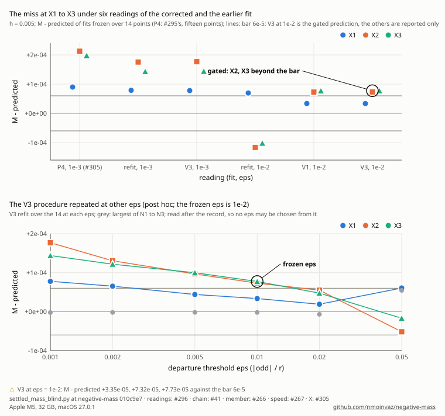

# Does the corrected ε = 1e-2 reading predict #305's route, frozen first? (#317)

Code: [settled_mass_blind.py](settled_mass_blind.py), a driver over #296's `settled_mass_eps.py` (its `read`, `fit_pred`, `design` and the V3 subtraction; through it #295's `settled_mass_route3.py`, #283's `settled_mass_route.py`,
#266's, #267's, #41's, #253's, #40's, #225's, #39's and #255's scripts) and #305's `settled_mass_route4.py` (the declared X1 to X3), all imported unchanged. Stored runs only; nothing is evolved.
Output of record: [settled_mass_blind_output.txt](settled_mass_blind_output.txt) (`python3 settled_mass_blind.py analyze`, exit 1: 19 checks, 15 gating, 4 non-gating; **1 gating check fails: PX**).
Post hoc description: `python3 settled_mass_blind.py post`, [settled_mass_blind_post_output.txt](settled_mass_blind_post_output.txt). Figure: [settled_mass_blind.svg](settled_mass_blind.svg), drawn by
[settled_mass_blind_graph.py](settled_mass_blind_graph.py). Raw output, with the method, bar, checks and mutations written before the fit was frozen, and the frozen fit committed before X1 to X3 were read by any code:
negative-mass-raw `I317-mac` (frozen file in commit 7a8a4e8c, record at a34eab4e; README stages 0 to 3, `frozen_v3.json`, `dev/`, `record/`, `scripts/`). Status words as in AGENTS.md: every number is *numerical evidence*; what is not shown is marked *conjecture*.
No sentence here says a result is new. Units: a = 1 is the throat radius of the initial static wormhole, 8πG = 1, D = 4, δ = 1e-8, h = 0.005, M = r/2 on the apparent horizon.

## Answer

**No, at the declared bar: the V3 fit frozen over fourteen members predicts X1 to 3.3e-5 and misses X2 and X3 by +7.3e-5 and +7.7e-5 (bar 6e-5), 1.2 and 1.3 times the bar.**
V3 is #296's corrected reading: B = 0's r_th − 1 and ṙ_th at ε = 1e-2 subtracted from every member, M₀ = 0.223086 kept, (a, b, c) refitted over the fifteen without δ = 1e-12. At ε = 1e-3 the frozen refit (#305) missed
by +9.0e-5, +2.13e-4, +1.98e-4: the corrected reading cuts the miss 2.6 to 2.9 times and leaves X2, X3 outside. V1 (free intercept) gives the same, +3.4e-5, +7.3e-5, +7.7e-5; V3 at ε = 1e-3 and the unsubtracted refits do not help
(+7.8e-5 to +1.8e-4 at ε = 1e-3; +7.0e-5, −1.2e-4, −1.0e-4 at 1e-2). README stage 1 said, before the freeze, that X1 inside and X2, X3 outside would not surprise me; that was a prior, not a criterion.

| acceptance (issue #317) | verdict | numbers |
|---|---|---|
| V3 frozen (B = 0's reading at ε = 1e-2 subtracted, M₀ = 0.223086, refit over the fifteen without e12), committed and pushed before X is read | **met** | raw commit 7a8a4e8c: `frozen_v3.json`, README stage 2; GIT passes in the record; X1 to X3 and N1 to N3 are not read by `freeze` (a guard) |
| every new member within 6e-5 of the frozen prediction at ε = 1e-2, or the residuals reported | **not met; residuals reported** | M − predicted = +3.35e-5, +7.32e-5, +7.73e-5 (X1, X2, X3); max 7.73e-5 |
| reported, not gating: V1 at ε = 1e-2, and V3 at ε = 1e-3, so the change from #305's miss is visible | **reported** | table below |

Residuals M − predicted at X1 to X3 (bar 6e-5), each fit frozen over the fourteen members (P4: #295's, fifteen members) before X was read:

| reading | (a, b, c) | X1 | X2 | X3 |
|---|---|---|---|---|
| P4, ε = 1e-3 (#305; reproduced to its printed digits) | 0.2296, 0.2834, 0.7658 | +9.00e-05 | +2.13e-04 | +1.98e-04 |
| unsubtracted refit, ε = 1e-3 (#305's setting, e12 dropped) | 0.2289, 0.2961, 0.7497 | +7.89e-05 | +1.76e-04 | +1.43e-04 |
| V3, ε = 1e-3 | 0.2288, 0.2973, 0.7500 | +7.77e-05 | +1.77e-04 | +1.44e-04 |
| unsubtracted refit, ε = 1e-2 | 0.2365, 0.0995, 0.4673 | +6.96e-05 | −1.17e-04 | −1.02e-04 |
| V1, ε = 1e-2 (intercept +2.12e-4) | 0.2297, 0.1315, 0.5583 | +3.36e-05 | +7.29e-05 | +7.72e-05 |
| **V3, ε = 1e-2 (gating)** | 0.229606, 0.131549, 0.558734 | **+3.35e-05** | **+7.32e-05** | **+7.73e-05** |

Controls: 19 checks, 15 gating. **The one failing gating check is PX**; the other 14 pass, with #296's printed numbers reproduced (162 table entries and the twelve printed T1, T2 maxima to half a unit of the last digit),
#305's printed misses at ε = 1e-3 reproduced (+9.001e-5, +2.128e-4, +1.980e-4) and #295's N1 to N3 predicted by the frozen V3 fit to +7.3e-8, −2.12e-6, −1.79e-6 (#296's T2 without e12: 2.12e-6). The four non-gating checks all fail (the rows above but V3's own).
The bar was not moved and no check was changed after X was read. The analysis of record equals its first run (`record/analyze_record.1.log`, `.2.log`, `.3.log`: the same apart from header and time; `.2` and `.3` were rerun after
adding the post hoc command to the script, which changed no line of the analysis: `git diff 8f63e0b 010c9e7` adds 62 lines and deletes none).

## What was run

- **Freeze** (`freeze --part=record`, 6 s): B = 0 and the fourteen training members (B = 0.025, 0.05, 0.1, 0.125; δ = 1e-7, 1e-9, 1e-10, 1e-11; #283's W1 to W3, C1 to C3) read at ε = 1e-3 and 1e-2 by #296's `read` (#266's `member_at`
  on the pair's mean profile at the first t where |odd|/r_tuned reaches ε, #267's `speed_at` there, M the plateau over the last 1.0 of x⁺); five least-squares fits of the form y = M/r_th − M₀ = a γ₁ + b γ₁² + c ṙ_th
  (no weights, no intercept except V1) written to `frozen_v3.json` with B = 0's offsets and the sha256 of the inputs. V3 subtracts (r_th − 1, ṙ_th) of B = 0 at the same ε from every member's r_th, ṙ_th, in the fit and in the prediction.
- **Order.** The frozen file was committed and pushed (raw 7a8a4e8c) with README stage 2 before `analyze` ran; `analyze` first checks that the file is tracked, unmodified and in a pushed commit (GIT), then loads X1 to X3 from
  `I305-mac/runs`, reads them at ε = 1e-3 and 1e-2 and predicts them from the frozen coefficients and B = 0's frozen offsets.
- **Development** (README stage 1): the fit over 11 of the 14 and the prediction of three held out (B = 0.05, C2, δ = 1e-10), no X or N member read (a guard). The baseline passes at 6e-5 (held-out residuals −2.4e-6, −1.3e-5, +9.3e-6).
- **Post hoc** (`post`): the shift of one reading that would close the miss, the V3 procedure at other ε, refits that include X, and the form's change along each member's trajectory.

## The frozen fit and the prediction

V3 at ε = 1e-2 over fourteen members: (a, b, c) = (0.229606394834, 0.131548678788, 0.558734349701), in-sample max 2.05e-5, leave-one-out max 2.97e-5; B = 0's reading at ε = 1e-2 is r_th − 1 = −1.4116e-4, ṙ_th = −3.2397e-4.
Against #295's (0.2296, 0.2834, 0.7658) at ε = 1e-3 the b and c are 0.46 and 0.73 times as large: the form's coefficients depend on the reading even with B = 0's offsets removed. At ε = 1e-3 the subtraction is −1.5e-6, −3.3e-6 and V3 and
the unsubtracted refit agree.

| point | γ₁ | r_th′ | ṙ_th′ | leverage | M | predicted | M − predicted |
|---|---|---|---|---|---|---|---|
| X1 | 0.012118 | 0.991932 | −7.418e-4 | 0.294 | 0.223687 | 0.223654 | **+3.35e-5** |
| X2 | 0.047648 | 0.980054 | −1.3280e-3 | 2.201 | 0.228997 | 0.228924 | **+7.32e-5** |
| X3 | 0.074473 | 0.981524 | −3.2956e-4 | 3.502 | 0.236361 | 0.236283 | **+7.73e-5** |

Leverage is the hat-matrix diagonal of (γ₁, γ₁², ṙ_th′) in the frozen design (training maximum 0.415 at W3, mean 0.214): X2 and X3 are extrapolations, 5 and 8 times the fitted maximum.
The residuals are 1.1, 2.5 and 2.6 times the largest leave-one-out error of the fit (2.97e-5), and 0.37, 0.34, 0.39 of #305's. X's own readings change with ε more than the training members': ṙ_th goes from −1.130e-3 to −1.066e-3 (X1), −2.733e-3 to −1.652e-3 (X2),
−2.439e-3 to −6.535e-4 (X3) between ε = 1e-3 and 1e-2, r_th from 0.99369 to 0.99179, 0.98380 to 0.97991, 0.98397 to 0.98138, while M is one number.

## Post hoc descriptions (gate nothing; X was read first)

([settled_mass_blind_post_output.txt](settled_mass_blind_post_output.txt); descriptions on points that include the tested ones.)

1. **Refit including X.** V3 at ε = 1e-2 refitted over the fourteen and X1 to X3 gives (a, b, c) = (0.2292, 0.1480, 0.5276) with in-sample max 2.31e-5 (X: +1.29e-5, +1.45e-5, +6.5e-6) and leave-one-out at X of 1.4e-5, 2.4e-5, 1.6e-5 (not independent: the other two X
   stay in the fit). At ε = 1e-3 the eighteen-point refit of #305 had in-sample errors up to 9.6e-5. The three-parameter form with the corrected reading describes seventeen members to 2.3e-5: the coefficients that describe X are not far from the fourteen's
   (c 0.528 against 0.559, b 0.148 against 0.132), and the frozen ones extrapolate to X2, X3 with a miss of 1.2 times the bar. The unsubtracted refit over the fourteen and X has in-sample errors up to 1.65e-4.
2. **The shift that would close it.** Taken alone, ṙ_th′ at X1, X2, X3 would have to be larger by +6.0e-5, +1.34e-4, +1.41e-4 (8 %, 10 %, 43 % of |ṙ_th′|), i.e. X's second-order speed part would have to be 1.19, 1.41, 1.44 times B = 0's (−3.24e-4);
   in r_th′ the shift is +1.5e-4, +3.1e-4, +3.2e-4 (X's part 2.05, 3.2, 3.3 times B = 0's −1.41e-4). #296 measured B = 0's part equal to 4 % across four pairs at γ₁ = 0.048 on one route; a 20 to 44 % member dependence at X is
   not excluded and not tested (PL4: a 50 % dependence would give 1.4e-4).
3. **Other ε.** The same procedure (V3 refit over the fourteen, predict X and N) at ε = 1e-3, 2e-3, 5e-3, 1e-2, 2e-2, 5e-2, max |M − predicted| at X1 to X3 and at N1 to N3:

   | ε | 1e-3 | 2e-3 | 5e-3 | 1e-2 (frozen) | 2e-2 | 5e-2 |
   |---|---|---|---|---|---|---|
   | X1 | +7.77e-5 | +6.54e-5 | +4.40e-5 | +3.35e-5 | +1.90e-5 | +6.07e-5 |
   | X2 | +1.77e-4 | +1.31e-4 | +9.66e-5 | +7.32e-5 | +5.50e-5 | −5.18e-5 |
   | X3 | +1.44e-4 | +1.22e-4 | +9.98e-5 | +7.73e-5 | +4.75e-5 | −1.70e-5 |
   | N, largest | 2.4e-6 | 2.1e-6 | 1.9e-6 | 2.1e-6 | 6.9e-6 | 5.5e-5 |

   The miss at X falls steadily with ε while the subtraction grows as ε² (B = 0's ṙ_th: −3.3e-6 at 1e-3, −3.2e-4 at 1e-2, −8.1e-3 at 5e-2), N stays at 2e-6 to 7e-6 up to 2e-2 and the fit's in-sample error falls from 4.0e-5 (1e-3) to 1.6e-5 (2e-2).
   At ε = 2e-2 V3 passes the bar at X (largest 5.5e-5); that is not a result: ε was fixed at 1e-2 beforehand, X was read, and at 5e-2 the sign changes at X2, X3 and N rises to 5.5e-5, so the trend is not a convergence to zero.
   At ε = 1e-3, where the subtraction is 3e-6, the miss is 7.8e-5 to 1.8e-4: most of it is not what B = 0's subtraction removes.
4. **The form along X's trajectory.** M is one number per member, so the frozen V3 prediction from a member's ε = 1e-3 reading (the V3 fit at 1e-3) and from its 1e-2 reading (the V3 fit at 1e-2) should agree. They differ by
   +4.4e-5, +1.04e-4, +6.7e-5 at X1, X2, X3, against at most 2.0e-5 over the fourteen training members (e11 +1.8e-5, W3 +2.0e-5, C3 −1.9e-5) and 1.9e-6 over N1 to N3. At X the form's prediction moves by about the size of the miss as the
   member's state moves between the two departure times; at the members fitted and at N it does not. That is a description of a fact about X, not a cause: a three-parameter state function with these coefficients does not hold along X's own trajectory (*conjecture*:
   the member at X is not close enough to a static member for (γ₁, r_th, ṙ_th) at one moment to fix M; #305 found the static-profile fit rms 1.5e-4 and 2.1e-4 there, against 1e-4).

## Error bars (kept separate, not mixed)

| kind | what | size | what it is |
|---|---|---|---|
| value | plateau mean over the last 1.0 of x⁺, h = 0.005, δ = 1e-8 | table above | |
| h | M at X between h = 0.01 and 0.005 | 1.0e-5, 1.2e-5, 9.0e-6 | quoted from #305, not remeasured; the residuals are 3.3 to 8.6 times these |
| roundoff realization | M from p*ₕ bisected along another path | ≤ 1.0e-7 | quoted from #305 |
| the refit | in-sample and leave-one-out errors of the fourteen under V3 | 2.05e-5 and 2.97e-5 | residual of a three-parameter form over the fit choices of the fourteen; not a confidence interval of the prediction |
| reading, definition | ε = 1e-3 against 1e-2 | X's ṙ_th by 6 %, 40 %, 73 %; the prediction by 4.4e-5, 1.0e-4, 6.7e-5 | the definition of departure, #296's `eps_alt` |
| reading, second-order part | B = 0's r_th − 1 and ṙ_th, applied to every member | −1.41e-4, −3.24e-4 at ε = 1e-2 | measured on one member, equal to 4 % on one δ scan (#296); not measured at X |

## Controls and mutations

19 checks, 15 gating (CFG, GIT, RUNS, RDX, REP296, FRZ, REPV3, PARSE305, REFX, PL1 to PL4, PL296, PX). The planted cases pass: members that follow the form exactly and carry B = 0's second-order part are recovered by the freeze and prediction code to
2.8e-17 (coefficients to 1e-14); a × 1.05, c × 0.8 or a 1.5 times larger offset at the test members fire it (5.5e-4 to 8.4e-4, 1.1e-4 to 2.5e-4, 1.4e-4 against 6e-5); #296's planted departure time and throat speed at ε = 1e-2 pass (5.8e-6, 8.1e-6).
Development ran on training members only: 23 mutations, each newly firing exactly its declared set on the second dev pass (23 of 23 MATCH; README stage 1). On the runs of record (`record/mut/*.1.log`, baseline `analyze_record.3.log`; PX and the four non-gating PX checks fail without a mutation, so no mutation can newly fire them): **20 of 23 newly fire exactly their declared sets; 2 fire their set and also REFX** (`test_swap`, `x_loader_h`: REFX's X branch compares X's residuals at ε = 1e-3 with #305's printed ones and has no development run, its dev stand-in reads C2 against #283's; README stage 1 said such a difference would be reported); **1 ends in an error after firing its check**: `parse_wrong` fires PARSE305, then raises `KeyError: 'X1'` in REFX's X branch (which reads the parsed residuals), so it prints no summary line (`record/mut/parse_wrong.1.log`, `.err`). The runner's exit codes are 0 for the 20, 1 for these three; nothing was edited after X was read.
The independence the issue asks for is limited: the prediction shares #296's readings and fit by design, so what the reproductions (REP296, REPV3, REFX, RDX) show is that this driver reaches #296's and #305's printed numbers through them.

## What this says, and does not

- *Shown (numerical evidence):* at D = 4, δ = 1e-8, h = 0.005, the V3 fit frozen over fourteen members before X1 to X3 were read predicts them to +3.35e-5, +7.32e-5, +7.73e-5 at ε = 1e-2 (bar 6e-5): X1 inside, X2 and X3 outside by
  1.2 and 1.3 times. The miss is 2.6 to 2.9 times smaller than #305's at ε = 1e-3. The corrected reading is what helps: V3 at ε = 1e-3 and the unsubtracted refits at either ε leave +7.8e-5 to +1.8e-4 or flip the sign.
- *Shown:* #295's N1 to N3 are predicted by the same frozen fit to 2.1e-6, so the corrected reading keeps the interpolation result of #295 (at the cost of changing b and c by factors 0.46 and 0.73).
- *Post hoc:* a refit over the fourteen and X describes all seventeen to 2.3e-5; the frozen prediction at X moves by 4.4e-5 to 1.0e-4 between X's two readings where it moves by at most 2.0e-5 at the training members.
- *Not shown:* where the remaining miss belongs. Two descriptions fit and neither is tested: the form extrapolated to leverage 2.2 and 3.5 (a refit with X changes c by 6 % and b by about 12 %), and a member dependence of the second-order part
  (X's would have to be 1.2 to 1.4 times B = 0's in ṙ_th). Also not shown: that V3 holds on a route not yet read (the refit with X is a description); any ε but 1e-3 and 1e-2 as a prediction; h other than 0.005; δ ≠ 1e-8; D = 5, 6; other pulse kinds.
- The conclusion of #314 (the miss does not belong to how the speed or the member's weighting is read) stands; "so the miss belongs to the form" does not follow from it, because the definition of departure was not among the readings varied and moves the miss by a factor 2.7 here.

## Stale or conflicting text found (for the coordinator; none was edited)

1. `settled_mass_route4.md`, "Coordinator's review", "Update from #314": "The miss is the form's." and `critical_ghost.md` §1.3 "Update from #314": "So #305's miss belongs to the three-parameter form, not to how the member is read." and Paper V
   (`paper/5-ellis-threshold/main.tex`): "So the miss belongs to the form, not to how the member is read, and the three-parameter description holds between the routes fitted and not far outside them": #314 varied the speed estimator and the
   member's weighting, not the definition of departure. With the corrected reading at ε = 1e-2 the miss is 2.6 to 2.9 times smaller (this note), so the sentences claim more than #314 showed. #314's own note says "the form outside its data, or a reading none of these
   touches" and lists the definition of departure as untested.
2. `settled_mass_eps.md`, "Not shown" ("that the form holds at ε = 1e-2 after the correction on a route not fitted (V3 and V1 were declared, not predicted blind)") and "Recommended tasks" 2: done here (not met at X2, X3; X1 inside).
3. `settled_mass_speed.md`, "Recommended tasks" 1 (read the fifteen, N and X at other departure definitions): done post hoc here for V3 (ε = 1e-3 to 5e-2, V3 only; the unsubtracted refits are in the post output), not as the declared task.

## Proposed text (for the coordinator; none applied)

**`settled_mass_eps.md`**, "What this says, and does not", *Not shown*, replace "that the form holds at ε = 1e-2 after the correction on a route not fitted (V3 and V1 were declared, not predicted blind)" by: "*Tested blind in #317* (`settled_mass_blind.md`): V3 frozen over the fourteen
(the fifteen without e12) before #305's route was read predicts X1 to +3.3e-5 and X2, X3 to +7.3e-5, +7.7e-5 at ε = 1e-2 (bar 6e-5), against #305's +9.0e-5, +2.1e-4, +2.0e-4 at ε = 1e-3." Recommended task 2: "done in #317 (not met at X2, X3)".

**`settled_mass_route4.md`**, after the "Update from #314" paragraph, and replacing its last sentence ("The miss is the form's."):
"*Update from #317* ([settled_mass_blind.md](settled_mass_blind.md)): read at ε = 1e-2 with B = 0's second-order part subtracted (V3, frozen over fourteen members before X was read), the miss at X1–X3 is +3.3e-5, +7.3e-5, +7.7e-5, 2.6 to 2.9 times smaller than at ε = 1e-3,
with X1 inside the bar and X2, X3 outside (1.2, 1.3 times). V3 at ε = 1e-3 and the unsubtracted refits do not reduce it. The definition of departure was not varied in #314; the remaining miss is not placed: post hoc, a refit over the fourteen and X describes all seventeen to 2.3e-5, and the form's prediction for X moves by 4.4e-5 to 1.0e-4 between the two readings of the same member."

**`critical_ghost.md` §1.3**, after the "Update from #314" bullet, and replacing the last sentence of that bullet ("So #305's miss belongs to the three-parameter form, not to how the member is read.") by "So the speed estimator is excluded as the cause; the definition of departure was not varied there (#317)":

> - *Update from #317* (`wormhole_evolution/settled_mass_blind.md`; *numerical evidence*):
>   - #296's corrected reading (ε = 1e-2, the static member's second-order part −1.41 ε² in r_th and −3.24 ε² in ṙ_th subtracted), with the three-parameter form refitted over fourteen members and frozen before #305's route was read, predicts
>     its three members to +3.3e-5, +7.3e-5, +7.7e-5 (bar 6e-5; at ε = 1e-3, #305: +9.0e-5, +2.1e-4, +2.0e-4): the first inside the bar, the other two outside by 1.2 and 1.3 times. #295's N1–N3 stay within 2.1e-6.
>   - Post hoc: the form refitted with these three describes all seventeen to 2.3e-5, and its prediction for them moves by 4.4e-5 to 1.0e-4 between the two readings of the same member (at most 2.0e-5 for the fitted ones). The remaining miss is not placed.

**Paper V**, in the paragraph "… (`…/settled_mass_route4.md`, `settled_mass_speed.md`)", replace "So the miss belongs to the form, not to how the member is read, and the three-parameter description holds between the routes fitted and not far outside them" by
"So the miss does not belong to how the throat speed is read from the stored locus or to how the member's fit is weighted", and after "…the mode's second-order part (`…/settled_mass_eps.md`)." add:

> With the static member's second-order part subtracted and the coefficients frozen over fourteen members before the route was read, the three members of the route of width $1.5$ at the centre $4.0$ are predicted to $3.3\times10^{-5}$, $7.3\times10^{-5}$ and $7.7\times10^{-5}$,
> against $9.0\times10^{-5}$, $2.1\times10^{-4}$ and $2.0\times10^{-4}$ read at $10^{-3}$, and the bar is $6\times10^{-5}$ (\texttt{notes/wormhole\_evolution/settled\_mass\_blind.md}).

`paper_numbers.py` would check +3.35e-05, +7.32e-05, +7.73e-05, the three frozen coefficients, B = 0's two offsets and N's three residuals from `settled_mass_blind_output.txt`.

## Limits

- D = 4, δ = 1e-8, family G with its ghost pulse unchanged, h = 0.005, ε = 1e-2 (V3) and 1e-3; the coefficients are for those; one route (X1 to X3).
- V3 subtracts B = 0's reading for every member; X's own second-order part is not measured. The fit set (fourteen), M₀ and the bar were fixed in README stage 1 and 2 and not changed.
- The development partition's held-out points (B = 0.05, C2, e10) are inside the fourteen; its passing says the code runs, not that V3 predicts a new route.
- The post hoc blocks use X after it was read; the other-ε table and the refits including X are descriptions.
- The prediction shares #296's reading code by design; the mutations show the checks can fail, not that the reading is right.

## Recommended tasks

1. *Is the form's prediction invariant along each member's trajectory?* What: for all stored members (the fourteen, N1–N3, X1–X3, #313's Y1–Y3) read at ε = 2e-3, 5e-3, 1e-2, 2e-2 with V3 at each, compute the change of the frozen prediction between readings (post hoc block 4's
   quantity) and tabulate it against the change of ṙ_th, r_th and γ₁ between the readings and against the static fit's rms. Why: it is 4.4e-5 to 1.0e-4 at X and ≤ 2.0e-5 elsewhere here, and it would say whether the miss follows the member's motion between readings rather than the leverage. Acceptance (can fail): the quantity at Y1–Y3 stays within the
   fourteen's spread (2.0e-5) and at X is at least 2 times it at every ε pair tested, and its rank correlates with |Δṙ_th| over the 21 members at Spearman ≥ 0.8, or the table is reported. Stored runs only. Depends on: this note, #313.
2. *The member dependence of the second-order part at X.* What: a pair at δ and δ/10 on each of X1, X2, X3 (and W3, C3, N3, as #296's task 3 asks), read at the same moment as #296's δ scan, the differences of r_th and ṙ_th against B = 0's (−1.41e-4, −3.24e-4 at ε = 1e-2). Why: V3 assumes B = 0's part for every member and X's would
   have to be 1.19 to 1.44 times it in ṙ_th to close the miss. Acceptance (can fail): the differences at X1–X3 within 10 % of B = 0's (then the miss does not belong to the member dependence), or reported with their ratio to the needed 1.19, 1.41, 1.44. Needs new runs (six pairs). Depends on: #296, this note.
3. *Predict a new high-leverage route blind with the seventeen-point V3 fit.* What: freeze V3's refit over the fourteen and X1–X3 (a, b, c) = (0.2292, 0.1480, 0.5276) in a README, then predict a route chosen by #305's rule with leverage above 1 in the new design (the stored scan lists (5.0, 1.0): 0.17, 1.19, 1.85) at ε = 1e-2.
   Why: the refit with X describes seventeen members to 2.3e-5, but that is a description on the tested points. Acceptance (can fail): each new member within 6e-5 of the frozen prediction, or the residuals reported. Needs new runs (three members at two h). Depends on: this note.

## Files

`settled_mass_blind.py` (commands `freeze`, `analyze`, `post`; `--part=record|dev`, `--mutate=`, `--baseline=`), `settled_mass_blind_output.txt`, `settled_mass_blind_post_output.txt`, `settled_mass_blind_graph.py`, `settled_mass_blind.svg`, this note;
raw `negative-mass-raw/I317-mac` (`README.md` stages 0 to 3: the method, bar, checks, mutations with their development effects, the frozen coefficients and their commit; `frozen_v3.json`; `dev/` the development freeze, baseline `analyze_dev.1.log` and `.2.log`, 23 mutations `mut/*.1.log` and `*.2.log`;
`record/` `freeze_record.1.log`, `analyze_record.1.log` to `.3.log` (`.3` is the output of record), `post_hoc.1.log`, `.2.log`, `mut/*.1.log` the 23 mutations of record, `graph.1.log`, `.2.log`; `scripts/run_muts.sh`).
