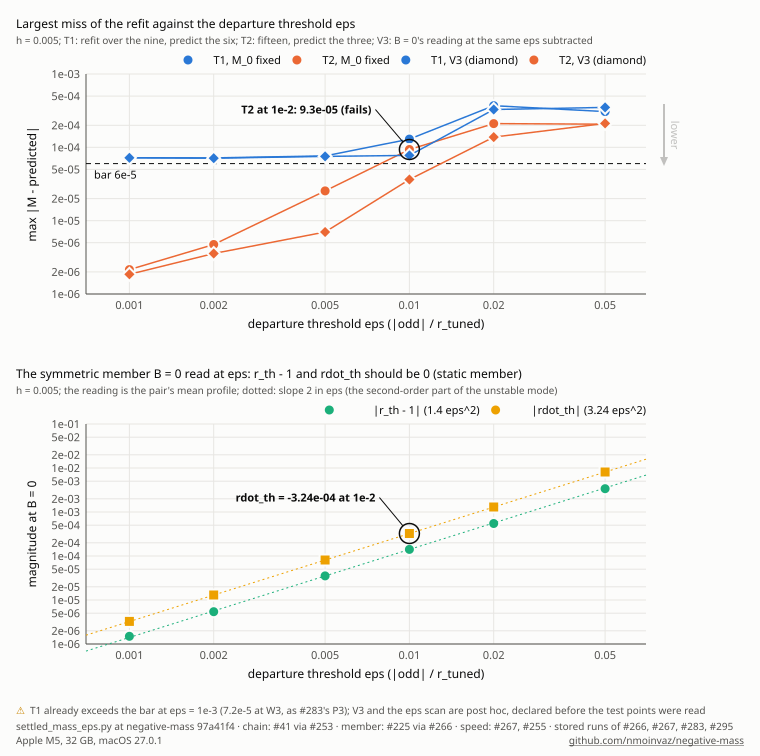

# Does the settled-mass relation of family G hang on where the member at departure is read? (#296)

Code: [settled_mass_eps.py](settled_mass_eps.py), a thin driver that imports #295's `settled_mass_route3.py` (and through it #283's `settled_mass_route.py`, #266's `settled_mass_b.py`, #267's `settled_mass_member.py`, #41's
`settled_mass.py`, #253's `settled_mass_g.py`, #40's `threshold.py`, #225's `throat_locus.py`, #39's `dn.py` and #255's `throat_drift.py`) unchanged. Output of record: [settled_mass_eps_output.txt](settled_mass_eps_output.txt)
(`python3 settled_mass_eps.py analyze`, exit 1: the two gating tests T1 and T2 fail, below). No new run: the stored runs of #266, #267, #283 and #295 are read. Raw output, with the tests, variants, bars and mutations declared before any of
the nine test points was read at ε = 1e-2: negative-mass-raw `I296-mac` (README in two stages; `dev/`, `record/`, `scripts/`). Status words as in AGENTS.md: every number below is *numerical evidence*; what is not shown is marked *conjecture*.
No sentence here says a result is new. Units: a = 1 is the throat radius of the initial static wormhole, 8πG = 1, D = 4, δ = 1e-8, h = 0.005 unless stated, M = r/2 on the apparent horizon.

The figure is drawn by `I296-mac/scripts/settled_mass_eps_graph.py` (the repository's `phase2/nonradial/data_graphs.py`, unchanged) from the same functions as the analysis.

## Answer

**No, at the declared bar: the refit of P3's form read at ε = 1e-2 misses #283's six by up to 1.29e-4 (T1) and #295's three by up to 9.3e-5 (T2), against 6e-5; at ε = 1e-3 the same numbers reproduce #283's and #295's to 5e-7.
The cause is the reading: the pair's mean profile carries a second-order part of the unstable mode that moves r_th by −1.41 ε² and ṙ_th by −3.24 ε² at the static member B = 0 and, nearly equally, at every member.
With that part removed (a post hoc variant declared beforehand) T2 passes at ε = 1e-2 (3.7e-5), and T1 misses by 7.8e-5, as it does at ε = 1e-3 (7.2e-5).**

| acceptance (issue #296, and #295's task 3) | verdict | numbers |
|---|---|---|
| T1: P3's form refitted at ε = 1e-2 over the nine (four B, five δ) predicts #283's six within 6e-5 | **not met** | M − pred = +4.80e-5, −1.28e-4, −1.97e-5 (W1–W3), +4.67e-5, −1.29e-4, −3.20e-5 (C1–C3); max 1.29e-4. At ε = 1e-3, same refit unrounded: +1.4e-5, +4.8e-5, +7.2e-5, −3.7e-6, −1.3e-5, −2.1e-5 (max 7.2e-5: **T1 misses the bar at ε = 1e-3 too**, W3, as #283's P3 did with 7.11e-5) |
| T2: the fifteen-point refit at ε = 1e-2 predicts #295's three within 6e-5 | **not met** | +6.67e-5, −9.34e-5, +1.24e-5 (N1–N3); max 9.3e-5. At ε = 1e-3: −4.8e-7, −2.2e-6, +1.2e-6 |
| the ε = 1e-3 numbers reproduce #283's and #295's to 1e-6 | **met** | #283's six (M and M − P3) to 4.7e-7; the fifteen-point refit (a, b, c) to 3.4e-11; #295's three (M and M − P4) to 4.6e-7; #267's nine-point refit and its nine leave-one-out errors to 3.6e-7 |

Controls: 21 checks, 13 gating, 8 post hoc. **The two failing gating checks are T1 and T2; the other 11 pass** (CFG, RUNS, PDEP2, PTD2, PFIT2, MEM, E2B, E3S, E3F, E3N, E3P). Six of the eight post hoc checks fail (the variants below).
The criteria were not moved: the raw README (21b10fba, code dc9d00a) was committed before any of the nine test points was read at ε = 1e-2 (a guard in the development partition raises if one is asked for). Two edits to my own controls came before the
README and are stated there: PTD2's planted speed bar is 1e-5 (#283's 5e-6 was set for ε = 1e-3; the planted error at ε = 1e-2 is 8.1e-6), and E3P's leave-one-out sign follows #267's print (predicted − measured). One block of post hoc prints
(`post_hoc2`: e12, the variants' own errors, B = 0 against ε) was added after the first record run and before the mutations of record, and is marked as such in the README and in the output; the first record's lines equal the second's above it.

## What was run

- The eighteen members of #283, #295, #266 and #267 (four B, five δ, the six and the three), and B = 0, at h = 0.005, each read by #266's `member_at` on the pair's mean profile at the first t where |odd|/r_tuned reaches ε, and #267's `speed_at`
  there. ε = 1e-3 is #266's definition; ε = 1e-2 is the other one #266 tested. The stored `member.json` rows reach t_dep(1e-1) + 1, so both are interpolated between stored slices every 0.5 in t. M is the plateau over the last 1.0 of x⁺.
- The form is P3's (#267): y = M/r_th − M₀ = a γ₁ + b γ₁² + c ṙ_th, M₀ = 0.223086, plain least squares, no intercept, no weights; the prediction is r_th (M₀ + a γ₁ + b γ₁² + c ṙ_th); bar 6e-5.
  T1 fits the nine of #267 (B = 0.025, 0.05, 0.1, 0.125 and δ = 1e-7, 1e-9 … 1e-12 at B = 0.1) and predicts #283's six; T2 fits the fifteen and predicts #295's three.
- Reproduction at ε = 1e-3 reads the earlier notes' printed numbers from their output files at run time; E2B does the same for the training members at both ε (60 printed numbers of #266 and #267, to the half unit of the last digit: all equal).
- Planted cases: a growing pair through the departure time at ε = 1e-2 (error 5.8e-6); planted pairs through `member_at` and `speed_at` at ε = 1e-2 (t_dep 6.6e-6, γ₁ 4.4e-10, r_th 9.0e-6, ṙ_th 8.1e-6); planted data following the form through the T1 and T2 code (zero
  miss; a × 1.05 or c × 0.8 in the test points misses by 5.5e-4 and 1.3e-4).

## The nine test members at both ε

h = 0.005. The departure comes 1.95 to 2.06 later at ε = 1e-2 (the mode's growth, ln 10/λ; MEM). d = value at 1e-2 minus value at 1e-3.

| point | γ₁ (1e-2) | d γ₁ | r_th (1e-2) | d r_th | ṙ_th (1e-2) | d ṙ_th | M | M − pred, ε = 1e-2 | M − pred, ε = 1e-3 |
|---|---|---|---|---|---|---|---|---|---|
| W1 | 0.012021 | +1.8e-5 | 0.994024 | −9.3e-4 | −6.580e-4 | −1.5e-4 | 0.224367 | +4.8e-5 | +1.4e-5 |
| W2 | 0.047924 | −5.8e-5 | 0.988479 | −7.0e-4 | −3.118e-4 | +3.5e-4 | 0.231740 | −1.28e-4 | +4.8e-5 |
| W3 | 0.074594 | −4.3e-4 | 0.995570 | +1.9e-3 | +1.231e-3 | +7.3e-4 | 0.240794 | −2.0e-5 | +7.2e-5 |
| C1 | 0.011964 | −2.4e-5 | 0.998882 | −7.4e-4 | −5.724e-4 | −1.8e-4 | 0.225489 | +4.7e-5 | −3.7e-6 |
| C2 | 0.047799 | −2.1e-4 | 1.006215 | −1.1e-4 | −4.720e-5 | +2.4e-4 | 0.235995 | −1.29e-4 | −1.3e-5 |
| C3 | 0.074203 | −6.3e-4 | 1.022170 | +2.8e-3 | +1.562e-3 | +5.7e-4 | 0.247278 | −3.2e-5 | −2.1e-5 |
| N1 | 0.011987 | −6.1e-6 | 0.996643 | −8.2e-4 | −6.054e-4 | −1.7e-4 | 0.224974 | +6.7e-5 | −4.8e-7 |
| N2 | 0.047844 | −1.4e-4 | 0.998415 | −3.1e-4 | −1.350e-4 | +2.8e-4 | 0.234137 | −9.3e-5 | −2.2e-6 |
| N3 | 0.074467 | −5.5e-4 | 1.011110 | +2.6e-3 | +1.482e-3 | +6.2e-4 | 0.244642 | +1.2e-5 | +1.2e-6 |

The W and C rows are T1's, the N rows T2's. The members change between the two readings by more than the bar (r_th by up to 2.8e-3, ṙ_th by up to 7.3e-4), so the refit has to move.

## The refit moves, and no longer describes its own members

| fit | (a, b, c) at ε = 1e-3 | (a, b, c) at ε = 1e-2 | in-sample max, 1e-3 → 1e-2 | leave-one-out max, 1e-3 → 1e-2 |
|---|---|---|---|---|
| nine (T1) | +0.2300, +0.2724, +0.7835 | +0.2403, +0.0519, +0.4775 | 4.4e-5 → 3.6e-4 | 6.7e-5 → 6.6e-4 |
| fifteen (T2) | +0.2296, +0.2834, +0.7658 | +0.2405, +0.0345, +0.5100 | 5.5e-5 → 3.7e-4 | 7.9e-5 → 4.3e-4 |
| eighteen (post hoc) | +0.2296, +0.2836, +0.7660 | +0.2402, +0.0380, +0.5101 | 5.5e-5 → 3.8e-4 | 7.9e-5 → 4.3e-4 |

The in-sample error of the fit rises eight-fold, to 3.6e-4, and the test residuals (1.3e-4, 9.3e-5) are below it. So the miss is not that a refit fails to carry over to a held-out route: the form with fixed M₀ does not describe the members as read at ε = 1e-2 at the
bar's level, and the held-out members are no worse than the fitted ones. The largest in-sample error at ε = 1e-2 is e12 (+374e-6, below). The eps = 1e-3 constants applied at ε = 1e-2 without a refit miss by 1e-3 (P3 on the six 9.8e-4, P4 on the three 9.5e-4):
the coefficients are not the same numbers at the two ε. #266's four-point relation at ε = 1e-2 gives (a, b) = (0.2170, 0.5348) (M₀ = 0.223086; see the conflicting text below) with an in-sample error of 2.6e-5.

## Where the ε dependence comes from

The symmetric member B = 0 is static: r_th = 1 and ṙ_th = 0 exactly. Read at ε it gives (h = 0.005, `post_hoc2`):

| ε | 1e-3 | 2e-3 | 5e-3 | 1e-2 | 2e-2 | 5e-2 |
|---|---|---|---|---|---|---|
| (r_th − 1)/ε² | −1.50 | −1.36 | −1.41 | −1.41 | −1.37 | −1.35 |
| ṙ_th/ε² | −3.26 | −3.24 | −3.24 | −3.24 | −3.24 | −3.25 |

The reading's departure from the static member scales as ε² to 4 % in r_th (from 2e-3 up; 7 % at 1e-3, where r_th − 1 is 1.5e-6) and to 1 % in ṙ_th over a factor 50 in ε (ṙ_th/(r_th − 1) = 2.3, close to 2λ with λ ≈ 1.15 per unit t: the square of the mode's part grows twice as fast).
So: at ε = 1e-3 the reading is clean to 1.5e-6 in r_th and 3.3e-6 in ṙ_th (M: below 3e-6); at ε = 1e-2 it is off by −1.41e-4 and −3.24e-4, and in y that is +3.1e-5 from r_th and c ṙ_th ≈ −1.5e-4 to −2.5e-4 from the speed.
The second-order part of the unstable mode in the pair's mean profile is the *conjecture* that fits this (the pair p* ± δ has a first-order mode that the mean removes; its square stays). It is measured, not derived here.

**The part is nearly the same for every member.** Read at the same moment from two pairs (δ = 10^−e at ε = 1e-2 and 10^−(e+1) at 1e-3, which reach it together) the δ scan differs by r_th +1.36e-4, +1.36e-4, +1.38e-4, +1.42e-4 (e7, B0.1, e9, e10) and
γ₁ −5e-6, ṙ_th +3.2e-4 to +3.3e-4: B = 0's −1.41e-4 and −3.24e-4 at γ₁ = 0.048 to 4 %. The pair e11 vs e12 differs (+5.5e-5, +2.6e-4, and t_dep by 0.026 where the others agree to 0.002); e12 is the point at the roundoff floor of the pair.

**Declared variants (post hoc, gate nothing; all declared in the raw README before the test points were read).** M = fixed M₀ is the gating reading; V2 reads M₀ at the same ε (B = 0's plateau over its r_th: 0.223118), V3 subtracts B = 0's r_th − 1 and ṙ_th at the same ε
from every member (M₀ fixed), V1 adds a free intercept (four parameters). Max |M − pred| at ε = 1e-2, bar 6e-5:

| | fixed M₀ (gating) | V2: M₀(ε) | V3: B = 0 subtracted | V1: free intercept | at h = 0.01, fixed M₀ |
|---|---|---|---|---|---|
| T1 | **1.29e-4** | 1.21e-4 | 7.76e-5 | 8.15e-5 | 8.4e-5 |
| T2 | **9.34e-5** | 8.51e-5 | **3.65e-5** | **4.17e-5** | 7.9e-5 |

V2 alone does not help: the speed's offset (c × 3.24e-4, 1.6e-4 to 2.5e-4) is five to eight times the r_th's (3.1e-5). V1's intercept is +2e-4, which is c × 3.24e-4 (1.9e-4 at c = 0.596). V3 and V1 bring T2 inside the bar and T1 to the level it has at ε = 1e-3 (7.2e-5, W3). T1's W3 and C3 are outside the nine's
fitted range (leverage 1.56 and 1.08 against the training maximum 0.96): an extrapolation there, which is what #283 found at ε = 1e-3. At h = 0.01 (coefficients refitted there) both tests fail with fixed M₀, so the miss is not an h effect.

**The e12 point (post hoc, added after the first record; a description on points that include the tested ones).** e12 (δ = 1e-12, the pair at the roundoff floor, read at t = 23.6) has the largest in-sample error at ε = 1e-2 (+374e-6) and a speed of 3.6e-4 where its neighbours give 4.8e-4,
6.8e-4, 8.4e-4. Without it, max |M − pred| at ε = 1e-2 is:

| | fixed M₀ | V1 | V3 |
|---|---|---|---|
| T1, without e12 | 8.15e-5 | 2.20e-5 | 2.13e-5 |
| T2, without e12 | 7.90e-5 | 2.24e-6 | 2.12e-6 |
| T1 / T2, without e11 and e12 | 7.74e-5 / 7.63e-5 | 2.30e-5 / 2.25e-6 | 2.22e-5 / 2.15e-6 |

With the second-order part removed (V1 or V3) and e12 dropped, both tests pass at ε = 1e-2, by more than at ε = 1e-3 (T1 5.3e-5 without e12 there). I did not test why e12 is off; the *conjecture* is that the pair's centre p*ₕ is defined to 4.3e-14 (#267's floor between bisection paths), 4 % of δ = 1e-12 (0.4 % of 1e-11 for e11), so the mean carries a first-order mode of that
fraction of the odd part, and at ε = 1e-2 that is a 4e-4 relative part of the reading (4e-5 at 1e-3). It is not checked here.

**The ε scan (post hoc, declared).** Max |M − pred| of T1 and T2 with fixed M₀, and with B = 0 subtracted:

| ε | 1e-3 | 2e-3 | 5e-3 | 1e-2 | 2e-2 | 5e-2 |
|---|---|---|---|---|---|---|
| T1, fixed M₀ | 7.2e-5 | 7.2e-5 | 7.6e-5 | 1.29e-4 | 3.7e-4 | 3.1e-4 |
| T1, V3 | 7.2e-5 | 7.1e-5 | 7.5e-5 | 7.8e-5 | 3.3e-4 | 3.5e-4 |
| T2, fixed M₀ | 2.2e-6 | 4.7e-6 | 2.5e-5 | 9.3e-5 | 2.1e-4 | 2.1e-4 |
| T2, V3 | 1.9e-6 | 3.6e-6 | 7.0e-6 | 3.7e-5 | 1.4e-4 | 2.1e-4 |

T2 passes at ε ≤ 5e-3 and fails from 1e-2, rising about as ε² from 2e-3 to 1e-2 (4.7e-6, 2.5e-5, 9.3e-5: exponents 1.8 and 1.9). Above 1e-2 the refit stops describing the members even with B = 0 subtracted (V3: 1.4e-4 and 2.1e-4). T1's W3 miss does not depend on ε below 5e-3.

## Error bars of M and of the reading (kept separate, not mixed)

| kind | what | size | what it is |
|---|---|---|---|
| value | plateau mean over the last 1.0 of x⁺, h = 0.005, δ = 1e-8 | table above | |
| h | T1 and T2 at h = 0.01 (refit there), ε = 1e-2 | 8.4e-5 and 7.9e-5 (fixed M₀) | two resolutions; the same verdict as at 0.005 |
| roundoff realization | M from p*ₕ bisected along another path | ≤ 2.1e-6 (#283's six), ≤ 1.6e-6 (#295's three) | quoted from #283 and #295, not remeasured here |
| reading, definition | ε = 1e-3 against 1e-2 | the nine test members change by up to 2.8e-3 (r_th), 7.3e-4 (ṙ_th), 6.3e-4 (γ₁); the miss in M is 1.3e-4 | this note |
| reading, second-order part | B = 0's r_th − 1 and ṙ_th | −1.41 ε², −3.24 ε² (−1.5e-6, −3.3e-6 at 1e-3) | measured on the static member; a model, not removed in the gating tests |
| the refit | in-sample and leave-one-out errors | 4.4e-5, 6.7e-5 (nine, 1e-3); 3.6e-4, 6.6e-4 (nine, 1e-2) | residual of a three-parameter form |

## Controls and mutations

21 checks, 13 gating, 8 post hoc. Development ran on a partition of training points only (the nine test points at ε = 1e-3 only, by a guard); the declared effects of the 12 mutations were computed there (12 of 12 match their declared sets on the second set of runs).
On the runs of record **9 of 12 newly fire exactly their declared set** (`asym_sign`, `coef_a`, `drop_point`, `eps_swap`, `loo_off`, `m0_shift`, `no_rscale`, `no_run`, `rdot_nolapse`); **3 fire their set and also T2-V1 and T2-V3** (`coef_c`, `dep_eps`, `no_speed`; exit 1, not edited):
the development used a bar of 3e-4 for the T-type checks, where their shifts of about 1e-4 did not reach it, and on the record those two post hoc checks sit at 6e-5 with margins of 1.8e-5 and 2.3e-5. T1 and T2 fail without a mutation, so no mutation can newly fire them on the record;
that they can fail is shown by these failures, by PFIT2's planted data (5.5e-4, 1.3e-4) and by `coef_a` and `no_rscale` at the development bar. E3P, E3S, E3N, E3F fire under the extraction mutations (`asym_sign`, `dep_eps`, `rdot_nolapse`) and `m0_shift`, so the reproduction can fail.

## What this says, and does not

- *Shown (numerical evidence):* at D = 4, δ = 1e-8, h = 0.005, the settled mass of the eighteen members of family G is not given at the bar 6e-5 by P3's form refitted over the members read at ε = 1e-2: T1 misses by 1.29e-4 and T2 by 9.3e-5, where at ε = 1e-3 T2 misses by 2.2e-6.
  The members' reading at ε = 1e-2 carries −1.41 ε² in r_th and −3.24 ε² in ṙ_th (measured at the static member, from 1e-3 to 5e-2), nearly equal across the members tested; with it subtracted T2 is within 3.7e-5 at ε = 1e-2.
- *Not shown:* that the second-order part of the unstable mode is the whole ε dependence (the V3 correction uses B = 0's value for every member; T1 still misses by 7.8e-5 with it, the level it has at ε = 1e-3, and the member dependence of the part is measured only on the δ scan at γ₁ = 0.048);
  why e12 is off (a *conjecture* above); that the form holds at ε = 1e-2 after the correction on a route not fitted (V3 and V1 were declared, not predicted blind); ε below 1e-3 (the readings there are cleaner by ε², but nothing was read); any h but 0.01 and 0.005.
- The conclusion of #295 (a refit over fifteen members predicts a third route to 2.2e-6) is a statement about the reading at ε = 1e-3, which is clean to 3e-6 in M. Read at ε = 1e-2 without the correction it does not hold at 6e-5.

## Stale or conflicting text found (for the coordinator; none was edited)

1. `settled_mass_b.md` ("Sensitivity of the member to its definition"), `settled_mass_route.md` and `settled_mass_route3.md` (the error-bar tables, "member, definition"): "ε = 1e-2 moves γ₁ by 3e-4 relative". At B = 0.1 γ₁ goes from 0.048316 to 0.048165 (1.5e-4 absolute): 3.1e-3 relative.
2. `settled_mass_b.md` same paragraph: "The member drifts slowly during the departure (r_th by 4e-4 over the two e-folds of the mode)". At B = 0, a static member, the reading's r_th changes by −1.4e-4 over the same interval: it is the second-order part, not a drift of the member. At B = 0.1 the +4.6e-4 holds −1.4e-4 of it.
3. The task text cites #266's relation at ε = 1e-2 as (0.2170, 0.5379). `settled_mass_member_output.txt` prints (0.2170, 0.5349); this note's refit over the four B gives (0.21697, 0.53480) with M₀ = 0.223086 and (0.21696, 0.53493) with M₀ = 0.2230862. 0.5379 appears in no file.
4. `settled_mass_route3.md` "Not shown": "any dependence on ε" and recommended task 3 ("The definition of departure"), `settled_mass_route.md` recommended task 2: done here (not met).
5. `critical_ghost.md` §1.3 "Update from #295": ends "outside them it is a *conjecture*"; add the ε result. Paper V (`paper/5-ellis-threshold/main.tex`), the paragraph added for #295 ("The three-parameter form was then refitted over fifteen members …"): add the ε result.

## Proposed text (for the coordinator; none applied)

**`settled_mass_route3.md`**, "What this says, and does not", *Not shown*, after "any dependence on ε, the definition of departure (#266: 1e-4 level)": "*Tested in #296* (`settled_mass_eps.md`): read at ε = 1e-2 instead of 1e-3 the same refit predicts the three to 9.3e-5 (bar 6e-5) and #283's six to 1.29e-4
(refit over the nine); the reading carries −1.41 ε² in r_th and −3.24 ε² in ṙ_th at the static member, and with it subtracted the three are predicted to 3.7e-5 and the six to 7.8e-5 (post hoc)." Recommended task 3: "done in #296". Error-bar table, "member, definition": "ε = 1e-2 moves γ₁ by 3e-3 relative
and r_th by 4.6e-4 at B = 0.1, and the reading carries a second-order part of −1.41 ε² in r_th (#296)".

**`critical_ghost.md` §1.3**, after the "Update from #295" bullet:

> - *Update from #296* (`wormhole_evolution/settled_mass_eps.md`; *numerical evidence*):
>   - The members were read at ε = 1e-2 as well as 1e-3 (the departure where the unstable mode's part reaches ε of the throat radius). The refit of P3's form at ε = 1e-2 over the nine members of #266 and #267 predicts #283's six to 1.29e-4, and over the fifteen predicts #295's three to 9.3e-5, against the declared bar of 6e-5 (at ε = 1e-3: 7.2e-5 and 2.2e-6). The refit's own in-sample error rises from 5e-5 to 4e-4.
>   - The reading carries the second-order part of the unstable mode: the static member B = 0 reads r_th − 1 = −1.41 ε² and ṙ_th = −3.24 ε² from ε = 1e-3 to 5e-2. With B = 0's reading subtracted (declared beforehand, post hoc) the three are predicted to 3.7e-5 at ε = 1e-2 and the six to 7.8e-5, the latter the level it has at ε = 1e-3.
>   - So the relation is a statement about the reading at ε = 1e-3, clean to 3e-6 in M; it does not hold at 6e-5 at ε = 1e-2 unless the second-order part is removed, and then not blind.

**Paper V**, after the paragraph added for #295:

> The member's definition matters. Read where the unstable mode's part has grown to $\epsilon=10^{-2}$ of the throat radius instead of $10^{-3}$, the refitted three-parameter form predicts the three members of the third route to $9.3\times10^{-5}$ and the six of the first two routes to $1.3\times10^{-4}$, against the bar of $6\times10^{-5}$; at $\epsilon=10^{-3}$ they are $2.2\times10^{-6}$ and $7.2\times10^{-5}$.
> The pair's mean profile carries the second-order part of the unstable mode: the static member reads $r_{\rm th}-1=-1.41\,\epsilon^2$ and $\dot r_{\rm th}=-3.24\,\epsilon^2$ (\texttt{notes/wormhole\_evolution/settled\_mass\_eps.md}).

`paper_numbers.py` would check 9.34e-05, 1.29e-04, the two refits' coefficients, 7.22e-05 and the two ε² constants from `settled_mass_eps_output.txt`.

## Limits

- D = 4, δ = 1e-8, family G; ε = 1e-3 and 1e-2 (and 2e-3 to 5e-2 post hoc); h = 0.005 (0.01 post hoc); the eighteen members of the four earlier notes; the three-parameter form with M₀ fixed.
- The variants V1 to V3, the e12 rows and the ε scan are descriptions on points that include the tested ones (V1, V2, V3 and the scan were declared before the test points were read; the e12 rows and `post_hoc2` were added after the first record run and before the mutations).
- B = 0's second-order part is measured on one member; its equality across members is measured only on the δ scan (γ₁ = 0.048, four pairs), to 4 %.
- The development partition's bar of 3e-4 and PTD2's planted-speed bar of 1e-5 are mine and stated in the README; the issue's bars (6e-5, 1e-6) are not moved.

## Recommended tasks

1. *Why e12 is off.* What: from the stored bisection of the δ = 1e-12 and 1e-11 pairs (hi − lo of p*ₕ, its sign changes) predict the first-order mode in the pair's mean and its effect on r_th and ṙ_th at ε = 1e-2, and compare with e12's readings against its neighbours.
   Why: e12 alone costs T1 and T2 about 6e-5 and 8e-5 at ε = 1e-2 (V1 and V3: 2.2e-5 against 8e-5 without and with it). Acceptance (can fail): the predicted shift of y at e12 (≈ c × the speed offset) is within a factor 2 of +374e-6, or the failure is reported. Depends on: this note (stored runs).
2. *The corrected reading, blind.* What: fix V3 (B = 0's reading at ε = 1e-2 subtracted, M₀ = 0.223086, coefficients refitted over the fifteen without e12, frozen in a README), then predict #305's members (the outside route) from the stored runs.
   Why: V3 and V1 were declared, not predicted blind, and T1 still misses at 7.8e-5. Acceptance: every new member within 6e-5 of the frozen prediction, or the residuals reported. Depends on: #305's stored runs, this note.
3. *The member dependence of the second-order part.* What: a pair at δ and δ/10 on each of W3, C3, N3 and B0.125 (the largest γ₁) read at the same moment, as the δ scan does at γ₁ = 0.048. Why: V3 assumes B = 0's −1.41 ε² for every member; it is measured to 4 % at γ₁ = 0.048 only. Acceptance: the difference of r_th and ṙ_th within 10 % of
   B = 0's at every γ₁ tested, or the differences reported. Depends on: this note; new runs (four pairs).

## Files

`settled_mass_eps.py` (command `analyze`; `--part=record|dev`, `--mutate=`, `--baseline=`), `settled_mass_eps_output.txt` (the second record, 139 lines), `settled_mass_eps.svg`, this note; raw `negative-mass-raw/I296-mac` (`README.md` in two stages with the tests, variants, development partition, mutation table and the record's verdicts;
`dev/` the development logs and `dev/mut/`; `record/analyze_record.log` and `.2.log` (the output of record), `record/mut/` the 12 mutations of record, `record/graph*.log`; `scripts/run_muts.sh`, `scripts/settled_mass_eps_graph.py`).
