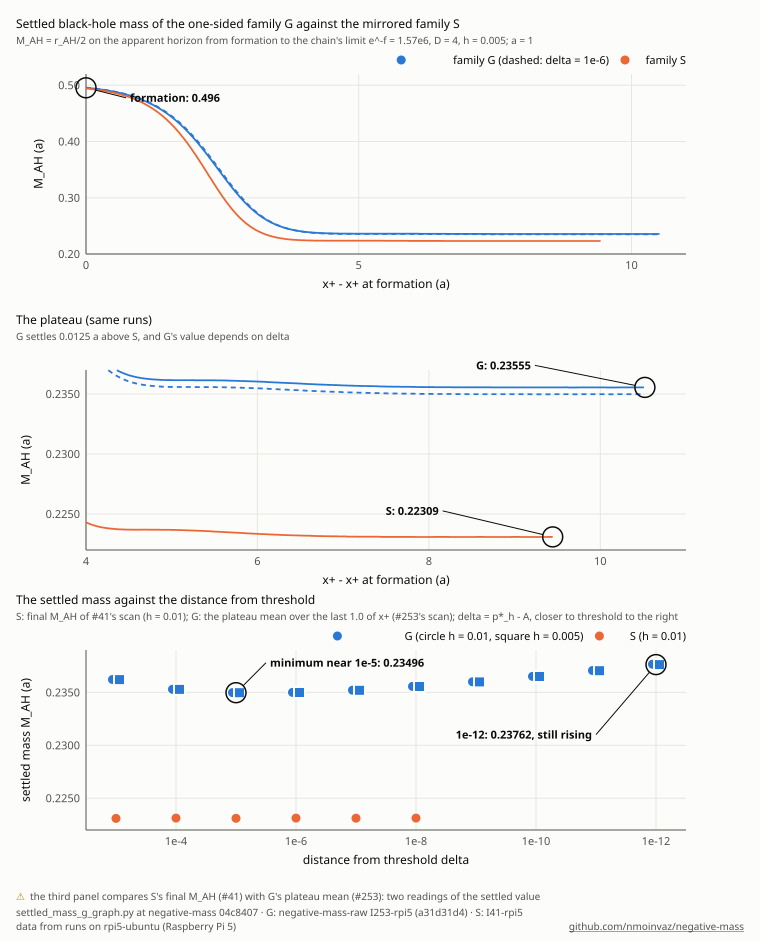

# The settled black-hole mass of the one-sided family G (#253), against family S (#41)

Code: [settled_mass_g.py](settled_mass_g.py), a thin driver that imports #41's `settled_mass.py`, #40's `threshold.py` and #39's `dn.py` unchanged. Output of record:
[settled_mass_g_output.txt](settled_mass_g_output.txt) (`python3 settled_mass_g.py analyze --raw=<negative-mass-raw>/I253-rpi5`, exit 1: RC7 and RNR fail, below). Raw output, with the criteria
written before any chain run of G (criteria at 08af1c1, mutation targets at 17f453b, runs of record at a31d31d): negative-mass-raw `I253-rpi5` (README, `runs/`, `mut/`, `dev/`, `settled_mass_g.svg`). Status words as in AGENTS.md: every mass below is *numerical evidence*; what is not shown is
marked *conjecture*. No sentence here says a result is new. Units: a = 1 is the throat radius of the initial static wormhole, 8πG = 1, D = 4, M = r/2 on the apparent horizon (r₊ = 0).

The figure is drawn by [settled_mass_g_graph.py](settled_mass_g_graph.py) from the raw folder named above.

## Answer

**Family G does not settle at S's mass, and its settled mass is not one number.** At D = 4, on the collapse side of its own p*ₕ with δ = 1e-8, M_AH falls from 0.4955 a at the first trapped cell and settles, to the
declared limit e^{−f} = 1.57e6 on the horizon, at **M_AH = 0.23555 a (r_AH = 0.4711 a)** (h = 0.005; Richardson 0.23554). S's value in the same run of the same code is 0.22309 a. The difference is +1.25e-2 a (5.6 %),
21 times the declared bar 6.0e-4 (h 1.1e-5, δ 5.7e-4, machine to machine 2e-5). The difference is the same at the three h (+1.25e-2 at each), so it is not truncation. G's plateau depends on δ: 0.23498 a at 1e-6,
0.23555 a at 1e-8, 0.23762 a at 1e-12 (+2.2e-4 to +5.7e-4 per decade from 1e-6 down), the same at h = 0.01 and 0.005 to 1.4e-5 (4.1e-5 at 1e-12); S's is flat from 1e-8 to 1e-3 (#41).

| acceptance (issue #253) | verdict | numbers |
|---|---|---|
| M_AH(t) second order at three h up to the declared limit | **met** (RC5, RC6) | all six runs end at e^{−f} = 1.54e6 to 1.57e6 (limit 1.57e6); observed orders 1.93 to 2.20 (band 1.5 to 2.5), three windows, both δ |
| #41's planted cases PL1 to PL3 unchanged | **met** | PL1 and PL2 print #41's ten lines character for character, with and without the driver's `track` wrapper; PL3 prints #41's line (nodes and dead flags bit-identical, events (385, 385)); PL3G for G passes |
| the settled value compared with 0.2231 a, error bar named | **done** | G − 0.2231 = +1.24e-2; bar = h 1.05e-5 + δ 5.66e-4 + machine 2e-5 = 5.97e-4 (kinds below) |
| if G differs from S by more than the bar, say so | **G differs** | \|G − S\| = 1.25e-2 > 5.97e-4. Also at every δ of the scan: +1.19e-2 to +1.31e-2 against S's scan for δ = 1e-8 to 1e-3, +1.45e-2 at 1e-12 against S's 0.2231 |

Controls: 17 of 19 checks pass. **RC7** (the plateau does not depend on δ, bar 1e-4) **fails**: 5.9e-4, 5.7e-4, 5.7e-4 at the three h. **RNR** (the ulp-noise scatter responds to the noise) **fails**: the scatter at 64 × 2⁻⁵² is 0.5 to
1.4 times that at 2⁻⁵². Both stay as declared. 20 of 20 mutations fire the declared set in the runs of record (see Files); two controls are silent by construction or in RC4, below.

## What was run

- #40's p*ₕ of G at D = 4 from its raw (`D4_G_h{0.02,0.01,0.005}`, hi − lo 5.7e-15 each; the h of each job.log is the h passed here), not bisected again. On this machine fate(p*ₕ − 1e-10) = collapse and
  fate(p*ₕ + 1e-10) = expansion at all three h (RC1); at δ = 1e-8 the first trapped cell is #40's: (530, 591), (1060, 1182), (2116, 2359) (RC2), and M_AH there is within 1.9e-4 of #40's M_hor (RC3).
- #41's chain unchanged: F₁ = 1.5, K = 20, W₁ = 2.4, dxp = 12, dm = 3, limit e^{−f} = 1 572 864 on the horizon (CFG). Six jobs (h = 0.02, 0.01, 0.005; δ = 1e-6, 1e-8), 2 to 29 s each, peak rss 0.73 GB.
- Not run: #41's anisotropic control AN (needs a second bisection on another grid for G; the zoom and interpolation code it tests is S's, covered by PL1 to PL3 and RC4), h = 0.0025 (no #40 p*ₕ for G).
- Added by the driver: the normal field's φ₊ on the horizon (`settled_mass.track` is called unchanged and a column is added); the first law and the horizon flux carry both fields (FLX checks the sign convention on
  planted series).

## M_AH(t) of G against S

`settled_mass_g_output.txt`, "M_AH(x+) of G against S"; h = 0.005, δ = 1e-8. G: x⁺_f = 11.7975, t_f = 15.810; S: x⁺_f = 10.4525, t_f = 14.768 (t = (x⁺ + x⁻)/√2 on the horizon). The series start at each run's first
trapped cell, so the rows are matched in x⁺ − x⁺_f, not in t.

| x⁺ − x⁺_f | t − t_f (G) | r_AH (G) | M_G | M_S | M_G − M_S | e^{−f} (G) | e^{−f} (S) |
|---|---|---|---|---|---|---|---|
| 0 | 0 | 0.99100 | 0.49550 | 0.49421 | +1.29e-3 | 0.98 | 1.02 |
| 1.0 | 1.256 | 0.95034 | 0.47517 | 0.47056 | +4.61e-3 | 1.08 | 1.13 |
| 2.0 | 2.372 | 0.80607 | 0.40304 | 0.37746 | +2.56e-2 | 1.64 | 1.94 |
| 2.5 | 2.826 | 0.68113 | 0.34056 | 0.30262 | +3.79e-2 | 2.80 | 4.10 |
| 3.0 | 3.215 | 0.56683 | 0.28342 | 0.24972 | +3.37e-2 | 6.5 | 12.1 |
| 4.0 | 3.931 | 0.47918 | 0.23959 | 0.22430 | +1.53e-2 | 44.9 | 100.9 |
| 5.0 | 4.639 | 0.47231 | 0.23615 | 0.22368 | +1.25e-2 | 253 | 657 |
| 6.0 | 5.346 | 0.47207 | 0.23604 | 0.22335 | +1.27e-2 | 1301 | 3978 |
| 7.0 | 6.053 | 0.47143 | 0.23572 | 0.22313 | +1.26e-2 | 6462 | 2.32e4 |
| 8.0 | 6.760 | 0.47115 | 0.23557 | 0.22309 | +1.25e-2 | 3.14e4 | 1.32e5 |
| 9.4 | 7.750 | 0.47110 | 0.23555 | 0.22309 | +1.25e-2 | 2.78e5 | 1.45e6 |

Both curves are monotone decreasing after formation. G lags S: it reaches e^{−f} = 100 at x⁺ − x⁺_f ≈ 4.4 against S's 4.0. The difference
M_G − M_S peaks at +4e-2 at x⁺ − x⁺_f = 2.5 and settles at +1.25e-2 from 5.0. The normal field's flux through the horizon after formation is negligible: the first law with both fields and with the ghost alone agree to five
digits (RC4, "ghost alone"), and the first law over the whole series, formation to the limit, holds to 3.8e-5 (G) and 3.7e-5 (S) at h = 0.005 (8.6e-4 and 8.2e-4 at h = 0.02; second order). The gap decomposes as +1.3e-3 at formation
(M_start 0.4955 against 0.4942) and +1.12e-2 less ghost flux afterwards (ΔM = −0.2600 against −0.2711).

## The error bar of G's value (kept separate, not mixed)

| kind | what | size | what it is |
|---|---|---|---|
| value | plateau mean over the last 1.0 of x⁺, h = 0.005, δ = 1e-8 | 0.235548 (r_AH = 0.47110) | |
| h | \|plat(0.01) − plat(0.005)\|, finest pair (range over the three h: 7.3e-5) | 1.05e-5 | difference between two resolutions of this code; second order, Richardson 0.235545 |
| δ | \|plat(1e-6) − plat(1e-8)\| at h = 0.005 | 5.66e-4 | **a physical dependence on the distance from threshold, not an error**; it is in the declared bar because the issue named it |
| machine to machine | #41's review: same code, another machine, 0.223109 against 0.223125 | 2e-5 | a measured reproducibility of one run, not a bound; the same kind of number as the noise scatter below |
| sum (declared) | h + δ + machine | 5.97e-4 | linear sum; none of the three is a rigorous enclosure |

S's value at the same h and δ is 0.223085 (the quoted 0.2231 a; Richardson 0.223080). G − S = +1.25e-2 (Richardson +1.25e-2). The verdict "differs" does not depend on the reading of the bar: the δ
dependence over six decades (2.7e-3) and the bar are each 5 to 20 times smaller than the difference.

## The dependence on δ (supplementary scan, no bar)

Plateau of M_AH at the limit, `scan`, h = 0.01 and 0.005 (they agree to 1.4e-5 from 1e-11 to 1e-3 and to 4.1e-5 at 1e-12), A = p*ₕ − δ; S from #41's scan (h = 0.01).

| δ | x⁺_f (G) | M_start (G) | plateau (G, h = 0.005) | r_AH (G) | G − S (M_end) |
|---|---|---|---|---|---|
| 1e-12 | 17.94 | 0.49899 | 0.237622 | 0.47526 | |
| 1e-10 | 14.90 | 0.49684 | 0.236498 | 0.47301 | |
| 1e-8 | 11.80 | 0.49550 | 0.235548 | 0.47111 | +1.24e-2 |
| 1e-6 | 8.70 | 0.49572 | 0.234982 | 0.46998 | +1.19e-2 |
| 1e-5 | 7.10 | 0.49746 | 0.234965 | 0.46994 | +1.19e-2 |
| 1e-4 | 5.46 | 0.50112 | 0.235275 | 0.47056 | +1.22e-2 |
| 1e-3 | 3.79 | 0.50807 | 0.236207 | 0.47243 | +1.31e-2 |
| 1e-2 | 3.12 | 0.49663 | 0.238720 | 0.47745 | +1.59e-2 |

The plateau has a minimum near δ = 1e-5 (0.23497) and rises as δ falls: per decade +1.7e-5 (1e-5 to 1e-6), +2.2e-4, +3.5e-4, +4.4e-4, +5.1e-4, +5.5e-4, +5.7e-4 (to 1e-12). The increments still grow at 1e-12; no limit
as δ → 0 is visible, and none is claimed. The formation value M_start rises the same way below 1e-7 (0.4952 to 0.4990). The gap to S is +1.2e-2 to +1.5e-2 over this range. At δ = 1e-12 the p*ₕ bracket (5.7e-15) is 0.6 % of δ.
*Tested in #267* ([settled_mass_member.md](settled_mass_member.md)): the member at departure drifts along the stall (r_th: 1.00288 a at δ = 1e-8 to
1.00864 a at 1e-12, after a minimum at t = 13.5; γ₁: 0.04832 to 0.04773), and the settled mass rises with it (0.235548 a to 0.237622 a). #266's
relation, found along B, assigns +1.19e-3 of the +2.07e-3 and misses by 8.9e-4 at 1e-12 (bar 6e-5). So the settled mass is not a function of the
member's (γ₁, r_th) at departure alone. S has no such drift (its member is the symmetric one).

## Is the convergence in h at the roundoff floor of #226?

No in the first two windows; approached in the last. Ten ulp-noise runs (h = 0.01, 0.005; δ = 1e-8; relative noise ξ·2⁻⁵² on every node of both rays, three seeds; plus one run at 64 × 2⁻⁵² and a zero-noise run that
reproduces the run of record bit for bit, RN0): max |M_noisy − M| in the windows of RC6 against the h-difference of RC6 (E12 between 0.02 and 0.01, E23 between 0.01 and 0.005):

| h (noise) | window x⁺ − x⁺_f | scatter at 2⁻⁵² (max of 3 seeds) | h-difference E | ratio |
|---|---|---|---|---|
| 0.01 | [0, 1.5] | 3.1e-7 | E12 3.2e-5 | 0.010 |
| 0.01 | [1.5, 3] | 5.7e-7 | E12 9.6e-5 | 0.006 |
| 0.01 | [3, end] | 2.5e-5 | E12 1.65e-4 | 0.15 |
| 0.005 | [0, 1.5] | 4.1e-7 | E23 7.5e-6 | 0.055 |
| 0.005 | [1.5, 3] | 7.6e-7 | E23 2.3e-5 | 0.034 |
| 0.005 | [3, end] | 6.6e-6 | E23 3.6e-5 | 0.19 |

- The ratio is below 1 everywhere (declared reading: ≥ 1 reached, 0.1 to 1 approached, < 0.1 not reached), so the second-order differences are not roundoff.
- **The estimator failed its control (RNR).** The scatter does not scale with the injected noise: exploratory dose scan (h = 0.005, last window): 6.6e-6 at 2⁻⁵², 6.0e-6 at 2⁻⁴⁶, 6.3e-6 at 2⁻⁴⁰, then 5.5e-4 at
  2⁻³² and 4.2e-2 at 2⁻²⁴ (2⁻¹⁶ ends with an empty series). Below about 2⁻⁴⁰ the scatter is the difference between roundoff realizations of the run (any perturbation selects another one), the first column already differs by 3e-8 to 5e-8 (*conjecture:* the near-critical evolution amplifies the difference by e^{λT} ≈ 1e8 up to the first trapped cell), and it is not a calibrated response. It is the same kind of number as #41's machine-to-machine 1.6e-5 (h = 0.01):
  here 2.5e-5 at h = 0.01 and 6.6e-6 at h = 0.005. So the declared machine bar 2e-5 is about 3 times the scatter at the finest h.
- The late-window scatter falls by 3.7 when h halves (2.5e-5 to 6.6e-6) and the early-window scatter does not (3.1e-7 to 4.1e-7, 5.7e-7 to 7.6e-7). The late-window scatter therefore behaves like a truncation-error jitter (second
  order in h), not like roundoff growing as 1/h² as #226's constraint does. The level boundaries are identical in the noisy and the reference runs, and the scatter sits inside the levels, with a random sign per level. A cause
  is not established.

## What this says, and does not

- *Shown (numerical evidence):* the mass on the apparent horizon of G at p*ₕ − δ ends, at e^{−f} = 1.57e6, 0.0125 a (5.6 %) above S's; it depends on δ (+5.7e-4 from 1e-6 to 1e-8, +5.7e-4 per decade at 1e-12); it is second
  order in h; the normal field adds no flux after formation; the gap is made at formation (+1.3e-3) and by 0.0112 a less ghost flux through the horizon afterwards.
- *Not a property of S's static member alone.* Strictly, the acceptance wording ("it would then not be a property of the static member alone") reads a different mass as a different cause than the member. G's member
  (γ₁ = 0.048, r_th = 1.0028 a) is not S's (γ₁ = 0, r_th = 1), so a different mass could still come from the member, from the length of the stall (δ), or from the normal pulse. What the data exclude is a single universal
  settled mass for the two families, and a δ-independent one for G.
- *Conjecture:* the settled mass follows the member's parameters at departure (the δ trend is consistent with a drifting member). Not tested; the first recommended task below tests it.
- Not measured: D = 5, 6; beyond e^{−f} = 1.57e6 (S's flux returned once before 8.5, #41; G's flux over the last 0.5 is 1.9e-7 and the plateau changes by ≤ 2.9e-5 between the last two windows, RC8 met); the event horizon.

## Stale or conflicting text found (for the coordinator; none was edited)

1. `critical_ghost.md` (argued paragraph after "Type II?"): the threshold mass "is a fixed fraction of the throat radius of whichever static wormhole the data approach". For G, M/r_th = 0.2355/1.0028 = 0.2349 against S's
   0.2231: the ratios differ by 5.3 % while the radii differ by 0.28 %, and G's M depends on δ. The statement does not hold as written.
2. `critical_ghost.md` §1.3, "It is the same for p*ₕ − δ with δ from 1e-8 to 1e-3": true for S only; G's is not.
3. `throat_locus.md` recommended task 1 (this issue): "a settled mass different from S's 0.2231 a would not come from the static member". G's static member differs from S's, so that inference is not valid as stated
   (section above).

## Proposed text (for the coordinator; none applied)

**`settled_mass.md`**, Limits, first bullet: replace "…and the settled mass of family G is not measured." by "…Family G is measured in #253 (`settled_mass_g.md`): 0.2355 a at δ = 1e-8, 0.0125 a above S's, and it depends on δ."
Recommended task 3 (family G): "done in #253".

**`critical_ghost.md` §1.3**, after the "Update from #41" list, add:

> *Update from #253* (`wormhole_evolution/settled_mass_g.md`; *numerical evidence*). In the one-sided family G (a ghost pulse tuned to p*ₕ plus a fixed normal pulse B = 0.1 on the same ray, #40) the same chain settles, to e^{−f} = 1.6e6 on
> the horizon, at 0.2355 a (r_AH = 0.4711 a) for p*ₕ − δ with δ = 1e-8, second order from h = 0.02 to 0.005: 0.0125 a (5.6 %) above S's 0.2231 a. Unlike S it depends on δ: 0.2350 a at 1e-6, 0.2376 a at 1e-12, 2e-4 to 6e-4 per decade. The normal
> field carries no flux through the horizon after formation; the gap is 0.0013 a at formation and 0.0112 a less ghost flux afterwards. So the settled mass is not the same for every family that approaches a static wormhole, and for G it is not
> one number. That it follows the member's parameters (γ₁, r_th at departure) is a *conjecture*.

and replace the sentence "It is a fixed fraction of the throat radius of whichever static wormhole the data approach." by "It is of the order of a fraction of the throat radius (0.22 a for S, 0.236 a for G at δ = 1e-8, with r_th = 1.0028 a), but not a fixed one: it depends on
the family and, for G, on δ (#253)." In §4 (the bullet "The threshold mass is 0.30 a [SH02] or 0.22 a [GGS09b]") append: "*Update from #253:* family G settles at 0.2355 a (δ = 1e-8), δ-dependent."

**Paper III**, threshold section (`paper/3-wormhole-largeD/main.tex`, after "…not reproduced with their initial data"), add: "With a fixed normal pulse added on the same ray (family G of the text above) the same chain gives $0.2355a$ at $\delta=10^{-8}$, $0.0125a$ above the
mirrored family, and the value rises by $2\times10^{-4}$ to $6\times10^{-4}$ per decade of $\delta$ (`notes/wormhole_evolution/settled_mass_g.md`)." `paper_numbers.py` would then check 0.2355 and 0.2231 from `settled_mass_g_output.txt`.

## Limits

- D = 4 and the family G of #40 only (B = 0.1); three h; the limit e^{−f} = 1.57e6 is reached 10.5 after x⁺_f in x⁺ (8.5 in t) for δ = 1e-8 (S: 9.4 and 7.9).
- The δ term in the bar is a physical dependence. The machine term 2e-5 is #41's, not remeasured on another machine here; the noise scatter (6.6e-6 at h = 0.005) is a same-machine estimate of the same thing.
- RNR failed: the noise runs measure the scatter between roundoff realizations, not a calibrated sensitivity. The dose scan is exploratory (not declared).
- AN was not repeated for G. The silent controls: `normal_drop` and `normal_sign` do not fire RC4 (the normal flux is below 1e-5 of the mass change), so only the planted FLX tests the normal field's term; `rn_ref` and `cmp_bar0`
  fire only their own checks plus the two baseline failures.
- p*ₕ is #40's (dh610-fedora), not bisected on rpi5; its bracket reproduces at ±1e-10 and the events at δ = 1e-8 equal #40's.

## Recommended tasks

1. *Settled mass against the normal amplitude (#253).* What: the chain for G with B = 0, 0.025, 0.05, 0.1, 0.2 at D = 4, each with its own bisected p*ₕ (14 to 140 s per h on rpi5), plus family O, at δ = 1e-8, h = 0.01, 0.005. Why: tests
   whether the settled mass follows the member's γ₁ (B = 0 must give S's 0.2231). Acceptance: B = 0 reproduces 0.22309 within the bar of this note; M(B) compared with γ₁ and r_th measured by #225's method at departure. Depends on: #225, this note.
2. *Does the plateau of G converge as δ → 0? (#253).* Done in #267: no limit as δ → 0 is seen, and the pair is at the roundoff floor at 1e-12. What: the member's γ₁(t), r_th(t) along the stall (`throat_locus.py`) at each δ of the scan and M_settled(δ) against them. Why: the plateau still rises at δ = 1e-12. Acceptance: M_settled is a
   single function of (γ₁, r_th) at departure for six δ to 1e-4; or the failure is reported. Depends on: this note.
3. *G at D = 5, 6.* What: the chain with M = r^{n−1}/2 and a planted Tangherlini per D, at #40's G h (D = 5 has a drifting throat, #255). Acceptance: planted M recovered at second order; G against S at the same D. Depends on: #246, #255.
4. *The mechanism of the late scatter.* What: why the roundoff-realization scatter of M_AH falls as h² in the last window; the level boundaries are identical, so test whether the box placement relative to the horizon (sub-cell phase) sets
   it, by shifting the box start by a fraction of a cell. Acceptance: the scatter changes with the shift and not with the noise. Depends on: this note.

## Files

`settled_mass_g.py` (commands `pstar`, `job`, `planted`, `analyze`, `scan`; `--mutate=`), `settled_mass_g_output.txt`, this note; raw `negative-mass-raw/I253-rpi5` (`README.md` with the criteria and the declared mutation sets;
`runs/`: p*ₕ, the six series, the ten noise runs, the dose runs, the scans; `mut/`: the 20 mutated analyses of record; `dev/`: development runs and logs; `plot_settled_mass_g.py`, `settled_mass_g.svg`).

## Coordinator's review

Review of branch `wip/i253-g-settled-mass` at 9579bcf and raw `I253-rpi5` at a31d31d, recorded in negative-mass-raw `I253-mac-review`
(criteria before the first run). On the Mac, nice 10.

- **Scope.** The branch adds the driver, its output and this note, nothing else.
- **Rerun.** `analyze` gives the 19 verdicts of record (17 pass; RC7 and RNR fail as declared). The coordinator's first rerun pointed
  `--raw` at the wrong folder; the log is kept.
- **Jobs.** The h = 0.005 jobs at δ = 1e-8 and 1e-6, rerun on the Mac, give G's plateau to 1.9e-7 and 8.1e-7 of rpi5's values. The δ
  dependence M(1e-8) − M(1e-6) = +5.670e-4 against +5.664e-4 (ratio 1.0011) survives the change of machine. So it is not roundoff.
- **No independent code.** The coordinator's own march is the symmetric half domain and cannot run the one-sided family G, and a
  uniform grid cannot reach the settled value (#41's review). The result rests on #41's chain, its planted cases (PL1–PL3 unchanged)
  and the second-order convergence at three h.
- **δ at the floor.** δ = 1e-12 lies at #40's roundoff floor of p*ₕ. The trend does not rest on it: the rise per decade grows smoothly
  from 2.2e-4 (1e-6 to 1e-7) to 5.5e-4 (1e-10 to 1e-11).
- **The error bar.** The declared bar adds a physical δ dependence to error terms, as the note says. The verdict that G differs from S
  holds by a factor of 20 whatever the reading.
- **Applied.**
  - `settled_mass.md` (Limits), `critical_ghost.md` §1.3 (the "fixed fraction" sentence corrected, an update from #253) and §4 are
    updated.
  - Paper III's threshold section now has G's settled mass and its δ dependence. It also has #225's locus slope at D = 4 (0.8495, the
    stall member's e-fold 0.847), in place of "the cause of the difference is not established", which #225 had made stale.
  - `paper_numbers.py` checks the five new numbers (0 failures).
- **Follow-ups.**
  - Task 1 (the settled mass against B, with B = 0 reproducing S) is #266.
  - Task 2 (G's plateau against the member at departure, as δ → 0) is #267.
  - Task 3 is added to #246.
  - Task 4 (the late-window scatter) is not filed: it is below the h-difference, and #266 and #267 will show whether it matters.

**Update from #266** ([settled_mass_b.md](settled_mass_b.md)): along B, M/r_th − M(B = 0) ≈ 0.203 γ₁ + 0.85 γ₁², with γ₁ ≈ 4.8 B² the member's
asymmetry at departure. The declared leave-one-out over three B is not met (7.9e-5 against 6e-5), and the post-hoc one over four B holds to
5.5e-6. This is a relation along one family, not a test that M depends on the member alone. B = 0.2 has no stall. Recommended task 1 is done.
