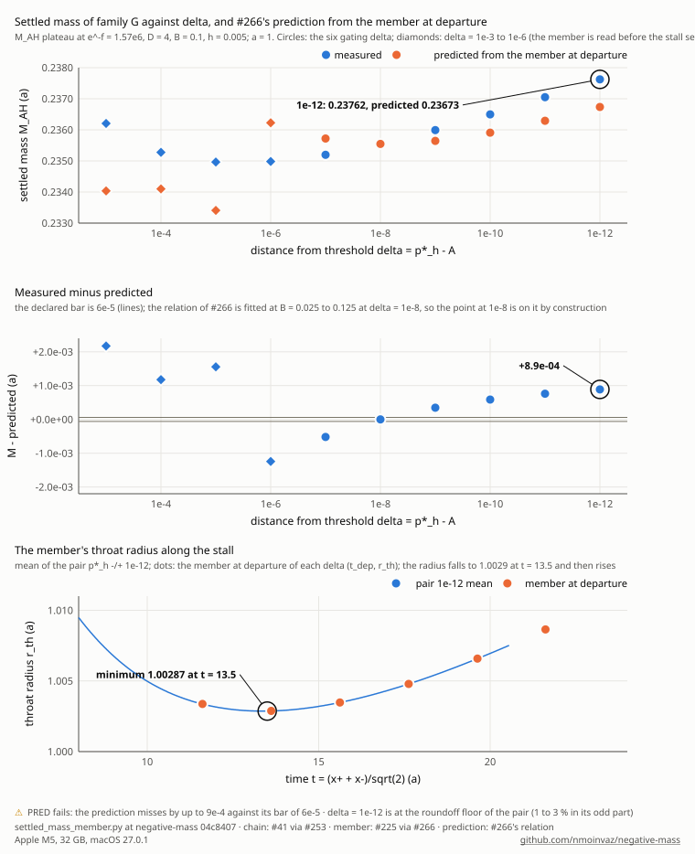

# Does the settled mass of family G follow the static member at departure as δ → 0? (#267)

Code: [settled_mass_member.py](settled_mass_member.py), a thin driver that imports #266's `settled_mass_b.py` (and through it #41's `settled_mass.py`, #253's `settled_mass_g.py`, #40's `threshold.py`, #225's
`throat_locus.py`, #39's `dn.py`) and #255's `throat_drift.py` unchanged. Output of record: [settled_mass_member_output.txt](settled_mass_member_output.txt)
(`python3 settled_mass_member.py analyze --raw=<negative-mass-raw>/I267-mac`, exit 1: two gating checks fail, HST and PRED, below). Raw output, with the criteria written before the runs of record:
negative-mass-raw `I267-mac` (README with the criteria, the bars and the mutation targets; `runs/`, `mut/`, `dev/`, `scripts/`, `settled_mass_member.svg`). Status words as in AGENTS.md: every mass and every member
parameter below is *numerical evidence*; what is not shown is marked *conjecture*. No sentence here says a result is new. Units: a = 1 is the throat radius of the initial static wormhole, 8πG = 1, D = 4, M = r/2 on the
apparent horizon.

The figure is drawn by [settled_mass_member_graph.py](settled_mass_member_graph.py) from the raw folder named above.

## Answer

**No. Family G's settled mass rises with the stall as the member's throat radius does, but #266's relation, found along B, predicts only 57 % of the rise and misses by up to 9e-4 against a declared bar of 6e-5.**
At D = 4, B = 0.1, h = 0.005, from δ = 1e-8 to 1e-12 the member at departure (the pair's mean, read where the unstable mode has grown to 1e-3 of r_th) moves from r_th = 1.00288 a, γ₁ = 0.04832 to r_th = 1.00864 a,
γ₁ = 0.04773, and the plateau of M_AH from 0.235548 a to 0.237622 a (+2.07e-3). #266's relation, M/r_th − M₀ = 0.2027 γ₁ + 0.853 γ₁² with the member of the scan, gives +1.19e-3 of that (+1.35e-3 through r_th,
−1.7e-4 through γ₁). Six checks fail without any mutation (HST and PRED, gating; RC6-ph, FITQ-ph, HST-ph, PRED-ph, post hoc), listed below. The member itself is well defined and does not depend on δ before departure: every δ leaves the same curve (γ₁(t), r_th(t))
at a later time, a decade of δ moving the departure by 2.00 in t. After a minimum at t = 13.5 (r_th = 1.00287), r_th rises at a speed that tends to +1.26e-3 per unit proper time; γ₁ falls by 7.6e-5 per unit t.

| acceptance (issue #267) | verdict | numbers |
|---|---|---|
| γ₁ and r_th at departure for six δ to 1e-4 relative, at two h | **met for 1e-7 … 1e-11, not met at 1e-12** (HST) | h = 0.01 against 0.005: γ₁ ≤ 3.3e-5, r_th ≤ 2.0e-6 (1e-7 … 1e-11); at 1e-12 1.6e-4 and 1.1e-4 (the pair's odd part is 1 % to 3 % roundoff there; t_dep 21.664 against 21.613) |
| M_settled against (γ₁, r_th): one smooth function to the scan's precision, with #266's relation as the declared prediction | **prediction not met** (PRED); the weak smoothness test met (SMOOTH) | M − predicted = −5.2e-4, +5e-7, +3.5e-4, +5.9e-4, +7.6e-4, +8.9e-4 at δ = 1e-7 … 1e-12 (h = 0.005; the same to 1e-5 at 0.01); bar 6e-5. SMOOTH: M = c₀ + p γ₁ + q r_th through the six points to 1.3e-5, which any smooth M(δ) allows (below) |
| the drift's rate during the stall at D = 4, compared with #255's D = 5 drift | **measured; #255's D = 4 fit reproduced and its extrapolation confirmed** (DR255, DREXT) | ṙ∞ = +0.00126 ± 3e-6 (pair 1e-12, t to 20.5) against #255's D = 5 +0.02602: a ratio of 20.6. #255's fit on t = 6.5 to 12 (+0.00133, κ = 0.244) predicts the measured dr_th/dτ over t = 14 to 20 within 6.8e-5 (bar 1e-4) |

Controls: 48 checks, 29 gating (the six δ = 1e-7 … 1e-12 at h = 0.01 and 0.005), 19 post hoc. **Two gating checks fail: HST and PRED.** Four post hoc checks fail: RC6-ph, FITQ-ph, HST-ph, PRED-ph. All other checks pass,
including the reproduction of #266 (δ = 1e-8: plateau, γ₁, r_th identical at the three h) and of #253's scan (every δ to 4.7e-6 at both h, bar 1e-4). 28 of 28 mutations fire exactly their declared set on the runs of record.
The criteria were not moved: the README with the bars and the mutation targets was committed (raw d534bf03, code 09d549f) before any run of record, and HST at 1e-12 and PRED were already failing in the development set,
as the README says.

## What was run

- Family G at D = 4 and B = 0.1, h = 0.02 (post hoc), 0.01 and 0.005; p*ₕ bisected to hi − lo = 5.7e-15 (44 runs) on this machine: **equal to #266's bit for bit** at the three h (P266, difference 0.0).
- For each δ = 10^−e, e = 3 … 12: #41's chain at p*ₕ − δ to e^{−f} = 1.56e6 to 1.57e6 (through #253's `run_real_g`, which also runs #40's fates at p*ₕ ∓ δ), and the pair p*ₕ ∓ δ through `throat_locus.sweep` with profile slices every
  0.5 in t, the member fitted on each (#266's `member` with the exponent e). 33 jobs, all exit codes 0, 6 min on two lanes (nice 10, one thread each); chain 4 to 8 s, whole job 10 s (h = 0.02) to 81 s (h = 0.005).
- Gating: e = 7 … 12 at h = 0.01 and 0.005. e = 3 … 6 (the rest of #253's scan to 1e-3) and h = 0.02 are post hoc: for δ ≥ 1e-6 the member is read before t = 9.6, while the pulses are still leaving (the fit residual of M(r) at
  departure is 3.3e-4 at 1e-6, 8.7e-3 at 1e-5, and t_dep sits at its floor t = 6 at 1e-3 and 1e-4).
- The member and the departure are #266's: #225's `slice_masses` and `fit_asym` on the pair's mean profile, t_dep(ε = 1e-3), linear interpolation between the two slices. The prediction uses #266's four B at the same h.

## The member at departure, δ = 1e-7 … 1e-12

h = 0.005; M the plateau mean over the last 1.0 of x⁺; the prediction is r_th (M₀ + a γ₁ + b γ₁²), M₀ = 0.223086, (a, b) = (0.2027, 0.8534) (h = 0.01: 0.223095, (0.2029, 0.8502)).

| δ | t_dep | r_th | γ₁ | M | predicted | M − predicted | h = 0.01 against 0.005: γ₁, r_th (relative) |
|---|---|---|---|---|---|---|---|
| 1e-7 | 11.610 | 1.003370 | 0.048511 | 0.235198 | 0.235719 | −5.21e-4 | 2.7e-5, 2.2e-7 |
| 1e-8 | 13.615 | 1.002878 | 0.048316 | 0.235548 | 0.235548 | +5e-7 (on the relation: B = 0.1 is one of its four points) | 2.2e-5, 1.0e-6 |
| 1e-9 | 15.618 | 1.003477 | 0.048159 | 0.235991 | 0.235644 | +3.48e-4 | 2.0e-5, 1.4e-6 |
| 1e-10 | 17.624 | 1.004787 | 0.048013 | 0.236497 | 0.235910 | +5.87e-4 | 2.2e-5, 2.0e-6 |
| 1e-11 | 19.628 | 1.006583 | 0.047870 | 0.237051 | 0.236290 | +7.61e-4 | 3.3e-5, 1.7e-6 |
| 1e-12 | 21.613 | 1.008642 | 0.047732 | 0.237622 | 0.236734 | +8.88e-4 | **1.6e-4, 1.1e-4** |

- **The member's trajectory does not depend on δ before departure**: at t = 11, 12, 13 the pair's mean r_th and γ₁ agree over every δ whose odd part is below 3e-4 to 3e-8 and 2e-9 (TRAJ, bar 2e-5, 1e-5). So the "member along
  the stall" is one curve, and the scan reads it at later times. t_dep gains 2.003 to 2.020 per decade (TDEP; ln 10 over the mode's rate 1.15 is 2.00); the lifetimes T of #40's events gain 1.94 to 2.11 (collapse side) and
  2.21 to 2.29 (expansion side) per decade at h = 0.02, and all are inside the declared bands at the three h (TG; the expansion side is read on the diagonal, #225).
- **The unstable mode is linear to δ = 1e-10**: |odd|(t)/δ at t = 10 and 11 agrees to 6e-5 (h = 0.02), 1.1e-4 (0.01), 8.7e-4 (0.005) over δ = 1e-8, 1e-9, 1e-10 (LIN, bar 2e-3). At 1e-11 it differs by ≤ 1.9e-3 and at **1e-12 by
  1.1 % (h = 0.02), 2.7 % (0.01), 3.1 % (0.005)** (LIN2 bar 5e-2): the roundoff realization of the evolution acts as an offset of the size of p*ₕ's own floor, 3e-14. It moves t_dep at 1e-12 by 0.05 between the two h
  (21.664, 21.613), and the member by 1e-4 relative: this is why HST fails there.
- The fit of M(r) on the two sides at departure has an rms of 6.4e-6 to 6.0e-5 for 1e-8 … 1e-12 (3.7e-5 at 1e-7; FITQ, bar 1e-4), so a static member describes the state; 3.3e-4 at 1e-6 and 3.6e-3 to 8.7e-3 for 1e-3 … 1e-5.
- The settled mass depends on h by 6.2e-6 to 9.7e-6 (|plat(0.01) − plat(0.005)|) for 1e-3 … 1e-11 and by **4.5e-5 at 1e-12** (RH, bar 5e-5; #253: 4.1e-5). Second order in h over the three h holds for δ ≥ 1e-8
  (observed orders 1.89 to 2.21) and **not below**: 2.3 to 3.0 at 1e-9, 1.6 to 2.0 at 1e-10, 0.6 to 1.4 at 1e-11, −2.9 at 1e-12 (RC6-ph, post hoc, fails). There the h-differences are of the size of the roundoff scatter
  (#253: 6.6e-6 at h = 0.005, 2.5e-5 at 0.01) and are not truncation.

## M against the member

- **The prediction fails, and fails the same way at both h.** The residual M − predicted is monotone in ln(1/δ) from 1e-8: +3.5e-4, +5.9e-4, +7.6e-4, +8.9e-4 (10 to 15 times the bar), and −5.2e-4 at 1e-7, −1.24e-3 at 1e-6
  (the member at ε = 1e-3 there is read at t = 9.6). Without the r_th scaling (M − M₀ = a′ γ₁ + b′ γ₁², (a′, b′) = (0.1521, 2.2014) from the same four B) the residual is larger: +4.7e-4, +1.03e-3, +1.64e-3, +2.26e-3.
  #266 found the scaling mattered along B; it matters here too, and is not enough.
- **Where the rise comes from** (h = 0.005, against δ = 1e-8; the part the relation assigns to the change of r_th and to the change of γ₁, and what it does not carry):

| δ | dM measured | dM predicted | from r_th | from γ₁ | unexplained |
|---|---|---|---|---|---|
| 1e-7 | −3.50e-4 | +1.71e-4 | +1.16e-4 | +5.6e-5 | −5.21e-4 |
| 1e-9 | +4.43e-4 | +9.6e-5 | +1.41e-4 | −4.5e-5 | +3.47e-4 |
| 1e-10 | +9.48e-4 | +3.62e-4 | +4.48e-4 | −8.7e-5 | +5.87e-4 |
| 1e-11 | +1.503e-3 | +7.42e-4 | +8.70e-4 | −1.28e-4 | +7.61e-4 |
| 1e-12 | +2.074e-3 | +1.186e-3 | +1.354e-3 | −1.67e-4 | +8.88e-4 |

  r_th rises, γ₁ falls (the relation weighs γ₁ by r_th (a + 2bγ₁) = 0.286), so the prediction is positive and about half the measured rise.
- **The scan alone cannot say what the function is.** Its six (γ₁, r_th, M) lie on a one-parameter curve in the (γ₁, r_th) plane, so a smooth M(δ) is a smooth function of the member along it. SMOOTH (M = c₀ + p γ₁ + q r_th through
  the six, residual 1.3e-5 at h = 0.005, 1.2e-5 at 0.01, bar 6e-5) passes, and the fit gives p = −2.2, q = +0.13, singular values 7.2e-3 and 2.9e-4 (condition 25), against #266's local gradient p = +0.29, q = +0.235. That is a
  weak test by construction, passed for any smooth M(δ) (its mutation `smooth_swap`, two M exchanged, fires it); the cross-family prediction is the test, and it fails.
- **What does and does not follow.** That the settled mass depends on the member at departure *and on nothing the stall changes* is not supported: the member changes along the stall (r_th by +5.8e-3, γ₁ by −5.8e-4 from 1e-8 to 1e-12)
  and M follows the sign and half the size of what the B-relation assigns. *Conjecture* (post hoc, below): a third quantity of the state at departure, the throat's speed, carries the rest.

## Post hoc: what the development runs suggested (gates nothing, printed in the output)

- **The part of dM not carried by r_th decays geometrically.** excess = dM − (M/r_th) dr_th between neighbouring decades: +4.65e-4 (1e-7 → 1e-8), +3.02e-4, +1.97e-4, +1.32e-4, +0.86e-4 (1e-11 → 1e-12), ratios 0.649,
  0.653, 0.669, 0.650 per decade. e^{−κ Δτ} with #255's κ = 0.244 per proper time and Δτ = 0.975 × 2.00 per decade is 0.621 to 0.624: the per-decade factors agree to 4 to 8 %. Late in the stall M then follows r_th: dM/dr_th = 0.277 between
  1e-11 and 1e-12 against M/r_th = 0.2355.
- **With the throat's speed as a third parameter the relation holds.** y = M/r_th − M₀ fitted over the four B of #266 and δ = 1e-7, 1e-9 … 1e-12 (nine points): y = aγ₁ + bγ₁² gives (0.2208, 0.618) with residual up to 8.4e-4
  and leave-one-out errors up to 1.0e-3; adding c·ṙ_th (ṙ_th = dr_th/dτ of the pair's mean at departure; B = 0.025 … 0.125: −1.0e-4, −3.0e-4, +7e-5, +1.59e-3; δ: −6.3e-4, +5.1e-4, +8.1e-4, +1.01e-3, +1.10e-3) gives
  (0.2300, 0.272, c = 0.78) with residual up to 4.3e-5 and leave-one-out errors up to 6.6e-5 (the bar of PRED is 6e-5). Nine points, three parameters, and the parameter was suggested by the scan: *a description, not a test*.
- **The ε = 1e-2 reading** (the relation refitted at ε = 1e-2: (a, b) = (0.2170, 0.535), the member of the scan read at ε = 1e-2): M − predicted = −2.6e-4, −1.3e-5, +1.6e-4, +2.9e-4, +3.7e-4, +5.4e-4: smaller, and still 4 to 9 times the bar.
  #266 found its relation depends on ε at the 1e-4 level; here the ε dependence is a factor of 1.6 of the residual, not the cause of it.

## The drift of the throat radius at D = 4 against #255's D = 5

Pair mean, h = 0.005 (the same at 0.01), τ the locus's proper time, #255's estimator `throat_drift.fit_rdot` (dr_th/dτ = ṙ∞ + c e^{−κ(τ−τ₀)}).

| t | τ | r_th | dr_th/dτ |
|---|---|---|---|
| 8 | 7.85 | 1.009484 | −0.00328 |
| 10 | 9.79 | 1.004983 | −0.00150 |
| 12 | 11.74 | 1.003157 | −0.00046 |
| 14 | 13.69 | 1.002919 | +0.00016 |
| 16 | 15.63 | 1.003677 | +0.00058 |
| 18 | 17.59 | 1.005091 | +0.00085 |
| 20 | 19.54 | 1.006948 | +0.00104 |
| 22 | 21.49 | 1.009058 | +0.00108 |

(The pair's odd part exceeds 3e-4 beyond t = 20.5; the value at 22 is read where the mode is 1.6e-3 of r_th and is not used in a fit.) The fit on #255's window t = 6.5 to 12 (pair 1e-10) reproduces #255's D = 4 numbers to all printed
digits (ṙ∞ = +0.00133 ± 1.9e-5, κ = 0.244, r_th − 1 = +0.00949, +0.00498, +0.00316 at t = 8, 10, 12; DR255). Its model, fitted on t = 6.5 to 12 only, predicts the measured slope over t = 14 to 20 within 6.8e-5 (DREXT,
bar 1e-4), and the fit on t = 6.5 to 20.5 gives ṙ∞ = +0.00126 ± 3.3e-6 (+0.00127 ± 3.6e-6 at h = 0.01), κ = 0.246 to 0.247. At D = 5, B = 0.1 #255 has ṙ∞ = +0.02602 ± 4.3e-5 and no relaxing phase: a ratio of
20.6 (19.5 against the window to t = 12). **At D = 4 the radius relaxes to a minimum at t = 13.5 and then rises at a speed that tends to the same kind of constant as at D = 5, 20 times smaller.** The mechanism that sets it is
#255's open question (#272, #273); nothing here bears on it.

## Error bars of M and of the member (kept separate, not mixed)

| kind | what | size | what it is |
|---|---|---|---|
| value | plateau mean over the last 1.0 of x⁺, h = 0.005, δ = 10^−e | table above | |
| h | \|plat(0.01) − plat(0.005)\| | 6.2e-6 to 9.7e-6 (1e-3 … 1e-11), 4.5e-5 (1e-12) | difference between two resolutions of this code; at second order the Richardson correction to the finest is 1/3 of it, but the order is not read below 1e-8 (RC6-ph) |
| roundoff realization | #253's late-window scatter | 6.6e-6 at h = 0.005, 2.5e-5 at 0.01 | quoted from #253, not remeasured; the 4.5e-5 at 1e-12 is of this kind (the pair's odd part at 1e-12 differs by 1 % to 3 % between realizations, LIN2) |
| member, h | γ₁ and r_th between h = 0.01 and 0.005 | ≤ 3.3e-5 and 2.0e-6 relative (1e-7 … 1e-11), 1.6e-4 and 1.1e-4 (1e-12) | two resolutions, and at 1e-12 the realization of t_dep (±0.03) |
| member, definition | ε = 1e-3 against 1e-2 | t_dep shifts by ln 10/λ = 2.0, i.e. one decade of δ | #266's choice; a member read at ε = 1e-2 at δ is the member read at ε = 1e-3 at δ/10 (13.615 against 15.618 at 1e-8 and 1e-9) |

The prediction's residual (9e-4 at 1e-12) is 20 times the sum of the first two rows (5e-5).

## What this says, and does not

- *Shown (numerical evidence):* at D = 4, B = 0.1, the member that G leaves drifts along the stall (r_th: 1.00337 at δ = 1e-7, minimum 1.00287 at t = 13.5, 1.00864 at 1e-12; γ₁: 0.04851, 0.04832, 0.04773), and the settled mass
  rises with it (0.235198, 0.235548, 0.237622) at 5.7e-4 per decade from 1e-11 to 1e-12; the member as a function of t is the same for every δ. #266's relation (found along B at δ = 1e-8) does not predict the scan: it misses by
  −5.2e-4 to +8.9e-4, assigning about half of the rise. The D = 4 drift speed is +0.00126 per unit τ, 20 times smaller than #255's D = 5 value, and #255's D = 4 fit extrapolates to t = 20.
- *Not shown:* any limit as δ → 0 (the pair is at the roundoff floor at 1e-12; the member's speed still tends to a constant at t = 22, and if M keeps following r_th the plateau keeps rising by about 5e-4 per decade: a
  *conjecture*, not tested); that the throat's speed carries the part the relation misses (post hoc, nine points); anything at δ = 1e-12 beyond the realization scatter of the pair; D = 5, 6 (#246); whether the stall ends.
- Not a failure of the chain: the chain, its first law and its planted cases are #41's and pass; the reproduction of #253's scan to 4.7e-6 at every δ and both h shows the chain and p*ₕ are the same on this machine.

## Stale or conflicting text found (for the coordinator; none was edited)

1. `settled_mass_g.md`, the conjecture bullet ("*Conjecture, not tested here:* during the stall G sits near the member γ₁ = 0.048, r_th = 1.0028 a … which drifts slowly (r_th relaxes by −0.23 % from t = 10 to 15 …); a longer stall
   lets it drift further, and the settled mass follows the member at departure"): the relaxation stops at t = 13.5 and the radius then rises (1.0029 to 1.0086 a by t = 21.6, at 1e-12); and the mass follows it only in part.
2. `critical_ghost.md` §1.3, "Update from #253", last sentences ("That it follows the member's parameters (γ₁, r_th at departure) is a *conjecture*"): now tested at δ → 0 along the stall and not supported by #266's relation.
3. `throat_locus.md`, "DR: the throat radius changes by −0.23 % from t = 10 to 15": true for the window, and the minimum is at t = 13.5.
4. Paper V (`paper/5-ellis-threshold/main.tex`): the `\pending{\#266, \#267}` paragraph (line 456) and the bullet at line 554 ("Whether it is a function of the member at departure is open (#266, #267)").
5. `settled_mass_g.md`, "second order from h = 0.02 to 0.005": it holds at δ = 1e-6 and 1e-8 (orders 1.95 to 2.21 here) and not at δ ≤ 1e-9 (RC6-ph above): the h-differences there are roundoff.

## Proposed text (for the coordinator; none applied)

**`settled_mass_g.md`**, the conjecture bullet: replace by "*Tested in #267 (`settled_mass_member.md`):* the member at departure drifts along the stall (r_th: 1.00288 a at δ = 1e-8 to 1.00864 a at 1e-12; γ₁: 0.04832 to 0.04773) and the settled
mass rises with it (0.235548 a to 0.237622 a); #266's relation, found along B, assigns +1.19e-3 of the +2.07e-3 and misses by 9e-4 at 1e-12 (bar 6e-5)." Recommended task 2: "done in #267; no limit as δ → 0 is seen, and the pair
is at the roundoff floor at 1e-12."

**`critical_ghost.md` §1.3**, after the "Update from #253" bullet (and after #266's, if applied):

> *Update from #267* (`wormhole_evolution/settled_mass_member.md`; *numerical evidence*). Along the stall of family G at D = 4 the member at departure is one curve in time, the same for every δ: r_th falls to 1.0029 a at t = 13.5 and
> then rises (+1.26e-3 per unit proper time, 20 times slower than #255's D = 5 value), γ₁ falls from 0.0485 to 0.0477. A decade of δ moves the departure by 2.0 in t. The settled mass rises with it, 0.2355 a at δ = 1e-8 to 0.2376 a at
> 1e-12, by 5.7e-4 per decade at the end. #266's relation M/r_th − M₀ = 0.2027 γ₁ + 0.853 γ₁², found along B, predicts +1.2e-3 of the +2.1e-3 and misses by 9e-4 at 1e-12 (declared bar 6e-5). So the settled mass is not a function of the member's
> (γ₁, r_th) alone along this family; that a further parameter, the throat's speed, carries the difference is a *conjecture* supported by a post hoc fit. No limit as δ → 0 is seen, and at δ = 1e-12 the pair is at the roundoff floor.

**Paper V**, line 456: replace the `\pending{\#266, \#267}` paragraph (after #266's text if applied) by

> Along the stall the member the data leave is one curve in time, the same for every $\delta$: its throat radius falls to $1.0029a$ at $t=13.5$ and then rises at $1.3\times10^{-3}$ per unit proper time ($D=4$; $0.026$ at $D=5$), and
> $\gamma_1$ falls from $0.0485$ to $0.0477$. The settled mass rises from $0.2355a$ at $\delta=10^{-8}$ to $0.2376a$ at $10^{-12}$. The relation found along $B$ predicts $+1.2\times10^{-3}$ of the $+2.1\times10^{-3}$ and misses by $9\times10^{-4}$
> at $10^{-12}$, so the mass is not a function of $(\gamma_1,r_{\rm th})$ at departure alone along this family (`notes/wormhole_evolution/settled_mass_member.md`).

and the bullet at line 554: "Whether it is a function of the member at departure is open (\#266, \#267)" → "It is not a function of $(\gamma_1,r_{\rm th})$ at departure alone along the stall (\#267); no limit as $\delta\to0$ is seen." `paper_numbers.py` would check 0.235548, 0.237622,
1.00864, 1.00288, 0.04773 and the 9e-4 miss from `settled_mass_member_output.txt`.

## Limits

- D = 4, B = 0.1, family G; h = 0.01 and 0.005 (0.02 post hoc); δ = 1e-7 … 1e-12 gating. p*ₕ is bisected here and equals #266's bit for bit.
- The member is read at ε = 1e-3, definitions #266's; the relation of #266 was chosen after its own development runs. The prediction is its four-B fit, at the same h.
- At δ = 1e-12 the pair is at the roundoff floor (LIN2): t_dep carries ±0.03, and HST fails there by a factor of 1.6.
- The settled mass is the plateau at e^{−f} = 1.57e6 on the apparent horizon (not the event horizon); the chain is #41's, unchanged. The roundoff scatter of the plateau is #253's.
- The post hoc third parameter and the decay of the excess were suggested by the scan and are not tests. The planted cases test the extraction, the departure time, the prediction test and the drift fit, not the evolution.
- The drift is the pair's mean throat radius, the minimum of r on a slice (#225); D = 5 values are #255's, read from its output, not rerun.

## Recommended tasks

1. *The throat's speed as a parameter of the departure state, tested blind.* What: a second family of departure states in which r_th, γ₁ and ṙ_th at departure vary independently of B and δ (for example #266's recommended task 1, the normal pulse's
   width or centre varied at tuned amplitude, at δ = 1e-8, h = 0.01 and 0.005), with the chain and the member of this note, and ṙ_th read as here. Why: B and δ each trace one curve; the three-parameter relation fitted post hoc on nine points
   (residual 4.3e-5) needs a point set it was not fitted on. Acceptance (can fail): y = M/r_th − M₀ = 0.2300 γ₁ + 0.272 γ₁² + 0.78 ṙ_th predicts every new member within 6e-5, or the failure is reported. Depends on: this note, #266 task 1.
2. *Does the stall of G at D = 4 have a mass limit?* What: the tuned pair's throat radius r_th(t) and γ₁(t) to t = 40, past the roundoff floor of the pair (the mode projected out at each row, or a higher-precision march; new method code), at
   two h, and the departure state at t = 22 … 40 through the same extraction. Why: the speed ṙ∞ = +0.00126 still tends to a constant at t = 22; if M follows r_th with the excess decaying at κ = 0.244, G's settled mass keeps rising by about 5e-4 per decade
   of δ with no limit. Acceptance: r_th(t) at two h against the extrapolation r_th(20) + 1.26e-3 (τ − τ₂₀) within 5e-4 at t = 30, or the speed's change reported. Depends on: this note, new method code (not a runner task without a ruling).
3. *The late scatter at δ ≤ 1e-9.* What: the pair at 1e-11, 1e-12 with three roundoff realizations (a 64 × 2⁻⁵² noise on the data, as #253's RN runs), and the departure time and plateau read in each. Why: HST fails at 1e-12 and the order in h is lost below 1e-8
   (RC6-ph); #253's task 4 asked the same for the plateau. Acceptance: the scatter of t_dep and of the plateau against the h-difference, and whether the h-difference is the scatter. Depends on: this note, #253.
4. *The linear spectrum beyond the unstable mode at D = 4* (#272's D = 5 question): the per-decade factor of the excess's decay (0.65) and e^{−κΔτ} with κ = 0.244 of the relaxation of the throat radius (0.62) agree to 4 to 8 %. Acceptance as in #272. Depends on: #272.

## Files

`settled_mass_member.py` (commands `pstar`, `job`, `member`, `planted`, `analyze`; `--mutate=`), `settled_mass_member_output.txt`, this note; raw `negative-mass-raw/I267-mac` (`README.md` with the criteria and the mutation targets; `runs/G_B0.1/h<h>/{pstar,e<e>/{chain,member,logs}}`,
`mut/` the 28 mutated analyses of record, `dev/` development runs and their logs, `scripts/`, `plot_settled_mass_member.py` with the vendored `data_graphs.py`, and `settled_mass_member.svg`: M(δ) with the prediction, the residual, and r_th(t) along the stall).

## Coordinator's review

Merged at 39d2f6e. Review folder `negative-mass-raw/I267-mac-review` at 2e3cb9c9, criteria committed (ca9f23fb) before the first run of
`ind267.py`. The changed files are those the brief names.

- **Rerun on the Mac** from 86b6039: the job and the pair at h = 0.005, δ = 1e-12 are bitwise equal to the runner's (chain, locus,
  member rows, t_dep), and `analyze` reproduces the stored output except for its timestamp (exit 1, HST and PRED fail).
- **ind267**, 5 of 5. It shares the evolution, the stored slices and #225's `fit_asym` (the stored s_m) with this note's code, and
  nothing else. From the raw files it recomputes the departure time, the member at departure, the plateau and #266's (a, b, M₀) over the
  four B. It reproduces the table to 5e-7 in r_th, γ₁ and M, and M − predicted to 4.7e-7. It confirms that PRED fails (8.88e-4 against
  6e-5) and the post hoc ratios 0.650, 0.653, 0.670, 0.650. The mutations `eps-1e-2`, `b-scale` and `rth-side` fire. `plat-half` does
  not: the plateau over the last 0.5 of x⁺ is within 7.4e-7 of the one over the last 1.0.
- **Not met, kept as declared:** HST at δ = 1e-12 and PRED. The stale items 1 to 3 above are applied (`settled_mass_g.md`,
  `critical_ghost.md` §1.3, `throat_locus.md`), and so is Paper V's paragraph. Item 5 is right as `settled_mass_g.md` states it: RC6
  there is for δ = 1e-6 and 1e-8.
- **Follow-ups:** the recommended tasks are filed as issues; task 4 is #272's D = 4 half, added to #272.
