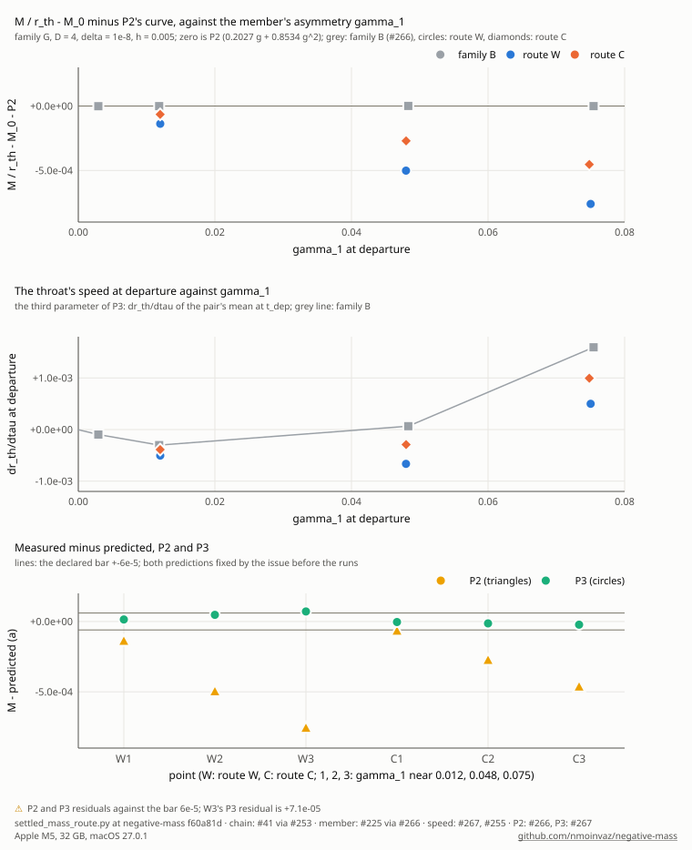

# Does the settled mass of family G follow its member at departure along a second route? (#283)

Code: [settled_mass_route.py](settled_mass_route.py), a thin driver that imports #266's `settled_mass_b.py` and #267's `settled_mass_member.py` (and through them #41's `settled_mass.py`, #253's `settled_mass_g.py`,
#40's `threshold.py`, #225's `throat_locus.py`, #39's `dn.py` and #255's `throat_drift.py`) unchanged. It replaces `threshold.family` in its own process by `route_family`, family G with its own normal pulse centre and width; with
the default pulse that is `threshold.family` bit for bit (check FAM0). Output of record: [settled_mass_route_output.txt](settled_mass_route_output.txt)
(`python3 settled_mass_route.py analyze --raw=<negative-mass-raw>/I283-mac --rn=<negative-mass-raw>/I283-mac/runs_rn`, exit 1: three gating checks fail, HST, P2 and P3, below). Raw output, with the criteria written before the runs of record:
negative-mass-raw `I283-mac` (README with the criteria, the bars and the 26 mutation targets; `runs/`, `runs_rn/`, `mut/`, `dev/`, `scripts/`). Status words as in AGENTS.md: every mass and every member parameter below is *numerical
evidence*; what is not shown is marked *conjecture*. No sentence here says a result is new. Units: a = 1 is the throat radius of the initial static wormhole, 8πG = 1, D = 4, M = r/2 on the apparent horizon.

The figure is drawn by [settled_mass_route_graph.py](settled_mass_route_graph.py) from the raw folder named above.

## Answer

**No, as the two relations are worded. P2 (#266's relation along B) misses all six new members, by −6.5e-5 to −7.5e-4 against a bar of 6e-5. P3 (the three-parameter fit of #267, with the throat's speed) predicts five of
the six within the bar and misses W3 by 1.1e-5; its residuals are 10 to 20 times smaller than P2's.** The throat's speed at departure carries most of what P2 misses on these routes, not all of it.
At D = 4, δ = 1e-8, h = 0.005, the normal pulse of family G was widened to w = 1.0 (route W, centre 3) or moved to centre 4.0 (route C, width 0.5), each with its ghost pulse unchanged and B tuned to γ₁ = 0.012, 0.048, 0.075 (the
member the data leave, as #266 reads it). Every point stalls, and each differs from family B at the same γ₁ in its throat radius (−2.2e-2 to +3.8e-3) and in the throat's speed (−1.1e-3 to −8.8e-5), by at least 5e3 and 1e3 times
the point's own h difference. P2, M = r_th (M₀ + 0.2027 γ₁ + 0.8534 γ₁²), overestimates M by 1.4e-4, 5.0e-4, 7.6e-4 (W1, W2, W3) and 6.5e-5, 2.7e-4, 4.6e-4 (C1, C2, C3). P3 adds 0.7835 ṙ_th to the bracket (with (a, b) = (0.2300, 0.2724)) and leaves
+1.4e-5, +4.7e-5, **+7.1e-5** and −3.8e-6, −1.4e-5, −2.2e-5. A second roundoff realization of the six (the same p*ₕ to 4.3e-14, its floor, a different ulp-noise realization of the chain) moves M by at most 2.1e-6 and W3's residual to +7.3e-5: the miss is not scatter.

| acceptance (issue #283) | verdict | numbers |
|---|---|---|
| P2 predicts each new member within 6e-5, or the failure is reported with the residuals | **not met** | M − P2 = −1.37e-4, −4.96e-4, −7.55e-4 (W1, W2, W3), −6.46e-5, −2.72e-4, −4.62e-4 (C1, C2, C3) |
| P3 predicts each new member within 6e-5, or the failure is reported | **not met** (W3) | M − P3 = +1.41e-5, +4.72e-5, +7.11e-5, −3.81e-6, −1.36e-5, −2.24e-5; W3 exceeds the bar by 1.1e-5 |
| the member at departure at the two h agrees to 1e-4 relative in γ₁, r_th and 2e-5 absolute in ṙ_th | **not met** (W1) | γ₁: 1.1e-4 (W1), 5.1e-5, 4.5e-5, 1.5e-5, 1.1e-5, 9.2e-6; r_th ≤ 3.7e-6; ṙ_th ≤ 8.2e-7 |
| SEP: the route separates the parameters | **met**, all six informative | r_th − family B's at the same γ₁: −3.4e-3, −1.4e-2, −2.2e-2 (W), +1.3e-3, +3.5e-3, +3.8e-3 (C); ṙ_th: −2.0e-4, −7.3e-4, −1.07e-3 (W), −8.8e-5, −3.5e-4, −5.7e-4 (C); each ≥ 5e3 (r_th) and ≥ 1e3 (ṙ_th) times its h difference |
| reproduction of #266's B = 0.1 (δ = 1e-8, h = 0.005) to 1e-6 in M and the member | **met** | p*ₕ, M, γ₁, r_th, ṙ_th equal #266's bit for bit (differences 0.0, at h = 0.01 too) |

Controls: 32 checks, 22 gating, 10 post hoc. **Three gating checks fail without a mutation: HST (W1), P2 and P3**; the post hoc P2-ph (P2 at h = 0.01) fails too. The planted cases pass (PMEM, PDEP, PTD, PPRED, PSEP) and
26 of 26 mutations newly fire exactly their declared set on the runs of record. The criteria were not moved: the raw README (77a21028, code b6f2ed4) was committed before any run of record; the runs of record equal the development
set's bit for bit, as it states. Two of my own checks were changed after the development data and before the README, both stated there: BR accepts a stop by "static through X" at hi − lo ≤ 2e-14 (C3 at h = 0.01 stops at 1.2e-14),
and the reproduction point starts from #266's bracket. The issue's four bars were not touched.

## What was run

- Family G at D = 4 with the ghost pulse (field 0, centre 3, width 0.5, amplitude A tuned) unchanged and the normal pulse (field 1, same ray) with its own amplitude B, centre x_c and width w. Route W: x_c = 3, w = 1.0; route C: x_c = 4.0,
  w = 0.5; family B (#266): x_c = 3, w = 0.5. Each route's parameter was chosen in development at h = 0.02 as the one, among the candidates that stall at all three γ₁, with the largest minimum over the three γ₁ of |ṙ_th − family B's at
  the same γ₁| (W: 0.35, 0.7, 1.0 tried, 1.0 chosen; C: 2.5, 3.5, 4.0, and 2.0, tried; 4.0 chosen; 2.5 has no stall at γ₁ = 0.075 and 2.0 none at B = 0.1). B per route and target by a secant iteration to within 0.4 % of the target at h = 0.02.
  Six points, (B, x_c, w): W1 (0.07905, 3, 1), W2 (0.1543, 3, 1), W3 (0.1909, 3, 1), C1 (0.0393, 4, 0.5), C2 (0.07726, 4, 0.5), C3 (0.09576, 4, 0.5), and the reproduction point (0.1, 3, 0.5).
- For each point and h = 0.01, 0.005: p*ₕ by #40's bisection to hi − lo ≤ 1e-14 (38 to 44 runs; C3 at h = 0.01 stops at 1.2e-14 by "static through X"), #41's chain at p*ₕ − 1e-8 to e^{−f} = 1.55e6 to 1.57e6 (through #253's
  `run_real_g`), the pair p*ₕ ∓ 1e-8 through `throat_locus.sweep`, the member at departure (ε = 1e-3, #266's `member_at`) and the throat's speed there (#267's `speed_at`). 14 jobs, all exit codes 0, 29 to 120 s each, two lanes
  (nice 10, one thread each). All points stall: T gains 3.8 to 4.9 per side from 1e-6 to 1e-8.
- The predictions are fixed by the issue: P2, M₀ = 0.223086, (a, b) = (0.2027, 0.8534); P3, the same M₀ and (a, b, c) = (0.2300, 0.2724, 0.7835), both at h = 0.005 (`settled_mass_member_output.txt`). Not refitted on the new points.
- Supplement, post hoc: the six points at h = 0.005 again from another bracket of the bisection (`runs_rn`): the same p*ₕ to 4.3e-14 (its floor, #267) and a different roundoff realization of the chain.

## The six members and the two predictions

h = 0.005; M the plateau mean over the last 1.0 of x⁺; family B at the same γ₁ is interpolated (piecewise linear, PCHIP; the smaller difference is used).

| point | p*ₕ | t_dep | γ₁ | r_th | ṙ_th | M | M − P2 | M − P3 |
|---|---|---|---|---|---|---|---|---|
| W1 | 5.2542e-3 | 13.348 | 0.012003 | 0.994956 | −5.05e-4 | 0.224367 | −1.37e-4 | +1.41e-5 |
| W2 | 2.0149e-2 | 13.568 | 0.047982 | 0.989179 | −6.65e-4 | 0.231740 | −4.96e-4 | +4.72e-5 |
| W3 | 3.0989e-2 | 13.776 | 0.075022 | 0.993634 | +4.99e-4 | 0.240794 | −7.55e-4 | **+7.11e-5** |
| C1 | 7.1354e-4 | 13.365 | 0.011989 | 0.999623 | −3.89e-4 | 0.225489 | −6.46e-5 | −3.81e-6 |
| C2 | 2.9324e-3 | 13.640 | 0.048006 | 1.006321 | −2.92e-4 | 0.235995 | −2.72e-4 | −1.36e-5 |
| C3 | 4.7379e-3 | 13.891 | 0.074833 | 1.019366 | +9.95e-4 | 0.247278 | −4.62e-4 | −2.24e-5 |
| (family B, B = 0.05, 0.1, 0.125) | | | 0.01184, 0.04832, 0.07545 | 0.99836, 1.00288, 1.01588 | −3.0e-4, +6.5e-5, +1.59e-3 | | | |

- **P2 fails the same way at both h**: M − P2 at h = 0.01 (with P2's own (a, b) at that h) is −1.38e-4, −4.98e-4, −7.53e-4, −6.18e-5, −2.74e-4, −4.61e-4. P2 overestimates M at every point, by 5e-4 and 7.6e-4 at γ₁ = 0.048 and 0.075 on route W.
- **Where P2's miss goes** (post hoc, h = 0.005; the prediction is r_th (M₀ + y), so P3 − P2 splits into the speed term r_th c ṙ_th and the shift of (a, b)):

| point | M − P2 | speed term r_th c ṙ_th | (a, b) shift term | M − P3 |
|---|---|---|---|---|
| W1 | −1.37e-4 | −3.94e-4 | +2.43e-4 | +1.41e-5 |
| W2 | −4.96e-4 | −5.16e-4 | −2.7e-5 | +4.72e-5 |
| W3 | −7.55e-4 | +3.88e-4 | −1.21e-3 | +7.11e-5 |
| C1 | −6.46e-5 | −3.04e-4 | +2.44e-4 | −3.81e-6 |
| C2 | −2.72e-4 | −2.30e-4 | −2.9e-5 | −1.36e-5 |
| C3 | −4.62e-4 | +7.95e-4 | −1.23e-3 | −2.24e-5 |

  The speed term alone would over-correct (W1: −3.9e-4 against a miss of −1.4e-4); what P3 gets right is the sum of it and the shifted (a, b), both of which are fitted. That is why the six points are a test of the form and not only of the
  speed's coefficient, and why a miss of 7e-5 against 4e-4 terms is not a large one.
- **What P3 leaves is proportional to the separation in r_th** (post hoc, six points, one parameter, a description): M − P3 divided by r_th − family B's at the same γ₁ is −4.1e-3, −3.5e-3, −3.2e-3 (W), −3.1e-3, −3.9e-3, −5.9e-3 (C);
  the least squares through the origin is −3.4e-3 with a residual of 9.7e-6. The sign is opposite on the two routes because r_th sits below family B's on W and above on C. *Conjecture* (not tested here): P3's coefficient on r_th, which
  comes from #266's scaling by r_th, is slightly off for members that are not on family B.
- **A refit over the four B and the six new points** (post hoc, fitted on points that include the ones tested): with the speed, y = M/r_th − M₀ = 0.2269 γ₁ + 0.3294 γ₁² + 0.7096 ṙ_th, residual up to 3.9e-5, leave-one-out up to 6.6e-5; without it,
  0.1971 γ₁ + 0.8569 γ₁², residual up to 4.0e-4, leave-one-out up to 6.0e-4. The coefficients move by 1 % to 21 % from #267's; the form with the speed holds to 4e-5 on ten points of three routes (B, W, C), and the form without it
  does not. Ten points, three parameters: a description, not a test.

## Separation, member at the two h, reproduction

- **SEP (met).** Family B is a curve in (γ₁, r_th, ṙ_th) through B = 0 … 0.125; the six points leave it by r_th −3.4e-3 to −2.2e-2 (W) and +1.3e-3 to +3.8e-3 (C) and by ṙ_th −2.0e-4 to −1.07e-3 (W) and −8.8e-5 to −5.7e-4 (C) at the same γ₁
  (linear and PCHIP interpolation differ by at most 1.0e-4 in r_th and 1.2e-5 in ṙ_th, at most 2.4 % of the separation). The point's own h difference is ≤ 3.7e-6 in r_th and ≤ 8.2e-7 in ṙ_th. So the new members are not points of
  family B: P2's miss is a miss of the function M(γ₁, r_th) of #266, not of a point of its curve.
- **HST (not met at W1).** γ₁ of W1 differs by 1.1e-4 between h = 0.01 and 0.005 (1.3e-6 absolute), against the issue's 1e-4; the other five γ₁ agree to 5.1e-5 and the REP point to 2.2e-5; r_th to 3.7e-6; ṙ_th to 8.2e-7 (bar 2e-5).
  The bar is the issue's and was not moved. Three h would say whether W1's difference is the second-order truncation of a small γ₁ (a relative measure is hardest where γ₁ is smallest on route W, where B is largest).
- **REP (met).** The default pulse through this driver gives #266's B = 0.1 point bit for bit at h = 0.005 and 0.01: p*ₕ, M, γ₁, r_th, ṙ_th, differences 0.0. With the bracket scan's bisection path in place of #266's, p*ₕ differs by 1.7e-15 and M by 1.5e-6, which is
  the roundoff realization of the chain (see the next section), so the reproduction point starts from #266's bracket.

## Error bars of M and of the member (kept separate, not mixed)

| kind | what | size | what it is |
|---|---|---|---|
| value | plateau mean over the last 1.0 of x⁺, h = 0.005, δ = 1e-8 | table above | |
| h | \|plat(0.01) − plat(0.005)\| | 6.1e-6 to 1.4e-5 (RH, bar 5e-5) | difference between two resolutions of this code |
| roundoff realization | M at h = 0.005 from p*ₕ bisected along another path (the same p*ₕ to 4.3e-14) | ≤ 2.1e-6 (W3 +2.1e-6, C2 and C3 −1.0e-6, the others ≤ 4.7e-7) | the ulp-noise realization of the chain, measured on these six points; #253's 6.6e-6 at h = 0.005 is its quoted range |
| member, h | γ₁, r_th, ṙ_th between h = 0.01 and 0.005 | ≤ 1.1e-4, 3.7e-6 relative; 8.2e-7 absolute | two resolutions (HST) |
| member, definition | ε = 1e-3 | #266's: a member read at ε = 1e-2 changes γ₁ by 3e-4 relative and r_th by 4.6e-4 | not remeasured here |

The bar 6e-5 is about three times the sum of the first two rows (1.6e-5 + 2.1e-6). W3's miss (+7.1e-5, +7.3e-5 in the second realization) is 1.1e-5 to 1.3e-5 above the bar, five times the realization scatter and about the size of the h difference.

## Controls and mutations

32 checks, 22 gating. The runs of record equal the development set (`runs_b`) bit for bit; the declared mutation sets were computed on it. On the runs of record **26 of 26 mutations newly fire exactly their declared set** (`mut/`; `sep_self` ran twice: its first run
stopped in the post hoc decomposition added after the development runs, which divided by a zero separation under that mutation; the print was guarded, `mut/sep_self.log` (crashed) and `mut/sep_self.2.log` (MATCH) are both kept). HST, P2, P3 and P2-ph already fail without a
mutation, so no mutation can newly fire them: their ability to fail is shown by those failures, their ability to pass by the other points (HST: six of seven; P3: five of six) and by the planted data that follow P2 or P3 exactly (PPRED passes them at 1e-12 and fires the
other relation at 1.3e-3). One mutation, `normal_drop`, fires nothing: **RC4 cannot see the normal field**, whose flux across the horizon is 2.6e-9 to 4.5e-8 of the first law's dM at F = 20 (the field has left the throat by then); RC4's bar, 2e-2, tests the ghost's flux only.
The planted speed goes through `member_at` and `speed_at` with an error of 1.4e-6 (bar 5e-6; #255's local slope over ±0.5 in τ), the departure time to 7.2e-6, γ₁ to 4.8e-10, r_th to 2.1e-5.

## What this says, and does not

- *Shown (numerical evidence):* at D = 4, δ = 1e-8, six members of family G reached by two routes other than B (the normal pulse's width and centre) with γ₁ = 0.012, 0.048, 0.075 differ from family B at the same γ₁ in r_th and ṙ_th, and the settled mass at
  them is not given by #266's relation: P2 overestimates by up to 7.6e-4 (13 times the bar), all six of one sign. With the throat's speed added (P3, coefficients fixed before the runs) the six are predicted to 7.1e-5 (five to 4.7e-5) instead.
- *Not shown:* that M is a function of (γ₁, r_th, ṙ_th) alone (P3 misses W3 by 1.1e-5 and its residual is correlated with r_th's separation from family B); that ṙ_th, and not another quantity that moves with it along these routes, is what carries the rest
  (the speed's coefficient is one of three fitted parameters); any dependence on ε, the definition of departure (#266: 1e-4 level); other pulse shapes, the ghost pulse changed, δ ≠ 1e-8 on these routes; D = 5, 6 (#246); γ₁ above 0.075 (on family B the stall ends near B = 0.16, γ₁ ≈ 0.12).
- Not a failure of the chain: the chain, its first law and its planted cases are #41's and pass at every point (RC4 to 1.3e-4, RC8 settled, RH 6e-6 to 1.4e-5), and the reproduction of #266 is exact.

## Stale or conflicting text found (for the coordinator; none was edited)

1. `settled_mass_member.md`, "What does and does not follow": "*Conjecture* (post hoc, below): a third quantity of the state at departure, the throat's speed, carries the rest", and "Not shown: … that the throat's speed carries the part the relation misses (post hoc, nine points)":
   now tested on six points it was not fitted on: it carries most of the miss, not all (above). Its recommended task 1 is done here.
2. `settled_mass_b.md`: recommended task 1 ("A second curve in (γ₁, r_th)…"): done here, and its acceptance (M/r_th − M₀ on 0.2027 γ₁ + 0.853 γ₁² within 6e-5) fails at all six points. "M following the member, and not something else that also scales with B², is still a *conjecture*":
   at fixed γ₁ the relation along B does not describe members that B does not reach.
3. `critical_ghost.md` §1.3, "Update from #267", last bullet: "That the throat's speed carries the difference is a *conjecture*, from a post hoc fit": add the result of this note.
4. Paper V (`paper/5-ellis-threshold/main.tex`), the paragraph ending "…at departure alone (`…/settled_mass_member.md`)" and the bullet "It is not a function of the member's (γ₁, r_th) at departure alone (\#267)": add this note's result.

## Proposed text (for the coordinator; none applied)

**`settled_mass_member.md`**, "What does and does not follow", replace the *Conjecture* sentence by: "*Tested blind in #283* (`settled_mass_route.md`): with its coefficients fixed, the three-parameter relation predicts six members of two further routes (the normal pulse's width 1.0 at centre 3, and its centre 4.0 at width 0.5; γ₁ = 0.012, 0.048, 0.075) to
7.1e-5 (five of six within 6e-5), where #266's relation misses by up to 7.6e-4; not met as worded (W3 by 1.1e-5)." Recommended task 1: "done in #283".

**`critical_ghost.md` §1.3**, after the "Update from #267" bullet:

> *Update from #283* (`wormhole_evolution/settled_mass_route.md`; *numerical evidence*). Reaching the members γ₁ = 0.012, 0.048, 0.075 of family G (D = 4, δ = 1e-8) by changing the normal pulse's width (1.0 at centre 3) or its centre (4.0 at width 0.5), instead of its amplitude, gives
> throat radii and speeds at departure that differ from family B's at the same γ₁ (r_th by −2.2e-2 to +3.8e-3, ṙ_th by −1.1e-3 to −8.8e-5). #266's relation misses the settled mass at all six points, by up to 7.6e-4 (declared bar 6e-5). With the throat's speed as a third parameter
> and the coefficients fixed by #267's post hoc fit, the six are predicted to 7.1e-5 (five of six within 6e-5; W3 misses by 1.1e-5). So the settled mass is not a function of (γ₁, r_th) at departure; the throat's speed carries most of the difference, and the remainder is correlated with r_th's separation
> from family B's. That it is a function of (γ₁, r_th, ṙ_th) alone is a *conjecture*, not supported at the declared bar.

**Paper V**, after the paragraph "Along the stall at $B=0.1$ …", add:

> The relation found along $B$ was then tried on members reached by other routes: with the normal pulse widened to $w=1.0$ or moved to the centre $x_c=4.0$, tuned to $\gamma_1=0.012$, $0.048$, $0.075$, it misses the settled mass at all six points, by up to $7.6\times10^{-4}$. With the
> throat's speed at departure as a third parameter, fixed beforehand from the $\delta$ scan, the six are predicted to $7.1\times10^{-5}$ (five within $6\times10^{-5}$), a tenth of the miss (`notes/wormhole_evolution/settled_mass_route.md`).

and the bullet "It is not a function of the member's $(\gamma_1,r_{\rm th})$ at departure alone (\#267)": "(\#267, \#283)". `paper_numbers.py` would check 0.224367 … 0.247278, the six residuals of P2 and P3 and the refit from `settled_mass_route_output.txt`.

## Limits

- D = 4, δ = 1e-8, family G with two routes, six points, h = 0.01 and 0.005; the member read at ε = 1e-3 (#266's definition); P2 and P3 are the issue's, fixed before the runs.
- The routes were chosen in development for their separation in ṙ_th (and r_th); P2 and P3 were not evaluated on the tuning points. The development set at h = 0.01 and 0.005 did evaluate them, and the runs of record equal it bit for bit; the README lists those residuals before the records.
- The refit and the proportionality of M − P3 to r_th's separation are post hoc descriptions on points that include the tested ones.
- The settled mass is the plateau at e^{−f} = 1.57e6 on the apparent horizon (not the event horizon); the chain is #41's. The roundoff scatter was measured on one second realization of six points.
- W1's γ₁ differs between the two h by 1.1e-4; the order in h was not read (two h only).
- The planted cases test the extraction, the departure time, the speed and the prediction tests, not the evolution.

## Recommended tasks

1. *A third route, blind, with P3 refitted first.* What: refit y = a γ₁ + b γ₁² + c ṙ_th over the fifteen points now available (the four B of #266, the five δ of #267, the six of this note), fix (a, b, c) and a bar, then reach γ₁ = 0.012, 0.048, 0.075 by a route that
   changes both the normal pulse's width and centre (or its pulse kind) and predict the settled mass. Why: P3 misses W3 by 1.1e-5, and its residual follows r_th's separation from family B's; a refit with a fixed form and a held-out route says whether a function of (γ₁, r_th, ṙ_th) exists at 6e-5. Acceptance (can fail):
   every new member within 6e-5 of the frozen refit, with SEP as here. Depends on: this note and the coordinator's ruling on the refit's coefficients.
2. *The definition of departure.* What: the six points and #266's and #267's runs read at ε = 1e-2 (the stored rows reach it), the relations refitted at ε = 1e-2, and P3's form tested there. Why: #266 found its relation depends on ε at the 1e-4 level, the size of this note's miss.
   Acceptance: P3 refitted at ε = 1e-2 over the nine points of #266 and #267 predicts the six new members within 6e-5, or the failure is reported. Depends on: this note (an analysis of stored runs; no new run).
3. *The order in h of the member at the small-γ₁ points.* What: the six points at h = 0.02 (and 0.0025 for W1) for the order of γ₁, r_th, ṙ_th in h. Why: HST fails at W1 by 1.1e-4 against 1e-4 with two h only. Acceptance: observed order in [1.5, 2.5] for γ₁ at W1, and the Richardson
   value of γ₁ stated. Depends on: this note.

## Files

`settled_mass_route.py` (commands `tag`, `bracket`, `pstar`, `job`, `member`, `planted`, `analyze`; `--mutate=`, `--baseline=`, `--rn=`), `settled_mass_route_output.txt`, `settled_mass_route_graph.py`, `settled_mass_route.svg`, this note; raw `negative-mass-raw/I283-mac` (`README.md` with the criteria,
the routes' selection, the development findings and the mutation targets; `runs/<tag>/h<h>/{pstar,chain,member,logs}` the 14 runs of record, `runs_rn/` the six second-realization runs, `mut/` the 26 mutated analyses of record, `dev/` the tuning and development sets and their logs,
`scripts/`, `jobs_rec.txt`, `jobs_rn.txt`, `analyze_record.log`, and the figure with its script).
