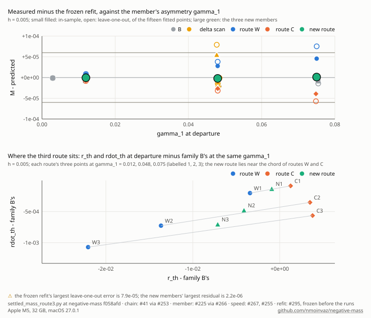

# Does a frozen refit of the settled mass over fifteen members predict a third route? (#295)

Code: [settled_mass_route3.py](settled_mass_route3.py), a thin driver that imports #283's `settled_mass_route.py` (and through it #266's `settled_mass_b.py`, #267's `settled_mass_member.py`, #41's `settled_mass.py`, #253's
`settled_mass_g.py`, #40's `threshold.py`, #225's `throat_locus.py`, #39's `dn.py` and #255's `throat_drift.py`) unchanged. Output of record: [settled_mass_route3_output.txt](settled_mass_route3_output.txt)
(`python3 settled_mass_route3.py analyze --raw=<negative-mass-raw>/I295-mac --rn=<negative-mass-raw>/I295-mac/runs_rn`, exit 0: 26 checks, none failing). Raw output, with the refit frozen first and the criteria written
before the runs of record: negative-mass-raw `I295-mac` (README in three stages; `runs/`, `runs_rep/`, `runs_rn/`, `mut/`, `dev/`, `scripts/`, `refit_frozen.log`). Status words as in AGENTS.md: every mass and every member
parameter below is *numerical evidence*; what is not shown is marked *conjecture*. No sentence here says a result is new. Units: a = 1 is the throat radius of the initial static wormhole, 8πG = 1, D = 4, M = r/2 on the apparent
horizon.

The figure is drawn by [settled_mass_route3_graph.py](settled_mass_route3_graph.py) from the raw folder named above.

## Answer

**Yes, as worded, and the test is an interpolation. A refit of y = M/r_th − M₀ = a γ₁ + b γ₁² + c ṙ_th over the fifteen members of four routes, frozen before any run of the third route, predicts the settled mass of all three new
members to 2.2e-6 at most, against a bar of 6e-5.** The third route (the normal pulse's width 0.75 at centre 3.5, B tuned to γ₁ = 0.012, 0.048, 0.075) was chosen by a rule fixed beforehand; it lies between routes W and C at the same γ₁ (a fraction
0.54 to 0.58 of the way from W to C in r_th, 0.60 to 0.74 in ṙ_th) and inside the fitted data (leverage 0.07, 0.19, 0.33 against a fitted maximum of 0.39). The test therefore says that (γ₁, r_th, ṙ_th) suffice *between* the routes
already fitted; it does not say they suffice outside them. The refit's own errors on the fifteen fitted points reach 5.5e-5 (leave-one-out 7.9e-5, above the bar at two points), 25 to 40 times the roundoff of the plateau: the form is a
description good to about 5e-5, not an exact relation.

| acceptance (issue #295) | verdict | numbers |
|---|---|---|
| every new member within 6e-5 of the frozen refit (P4) | **met** | M − P4 = −4.77e-07, −2.15e-06, +1.21e-06 (N1, N2, N3); at h = 0.01 (post hoc, same coefficients, M₀ = 0.223095) +7.3e-07, −7.5e-07, +4.7e-06 |
| SEP against both earlier routes (W, C) | **met** (and against family B) | r_th − route's at the same γ₁: W +2.5e-3, +9.5e-3, +1.5e-2; C −2.2e-3, −7.6e-3, −1.1e-2; B −9.0e-4, −4.1e-3, −7.1e-3; ṙ_th: W +7.0e-5, +2.5e-4, +3.7e-4; C −4.6e-5, −1.3e-4, −1.4e-4; B −1.3e-4, −4.8e-4, −7.0e-4; every one at least 7e3 (r_th) and 3e2 (ṙ_th) times the point's own h difference |
| the member at the two h agrees as in #283 | **met** | γ₁: 3.3e-5, 7.8e-6, 5.4e-6 (bar 1e-4); r_th ≤ 6.5e-7; ṙ_th ≤ 4.0e-7 (bar 2e-5) |
| reproduction of one stored #283 point bit for bit | **met** | W3 at h = 0.005 from its stored bracket: p*ₕ, the chain's series, the locus, the member rows (all but the job's wall time), M, γ₁, r_th, ṙ_th, t_dep equal #283's exactly |

Controls: 26 checks, 25 gating, 1 post hoc; **none fails**. The six planted cases pass and 30 of 30 mutations newly fire exactly their declared set on the runs of record. The criteria were not moved: the refit was frozen in the
raw README (305e5fee) before any run of the third route, the route and criteria were declared (6bdd3c69, code bf82f25) before the runs of record, and the runs of record equal the development set bit for bit. One of my own checks (REP3's
comparison of `member.json`, which holds a wall time) was corrected after the development data and before the criteria, stated there. The development set had already shown the residuals below; the README says so before the records.

## The frozen refit

Plain least squares, no intercept, no weights, M₀ = 0.223086 (the coordinator's ruling; B = 0's plateau is 0.2230862), over the fifteen members at h = 0.005: the four B of #266, the five δ = 1e-7, 1e-9 … 1e-12 of #267 (B = 0.1), and the
six of #283 (routes W and C). Each member is read with #283's code from the stored runs (γ₁, r_th at ε = 1e-3, ṙ_th there, M the plateau over the last 1.0 of x⁺).

| | a | b | c |
|---|---|---|---|
| frozen refit (P4) | +0.2296318924 | +0.2834170383 | +0.7657657062 |
| #267's post hoc fit over nine points (P3) | +0.2300 | +0.2724 | +0.7835 |
| the refit without the speed (P2′, comparison only) | +0.2177664539 | +0.5888595816 | |

M − predicted of the refit (frozen with the coefficients, README stage 1):

| point | B0.025 | B0.05 | B0.1 | B0.125 | e7 | e9 | e10 | e11 | e12 | W1 | W2 | W3 | C1 | C2 | C3 | max |
|---|---|---|---|---|---|---|---|---|---|---|---|---|---|---|---|---|
| in-sample (×1e-6) | −1.1 | −7.7 | −20 | −8.9 | −0.6 | −19 | −12 | −1.1 | **+55** | +8.0 | +28 | **+46** | −7.9 | −27 | −39 | 55 |
| leave-one-out (×1e-6) | −1.1 | −8.1 | −23 | −14 | −0.8 | −22 | −14 | −1.5 | **+79** | +8.7 | +38 | **+75** | −8.4 | −32 | −57 | 79 |

Two leave-one-out errors (e12, W3) exceed the bar of 6e-5; the README says so before the runs. The residuals have a sign structure: route W's are positive and route C's negative, at all three γ₁, growing with γ₁.
The coefficients moved from #267's by −0.2 %, +4.0 % and −2.3 %.

## The route and the three members

The candidates were eight Gaussian normal pulses (x_c, w) tuned at h = 0.02, with the selection rule written before any run: among those that stall at all three targets, the largest D, the smallest over the three γ₁ and the three
reference routes (B, W, C) of sqrt((Δr_th/1e-3)² + (Δṙ_th/1e-4)²). (3.5, 0.75) has D = 1.60, (4.5, 0.7) 1.56, (4.0, 0.7) 1.42, (3.5, 1.0) 1.06, (4.0, 0.35) 0.85, (3.5, 0.35) 0.81, (2.5, 0.35) 0.60; (2.5, 0.7) does not stall at
γ₁ = 0.048 and 0.075. The rule picked the issue's example. The rule used (γ₁, r_th, ṙ_th) only.

h = 0.005; M the plateau mean over the last 1.0 of x⁺.

| point | B | p*ₕ | t_dep | γ₁ | r_th | ṙ_th | M | M − P4 | M − P3 (#267's) | M − P2′ |
|---|---|---|---|---|---|---|---|---|---|---|
| N1 | 0.05648 | 1.84084e-3 | 13.361 | 0.011993 | 0.997459 | −4.348e-4 | 0.224974 | −4.8e-07 | +4.4e-06 | −2.3e-04 |
| N2 | 0.1101 | 7.30328e-3 | 13.623 | 0.047988 | 0.998724 | −4.177e-4 | 0.234137 | −2.2e-06 | +1.3e-05 | −4.6e-04 |
| N3 | 0.136 | 1.15260e-2 | 13.867 | 0.075017 | 1.008541 | +8.649e-4 | 0.244642 | +1.2e-06 | +2.0e-05 | −1.7e-04 |

- **What the number means.** The residuals are of the size of the roundoff realization of the plateau (a second realization of the chain, the same p*ₕ to 4.3e-15: M changes by +1.8e-07, +1.6e-06, −1.0e-06, and M − P4 becomes −3.0e-07, −5.9e-07,
  +2.0e-07), and below the h difference of M (1.0e-05, 1.0e-05, 1.2e-05). They say "at most about 2e-6", not more. The speed matters: the same fit without it misses by 1.7e-4 to 4.6e-4, 76 to 210 times the largest residual of P4.
  #267's own P3, fixed since #267, also predicts all three within the bar (up to 2.0e-5).
- **Why the new members sit where the refit is good** (post hoc statistics, in the output): their leverage in the fit's design is 0.070, 0.189, 0.328 (the fitted points' maximum is 0.393, at W3; the mean 0.200), and their nearest fitted
  points are B0.05, e7 and B0.125 at 1.6, 5.1 and 10.4 in units of (1e-3 in γ₁, 1e-3 in r_th, 1e-4 in ṙ_th). Route W's residuals are positive and route C's negative; the new route lies between them (the table below), where the refit's residual
  changes sign and is close to zero.
- **Position between W and C** (post hoc, same γ₁): the fraction of the way from W's to C's value, N1, N2, N3: r_th 0.54, 0.56, 0.58; ṙ_th 0.60, 0.66, 0.74.
- **#283's description tested blind** (post hoc; its constant is not refitted): #283 found M − P3 ≈ K (r_th − family B's at the same γ₁), K = −3.365e-3, from the six points of W and C. On the new members K (r_th − B's) is +3.1e-06, +1.4e-05,
  +2.4e-05 against the observed M − P3 of +4.4e-06, +1.3e-05, +2.0e-05: it holds to 3.6e-6. The new route's r_th lies below family B's, as W's does, so its P3 residual has W's sign (and a size set by the separation).

## Separation, member at the two h, reproduction

- **SEP (met).** Each route's curve is B = 0's member plus its three points, interpolated by a piecewise-linear and a PCHIP curve, the smaller difference (γ₁ up to 3 % beyond a curve's last point is extrapolated; the largest needed was 0.2 %).
  The separations are in the table above; the point's own h difference is ≤ 6.6e-7 in r_th and ≤ 4.0e-7 in ṙ_th. The third route is not a point of any earlier curve, and it is between two of them.
- **HST (met).** γ₁, r_th, ṙ_th at the two h agree to 3.3e-5, 6.5e-7, 4.0e-7 at most (#283's W1 at γ₁ = 0.012 failed at 1.1e-4; N1 at the same γ₁ agrees to 3.3e-5).
- **REP3 (met).** #283's W3 at h = 0.005, bisected from its stored bracket (0.0256, 0.0512), is #283's stored run bit for bit: p*ₕ, every array of the chain's series and of the locus, the member rows, M, γ₁, r_th, ṙ_th and t_dep.
- **TGT.** γ₁ is within 5.5e-4 (relative) of its target at h = 0.005 (bar 3 %).

## Error bars of M and of the member (kept separate, not mixed)

| kind | what | size | what it is |
|---|---|---|---|
| value | plateau mean over the last 1.0 of x⁺, h = 0.005, δ = 1e-8 | table above | |
| h | \|plat(0.01) − plat(0.005)\| | 1.0e-5, 1.0e-5, 1.2e-5 (RH, bar 5e-5) | difference between two resolutions of this code |
| roundoff realization | M at h = 0.005 from p*ₕ bisected along another path (the same p*ₕ to 4.3e-15) | ≤ 1.6e-6 | the ulp-noise realization of the chain, measured on these three points |
| member, h | γ₁, r_th, ṙ_th between h = 0.01 and 0.005 | ≤ 3.3e-5, 6.5e-7 relative; 4.0e-7 absolute | two resolutions (HST) |
| member, definition | ε = 1e-3 | #266's: ε = 1e-2 moves γ₁ by 3e-4 relative and r_th by 4.6e-4 | not remeasured here |
| the refit | in-sample and leave-one-out errors of the fifteen | up to 5.5e-5 and 7.9e-5 | residual of a three-parameter form; 25 to 40 times the roundoff |

## Controls and mutations

26 checks, 25 gating. The runs of record equal the development set (`dev/set_a`) bit for bit. On the runs of record **30 of 30 mutations newly fire exactly their declared set** (`mut/`; the effects were computed on the development set
before being declared). P4 newly fires under `coef_a` (a × 1.05), `coef_c` (c × 0.8), `no_rscale`, and every mutation that changes M or the member (the chain reruns `mass_exponent`, `short_limit`, `w_scale`, `xc_offset`, and `no_settle`, `asym_sign`, `dep_eps`, `eps_h`, `no_run`), so it can fail
on these data; FRZ (the refit recomputed from the stored fifteen points equals the frozen constants) fires under `frz_a`, `frz_m0`, `drop_point`, `loo_off` and the extraction mutations. One mutation, `normal_drop`, fires nothing:
RC4 cannot see the normal field (#283: 1e-8 of the flux). The planted cases: the extraction, departure time and speed as #283 (errors 5.8e-7 in γ₁, 6.3e-6 in t_dep, 1.4e-6 in ṙ_th); the refit (planted data that follow it return (a, b, c) to 2e-15, one point
displaced by 1e-4 has a leave-one-out error equal to the displacement); the prediction test (planted data pass at 1e-12, with a × 1.05 or c × 0.8 they miss by 8.7e-4 and 1.9e-4); the separation test against three planted curves.

## What this says, and does not

- *Shown (numerical evidence):* at D = 4, δ = 1e-8, h = 0.005, the settled mass of three members of family G reached by a third route (normal pulse width 0.75 at centre 3.5; γ₁ = 0.012, 0.048, 0.075) equals r_th (M₀ + a γ₁ + b γ₁² + c ṙ_th)
  with (a, b, c) fixed beforehand over fifteen members of four routes, to 2.2e-6 (bar 6e-5), where the same fit without the throat's speed misses by up to 4.6e-4. The route differs from B, W and C at the same γ₁, and lies between W and C.
- *Not shown:* that M is a function of (γ₁, r_th, ṙ_th) alone **outside** the fitted data (the new members have leverage inside the fitted range and sit near the chord of two fitted routes; a route that leaves it, or ṙ_th beyond [−6.7e-4, +1.6e-3],
  is untested); that the form is exact (its residuals on the fitted points are 5.5e-5, structured by route, and two leave-one-out errors exceed the bar: a *conjecture* that a fourth quantity of the state at departure carries the rest);
  the coefficients at any h but 0.005; any dependence on ε, the definition of departure (#266: 1e-4 level); other pulse kinds, the ghost pulse changed, δ ≠ 1e-8 on these routes; D = 5, 6 (#246); γ₁ above 0.075.
- Not a failure of the chain: the chain, its first law and its planted cases are #41's and pass at every point (RC4 to 1.3e-4, RC8 settled, RH 1.0e-5 to 1.2e-5), and the reproduction of #283 is exact.

## Stale or conflicting text found (for the coordinator; none was edited)

1. `settled_mass_route.md`, "What this says, and does not", "*Not shown:* that M is a function of (γ₁, r_th, ṙ_th) alone (P3 misses W3 by 1.1e-5 …)", and recommended task 1 ("A third route, blind, with P3 refitted first"): done here.
2. `critical_ghost.md` §1.3, "Update from #283", last bullet: "that (γ₁, r_th, ṙ_th) suffice is a *conjecture*, not supported at the declared bar": add this note's result.
3. Paper V (`paper/5-ellis-threshold/main.tex`), the paragraph ending "… (`…/settled_mass_route.md`)" after "The relation found along B was then tried on members reached by other routes", and the bullet "It is not a function of the member's
   (γ₁, r_th) at departure alone (\#267, \#283)": add this note's result.

## Proposed text (for the coordinator; none applied)

**`settled_mass_route.md`**, in "What this says, and does not", after the *Not shown* bullet: "*Tested in #295* (`settled_mass_route3.md`): a refit over the fifteen members (four B, five δ, the six of this note), its coefficients (0.2296, 0.2834, 0.7658)
frozen before the runs, predicts three members of a third route (normal pulse width 0.75, centre 3.5; γ₁ = 0.012, 0.048, 0.075) to 2.2e-6, against the bar 6e-5; the new members lie between W's and C's. Not tested outside the fitted data."
Recommended task 1: "done in #295".

**`critical_ghost.md` §1.3**, after the "Update from #283" bullet:

> - *Update from #295* (`wormhole_evolution/settled_mass_route3.md`; *numerical evidence*):
>   - Refitting y = M/r_th − M₀ = a γ₁ + b γ₁² + c ṙ_th over the fifteen members of four routes (B, the δ scan, W, C) at h = 0.005 gives (a, b, c) = (0.2296, 0.2834, 0.7658); the fit's errors are up to 5.5e-5 in sample and 7.9e-5 leave-one-out.
>   - Frozen before any run, it predicts three members of a third route (the normal pulse's width 0.75 at centre 3.5, γ₁ = 0.012, 0.048, 0.075) to 2.2e-6, against the declared bar of 6e-5. The same fit without the speed misses by up to 4.6e-4.
>   - The new members lie between routes W and C and inside the fitted data (leverage 0.07 to 0.33 against 0.39). So (γ₁, r_th, ṙ_th) suffice between the routes fitted, at the declared bar; outside them it is a *conjecture*.

**Paper V**, after the paragraph "The relation found along $B$ was then tried …", add:

> The three-parameter form was then refitted over fifteen members of four routes, $(a,b,c)=(0.2296,0.2834,0.7658)$, and fixed before the next runs. A third route, the normal pulse's width $0.75$ at the centre $3.5$, tuned to the same three $\gamma_1$,
> is predicted to $2.2\times10^{-6}$, against a bar of $6\times10^{-5}$. That route lies between the two earlier ones in $(\gamma_1,r_{\rm th},\dot r_{\rm th})$, and the form's own errors on the fitted members reach $5.5\times10^{-5}$ (\texttt{notes/wormhole\_evolution/settled\_mass\_route3.md}).

`paper_numbers.py` would check 0.2296318924, 0.2834170383, 0.7657657062, the three residuals and the fitted errors from `settled_mass_route3_output.txt`.

## Limits

- D = 4, δ = 1e-8, family G with its ghost pulse unchanged, one third route (Gaussian normal pulse, three points), h = 0.01 and 0.005; the member read at ε = 1e-3 (#266's definition); the coefficients are for h = 0.005.
- The route was chosen in development at h = 0.02 by a rule on (γ₁, r_th, ṙ_th); P4 was not evaluated at h = 0.02. The development set at h = 0.01 and 0.005 did evaluate it, and the runs of record equal it bit for bit; the README lists the residuals before the records.
- The refit is a description on points that include four routes; the test is on points it was not fitted on, inside their range. The fit has three parameters on fifteen points, a design condition number of about 100.
- The settled mass is the plateau at e^{−f} = 1.57e6 on the apparent horizon (not the event horizon); the chain is #41's. The roundoff scatter was measured on one second realization of three points.
- The planted cases test the extraction, the departure time, the speed, the refit and the prediction and separation tests, not the evolution.

## Recommended tasks

1. *A route outside the fitted cloud, blind.* What: reach γ₁ = 0.012, 0.048, 0.075 by a normal pulse chosen in development at h = 0.02 for its leverage in the frozen fit's design (and ṙ_th outside [−6.7e-4, +1.6e-3]) instead of its separation, for example the
   Gaussian (x_c, w) = (2.5, 0.35), whose h = 0.02 members have ṙ_th = −2.4e-4, +2.9e-4, +1.9e-3 (`I295-mac/dev/logs/tune_xc2.5_w0.35_h0.02.log`), or another pulse kind; test the same frozen refit. Why: this route sat inside the fitted data, and the
   two leave-one-out errors above the bar are at the edge of it. Acceptance (can fail): at least one new point with leverage above 0.393, and every new member within 6e-5 of the frozen P4, or the residuals reported. Depends on: this note.
2. *The structure of the refit's residuals.* What: from the stored fifteen (and eighteen) points, ask whether one more quantity of the state at departure (for example r_th − 1, γ₁ ṙ_th, t_dep) removes the in-sample residual that has route W's sign positive and route C's negative.
   Why: the residual is 25 times the roundoff and structured by route; a fourth parameter that fits it would be a candidate for what the three quantities miss. Acceptance: in-sample residual below 1e-5 and leave-one-out below 2e-5 on the fifteen with a fourth term fixed beforehand, tested on
   the three new members, or the failure reported. Depends on: this note (an analysis of stored runs; no new run).
3. *The definition of departure* (#283's task 2, still open). What: the fifteen and the three new points read at ε = 1e-2 (the stored rows reach it), the refit redone there. Why: #266 found its relation depends on ε at the 1e-4 level, above this note's residuals.
   Acceptance: the refit at ε = 1e-2 predicts the three new members within 6e-5, or the failure is reported. Depends on: this note (stored runs only).

## Files

`settled_mass_route3.py` (commands `refit`, `tag`, `bracket`, `pstar`, `job`, `member`, `planted`, `analyze`; `--mutate=`, `--baseline=`, `--rn=`), `settled_mass_route3_output.txt`, `settled_mass_route3_graph.py`, `settled_mass_route3.svg`, this note;
raw `negative-mass-raw/I295-mac` (`README.md` with the frozen refit, the route's selection rule, the criteria, the development findings and the mutation table; `refit_frozen.log`; `runs/<tag>/h<h>/{pstar,chain,member,logs}` the six runs of record,
`runs_rep/` the W3 reproduction, `runs_rn/` the second realization, `mut/` the 30 mutated analyses of record, `mut_aborted_1/` a stopped first run of them, `dev/` the tuning, the development set, its analysis and mutations, `scripts/`, `jobs_*.txt`,
`analyze_record.log` (final) and `analyze_record.1.log`, and the figure).

## Coordinator's review

Merged at f0151db. Review folder `negative-mass-raw/I295-mac-review` at 10458731, criteria committed (3f6a8842) before the first run of
`ind295.py`. The raw commits are in the declared order: the refit frozen (305e5fee), then the criteria (6bdd3c69), then the runs.

- **Rerun on the Mac** from f9e5998: the N3 point at h = 0.005 is bitwise equal to the runner's, and `analyze` equals the output
  of record (26 checks, none failed).
- **ind295**, 4 of 4. Its own readings (ind283's reader: member, plateau, ṙ_th by a different estimator) and its own fit over
  the fifteen points give (0.229631, 0.283430, 0.765761), within 1.3e-5 of the frozen coefficients. With the frozen ones the
  three new members are within 2.1e-6, and within 7.5e-9 of the note's residuals. The three new points lie inside the fitted
  points' bounding box in (γ₁, r_th, ṙ_th), so this is an interpolation test, as the note says. `no-speed` fires. `drop-routes`
  does not, because K1's bars were too loose; the nine-point fit also predicts the three within 2.2e-5.
- Applied: `settled_mass_route.md`, `critical_ghost.md` §1.3, and Paper V (`paper_numbers.py` 259 of 259). The check caught
  the proposal's "4.6e-4" for the no-speed miss; the output's value is 4.55e-4.
