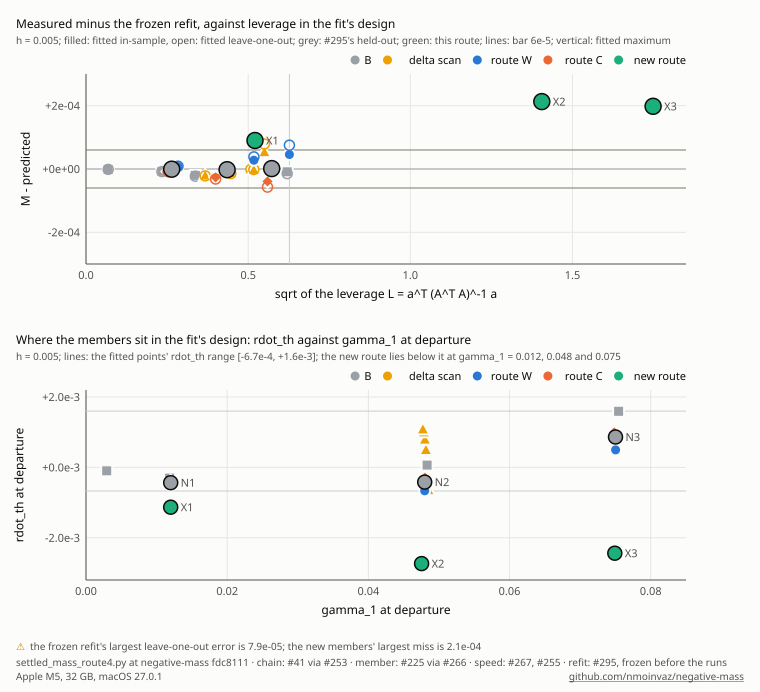

# Does the frozen settled-mass refit hold on a route outside its fitted data? (#305)

Code: [settled_mass_route4.py](settled_mass_route4.py), a driver over #295's `settled_mass_route3.py`, which imports #283's `settled_mass_route.py` (and through it #266's, #267's, #41's, #253's, #40's, #225's, #39's and #255's scripts) unchanged.
Output of record: [settled_mass_route4_output.txt](settled_mass_route4_output.txt) (`python3 settled_mass_route4.py analyze --raw=<negative-mass-raw>/I305-mac --rn=<negative-mass-raw>/I305-mac/runs_rn`, exit 1: 31 checks, 30 gating, **2 gating fail: P4 and FITQ**).
Post hoc reading of the misses: [settled_mass_route4_post.py](settled_mass_route4_post.py), [settled_mass_route4_post_output.txt](settled_mass_route4_post_output.txt). Raw output, with the choice rule, the placement readings and the criteria written before the runs of record:
negative-mass-raw `I305-mac` (README in stages 1, 1b, 2a, 2b; `runs/`, `runs_rep/`, `runs_rn/`, `mut/`, `dev/`, `scripts/`). Status words as in AGENTS.md: every mass and member parameter below is *numerical evidence*;
what is not shown is marked *conjecture*. No sentence here says a result is new. Units: a = 1 is the throat radius of the initial static wormhole, 8πG = 1, D = 4, M = r/2 on the apparent horizon.

The figure is drawn by [settled_mass_route4_graph.py](settled_mass_route4_graph.py) from the raw folder named above.

## Answer

**No, at the declared bar, on this route. The refit of y = M/r_th − M₀ = a γ₁ + b γ₁² + c ṙ_th frozen in #295, (a, b, c) = (0.2296318924, 0.2834170383, 0.7657657062), misses the settled mass of all three members of a route chosen for its
leverage by +9.0e-5, +2.1e-4 and +2.0e-4 (bar 6e-5).** The route is the Gaussian normal pulse of width 1.5 at centre 4.0, B tuned to γ₁ = 0.012, 0.048, 0.075. It was selected by a rule fixed before the scan (the largest summed leverage at h = 0.02
of sixteen candidates), not the issue's example. Its leverage in the fit's design is 0.27, 1.98 and 3.06 against 0.393 for the fitted points; its ṙ_th is −1.1e-3, −2.7e-3 and −2.4e-3 against the fitted range [−6.7e-4, +1.6e-3].
So this is an extrapolation, far beyond the edge of the data. The misses are 1.5, 3.6 and 3.3 times the bar and 1.1 to 2.7 times the largest leave-one-out error of the fitted points (7.9e-5); they are not roundoff (the second realization moves M by 1.0e-7 at most),
not the resolution (the plateau changes by 1.0e-5 at most between h = 0.01 and 0.005) and not the extraction code (the planted cases pass). #295's interpolation result stands unchanged.

**FITQ, #283's control that the member's static-profile fit describes the state at departure (rms of M(r) at most 1e-4), fails beside it: 6.5e-5, 1.46e-4, 2.09e-4.** Over the 22 stored members the rms correlates with |ṙ_th| at +0.95.
**Which of the two the miss belongs to** (the form fails outside its data, or the member read from a state a static member describes poorly is not what the form assumes): **by the readings declared before the runs, the data do not separate them**
(verdict map of the raw README stage 2a: "not separable by these data"); see below. A reading error larger than the readings measure is not excluded.

| acceptance (issue #305) | verdict | numbers |
|---|---|---|
| at least one new point with leverage above 0.393 in the frozen design | **met** | 0.272, 1.975, 3.058 (X2, X3 above the fitted maximum 0.3932, W3) |
| ṙ_th outside [−6.7e-4, +1.6e-3] (the task's choice condition) | **met** | −1.130e-3, −2.733e-3, −2.439e-3 |
| every new member within 6e-5 of the frozen fit, or the residuals reported | **not met** | M − P4 = +9.00e-05, +2.13e-04, +1.98e-04 (X1, X2, X3); the same fit without the speed misses by −6.7e-4, −2.0e-3, −2.5e-3; #267's P3 by +1.1e-4, +2.7e-4, +2.7e-4 |
| SEP against routes B, W, C and #295's route | **met** | r_th separations 1.3e-3 to 3.5e-2 (at least 3.7e3 times the point's own h difference), ṙ_th 6.3e-4 to 4.0e-3 (at least 6e3 times) |
| the member at the two h as in #283 | **met** | γ₁ 1.1e-5, 1.3e-6, 3.5e-6 (bar 1e-4); r_th ≤ 1.0e-6; ṙ_th ≤ 4.9e-7 (bar 2e-5) |
| reproduction of one stored #295 point bit for bit | **met** | N3 at h = 0.005 from its stored bracket: p*ₕ, the chain's series, the locus, the member rows (all but the wall time), M, γ₁, r_th, ṙ_th, t_dep identical |
| FITQ, my control of #283's (not an acceptance bar of the issue) | **not met** | rms 6.5e-5, **1.46e-4, 2.09e-4** (bar 1e-4); fails at X2 and X3 |

Controls: 31 checks, 30 gating, 2 fail (P4, FITQ), the post hoc P4 at h = 0.01 also fails (+9.1e-5, +2.2e-4, +2.0e-4). The eight planted cases pass and 35 of 35 mutations newly fire exactly their declared sets on the runs of record. Neither failing check is changed: both bars were
declared before the scan or taken from #295 and #283, and the development set showed both failures before the criteria were written (README stages 2a and 2b say so). The runs of record equal the development set bit for bit.

## The route and the rule

Sixteen Gaussian candidates (x_c, w) were tuned at h = 0.02 (seven stored from #295's development logs, nine new; (2.0, 0.35) and (2.0, 0.25) do not stall). The rule, written in the raw README before the scan: a candidate counts if all three targets stall, if D ≥ 0.1 from
families B, W, C and #295's route (a guard, not a selection by separation, which the issue forbids), if at least one ṙ_th is outside the fitted range, and if its largest leverage is at least 0.43; the largest S = L₁ + L₂ + L₃ wins, with L the leverage
aᵀ(AᵀA)⁻¹a of (γ₁, γ₁², ṙ_th) at h = 0.02 in the design of the fifteen fitted points. The scan (README stage 1b):

| (x_c, w) | leverage at γ₁ = 0.012, 0.048, 0.075 | S | counts |
|---|---|---|---|
| **(4.0, 1.5)** | 0.272, 1.977, 3.061 | **5.31** | yes, selected |
| (5.0, 1.0) | 0.173, 1.189, 1.854 | 3.22 | yes |
| (4.5, 1.0) | 0.134, 0.774, 1.131 | 2.04 | yes |
| (5.0, 0.7) | 0.103, 0.521, 0.773 | 1.40 | yes |
| (4.0, 1.0) | 0.109, 0.518, 0.714 | 1.34 | yes |
| (4.5, 0.7), (3.5, 1.0) | 0.086, 0.342, 0.514; 0.092, 0.358, 0.490 | 0.94 | yes |
| (2.5, 0.25), (2.5, 0.35) (the issue's) | 0.051, 0.117, 0.497; 0.052, 0.114, 0.452 | 0.67, 0.62 | yes |

The rule picked the most extreme candidate. The coordinator ruled to keep it: switching to a milder route after the development residuals would choose the test by its outcome. Before the rule was written I had read #295's stored tunings and their leverage, and a draft guard
(D ≥ 1.0) that excluded the issue's example was relaxed to D ≥ 0.1; both are stated in the README.

## The three members and the miss (h = 0.005)

| point | B | p*ₕ | t_dep | γ₁ | r_th | ṙ_th | leverage | M | M − P4 | static-fit rms |
|---|---|---|---|---|---|---|---|---|---|---|
| X1 | 0.09112 | 2.38246e-3 | 13.376 | 0.011999 | 0.993694 | −1.130e-3 | 0.272 | 0.223687 | **+9.00e-05** | 6.46e-05 |
| X2 | 0.1695 | 8.34446e-3 | 13.649 | 0.047545 | 0.983798 | −2.733e-3 | 1.975 | 0.228997 | **+2.13e-04** | **1.46e-04** |
| X3 | 0.2044 | 1.22526e-2 | 13.879 | 0.074911 | 0.983968 | −2.439e-3 | 3.058 | 0.236361 | **+1.98e-04** | **2.09e-04** |

- **Not an error of the chain.** The chain's checks, first law (RC4 to 1.3e-4), settlement (RC8), the stall (T gains 3.9 to 4.9 per side), the pair and the bit-for-bit reproduction of #295's N3 pass.
- **Not roundoff, not h.** The second realization (p*ₕ bisected from another bracket, the same to 5.3e-14): M changes by −2.3e-9, +1.2e-8, −1.0e-7 and M − P4 stays +9.00e-05, +2.13e-04, +1.98e-04. M at h = 0.01 against 0.005: 1.0e-5, 1.2e-5, 9.0e-6.
- **The fit's own refit.** Refitting over the fifteen and the new points (post hoc; descriptions) gives (a, b, c) = (0.2292, 0.2993, 0.7130), c lower by 7 %, with in-sample errors up to 9.6e-5; over the eighteen with #295's three, (0.2290, 0.3018, 0.7133), in-sample up to 1.0e-4.
  The form with three parameters does not describe all of them at 5e-5.
- **#283's description of P3's residual** (M − P3 = K (r_th − family B's), K = −3.365e-3 from routes W and C, not refitted) gives +1.6e-5, +6.4e-5, +1.1e-4 against the observed +1.1e-4, +2.7e-4, +2.7e-4: it does not carry over.

## Where the miss belongs: the form or the member's reading

Declared in README stage 2a (commit 811e32ab) after the development set and the coordinator's ruling, before the placement readings were computed on this route. The readings are post hoc blocks of the analysis; the map decides:

| reading | what it measures | result |
|---|---|---|
| M1, the confound | correlation of the static fit's rms with \|ṙ_th\|, \|r_th − 1\|, \|γ₁\| over the 22 stored members (the fifteen, #295's three, the new three) | +0.952, +0.795, +0.549: **one coordinate with the speed** (≥ 0.9): a poor member fit and a large throat speed are not separable in these data. The fitted B0.125 (ṙ_th = +1.59e-3) has rms 1.07e-4, above the FITQ bar too |
| M2, a common mechanism | \|M − P4\| / rms at the six held-out members: #295's N1, N2, N3 (0.086, 0.072, 0.026) and X1, X2, X3 (1.39, 1.46, 0.95); geometric means 0.055 and 1.24 | ratio 22.7, **apart** (above 10): a miss proportional to the misfit with one constant is not supported (N's rms reach 4.6e-5 with misses of 1e-6). Not blind: the development set showed it |
| M3, the reading's own ambiguity | the shift of one reading that would close the miss, δ*, against the change of that reading between ε = 1e-3 and 1e-2 (the definition of departure), R = A/\|δ*\| | at X1, X2, X3: γ₁ 0.31, 0.12, 0.59; r_th 4.8, 4.3, 3.1; ṙ_th 0.55, 3.8, 6.8: **reading-compatible** at all three. The same R on #295's N1 to N3, where P4 holds to 1e-6, are 3 to 514: R ≥ 1 is met nearly everywhere, so M3 cannot place a miss (calibration added after the development set; not part of the map) |

**Verdict by the map (reading: M2 consistent and M3 reading-compatible at all three; form: M2 apart and M3 form-side at all three): not separable by these data.** M1 says the two readings are one coordinate here; M2 argues against a reading error proportional to the misfit with
a constant that holds at N; M3 does not discriminate. A reading error that grows faster with speed than the misfit does is not excluded, and neither is a form that fails outside its data.

**A post hoc description, not part of the verdict** ([settled_mass_route4_post_output.txt](settled_mass_route4_post_output.txt)): the miss is proportional to ṙ_th along this route. (M − P4)/ṙ_th = −0.0796, −0.0779, −0.0812 at X1, X2, X3 (spread 4 %), so the
coefficient of ṙ_th that removes each miss with a and b kept is c_eff = 0.6856, 0.6866, 0.6833 = 0.895, 0.897, 0.892 times the frozen c. One constant describes three points on one route, at leverage 0.27 to 3.06 and γ₁ from 0.012 to 0.075. It is not a law of the
fifteen: at #295's N1 to N3 the same c_eff/c is 1.001, 1.007, 1.002 (ṙ_th between −4.3e-4 and +8.6e-4). Two things would make a route's coefficient differ from c: the form is not linear in ṙ_th beyond the fitted range (or c depends on the route), or the speed read by
`speed_at` at departure is about 12 % too large in magnitude on this route (1/0.895). Against the second: the planted speeds up to 2e-3 are recovered to 1.4e-6, and the speed read at ε = 1e-3 against 1e-2 differs by 6 %, 40 % and 73 % at X1, X2, X3 (and 39 % to 71 % at N), so the definition of departure moves ṙ_th by far more than 12 % on routes where P4 holds.
Neither is decided.

## Error bars (kept separate, not mixed)

| kind | what | size | what it is |
|---|---|---|---|
| value | plateau mean over the last 1.0 of x⁺, h = 0.005, δ = 1e-8 | table above | |
| h | \|plat(0.01) − plat(0.005)\| | 1.0e-5, 1.2e-5, 9.0e-6 (RH, bar 5e-5) | difference between two resolutions of this code |
| roundoff realization | M at h = 0.005 from p*ₕ bisected along another path | ≤ 1.0e-7 | measured on these three points |
| member, h | γ₁, r_th, ṙ_th between h = 0.01 and 0.005 | ≤ 1.1e-5, 1.0e-6 relative; 4.9e-7 absolute | two resolutions (HST) |
| member, definition | ε = 1e-3 against 1e-2 | γ₁ 1.2e-4, 1.0e-4, 4.4e-4; r_th 1.9e-3, 3.9e-3, 2.6e-3; ṙ_th 6.5e-5, 1.1e-3, 1.8e-3 (absolute) | the definition of departure, #266's `eps_alt`; larger than #266's on its points |
| member, fit | rms of the static-member fit at departure | 6.5e-5, 1.5e-4, 2.1e-4 | the state is not an exact static member; tracks \|ṙ_th\| |
| the refit | in-sample and leave-one-out errors of the fifteen | up to 5.5e-5 and 7.9e-5 | residual of a three-parameter form; the misses here are 1.6 to 3.9 times its largest in-sample error |

## Controls and mutations

31 checks, 30 gating. The runs of record equal the development set (`dev/set_a`) in every printed number (the analyses differ only in the path). On the runs of record **35 of 35 mutations newly fire exactly their declared set** (`mut/`; effects computed on the development set before being declared).
P4 and FITQ fail without a mutation, so no mutation can newly fire them: P4 shows that it can fail by failing on the data, and PPRED4 shows P4 passing planted data that follow the fit (and failing them with a × 1.05 by 8.7e-4 or c × 0.8 by 1.9e-4). `fitq_scale` fires nothing for the same reason.
`normal_drop` fires nothing (RC4 cannot see the normal field, #283's blind spot) and `lev_rdot` fires nothing (LEV does not depend on ṙ_th at these points; the leverage of X2, X3 stays above 0.3932 without it). New checks: LEV fires under `lev_bar`, `eps_h`, `no_run`, `w_scale`, `xc_offset`;
OUTR under `outr_range`, `w_scale`, `xc_offset`; REP4 under `rep_off`, `mass_exponent`, `no_settle`, `short_limit`; PLEV under `lev_design`; PBEL under `bel_swap`; SEPN under `sep_self`. The planted cases: #295's six (the extraction, departure time, speed, refit, prediction and separation tests) and PLEV (the leverage function equals the hat-matrix
diagonal to 1.5e-15 and the SVD form to 5.7e-15, and decides 'above the fitted maximum' correctly) and PBEL (the verdict map on six planted inputs).

## What this says, and does not

- *Shown (numerical evidence):* at D = 4, δ = 1e-8, h = 0.005, the frozen three-parameter relation with (a, b, c) = (0.2296, 0.2834, 0.7658) does not predict the settled mass of three members of a Gaussian route (x_c = 4.0, w = 1.5) at the bar 6e-5: it misses by 9.0e-5 to 2.1e-4, where the
  leverage is up to 3.06 (fitted maximum 0.39) and ṙ_th down to −2.7e-3 (fitted minimum −6.7e-4). So (γ₁, r_th, ṙ_th) with these coefficients do not suffice there. The speed is still needed: the fit without it misses by 6.7e-4 to 2.5e-3.
- *Shown:* at the same points the member's static-profile fit has rms up to 2.1e-4 (FITQ's bar 1e-4), and the rms follows |ṙ_th| (+0.95 over 22 members).
- *Not shown:* whether the miss belongs to the form or to the member's reading (the map returns "not separable"; a reading error beyond what M3 measures is not excluded); **where the relation starts to fail** (leverage 0.4 to 1.0 is untested: this route has none of it); that the miss follows ṙ_th on other routes
  (the post hoc c_eff/c = 0.895 is one route, three points); other pulse kinds; the ghost pulse changed; δ ≠ 1e-8; D = 5, 6; h other than 0.005; any dependence on ε, the definition of departure (#296).
- Not a failure of the chain: the chain, its first law and its planted cases are #41's and pass at every point, and the reproduction of #295's N3 is exact.

## Stale or conflicting text found (for the coordinator; none was edited)

1. `settled_mass_route3.md`, "What this says, and does not": "*Not shown:* that M is a function of (γ₁, r_th, ṙ_th) alone **outside** the fitted data … is untested", and "Recommended tasks" 1 ("A route outside the fitted cloud, blind"): done here.
2. `critical_ghost.md` §1.3, "Update from #295", last bullet: "outside them it is a *conjecture*": add this note's result.
3. Paper V (`paper/5-ellis-threshold/main.tex`), the paragraph ending "… so the test is one of interpolation (`…/settled_mass_route3.md`)": add this note's result.

## Proposed text (for the coordinator; none applied)

**`settled_mass_route3.md`**, in "What this says, and does not", after the *Not shown* bullet: "*Tested outside the fitted data in #305* (`settled_mass_route4.md`): a route chosen for leverage in the fit's design (normal pulse width 1.5, centre 4.0; leverage 0.27, 1.98, 3.06 against 0.39; ṙ_th down to −2.7e-3 against −6.7e-4)
is missed by this refit by +9.0e-5, +2.1e-4, +2.0e-4, against the bar 6e-5; the static-member fit at the same points has rms up to 2.1e-4 (bar 1e-4). Whether the miss belongs to the form or to the member's reading is not separated by the data." Recommended task 1: "done in #305".

**`critical_ghost.md` §1.3**, after the "Update from #295" bullet:

> - *Update from #305* (`wormhole_evolution/settled_mass_route4.md`; *numerical evidence*):
>   - The frozen refit of #295 was tried on three members of a route chosen for leverage in its design (the normal pulse's width 1.5 at centre 4.0, γ₁ = 0.012, 0.048, 0.075; leverage 0.27, 1.98, 3.06 against the fitted maximum 0.39; ṙ_th down to −2.7e-3 against −6.7e-4).
>     It misses the settled mass by +9.0e-5, +2.1e-4, +2.0e-4, against the declared bar of 6e-5; the same fit without the speed misses by up to 2.5e-3.
>   - The member's static-profile fit at those points has rms up to 2.1e-4 (bar 1e-4), following |ṙ_th|. By the readings declared beforehand the data do not say whether the miss belongs to the form or to the member's reading.
>     So (γ₁, r_th, ṙ_th) with these coefficients suffice between the routes fitted (#295) and not far outside them (#305); where between the two they stop is untested.

**Paper V**, after the paragraph ending "… the test is one of interpolation …", add:

> A route chosen for its leverage in the form's design was then tried, the normal pulse of width $1.5$ at the centre $4.0$: its leverage is $0.27$, $1.98$ and $3.06$ against $0.39$ for the fitted members, and its $\dot r_{\rm th}$ reaches $-2.7\times10^{-3}$ against $-6.7\times10^{-4}$. The same fit
> misses the settled mass there by $+9.0\times10^{-5}$, $+2.1\times10^{-4}$ and $+2.0\times10^{-4}$, against a bar of $6\times10^{-5}$, and the member's static-profile fit is poor at two of the three points (rms $1.5\times10^{-4}$ and $2.1\times10^{-4}$, against $10^{-4}$). The data do not say whether the miss
> belongs to the form or to the reading of the member (\texttt{notes/wormhole\_evolution/settled\_mass\_route4.md}).

`paper_numbers.py` would check 9.00e-05, 2.13e-04, 1.98e-04, the three leverages and the three rms from `settled_mass_route4_output.txt`.

## Limits

- D = 4, δ = 1e-8, family G with its ghost pulse unchanged, one route (a Gaussian normal pulse, three points), h = 0.01 and 0.005; the member read at ε = 1e-3; the coefficients are for h = 0.005.
- The route was selected in development at h = 0.02 by a rule on (γ₁, ṙ_th) only; the frozen refit was not evaluated at h = 0.02. The development set at h = 0.01 and 0.005 did evaluate it, and the runs of record equal it bit for bit; the README lists the misses and the FITQ failure before the criteria.
- The route is far outside the data (leverage 3.06 at the largest), so the miss does not say how close to the data the relation fails. The settled mass is the plateau at e^{−f} = 1.57e6 on the apparent horizon (not the event horizon); the chain is #41's.
- The placement readings use stored runs and one alternative definition of departure (ε = 1e-2); a reading error of another kind is not measured. M2 was seen on the development set before it was declared (README stage 2a). The c_eff description is post hoc, three points and one constant.

## Recommended tasks

1. *A route at leverage 0.4 to 1.0, chosen by a rule declared before any run.* What: tune a Gaussian normal pulse at h = 0.02 for γ₁ = 0.012, 0.048, 0.075 and select by a rule written in the raw README before the scan: among candidates that stall at all three targets, with every leverage at most 1.0 and the largest at least 0.43 in the
   frozen design, take the largest S = L₁ + L₂ + L₃; ties within 0.01 by the smaller largest |ṙ_th|. This issue's scan (`I305-mac/dev/devselect.1.log`) already lists h = 0.02 candidates in that band: (5.0, 0.7) S 1.40 (largest leverage 0.77), (4.0, 1.0) 1.34 (0.71), (4.5, 0.7) 0.94 (0.51), (3.5, 1.0) 0.94 (0.49), (2.5, 0.25) 0.67 (0.50), (2.5, 0.35) 0.62 (0.45);
   by the rule as worded the stored table would select (5.0, 0.7), whose ṙ_th at γ₁ = 0.048 (−1.2e-3) is still outside the fitted range. Test the same frozen P4 and record the static fit's rms. Why: this route had no leverage between 0.4 and 1.0 and its speed is far out, so it cannot say where the relation starts to fail, or whether a route
   with large leverage but ṙ_th inside the fitted range and a good member fit also fails (that would put the miss on the form). Acceptance (can fail): at least one new point with leverage in [0.4, 1.0] and no point above 1.0; every new member within 6e-5 of the frozen P4, or the residuals reported with the rms and |ṙ_th|; REP of a stored point bit for bit.
   Dependencies: this note.
2. *Re-read the throat's speed and the member on the stored runs of X1 to X3 and of the fifteen, by estimators that share nothing with `speed_at`, with the criterion declared first.* What: ṙ_th by the local slope in coordinate time and by a slope over a window twice as wide, at ε = 1e-3, and the member (γ₁, r_th) at ε = 1e-3 by a fit with another weighting; refit the fifteen with each reading and predict X1 to X3.
   Why: the post hoc description says the miss on this route equals a coefficient 10.5 % below c, and a speed read 12 % too large in magnitude would do the same. Acceptance (can fail): the readings of the fifteen change by less than 2 % in ṙ_th and the refit predicts X1 to X3 within 6e-5 (then the miss belonged to the reading), or the readings of X1 to X3 change by at least 10 % while the fifteen's change by less than 2 %
   (the reading is route dependent), or neither (the miss belongs to the form). Stored runs only. Dependencies: this note; the departure definition of #296's third task is separate.
3. *Add X1 to X3 to #306's stored-point analysis.* The eighteen fitted points of #306 cannot be tested blind any more on these three; #306's fourth quantity should be judged on them as in-sample, and a later route is the held-out test. One line, stored runs only.

## Files

`settled_mass_route4.py` (commands `tag`, `bracket`, `pstar`, `job`, `member`, `planted`, `analyze`; `--mutate=`, `--baseline=`, `--rn=`), `settled_mass_route4_output.txt`, `settled_mass_route4_post.py`, `settled_mass_route4_post_output.txt`, `settled_mass_route4_graph.py`, `settled_mass_route4.svg`, this note;
raw `negative-mass-raw/I305-mac` (`README.md` in stages 1, 1b, 2a, 2b: the choice rule, the scan, the placement readings, the criteria and the mutation table; `runs/<tag>/h<h>/{pstar,chain,member,logs}` the six runs of record, `runs_rep/` the N3 reproduction, `runs_rn/` the second realization,
`mut/` the 35 mutated analyses of record, `dev/` the scan (`logs/`), the development set (`set_a/`), its analyses and mutations, `devselect.*.log`, `fitq_diag.1.log`, `scripts/`, `jobs_*.txt`, `analyze_record.log` (final) and `analyze_record.1.log`, `post_hoc_1.log`, and the figure).
