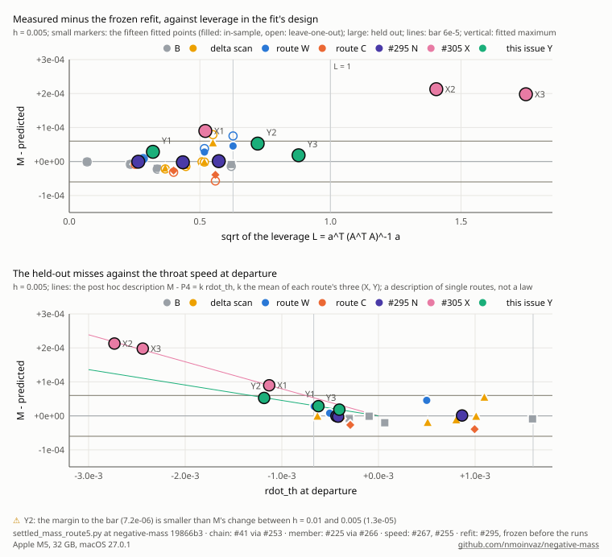

# Does the frozen settled-mass refit hold on a route of leverage 0.4 to 1.0? (#313)

Code: [settled_mass_route5.py](settled_mass_route5.py), a driver over #305's `settled_mass_route4.py`, #295's `settled_mass_route3.py` and #283's `settled_mass_route.py` (and through them #266's, #267's, #41's, #253's, #40's, #225's, #39's and #255's scripts), unchanged.
Output of record: [settled_mass_route5_output.txt](settled_mass_route5_output.txt) (`python3 settled_mass_route5.py analyze --raw=<negative-mass-raw>/I313-mac --rn=<negative-mass-raw>/I313-mac/runs_rn`, exit 1: 31 checks, 30 gating, **1 gating fail: FITQ**).
Post hoc reading of the nine held-out members: [settled_mass_route5_post.py](settled_mass_route5_post.py), [settled_mass_route5_post_output.txt](settled_mass_route5_post_output.txt). Raw output, with the choice rule, the bars, the planted cases and the mutations written before the runs of record:
negative-mass-raw `I313-mac` (README in stages 1, 1b, 2; `runs/`, `runs_rep/`, `runs_rn/`, `mut/`, `dev/`, `scripts/`). Status words as in AGENTS.md: every mass and member parameter below is *numerical evidence*; what is not shown is marked *conjecture*.
No sentence here says a result is new. Units: a = 1 is the throat radius of the initial static wormhole, 8πG = 1, D = 4, M = r/2 on the apparent horizon.

The figure is drawn by [settled_mass_route5_graph.py](settled_mass_route5_graph.py) from the raw folder named above.

## Answer

**Yes, at the declared bar, on this route, with no margin to spare at one point. The refit of y = M/r_th − M₀ = a γ₁ + b γ₁² + c ṙ_th frozen in #295, (a, b, c) = (0.2296318924, 0.2834170383, 0.7657657062), predicts the settled mass of all three members of a route of leverage 0.10, 0.52 and 0.77
to +2.9e-5, +5.3e-5 and +1.8e-5 (bar 6e-5).** The route is the Gaussian normal pulse of width 0.7 at centre 5.0, B tuned to γ₁ = 0.012, 0.048, 0.075. It was selected by the issue's rule, written before the scan: among candidates that stall at all three, every leverage at most 1.0 and the largest at least 0.43, the largest summed leverage.
The pass is at the bar, not well inside it: the margin at Y2 (7.2e-6) is smaller than the change of M between h = 0.01 and 0.005 (1.3e-5), though larger than the roundoff realization's (1.0e-6). All three misses are positive, as #305's.

**FITQ, #283's control that the member's static-profile fit describes the state at departure (rms of M(r) at most 1e-4), fails beside it at two points: 6.9e-5, 1.50e-4, 2.33e-4.** Y3 has the largest rms of the 25 stored members and a small miss (+1.8e-5) and a small speed (ṙ_th = −4.0e-4).
So a poor static fit does not by itself carry a miss, and #305's reading that the rms follows |ṙ_th| (+0.95 over its 22 members, reproduced here) falls to +0.67 over 25.
**Where the relation stops is not given by leverage.** #305's X1 has leverage 0.27 and misses by +9.0e-5; Y3 has leverage 0.77 and misses by +1.8e-5. Over the nine held-out members the miss is ordered better by |ṙ_th| (Spearman +0.78; +0.94 over the six of X and Y) than by leverage (+0.68; +0.54), and the constant of proportionality differs by route (below).

| acceptance (issue #313) | verdict | numbers |
|---|---|---|
| every new member within 6e-5 of the frozen fit, or the residuals reported with their leverage | **met** | M − P4 = +2.87e-05, +5.28e-05, +1.83e-05 at leverage 0.103, 0.521, 0.771 (Y1, Y2, Y3); the same fit without the speed misses by −3.5e-4, −9.9e-4, −1.1e-3; #267's P3 by +3.7e-5, +8.2e-5, +6.0e-5 |
| the static-member fit (FITQ, bar 1e-4) reported beside each residual | **reported; the bar is not met at Y2, Y3** | rms 6.86e-05, **1.50e-04, 2.33e-04** beside M − P4 +2.87e-05, +5.28e-05, +1.83e-05 |
| SEP against routes B, W, C, #295's (N) and #305's (X) | **met** | the larger of the r_th and ṙ_th separations is at least 2.6e3 times the point's own h difference for all 15 (point, route) pairs (bar 5) |
| the member at two h as in #283 | **met** | γ₁ 1.7e-5, 2.1e-5, 1.3e-5 relative (bar 1e-4); r_th ≤ 1.3e-6; ṙ_th ≤ 3.0e-7 (bar 2e-5) |
| reproduction of one stored #305 point bit for bit | **met** | X2 at h = 0.005 from its stored bracket: p*ₕ, the chain's series, the locus, the member rows (all but the wall time), M, γ₁, r_th, ṙ_th, t_dep identical |
| LEVB, my reading of the title's 0.4 to 1.0 (every leverage ≤ 1.0, the largest ≥ 0.40 at h = 0.005) | **met** | 0.103, 0.521, 0.771 (fitted maximum 0.3932, W3) |

Controls: 31 checks, 30 gating, 1 fails (FITQ); the post hoc P4 at h = 0.01 passes too (+2.9e-5, +5.7e-5, +1.9e-5). The eight planted cases pass and 35 of 35 mutations newly fire exactly their declared sets on the runs of record. FITQ is not changed: its bar is #283's.
The development set showed P4 passing and FITQ failing after the bars were committed (raw README stage 1, 6b3e0f6e; stage 2, d9fb2fc0); no bar moved. The runs of record equal the development set bit for bit.

## The route and the rule

The candidates were the sixteen Gaussian routes already tuned at h = 0.02 in #295 and #305 (stored, read, not rerun; no new candidate was tuned). Thirteen stall at all three targets; six have every leverage at most 1.0 and the largest at least 0.43:

| (x_c, w) | leverage at γ₁ = 0.012, 0.048, 0.075 (h = 0.02) | S = L₁ + L₂ + L₃ | counts |
|---|---|---|---|
| **(5.0, 0.7)** | 0.103, 0.521, 0.773 | **1.397** | yes, selected |
| (4.0, 1.0) | 0.109, 0.518, 0.714 | 1.341 | yes |
| (4.5, 0.7) | 0.086, 0.342, 0.514 | 0.942 | yes |
| (3.5, 1.0) | 0.092, 0.358, 0.490 | 0.941 | yes |
| (2.5, 0.25), (2.5, 0.35) | 0.051, 0.117, 0.497; 0.052, 0.114, 0.452 | 0.665; 0.618 | yes |

The runner-up's S is 0.056 lower, so the tie rule did not act. **I knew the selection in advance:** #305's note says that the stored table selects (5.0, 0.7); the raw README stage 1 says so before the scan, and fixes the candidate set (no new tuning) because a larger set would be a larger choice by me.
The retune of the selected route at h = 0.02 equals the stored tuning in every digit. The issue's rule has no condition on ṙ_th: of the three points ṙ_th is inside the fitted range [−6.7e-4, +1.6e-3] at Y1 and Y3 and outside at Y2 (−1.18e-3).

## The three members and the result (h = 0.005)

| point | B | p*ₕ | t_dep | γ₁ | r_th | ṙ_th | leverage | M | M − P4 | static-fit rms |
|---|---|---|---|---|---|---|---|---|---|---|
| Y1 | 0.0394 | 1.58911e-4 | 13.361 | 0.011968 | 0.999756 | −6.213e-4 | 0.103 | 0.225373 | **+2.87e-05** | 6.86e-05 |
| Y2 | 0.0768 | 6.25805e-4 | 13.609 | 0.047984 | 1.005090 | −1.183e-3 | 0.521 | 0.235094 | **+5.28e-05** | **1.50e-04** |
| Y3 | 0.09431 | 9.86270e-4 | 13.818 | 0.074387 | 1.015009 | −4.048e-4 | 0.771 | 0.245068 | **+1.83e-05** | **2.33e-04** |

- **Not an error of the chain.** The chain's checks, first law (RC4 to 1.1e-4), settlement (RC8), the stall (T gains 3.8 to 4.6 per side), the pair and the bit-for-bit reproduction of #305's X2 pass.
- **Roundoff and h.** The second realization (p*ₕ bisected from another bracket, the same to 5.0e-14): M changes by −5.7e-7, −9.8e-7, +1.3e-6 and M − P4 stays +2.81e-05, +5.18e-05, +1.96e-05. M at h = 0.01 against 0.005: 8.9e-6, 1.3e-5, 1.0e-5. The margin to the bar is 3.1e-5, **7.2e-6** and 4.2e-5: Y2's is 0.54 of its h change.
- **The refit's own errors.** In-sample up to 5.5e-5 and leave-one-out up to 7.9e-5 for the fifteen: the new misses are within them. Refitting over the fifteen and Y (post hoc; description) gives (0.2297, 0.2843, 0.7538), in-sample up to 6.1e-5; over all twenty-four (with #295's and #305's), (0.2292, 0.2980, 0.7157), in-sample up to 9.9e-5.
- **#283's description of P3's residual** (M − P3 = K (r_th − family B's), K = −3.365e-3, not refitted) gives −4.7e-6, −7.6e-6, +1.2e-6 against the observed +3.7e-5, +8.2e-5, +6.0e-5: it does not carry over, as in #305.

## What the nine held-out members say (post hoc; descriptions of nine points, not tests)

| route | members | leverage | ṙ_th | M − P4 | static-fit rms | (M − P4)/ṙ_th |
|---|---|---|---|---|---|---|
| N (#295) | N1–N3 | 0.07, 0.19, 0.33 | −4.3e-4, −4.2e-4, +8.6e-4 | −4.8e-7, −2.2e-6, +1.2e-6 | 5.6e-6, 3.0e-5, 4.6e-5 | +0.001, +0.005, +0.001 |
| Y (this issue) | Y1–Y3 | 0.10, 0.52, 0.77 | −6.2e-4, −1.18e-3, −4.0e-4 | +2.9e-5, +5.3e-5, +1.8e-5 | 6.9e-5, 1.50e-4, 2.33e-4 | −0.0462, −0.0446, −0.0453 |
| X (#305) | X1–X3 | 0.27, 1.98, 3.06 | −1.13e-3, −2.73e-3, −2.44e-3 | +9.0e-5, +2.13e-4, +1.98e-4 | 6.5e-5, 1.46e-4, 2.09e-4 | −0.0796, −0.0779, −0.0812 |

- **Leverage does not order the misses.** By leverage: N1 0.07 −5e-7, Y1 0.10 +2.9e-5, N2 0.19 −2e-6, X1 0.27 +9.0e-5, N3 0.33 +1e-6, Y2 0.52 +5.3e-5, Y3 0.77 +1.8e-5, X2 1.98 +2.1e-4, X3 3.06 +2.0e-4.
  Of the held-out members whose leverage is in [0.40, 1.0] (Y2, Y3) the largest miss is 5.3e-5; X1 at 0.27 misses by more. Spearman of |M − P4| with leverage is +0.68 over the nine and +0.54 over X and Y, with γ₁ −0.05.
- **The miss is proportional to ṙ_th on each of X and Y, with different constants.** (M − P4)/ṙ_th is −0.0796 on X (spread 4.1 %) and −0.0454 on Y (spread 3.4 %), Y's 0.57 of X's; #305's description with k from X predicts +4.9e-5, +9.4e-5, +3.2e-5 for Y against the observed +2.9e-5, +5.3e-5, +1.8e-5
  (better than no correction at all three, but too large by 1.7 to 1.8 times). Over the six of X and Y, |ṙ_th| orders |M − P4| with Spearman +0.94. On N the miss is 1e-6 to 2e-6 with ṙ_th of both signs. Equivalent statement: c_eff/c = 0.896 on X and 0.941 on Y, 1.00 on N. The constant is not one number across routes; what sets it is not found here.
- **The static fit's rms does not follow |ṙ_th| across routes.** At the same γ₁ the rms of X and Y agree to within 12 % (6.5e-5 and 6.9e-5, 1.46e-4 and 1.50e-4, 2.09e-4 and 2.33e-4) while their speeds differ by 1.8, 2.3 and 6.0 times; W, C and N have 3 to 20 times less at the same γ₁ (at most 5.9e-5).
  Over the 25 stored members the correlation of the rms with |ṙ_th| is +0.669, with |r_th − 1| +0.693, with γ₁ +0.537; over the 22 without Y it is +0.952, +0.795, +0.549 (#305's, reproduced).
- **|M − P4| / rms** (#305's M2 quantity): geometric means 0.055 on N, 0.226 on Y, 1.244 on X (Y over N 4.1, X over Y 5.5, X over N 22.7). A miss proportional to the misfit with one constant is not supported: Y3 has the worst static fit and a small miss.

So the placement of the miss on the form or on the member's reading, left open in #305, is still open; the new points rule out one simple version of the second (a miss proportional to the static fit's rms) and one simple version of the first (a failure that starts at a leverage threshold in this design).

## Error bars (kept separate, not mixed)

| kind | what | size | what it is |
|---|---|---|---|
| value | plateau mean over the last 1.0 of x⁺, h = 0.005, δ = 1e-8 | table above | |
| h | \|plat(0.01) − plat(0.005)\| | 8.9e-6, 1.3e-5, 1.0e-5 (RH, bar 5e-5) | difference between two resolutions of this code |
| roundoff realization | M at h = 0.005 from p*ₕ bisected along another path | ≤ 1.3e-6 | measured on these three points; larger than #305's (1e-7) |
| member, h | γ₁, r_th, ṙ_th between h = 0.01 and 0.005 | ≤ 2.1e-5, 1.3e-6 relative; 3.0e-7 absolute | two resolutions (HST) |
| member, definition | ε = 1e-3 against another ε | **not measured here** | #296 measured it for the earlier routes; the refit is for ε = 1e-3 |
| member, fit | rms of the static-member fit at departure | 6.9e-5, 1.5e-4, 2.3e-4 | the state is not an exact static member; does not track \|ṙ_th\| on this route |
| the refit | in-sample and leave-one-out errors of the fifteen | up to 5.5e-5 and 7.9e-5 | residual of a three-parameter form; the largest new miss is 5.3e-5 |

## Controls and mutations

31 checks (1 post hoc), 30 gating, 1 fails (FITQ). The runs of record equal the development set (`dev/set_a`) in every printed number (the analyses differ only in the path and the second-realization block). **On the runs of record 35 of 35 mutations newly fire exactly their declared set** (`mut/`; effects computed on the development set before being declared).
FITQ fails without a mutation, so no mutation can newly fire it: it shows that it can fail by failing on the data, and `fitq_scale` fires nothing for that reason. P4 passes here, so `coef_a`, `coef_c`, `no_rscale`, `eps_h`, `dep_eps`, `asym_sign`, `mass_exponent`, `no_settle`, `short_limit`, `no_run`, `w_scale` and `xc_offset` newly fire it. `normal_drop` fires nothing (RC4 cannot see the normal field, #283's blind spot)
and `lev_rdot` fires nothing (with ṙ_th set to 0 the leverages are 0.052, 0.118, 0.546, still in the band). New checks: LEVB fires under `lev_hi`, `lev_lo`, `eps_h`, `no_run`, `w_scale`, `xc_offset`; PBAND under `lev_hi`, `lev_lo`; SEPX under `sepx_self`, `sep_self`, `eps_h`, `no_run`, `asym_sign`, `w_scale`, `xc_offset`; REP5 under `rep_off`, `mass_exponent`, `no_settle`, `short_limit`, `w_scale`, `xc_offset`.
The planted cases: #295's six (the extraction, departure time, speed, refit, prediction and separation tests), #305's PLEV (the leverage function equals the hat-matrix diagonal and the SVD form) and PBAND (the band decision on five planted triples).

## What this says, and does not

- *Shown (numerical evidence):* at D = 4, δ = 1e-8, h = 0.005, the frozen three-parameter relation with (a, b, c) = (0.2296, 0.2834, 0.7658) predicts the settled mass of three members of a Gaussian route (x_c = 5.0, w = 0.7) to 5.3e-5 at the bar 6e-5, at leverage 0.10 to 0.77 (fitted maximum 0.39) and ṙ_th from −1.2e-3 to −4.0e-4
  (fitted range [−6.7e-4, +1.6e-3]). The margin at the middle point is smaller than the change of M with h. The speed is still needed: the fit without it misses by 3.5e-4 to 1.1e-3.
- *Shown:* the misses of the frozen refit are not ordered by leverage in its design across #295's, #305's and this route (X1, 0.27: +9.0e-5; Y3, 0.77: +1.8e-5).
- *Shown:* the static fit's rms at departure reaches 2.3e-4 at a point with ṙ_th = −4.0e-4 and a miss of 1.8e-5, so over 25 members it follows |ṙ_th| at +0.67, not +0.95.
- *Not shown:* where the relation fails; whether it holds on other routes at leverage 0.4 to 1.0 (one route, three points); why the constant in (M − P4)/ṙ_th differs between X and Y; whether the form or the member's reading carries the misses; other pulse kinds; the ghost pulse changed; δ ≠ 1e-8; D = 5, 6; h other than 0.005; any dependence on ε, the definition of departure (#296).
- Not a failure of the chain: the chain, its first law and its planted cases are #41's and pass at every point, and the reproduction of #305's X2 is exact.

## Stale or conflicting text found (for the coordinator; none was edited)

1. `settled_mass_route4.md` (#305), "What this says, and does not": "the rms follows |ṙ_th| (+0.95 over 22 members)" and the verdict-map reading "one coordinate with the speed": true over its 22, +0.67 over the 25 with Y. Its *Not shown* "where the relation starts to fail (leverage 0.4 to 1.0 is untested)" and recommended task 1: done here.
2. `critical_ghost.md` §1.3, "Update from #305": "following |ṙ_th|" (second bullet) and "suffice between the routes fitted (#295) and not far outside them (#305)" (third bullet): add this note's result; "not far outside them" is not given by leverage.
3. Paper V (`paper/5-ellis-threshold/main.tex`), the paragraph ending "… the three-parameter description holds between the routes fitted and not far outside them (`…/settled_mass_route4.md`)": add this note's result.
4. `settled_mass_route3.md`, "What this says, and does not", the *Tested outside the fitted data in #305* bullet: add this note's result.

## Proposed text (for the coordinator; none applied)

**`settled_mass_route3.md`**, after the *Tested outside the fitted data in #305* bullet: "*Tested at leverage 0.4 to 1.0 in #313* (`settled_mass_route5.md`): a route chosen by a rule declared first (normal pulse width 0.7, centre 5.0; leverage 0.10, 0.52, 0.77; ṙ_th −6.2e-4, −1.18e-3, −4.0e-4) is predicted by this refit to +2.9e-5, +5.3e-5, +1.8e-5, inside the bar 6e-5 (the margin at the middle point is below the change of M with h); the static-member fit has rms 6.9e-5, 1.5e-4, 2.3e-4 (bar 1e-4).
The misses of this refit are not ordered by leverage across the three routes (#305's point of leverage 0.27 misses by 9.0e-5)."

**`critical_ghost.md` §1.3**, after the "Update from #305" bullet:

> - *Update from #313* (`wormhole_evolution/settled_mass_route5.md`; *numerical evidence*):
>   - The frozen refit of #295 was tried on three members of a route of leverage 0.10, 0.52, 0.77 in its design (the normal pulse's width 0.7 at centre 5.0, γ₁ = 0.012, 0.048, 0.075; ṙ_th −6.2e-4, −1.18e-3, −4.0e-4). It predicts the settled mass to +2.9e-5, +5.3e-5, +1.8e-5, inside the declared bar 6e-5; the margin at the middle point is smaller than the change of M between h = 0.01 and 0.005.
>   - The member's static-profile fit has rms 6.9e-5, 1.5e-4, 2.3e-4 (bar 1e-4): the worst of 25 members is at a point with a small speed and a small miss, so the rms follows |ṙ_th| over #305's 22 members (+0.95) and not over the 25 (+0.67).
>   - The misses are not ordered by leverage across #295's, #305's and this route (leverage 0.27: +9.0e-5; 0.77: +1.8e-5); on #305's route and on this one (M − P4)/ṙ_th is −0.080 and −0.045. Where the relation stops, and whether the form or the reading carries the misses, is not found.

**Paper V**, after the sentence ending "… not far outside them (`…/settled_mass_route4.md`)", add:

> A route chosen instead for leverage between $0.4$ and $1.0$, the normal pulse of width $0.7$ at the centre $5.0$, has leverage $0.10$, $0.52$ and $0.77$, and the same fit predicts its settled mass to $2.9\times10^{-5}$, $5.3\times10^{-5}$ and $1.8\times10^{-5}$, inside the bar of $6\times10^{-5}$ but by less than the change of the mass between two resolutions at the middle point. The member's static-profile fit is again poor at two of the three points (rms $1.5\times10^{-4}$ and $2.3\times10^{-4}$, against $10^{-4}$),
> at the point whose misses are smallest in speed; and the misses are not ordered by leverage, since the first route's point of leverage $0.27$ misses by $9.0\times10^{-5}$ (\texttt{notes/wormhole\_evolution/settled\_mass\_route5.md}).

`paper_numbers.py` would check 2.87e-05, 5.28e-05, 1.83e-05, the three leverages and the three rms from `settled_mass_route5_output.txt`.

## Limits

- D = 4, δ = 1e-8, family G with its ghost pulse unchanged, one route (a Gaussian normal pulse, three points), h = 0.01 and 0.005; the member read at ε = 1e-3; the coefficients are for h = 0.005.
- The route was selected at h = 0.02 by the issue's rule from sixteen stored candidates; the selection was known to me before the rule was written (stated in the raw README). Its leverage at h = 0.005 (0.103, 0.521, 0.771) is as at h = 0.02 (0.103, 0.521, 0.773). The frozen refit was not evaluated at h = 0.02.
- The pass at Y2 is within the change of M with h; the continuum value of M − P4 at Y2 is not found here (the coefficients are fitted at h = 0.005).
- The post hoc descriptions (the per-route constants, the rank correlations, the refits) use nine or twenty-four points that include the ones described; they are descriptions, not tests. The settled mass is the plateau at e^{−f} = 1.57e6 on the apparent horizon (not the event horizon); the chain is #41's.

## Recommended tasks

1. *What sets the static fit's poor rms on routes X and Y.* What: on the stored runs, compare the static fit's rms at the slices around departure of X and Y with W, C, N (at the same γ₁ it is 3 to 20 times larger on X and Y) against the normal pulse's arrival (centre, width), the member's (γ₁, r_th) and the time since the pulse crossed the throat; no new run.
   Why: the rms is FITQ's quantity and it is the one control that fails on X and Y but not on the three earlier routes, and it no longer follows |ṙ_th|. Acceptance (can fail): a stated quantity predicts the rms of the 25 members to within a factor 1.5, fixed before it is evaluated on Y (leave Y out first), or the note says none was found. Dependencies: this note.
2. *A route to separate the constant in (M − P4)/ṙ_th from the route.* What: the stored candidate (5.0, 1.0) (h = 0.02 tuning B = 0.05128, 0.09842, 0.1202; ṙ_th −8.8e-4, −2.0e-3, −1.6e-3; leverage 0.17, 1.19, 1.85), the only stored candidate other than X with |ṙ_th| of 1e-3 or more at two targets,
   run as here, with the prediction M − P4 = k ṙ_th, k between X's and Y's constants (−0.0796, −0.0454), declared before any run. Why: the miss is proportional to ṙ_th on each of X and Y with different constants; a third route says whether k is a function of something measurable.
   Acceptance (can fail): (M − P4)/ṙ_th of every new point lies in [−0.085, −0.040], or the residuals are reported with the rms and the route's constant. Dependencies: this note.
3. *Re-read the speed and the member on the stored runs of X, Y and the fifteen by estimators that share nothing with `speed_at`* (#305's recommended task 2, still open): the constants of X and Y differ by 0.57, which a route-dependent reading error could also produce. Acceptance as #305's, with Y in the held-out set.
4. *Add Y1 to Y3 to #306's stored-point analysis*: the twenty-one points of #306 cannot be tested blind on these three any more; one line, stored runs only.

## Files

`settled_mass_route5.py` (commands `tag`, `bracket`, `pstar`, `job`, `member`, `planted`, `analyze`; `--mutate=`, `--baseline=`, `--rn=`), `settled_mass_route5_output.txt`, `settled_mass_route5_post.py`, `settled_mass_route5_post_output.txt`, `settled_mass_route5_graph.py`, `settled_mass_route5.svg`, this note;
raw `negative-mass-raw/I313-mac` (`README.md` in stages 1, 1b, 2: the choice rule, the bars, the scan, the route, the mutation table; `runs/<tag>/h<h>/{pstar,chain,member,logs}` the six runs of record, `runs_rep/` the X2 reproduction, `runs_rn/` the second realization, `mut/` the 35 mutated analyses of record,
`dev/` the scan (`devselect.1.log`), the retune (`logs/tune_*`), the planted cases (`planted_1.log`), the development set (`set_a/`), its analyses (`ana_dev1.log`, `ana_dev2.log`) and mutations (`mut_a/`), `scripts/`, `jobs_*.txt`, `analyze_record.log`, `post_hoc_1.log`, `post_hoc_2.log` (final) and the figure).
