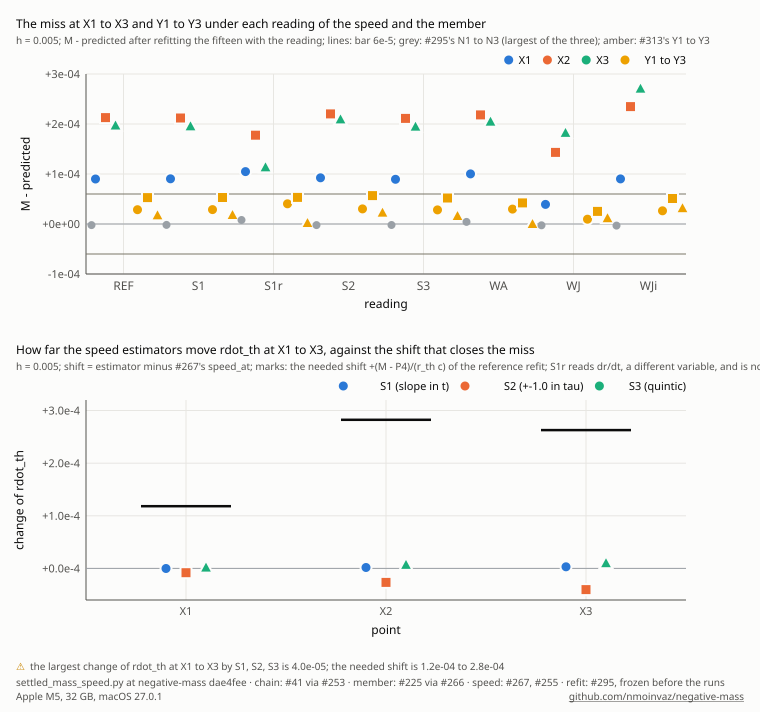

# Is #305's miss in the reading of the throat speed or of the member? (#314)

Code: [settled_mass_speed.py](settled_mass_speed.py), a driver over #305's `settled_mass_route4.py` (and through it #295's, #283's, #266's, #267's, #41's, #253's, #40's, #225's, #39's and #255's scripts), which it imports unchanged.
Its pair mean, departure time, speed estimators and member fits call none of `speed_at`, `pair_arrays`, `rdot_local`, `departure_time`. Stored runs only; nothing is evolved.
Output of record: [settled_mass_speed_output.txt](settled_mass_speed_output.txt) (`python3 settled_mass_speed.py analyze`, exit 1: 39 checks, 1 post hoc, **9 gating fail: PX_ρ for the eight readings, and REFX**; the held-out set is #295's N1 to N3, #305's X1 to X3 and, added in stage 3 of the raw README at the coordinator's request, #313's Y1 to Y3).
Post hoc description: [settled_mass_speed_post.py](settled_mass_speed_post.py), [settled_mass_speed_post_output.txt](settled_mass_speed_post_output.txt). Figure: [settled_mass_speed.svg](settled_mass_speed.svg), drawn by [settled_mass_speed_graph.py](settled_mass_speed_graph.py).
Raw output, with the readings, bars, planted cases and mutations written before X1 to X3 were read by any new estimator: negative-mass-raw `I314-mac` (README stages 1 to 3, `dev/`, `record/`, `scripts/`).
Status words as in AGENTS.md: every number is *numerical evidence*. No sentence here says a result is new. Units: a = 1 is the throat radius of the initial static wormhole, 8πG = 1, D = 4, h = 0.005, δ = 1e-8.

## Answer

**No, at the declared bar. Three estimators of ṙ_th that share nothing with `speed_at`, and three weightings of the member's fit, leave the miss of the frozen-form refit at X1 to X3 between +3.9e-5 and +2.7e-4 (bar 6e-5); only the joint fit WJ brings one point (X1) inside.**
The speed would have to be 10.3 to 10.8 % smaller in magnitude at X1 to X3 (a shift of +1.18e-4, +2.83e-4, +2.63e-4). The three estimators move it by at most 3.1e-6 (S1, 0.13 %), 4.0e-5 (S2, 1.65 %, in the wrong direction) and 1.1e-5 (S3, 0.45 %).
By the map declared before the record, each speed estimator returns "form (neither)". The member readings close +56 %, +33 %, +8 % of the miss at X1, X2, X3 at most (WJ) and widen it under WA and WJi.
N1 to N3 stay within 6e-5 under every reading (largest 8.0e-6), and so do #313's Y1 to Y3, added after the criteria: +9.5e-6 to +5.7e-5 (largest S2 at Y2, 95 % of the bar; WJ lowers the three to +9.5e-6, +2.5e-5, +1.3e-5). So the miss does not belong to how `speed_at` reads ṙ_th from the stored locus. It belongs to the form outside its data, or to a reading none of these touches (the definition of departure, the member's static-profile fit as a whole): which, the data still do not say.

Residuals M − predicted after refitting the fifteen with each reading (bar 6e-5):

| reading | X1 | X2 | X3 | Y1 | Y2 | Y3 | N1 to N3, largest | fifteen, in-sample / leave-one-out |
|---|---|---|---|---|---|---|---|---|
| REF (#295, #305, #313) | +9.00e-05 | +2.13e-04 | +1.98e-04 | +2.87e-05 | +5.28e-05 | +1.83e-05 | 2.2e-06 | 5.5e-05 / 7.9e-05 |
| S1 slope in t over ±0.5, ÷ lapse | +9.03e-05 | +2.12e-04 | +1.96e-04 | +2.88e-05 | +5.31e-05 | +1.89e-05 | 1.9e-06 | 5.5e-05 / 7.9e-05 |
| S1r dr/dt (another variable) | +1.05e-04 | +1.78e-04 | +1.14e-04 | +4.03e-05 | +5.31e-05 | +2.96e-06 | 8.0e-06 | 5.3e-05 / 7.6e-05 |
| S2 linear slope over ±1.0 in τ | +9.25e-05 | +2.20e-04 | +2.10e-04 | +3.03e-05 | +5.68e-05 | +2.35e-05 | 2.3e-06 | 5.9e-05 / 8.4e-05 |
| S3 quintic over τ_dep − 2.0 … + 0.5 | +8.93e-05 | +2.11e-04 | +1.96e-04 | +2.83e-05 | +5.19e-05 | +1.70e-05 | 2.1e-06 | 5.4e-05 / 7.7e-05 |
| WA s_th weights (r_th/r)² | +1.00e-04 | +2.18e-04 | +2.06e-04 | +2.98e-05 | +4.22e-05 | +1.00e-06 | 4.2e-06 | 5.4e-05 / 7.8e-05 |
| WJ (r_th, s_th) jointly, equal weights | **+3.92e-05** | +1.43e-04 | +1.83e-04 | +9.54e-06 | +2.51e-05 | +1.26e-05 | 2.6e-06 | 5.2e-05 / 7.8e-05 |
| WJi (r_th, s_th) jointly, weights (r_th/r)² | +9.02e-05 | +2.35e-04 | +2.72e-04 | +2.64e-05 | +5.11e-05 | +3.25e-05 | 3.3e-06 | 5.2e-05 / 7.5e-05 |

| acceptance (issue #314) | verdict | numbers |
|---|---|---|
| at least three estimators of ṙ_th sharing nothing with `speed_at`, and one other weighting of the member fit | **met** | S1, S1r, S2, S3 (S3 = the derivative of a fitted model of r(τ) over the stall); WA, WJ, WJi; planted-truth bars met (below) |
| X1 to X3 within 6e-5 under each estimator, or the residuals reported | **not met; residuals reported** | the table above: 0 of 8 readings within the bar at all three points; WJ at X1 only |
| N1 to N3 within 6e-5 under each | **met** | 8 of 8; largest 8.0e-06 (S1r at N1) |
| Y1 to Y3 (#313; added by the coordinator, declared in stage 3 before they were read) within 6e-5 under each | **met** | 8 of 8; largest +5.68e-05 (S2 at Y2); REFY passes (+2.87e-05, +5.28e-05, +1.83e-05) |
| each estimator recovers a planted ṙ_th through the same code path | **met** | max error S1 4.3e-06, S1r 4.1e-06, S2 1.9e-05, S3 9.0e-08 (bars 1e-5, 1e-5, 3e-5, 1e-5) on 18 planted cases with the measured noise 1.24e-9 |
| every check can fail (a mutation, its effect computed first) | **met** | 17 of 18 mutations of the record newly fire exactly their declared sets (computed on the dev partition before X1 to X3 and Y1 to Y3 were read); the 18th, `x_speed`, newly fires nothing as declared but its expectation is not met (below) |

Controls: 39 checks (1 post hoc), 9 gating fail. PX_REF fails as in #305 (it is #305's P4), the seven other PX_ρ fail for the reason of the table, and REFX fails because of a bar of mine that was too small (below). PY_ρ, REFY and every other check pass.

## What is read, and what the refit can see

Every reading acts on the pair's mean throat radius r(τ) of the stored runs A = p* ∓ 1e-8 (the mean cancels the unstable mode to first order) and is evaluated at the departure time of |odd|/r = 1e-3 (#266's definition, recomputed here; it agrees with #266's to 1.8e-6, the interpolation convention).

| reading | what | window / weights |
|---|---|---|
| S1 | dr/dt over t_dep ± 0.5 (least squares), divided by dτ/dt over the same window | ±0.5 in t |
| S1r | dr/dt alone: the variable changes, the refit has its own (a, b, c) | ±0.5 in t |
| S2 | linear slope of r against τ, twice #267's window | ±1.0 in τ |
| S3 | derivative at τ_dep of a quintic fitted to r(τ) | τ_dep − 2.0 … + 0.5 |
| WA | s_th of the static member from M₊ − M₋, weights (r_th/r)², r_th the locus's | r = 1.25 … 4 r_th |
| WJ, WJi | (r_th, s_th) jointly from M₊ and M₋, equal weights, weights (r_th/r)² | the same radii |

The reference (`speed_at`, `member_at`) fits s_th only, from M₊ − M₋ with equal weights, at the locus's r_th. A refit absorbs whatever is the same on every point: a scale of ṙ_th on all 24 points changes c by its inverse and moves no prediction.
Only a reading that differs between the fifteen and X moves X. The mutation `n_speed` (N's speeds × 1.3) fires every PN check; a uniform scale would fire none.

## The throat speed

The three estimators agree with `speed_at` and with each other to a small fraction of what would close the miss.

| | S1 − REF | S2 − REF | S3 − REF | needed |
|---|---|---|---|---|
| the fifteen, largest | 7.5e-07 | 1.4e-05 | 4.8e-06 | |
| N1, N2, N3, largest | 6.1e-08 | 1.3e-05 | 4.2e-06 | |
| Y1, Y2, Y3, largest | 2.0e-07 | 2.3e-05 | 7.2e-06 | (Y passes) |
| X1 | −1.2e-07 | −8.2e-06 | +2.5e-06 | +1.18e-04 (+10.5 % of \|ṙ_th\|) |
| X2 | +1.8e-06 | −2.7e-05 | +7.7e-06 | +2.83e-04 (+10.3 %) |
| X3 | +3.1e-06 | −4.0e-05 | +1.1e-05 | +2.63e-04 (+10.8 %) |

- **S2's shift at X is its own bias.** A local linear fit over ±w has the bias q w²/10 for r‴ = q, so S2 − REF is 3q/40 to leading order. The planted cases give S2 an error of 1.9e-05 at the steepest of the 18 points (W3, where S2 − REF is −1.4e-05) and 3.8e-05 at twice their curvature; S2 − REF is −2.7e-05 and −4.0e-05 at X2 and X3, so r‴ there is roughly 2 to 3 times W3's (inferred from the ratios; the curvature is not printed). S3, a quintic with no such bias, is 3 to 4 times closer to REF than S2 is. S2 is not the better reading at X; its error grows there.
- **S1 shares REF's window bias** (a linear fit of the same half-width), so its agreement with REF tests the variable and the code, not the bias. S3 and S2 test the bias: S3 differs from REF by at most 0.45 %.
- **Verdict map** (declared in README stage 1, from #305's task 2): S1 (D15 0.10 % of the fifteen's rms speed, DX 0.01, 0.07, 0.13 %), S2 (1.93 %; 0.73, 0.97, 1.65 %), S3 (0.64 %; 0.22, 0.28, 0.45 %): X is not within the bar and DX is far below 10 %, so each is "form (neither)"; S1r reads another variable (D15 9.1 %, DX 1.1, 4.2, 6.4 %), also "form (neither)".
- **The speed is not the weak link.** Varying the window (±0.5 in t, ±1.0 in τ), the variable (t, τ) and the model (linear, quintic) moves ṙ_th at X1 to X3 by at most 1.65 % (S2, by its bias) and by 0.45 % where the window bias is absent (S3), against 10.3 to 10.8 %.

## The member

WA changes only the weights; WJ and WJi also free r_th. The member moves by:

| | γ₁ shift (WA, WJ, WJi) | r_th shift (WJ, WJi) |
|---|---|---|
| the fifteen, largest | 9.2e-05, 1.6e-04, 1.6e-04 | +1.8e-04, 4.5e-05 |
| X1 | +2.2e-05, −3.5e-05, −2e-07 | +2.9e-04, +1.8e-05 |
| X2 | +1.3e-04, −4.0e-04, −1.3e-04 | +7.9e-04, +1.1e-05 |
| X3 | +1.0e-04, −7.9e-04, −4.1e-04 | +9.8e-04, −1.4e-05 |
| Y1 | +3.1e-05, −1.5e-05, +2.1e-05 | +1.2e-04, +2.9e-06 |
| Y2 | +1.1e-04, −1.9e-04, −2.1e-05 | +3.7e-04, −1.4e-05 |
| Y3 | +9.1e-05, −4.0e-04, −1.8e-04 | +5.0e-04, −3.3e-05 |

- **The member at X is read less firmly than anywhere in the fitted data:** at X3 the joint fit moves r_th by 5.5 times the largest shift in the fifteen (+9.8e-04 against +1.8e-04) and γ₁ by 5 times (−7.9e-04 against −1.6e-04). The static-profile fit is poor there (#305's FITQ), and its readings depend on how it is weighted.
- **The prediction is much less sensitive than the member.** r_th and γ₁ move in the direction that leaves r_th(M₀ + y) nearly unchanged: their effects on the prediction at the frozen P4 have opposite signs ([settled_mass_speed_post_output.txt](settled_mass_speed_post_output.txt), post hoc). Under WJ at X1, X2, X3 the r_th part is +6.5e-05, +1.84e-04, +2.35e-04 and the γ₁ part −8.1e-06, −1.00e-04, −2.10e-04, a total of +5.7e-05, +8.4e-05, +2.5e-05; at the fifteen the total is at most +1.0e-05 and at Y1, Y2, Y3 +2.4e-05, +3.8e-05, +1.1e-05.
- **No weighting closes the miss.** WJ closes +56 %, +33 %, +8 % at X1, X2, X3 (X1 inside the bar); WA widens it by 11, 2.5, 3.9 %; WJi widens it by 0.2, 10, 37 %. The refit's own error on the fifteen does not improve under any reading (in-sample 5.2e-05 to 5.9e-05 against 5.5e-05).
- **At Y, where the reference passes, WJ lowers the residual too** (+2.87e-05, +5.28e-05, +1.83e-05 to +9.5e-06, +2.5e-05, +1.3e-05: 67, 52, 31 %), so it lowers it at all six held-out points of X and Y (8 to 67 %) with no worse error on the fifteen (5.2e-05 / 7.8e-05 against 5.5e-05 / 7.9e-05). Y was added after WJ was declared, so that is a blind result for WJ, small against the bar at Y; at N all readings are at the noise (≤ 8e-06). WJi widens Y3 (+1.83e-05 to +3.25e-05) and WA lowers it (+1.0e-06).

## Where the miss belongs, after this

- The speed estimator is excluded as the cause, within what the three estimators and the stored locus can show: ṙ_th at X is 10 % smaller than `speed_at` by none of them. They share the locus, τ, and the definition of departure (ε = 1e-3), not tested here.
- The member's weighting is not excluded as a contributor (its reading at X moves by up to 1e-3 and one weighting closes a third to a half at two points) and is not sufficient (no weighting closes X2 or X3).
- The readings do not move a route to the other side of the bar: Y (leverage 0.10 to 0.77; ṙ_th −6.2e-4, −1.18e-3, −4.0e-4) is within it under all eight, X (leverage up to 3.06; ṙ_th −1.1e-3, −2.7e-3, −2.4e-3) outside under all eight.
- What remains: the form outside its data (leverage up to 3.06), or a reading none of these varies. The definition of departure moves ṙ_th at X by 6 %, 40 %, 73 % between ε = 1e-3 and 1e-2 (#305), far more than any estimator here: it is the reading that can matter at the size of the miss (#296 refit at ε = 1e-2 and tested #283's six and #295's three, not X).

## Error bars and defects (kept separate)

| kind | what | size |
|---|---|---|
| estimator, planted | recovered ṙ_th against truth, 18 planted cases (each point's own model, noise 1.24e-9) | S1 4.3e-06, S1r 4.1e-06, S2 1.9e-05, S3 9.0e-08 |
| departure time | recomputed against #266's (ln-linear against linear interpolation) | 1.8e-06 in t |
| `speed_at` re-implemented | my local linear fit over ±0.5 at t_dep against `speed_at` (SPD0) | 1.2e-06 |
| the refit | in-sample and leave-one-out errors of the fifteen | 5.0e-05 to 5.9e-05 and 7.5e-05 to 8.4e-05 under the readings |

Defects, all mine, none changing a declared criterion (record 3 adds Y1 to Y3 by the amendment of stage 3; N and X residuals are identical to record 2's): **REFX** (the reference's residuals at X equal #305's printed values to 6e-8) fails as declared, because 6e-8 is below half a unit of the printed last digit of +2.13e-04 and +1.98e-04 (5e-7): the post hoc REFX-ph with half a unit of each printed digit passes (differences ≤ 2.0e-07). The first print of the needed shift had the wrong sign (record 1,
`I314-mac/record/analyze_record.1.log`; fixed in record 2; record 3, with Y1 to Y3, is the output of record). The DEP bar was first 1e-6 and the interpolation convention shows 1.8e-6 (changed in development, before the README). A cache key of the member fits collided across points in the first development run (fixed before any log counted). The post hoc REFX-ph was missing from the list of X-checks that the mutation runs print apart, so four mutations of record 2 (`coef_c`, `drop_pt`, `m0_shift`, `x_speed`) read DIFFERENT for that reason; the list was completed in record 3 (the record 2 logs are kept in `record/mut/`).
REF's own PN and PX are #295's and #305's results, reproduced (FRZ 3.4e-11, REFN to 1e-8).

## Controls and mutations

39 checks at the record: 38 gating and one post hoc (REFX-ph). 9 gating fail (PX_ρ, REFX); the other 29 pass, with the planted cases, `SPD0` (1.2e-06), `DEP` (1.8e-06) and `PAIR` (0) among them. Mutations: 18, effects of 17 computed on the dev partition (`I314-mac/dev/mut/`, all 17 matched their declared sets there) before X1 to X3 and Y1 to Y3 were read by any new reading; the record's are in `record/mut_3/` (record 2's, with the missing REFX-ph entry in the list of X-checks, in `record/mut/`).

| mutation | what it breaks | newly fires (declared, matched on the record) | X- and Y-checks that also fire (not declared) |
|---|---|---|---|
| `s1_win` | S1's window ±1.0 in t (S1r shares it) | PSPD_S1, PSPD_S1r | |
| `s1_nolapse`, `s1_lapse_inv` | S1 without, or with the inverted, lapse factor | PSPD_S1 | |
| `s1r_tau` | S1r read against τ | PSPD_S1r | |
| `s2_win3` | S2's window ±3.0 | PSPD_S2 | PY_S2 |
| `s3_deg2` | S3 a quadratic | PSPD_S3 | |
| `spd0_win`, `tau_unit` | SPD0's window ±1.0; τ × √2 | SPD0; PAIR, SPD0 | |
| `dep_eps` | departure criterion 1e-2 | DEP, SPD0, PN_S1, PN_S1r, PN_S2, PN_S3, PSPD_S1, PSPD_S1r, PSPD_S2 | PY_S1, PY_S1r, PY_S2, PY_S3 |
| `m0_shift`, `drop_pt` | M₀ = 0.223095; e12 dropped | FRZ, REFN, PPRED; FRZ, REFN | REFX-ph, REFY |
| `coef_c` | predictions with c × 0.8 | the eight PN_ρ, REFN, PPRED | the eight PY_ρ, REFY, REFX-ph |
| `n_speed`, `n_g1` | N1 to N3's speeds × 1.3; γ₁ × 1.05 | the eight PN_ρ, REFN | |
| `wa_outer`, `wj_swap`, `memref_w` | wrong weights or swapped sides in the member fits | PMEM; PMEM; MEMREF, PMEM | PY_WA (`wa_outer`) |
| `x_speed` | X1 to X3's speeds × 0.895 (#305's c_eff / c) | nothing, as declared | REFX-ph |

`PX_ρ` and `REFX` fail without a mutation, so none can newly fire them. **`x_speed`'s expectation was that every PX_ρ failing in the baseline would pass; it is not met.** With the speeds of X1 to X3 read 10.5 % smaller, PX_REF, PX_S1, PX_S2, PX_S3 and PX_WA pass (largest residual 1.5e-05, S2 at X3; REF −3.1e-07, −3.4e-06, +5.0e-06), which says the pipeline responds to exactly the hypothesised error and the speed estimators do not contain it;
PX_S1r (X3 −7.1e-05), PX_WJ (X1 −5.1e-05, X2 −7.4e-05) and PX_WJi (X3 +7.8e-05) stay out of the bar, because their coefficients and members differ and the factor 0.895 was derived for REF. The MATCH logic of the script also could not be met: it required REFX, which compares with printed values, to flip.

## What this says, and does not

- *Shown (numerical evidence):* at D = 4, δ = 1e-8, h = 0.005, three estimators of ṙ_th at departure that call nothing of `speed_at` (a slope in coordinate time over ±0.5 divided by the lapse, a fit twice as wide, a quintic over 2.5 in τ) agree with it to 0.13 %, 1.65 % and 0.45 % at X1 to X3, against the 10.3 to 10.8 % that would close #305's miss. A refit over the fifteen with any of them predicts N1 to N3 to 2.3e-06 and X1 to X3 to between +8.9e-05 and +2.1e-04.
- *Shown:* three weightings of the member's static fit move γ₁ and r_th at X by up to 8e-04 and 1.0e-03 and close at most a half of the miss at one point (WJ at X1) and a third at the next.
- *Shown:* #313's Y1 to Y3, a route at leverage 0.10 to 0.77, are within 6e-5 under all eight readings (largest +5.7e-05, S2 at Y2), so no reading here changes #313's pass.
- *Not shown:* where the miss belongs. The form outside its data and a reading not varied here are both open. Not varied: the definition of departure (ε), τ, the locus's own throat radius, the pair mean's second-order part of the unstable mode (#296: r_th − 1 = −1.4 ε² at B = 0), the weighting by radius beyond the three. Not tested: other routes, other pulse kinds, D = 5, 6, h other than 0.005.

## Stale or conflicting text found (for the coordinator; none was edited)

1. `settled_mass_route4.md`, "Where the miss belongs" ("Neither is decided" after the speed paragraph) and "Not shown" ("whether the miss belongs to the form or to the member's reading"): add this note's result. Recommended task 2 ("Re-read the throat's speed and the member …"): done here.
2. `critical_ghost.md` §1.3, the "Update from #305" last bullet: "The data do not say whether the miss belongs to the form or to the reading of the member": add this note's result.
3. Paper V (`paper/5-ellis-threshold/main.tex`), the paragraph ending "… (`…/settled_mass_route4.md`)": the sentence "The data do not say whether the miss belongs to the form or to the reading of the member" needs this note's result.

## Proposed text (for the coordinator; none applied)

**`settled_mass_route4.md`**, at the end of "Where the miss belongs": "*Tested in #314* (`settled_mass_speed.md`): the speed read by a slope in coordinate time, by a fit twice as wide and by a quintic over the late stall moves ṙ_th at X1 to X3 by at most 0.13 %, 1.65 % and 0.45 %, against the 10.3 to 10.8 % that would close the miss; the refit with each leaves X1 to X3 at +8.9e-05 to +2.1e-04. Three weightings of the member's fit move γ₁ and r_th at X by up to 8e-04 and 1.0e-03 and close at most +56 %, +33 %, +8 % of the miss. The speed estimator is not the cause; whether the form outside its data or a reading not varied (the definition of departure) is, remains open." Recommended task 2: "done in #314".

**`critical_ghost.md` §1.3**, after the "Update from #305" bullet:

> - *Update from #314* (`wormhole_evolution/settled_mass_speed.md`; *numerical evidence*):
>   - The throat speed at departure, read by three estimators that share nothing with `speed_at`, differs from it by at most 0.13 %, 1.65 % and 0.45 % at X1 to X3, where 10.3 to 10.8 % would close #305's miss. Refitting the fifteen with each leaves X1 to X3 at +8.9e-5 to +2.1e-4 (bar 6e-5); #295's N1 to N3 stay within 8e-6.
>   - Three weightings of the member's static fit move γ₁ and r_th at X1 to X3 by up to 8e-4 and 1.0e-3 and close at most 56 %, 33 % and 8 % of the miss. #313's Y1 to Y3 stay within the bar under all eight readings (largest +5.7e-5). So the speed estimator is excluded as the cause; the form outside its data, or the definition of departure, is not.

**Paper V**, in the paragraph after the route of width $1.5$ at centre $4.0$, replace "The data do not say whether the miss belongs to the form or to the reading of the member" by:

> Reading the throat speed three other ways moves it by at most $1.7\%$ at those points, where $10.5\%$ would close the miss, and weighting the member's fit three other ways closes at most half of it at one point; the miss does not belong to how the speed is read, and the data do not say whether it belongs to the form or to the definition of departure (\texttt{notes/wormhole\_evolution/settled\_mass\_speed.md}).

`paper_numbers.py` would check the four estimators' shifts at X1 to X3, the eight readings' residuals and the three member shifts from `settled_mass_speed_output.txt`.

## Limits

- D = 4, δ = 1e-8, family G with its ghost pulse unchanged, the 21 stored points at h = 0.005; the departure at ε = 1e-3; the coefficients are those of h = 0.005 with M₀ = 0.223086.
- The estimators read one locus: S1, S2, S3 are three windows and models of the same stored r(τ) and τ; they cannot show an error of the locus itself (its throat radius is the parabolic minimum on the stored slices).
- The member readings are three weightings of one static member and its stored profile samples (four or five radii per slice, slices 0.5 apart in t); a reading from other quantities is not tried.
- S2 at X has its own window bias (above). The four PSPD bars (1e-5, 1e-5, 3e-5, 1e-5) were written before the first development run; S2 at twice the curvature (3.8e-5) exceeds its bar, is reported and gates nothing.
- X1 to X3 were read by the reference (`speed_at`, `member_at`) in #305; the numbers of #305 were known when the README was written, and the README says what I expected: every reading near +9e-5 to +2e-4. The speed readings and WA, WJi did; WJ at X1 (+3.9e-5) did not.

## Recommended tasks

1. *Read the fifteen, N and X at other departure definitions, refit at each.* What: at ε = 3e-4, 1e-3, 3e-3 (and 1e-2 for X, which #296 did not read), the fifteen's (γ₁, r_th, ṙ_th) from the stored rows with `member_at` and `speed_at`; refit; predict N1 to N3 and X1 to X3; also with the second-order part of the unstable mode (−1.4 ε² in r_th, −3.2 ε² in ṙ_th at B = 0, #296) subtracted. Why: ṙ_th at X changes by 6 %, 40 %, 73 % between ε = 1e-3 and 1e-2 (#305), by far more than the estimators here, and the miss is 10.5 %: ε is the reading that can matter. Acceptance (can fail): X1 to X3 within 6e-5 at some ε at which N1 to N3 stay within 6e-5 and the fifteen's in-sample error stays at most 6e-5, or the residuals reported against ε. Stored runs only. Depends on: this note, #296.

## Files

`settled_mass_speed.py` (commands `analyze [--part=dev] [--mutate=NAME] [--baseline=FILE]`, `planted`), `settled_mass_speed_output.txt`, `settled_mass_speed_post.py`, `settled_mass_speed_post_output.txt`, `settled_mass_speed_graph.py`, `settled_mass_speed.svg`, this note;
raw `negative-mass-raw/I314-mac` (`README.md`: stage 1 the readings, bars, planted cases, 18 mutations with their development effects; stage 2 the record; `dev/` the development logs and mutations on the dev partition; `record/analyze_record.3.log` (final, with Y1 to Y3), `.log` (record 2) and `.1.log` (record 1), `record/mut/` (record 2's) and `record/mut_3/` (the output of record's) 18 mutated records; `scripts/run_muts.sh`).

## Coordinator's review

Merged at 77befa8. Review folder `negative-mass-raw/I314-mac-review` at 581e7ec9. The changed files are those the brief names, plus a
post hoc script and its output.

- **Rerun on the Mac**: `analyze` equals `settled_mass_speed_output.txt` apart from the header (exit 1, as stored).
- **Independent reading**: the coordinator's `I305-mac-review/ind305.py` reads ṙ_th by a quadratic fit in τ, an estimator this note
  does not use, and found the same miss at X1–X3. With this note's readings that is eight that leave X2 and X3 beyond the bar.
- REFX's declared bar (6e-8) was smaller than the printed digits of #305's residuals allow; it fails as declared and passes post hoc at
  half a unit of the last digit, as the note says. 17 of 18 record mutations match.
- Applied: `critical_ghost.md` §1.3, `settled_mass_route4.md`, and Paper V (`paper_numbers.py` 273 of 273; my first wording claimed all
  three points stayed beyond the bar, which WJ's X1 = 3.9e-5 contradicts, and gave 1.43e-4 for the smallest X2/X3 miss where the
  output has 1.14e-4; both were corrected before the commit).
