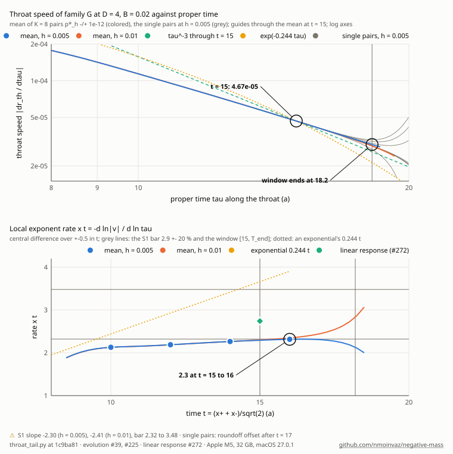

# The power-law tail of family G's throat speed at D = 4, B = 0.02 in the nonlinear data (#291)

Driver: [throat_tail.py](throat_tail.py), a thin driver that imports #266's `settled_mass_b.py` (and through it #41's `settled_mass.py`, #253's `settled_mass_g.py`,
#40's `threshold.py`, #225's `throat_locus.py`, #39's `dn.py`) and #255's `throat_drift.py` unchanged. Output of record: [throat_tail_output.txt](throat_tail_output.txt)
(`python3 throat_tail.py analyze --raw=<negative-mass-raw>/I291-mac`, exit 1: one gating check fails, S1 at h = 0.005, below). Raw output, with the criteria written before
the runs of record: negative-mass-raw `I291-mac` (README with the criteria, the planted cases and the mutations; `runs/`, `runs_k1` … `runs_k7`, `mut/`, `dev/`, `scripts/`).
Status words as in AGENTS.md: every number is *numerical evidence*. No sentence here says a result is new. Units: a = 1 is the throat radius of the initial static wormhole,
8πG = 1, D = 4, t = (x⁺ + x⁻)/√2, τ the proper time of the throat locus (τ = t − 0.01 here).

The figure is drawn by [throat_tail_graph.py](throat_tail_graph.py) from the raw folder named above.

## Answer

**The throat's speed falls as a power law whose local exponent rate × t is 2.13 at t = 10 and 2.29 to 2.30 at t = 15, rising slowly. It is not an exponential
(its rate falls from 0.21 at t = 10 to 0.14 at t = 17) and it is not the linear response's 2.74 at t = 15.** The slope over the window [15, 18.2] is −2.41 at h = 0.01 and
−2.30 at h = 0.005, against the bar 2.32 (20 % of 2.9): S1 is met at one h and not met at the other, by 0.016. The window ends at t = 18.2, not 25: after t ≈ 17 the
pair's mean carries the roundoff offset of p*ₕ, a first-order multiple of the unstable mode that no choice of δ removes. No drift dominates before t = 15.

| acceptance (issue #291) | verdict | numbers |
|---|---|---|
| S1: the log-log slope of \|v\| over t ∈ [15, 25] within 20 % of −2.9 | window [15, 18.2]; **met at h = 0.01, not met at h = 0.005** | −2.413 and −2.304 (the mean of 8 pairs); \|p − 2.9\| = 0.487 and 0.596 against 0.580. Over [15, 16], where the contamination is below 0.1 %: −2.321, −2.306 (0.579, 0.594). Spread of the slope: realization ±0.03 and ±0.08 (standard error of the mean), fit choices 2.26 to 2.41 |
| S2: rate × t against an exponential's, which grows as t | **met** on [10, 16] (not evaluable at t = 20, 25) | rate × t = 2.106, 2.229, 2.326 (h = 0.01) and 2.112, 2.228, 2.321 (h = 0.005) at t = 10, 13, 16: spread 9.9 % and 9.4 % of the mean, against 46.2 % for a constant rate (bar 23.1 %) |
| S3: the two h agree on the slope within 10 % | **met** | −2.413 and −2.304: 4.6 %. The difference is the realization, not the truncation (below) |
| the drift, if it dominates before t = 15 | **does not** | v < 0 and \|v\| falls at every t ∈ [12, 18.2] at both h. A constant +3.3e-6 to +1.1e-5 fits (post hoc, not stable); #255's B^3.16 scaling gives +7.8e-6 |

25 checks, 24 pass, 1 fails (S1 at h = 0.005). The planted t⁻³, t^−2.3 and exponential cases pass (PL1 to PL5), and 13 of 13 mutations fire exactly their declared set.
S1 is on the bar's edge and the verdict follows the realization and the window: it is reported as it came out, not moved.

## What was run

- Family G of #40 at D = 4 with the normal amplitude B = 0.02 (the ghost pulse A tuned, the normal pulse on the same ray), h = 0.01 and 0.005 (gating), 0.02 (post hoc).
- p*ₕ by bisection to hi − lo ≤ 1e-14 (#266's `pstar`, 43 runs; 4 to 5 s, 15 to 18 s, 53 to 63 s at h = 0.02, 0.01, 0.005): 6.5839623e-4, 5.8719937e-4, 5.6939539e-4 at h = 0.02, 0.01, 0.005, second order
  (observed order 2.00, ORD-p). Then the pair p*ₕ ∓ 1e-12 through `throat_locus.sweep` (#266's `member` command with the exponent 12): collapse on the − side, expansion on the + side,
  profile slices every 0.5 in t, the member fitted on each; 7 to 9 s, 10 to 11 s, 19 to 21 s per pair.
- **An ensemble**: eight independent bisections per h (eight different brackets, member 0 being the task's), each with its own pair. 48 jobs of record on two lanes, nice 10, one
  thread each, all exit 0 in 9 min; the runs of record equal the development runs bit for bit (`scripts/repro.sh`, 72 files, 0 different apart from wall-clock seconds).
- The throat speed v = dr_th/dτ of the mean r_th(τ) of the pair, by #255's local linear fit over ±0.5 in τ; the series of record is the mean over the eight pairs.

## The speed and its exponent

h = 0.005, mean series; the local exponent is the central difference of ln\|v\| against ln τ over ±0.5 in t, at the three h (they agree to 1e-3 up to t = 14, the second-order
truncation, and differ beyond t = 15 by the realization).

| t | v | rate × t, h = 0.02 / 0.01 / 0.005 | rate = (rate × t)/t | #272's linear response |
|---|---|---|---|---|
| 8 | −1.776e-4 | 1.703 / 1.709 / 1.711 | 0.214 | 2.26 |
| 10 | −1.141e-4 | 2.120 / 2.127 / 2.129 | 0.213 | 2.45 |
| 12 | −7.70e-5 | 2.181 / 2.187 / 2.188 | 0.182 | 2.59 |
| 14 | −5.47e-5 | 2.252 / 2.263 / 2.263 | 0.162 | |
| 15 | −4.67e-5 | 2.285 / 2.301 / 2.293 | 0.153 | 2.74 |
| 16 | −4.02e-5 | 2.300 / 2.347 / 2.315 | 0.145 | |
| 17 | −3.50e-5 | 2.262 / 2.443 / 2.308 | 0.136 | |

(The linear response's column is #272's rate times t at t = 8 … 15: 0.283, 0.245, 0.216, 0.182; 2.89 at t = 20 and 2.97 at t = 25. Beyond t = 16 the three h disagree because of the
offset, not the evolution.)

- **A power law, not an exponential.** The rate −d ln\|v\|/dt falls by 36 % from t = 10 to 17; a constant rate (κ = 0.244, or any) would not. rate × t grows from 2.11 to 2.33
  between t = 10 and 16 (10 % of the mean), against 46 % for a constant rate (S2); the planted exponential fails the same test in all 200 draws and the planted t⁻³ passes in all 200
  (PL3, PL4). The local rate near t = 8 to 10 is 0.21, the order of #255's κ = 0.244 (fitted at B = 0.1 on [6.5, 12]): κ is the local rate of a falling power law, not a mode, as #272 found for
  the linear response.
- **The exponent is 2.3 at t = 15, not 2.7 to 3.0.** The nonlinear data follow the linear response's shape (rate × t rising slowly) about 0.4 lower (2.13 against 2.45 at t = 10,
  2.29 against 2.74 at t = 15). Whether it reaches 2.9 at t = 25 is not measured: the data end at t = 18.2. The source's finite duration and its second-order content differ from
  #272's Gaussian kick (its own limit); nothing here separates them.
- **The slope's verdict.** The line fit over [15, T_end] gives 2.304 and 2.413; the bar's edge is 2.32. A window ending at 16 gives 2.306 and 2.321, at 17 gives 2.313 and 2.349
  (the sensitivity table in the output: 2.26 to 2.41 over windows starting at 12 … 15 and ending at 16 … 18.2). The two h are 17 % and 21 % below 2.9, give or take the realization.

## What limits the window: the roundoff offset of p*ₕ

The odd part of the pair reaches 3e-4 of r_th at t = 20.06 to 20.09, as the issue assumes, but the speed of a pair is wrong long before that.

- A pair's mean is r_c + ε Q(t), with Q = odd/δ ∝ e^{1.18 t} the unstable mode's profile and ε the offset of p*ₕ from the true threshold. The pairs of one h differ from their mean by
  (v_k − v̄)/(λ odd_k/δ) = ε_k − ε̄, **constant in t**: the spread over t of one member is 0.001e-14 to 0.011e-14 between t = 12 and 18 (output, "offsets"). So the contamination is
  exactly the unstable mode times a constant, first order, and it is the same at every δ: the pairs at e = 10 and 11 of one bisection differ from the e = 12 pair by −1.4, −3.0 (h = 0.02), −3.0, −6.3
  (0.01), +0.6, +1.6 (0.005) in units of 1e-14, constant in t (e = 11 to t = 16; e = 10 to t = 12, then its δ² term takes over).
- ε is random: 0.82e-14, 1.74e-14, 4.49e-14 (standard deviation over the eight members at h = 0.02, 0.01, 0.005, rising with the number of steps). λ Q ε is 0.1 % of \|v\| at
  t = 16, 1 to 2 % at 17 to 18 and 40 to 70 % at 20, and 1 % of it moves the local exponent by about 0.2 at t = 18 (the derivative of an exponential).
- The window [15, T_end] therefore ends where the standard error of the mean of v over the eight members reaches 2 % of \|v\|: 18.9 (h = 0.01), 18.2 (h = 0.005), common 18.2.
  The single pairs give slopes 2.25 to 2.50 (h = 0.01, mean 2.414, standard deviation 0.091) and 1.94 to 2.67 (h = 0.005, mean 2.308, standard deviation 0.229): the task's own pair
  (member 0) gives −2.36 and −2.07, passing S1 at h = 0.01 and failing it by 0.25 at h = 0.005. This is why the series of record is the mean.
- Planted truth (PL1, PL2, PL5): a t⁻³ speed with the measured noise of r_th and eight pairs with offsets of the measured spread (3.4e-14) is recovered to 0.25 in 97 % of 200 draws
  (5 to 95 %: 2.88 to 3.14), t^−2.3 in 100 % (2.15 to 2.43), and t⁻³ with offsets three times larger in 92 %. The rate × t spread on [15, T_end] itself does not separate a power law
  from an exponential (planted t⁻³: median 0.081, 95 % 0.229; exponential: 0.179), so S2 is evaluated on [10, 16] (declared).

## Kinds of error bar, kept apart

| kind | size | what it is |
|---|---|---|
| realization (roundoff offset of p*ₕ and of each pair) | slope of a single pair ±0.09 (h = 0.01), ±0.23 (h = 0.005); of the mean of eight ±0.03, ±0.08 | the standard deviation over eight independent bisections, and its standard error |
| truncation | v at t = 10, 12: orders 1.96, 1.97 over the three h, h = 0.01 against 0.005 within 1e-3; the slope 0.109 between the two h is realization | second order in h (ORD-p, ORD-v10, ORD-v12) |
| fit choices | 2.26 to 2.41 | windows [12 … 15, 16 … 18.2] and ln t against ln τ (the regressors differ by 0.001) |
| not an error bar | S1's bar, 0.58 | the issue's 20 % of 2.9 |

## The tail plus a constant (post hoc, gates nothing)

v = −A τ^−p + b over [t_start, 18.2] for t_start = 8, 10, 12 gives p = 1.90, 1.99, 1.98 and b = +1.09e-5, +7.4e-6, +7.9e-6 (h = 0.01), p = 1.92, 2.05, 2.13 and b = +9.7e-6,
+5.3e-6, +3.3e-6 (h = 0.005); without b, p = 2.15 to 2.29. The constant is 7 % to 23 % of \|v\| at t = 15 and is of the size #255's B^3.16 scaling predicts (6e-3 of B = 0.1's
+1.26e-3, +7.8e-6), but p and b are not stable against the start and h (three parameters over a 10-long window): *a description, not a test*. A positive constant makes the raw log-log
slope steeper than the tail's own exponent, so correcting for it moves the exponent away from 2.9 (about 2), not toward it.

The stall member (the pair's mean profile, #225's fit on each stored slice) is a nearly static throat: γ₁ = 0.0012 at t = 6 and 0.0019 for t ≥ 10 (rms of the fit of M(r) 6e-6
to 3e-7), r_th − 1 = +6.4e-4 at t = 6, −8.8e-5 at 10, −4.1e-4 at 14, −5.7e-4 at 18. At B = 0.1 (#267) r_th falls to a minimum at t = 13.5 and then rises at +1.26e-3; here it keeps
falling and the speed's magnitude falls.

## Checks and mutations

25 checks: 19 gating, 6 post hoc (the three h = 0.02 integrity checks and the three ORD checks). 24 pass; the one failure is S1 at h = 0.005.

| group | checks | verdict |
|---|---|---|
| integrity: BR, EVT, RATE at h = 0.02, 0.01, 0.005 (24 members) | 9 | all pass: bisections end at 9.1e-15, the pair collapses and expands in every member, the odd part grows at 1.181 |
| window and drift: WIN, DR at both h | 3 | pass: T_end = 18.20 (≥ 2 long), v keeps its sign and \|v\| falls on [12, 18.2] |
| the issue's tests: S1 (2), S2 (2), S3 | 5 | 4 pass; S1 at h = 0.005 fails (0.596 against 0.580) |
| order in h: ORD-p, ORD-v10, ORD-v12 | 3 | pass (2.00, 1.96, 1.97) |
| planted: PL1 to PL5 | 5 | pass (97 %, 100 %, 100 %, 100 %, 92 % against 90 %) |

Controls (`--mutate=NAME`), each computed on the development set before it was declared (README), and on the runs of record (`mut/`) each fires exactly its declared set: `bisect_early`
(BR), `evt_swap` (EVT), `odd_t2` (RATE, WIN), `one_side` (S1, S2), `ens_one` (DR at h = 0.005: the unremoved mode reverses the speed), `short_win` (WIN), `drift_add` (DR),
`rate_not_p` (S1), `v_exp` (S1, S2, ORD), `s3_scale` (S3), `order_h` (ORD), `pl_exp` (PL1 to PL3, PL5), `pl_eps` (PL1, PL2, PL4, PL5). S1 at h = 0.005 fails without any mutation and is in
the set of every mutation that evaluates it.

## Discrepancies and things to know

1. The issue asks for the slope over t ∈ [15, 25] and rate × t at 15, 20, 25. The data end at 18.2 (above), so the slope is over [15, 18.2] and S2 on [10, 16].
2. S1 is on the bar's edge (2.30 and 2.41 against 2.32) and the task's single pairs give −2.36 (h = 0.01) and −2.07 (h = 0.005); the verdict is one pass and one fail by the declared rule.
3. The estimator was redesigned after a development planted run and before the runs of record: the first design (the primary pair alone as the series, a spread test on [15, T_end]) passed
   a planted t⁻³ in 46 % of the draws. The series became the ensemble mean, S2 moved to [10, 16], and the tolerance on the recovered slope was set to 0.25 (0.15 reached 78 %). No bar of
   S1, S2 or S3 changed; the README says so before the runs.
4. Report-only code was added after the declaration: the offset tables (`report_offsets`), 6 extra pairs at e = 11 and 10 for the δ dependence, and the figure script. No check, bar,
   window or mutation changed. The README's development table quotes six offsets from a K = 6 mean; the output has the K = 8 table.
5. The first launch of the mutation runs of the development set stopped at once (`mut_list.txt` was looked up after a `cd`); relaunched, nothing else.
6. The evolution is #39's and was not independently coded (the one-sided family needs the double-null code): the cross-checks are the second-order convergence and the comparison with #272's linear response.

## What `ellis_spectrum.md`, `throat_drift.md` and Paper V should now say (proposals for the coordinator, none applied)

**`ellis_spectrum.md`**, the D = 4 bullet under "The time domain" (after "T3-D4 fails"), and the Limits bullet on #255's fits:
*Tested in the nonlinear data (#291, `throat_tail.md`; numerical evidence): family G at D = 4, B = 0.02, the mean of eight pairs p*ₕ ∓ 1e-12 per h. The throat's speed falls as a
power law with rate × t = 2.13 at t = 10 and 2.29 to 2.30 at t = 15, not as an exponential (the rate falls from 0.21 to 0.14 between t = 10 and 17), but with an exponent about 0.4 below
the linear response's (2.74 at t = 15); the data end at t = 18.2 where the roundoff offset of p*ₕ takes over, so the t⁻³ of the linear response is neither confirmed nor excluded at
t = 20 to 25. The slope over [15, 18.2] is −2.41 (h = 0.01) and −2.30 (h = 0.005), at the edge of the 20 % bar.* Recommended task 3 is done (#291).

**`throat_drift.md`**, the table row "a generalized zero mode …" and the paragraph on the transient's rate κ, add: *at D = 4, B = 0.02 (#291) the tuned throat's speed has no
drift dominating before t = 15 (v < 0, \|v\| falling to t = 18.2); a constant of +3e-6 to +1e-5 fits post hoc, of the size the B^3.16 scaling of ṙ∞ predicts (+7.8e-6), not stable. The
local rate falls from 0.21 at t = 10 to 0.14 at t = 17: κ = 0.244 is the local rate of a power-law tail, as in the linear response.*

**Paper V**, the drift paragraph (`paper/5-ellis-threshold/main.tex`, after "the shift saturates with a speed falling as $t^{-2.9}$", line 381): *In the nonlinear data at $D=4$, $B=0.02$ the
speed of the tuned throat falls as a power law as well, with a local exponent $2.1$ at $t=10$ rising to $2.3$ at $t=15$ (the linear response has $2.7$) and a rate that falls from $0.21$
to $0.14$ between $t=10$ and $17$, not as an exponential; the roundoff offset of the tuned amplitude ends the measurement at $t\approx18$
(\texttt{notes/wormhole\_evolution/throat\_tail.md}).* `paper_numbers.py` would check 2.13, 2.29 and 18.2 from `throat_tail_output.txt`.

## Limits

- D = 4, B = 0.02, family G; h = 0.01 and 0.005 (0.02 post hoc); one family of data (#255's Gaussian pulses, centre 3, width 0.5).
- The clean part of the speed is t ≤ 16 to 18; t = 20, 25 are not reached, so whether the exponent approaches 2.9 is not measured.
- The offset's mean over the eight members is assumed zero; a common offset of all members would bias the late speed by λ Q ε̄ and is not separable from the data.
- The decomposition into a tail and a constant is post hoc and unstable; the drift is not measured separately.
- The planted cases test the slope, the shape test and the window rule with the measured noise, not the evolution; the evolution is #39's, unchanged.

## Recommended tasks

1. **The linear response to #255's pulses at B = 0.02** (#272's task 1). What: put the pulses' stress as a source into #272's `Y_tt = DY + S` at D = 4 and evolve with its time-domain code.
   Why: the nonlinear exponent is 0.4 below the linear response to a Gaussian kick at t = 10 to 15 (2.13 against 2.45, 2.29 against 2.74); the source's duration and content may account
   for it. Accept (can fail): rate × t of the linear response within 0.1 of 2.13, 2.19, 2.29 at t = 10, 12, 15, and a flipped source sign must fail it. Depends on: #272, this note.
2. **The tail past the roundoff floor.** What: the speed to t = 25, by removing the unstable mode at each row (its profile is measured by the pair: odd/δ) or a higher-precision march;
   new method code, not a runner task without a ruling. Why: the offset ε (1e-14 to 5e-14) makes v unusable after t ≈ 18 and the issue's window is [15, 25]. Accept: the slope over
   [15, 25] at two h with the planted t⁻³ and exponential through the same code, the ensemble's offset spread below 1e-15. Depends on: this note, new method code.
3. **The B dependence of the tail at D = 4.** What: the same ensembles at B = 0.01, 0.014, 0.03 (about 12 min per B and h on two lanes). Why: whether the constant (+3e-6 to +1e-5
   at B = 0.02) scales as B^3.16 (#273) and whether the exponent at t = 15 depends on B. Accept: rate × t at t = 10, 15 and the post hoc constant at each B with the ensemble's error bars.
   Depends on: this note, #273.

## Files

`throat_tail.py` (commands `pstar`, `member`, `planted`, `analyze`; `--mutate=`), `throat_tail_output.txt`, `throat_tail_graph.py`, `throat_tail.svg`, this note; raw
`negative-mass-raw/I291-mac` (`README.md` with the criteria, the planted cases and the mutation sets; `runs/` and `runs_k1` … `runs_k7`: `G_B0.02/h<h>/{pstar,e12/{member,logs}}`, with
`e11`, `e10` of member 0; `mut/` the 13 mutated analyses of record; `dev/` the development runs, analyses and mutations; `scripts/`: `run_one.sh`, `run_jobs.sh`, `launch_I291.sh`,
`run_muts.sh`, `repro.sh`; `analyze_record.log`).
