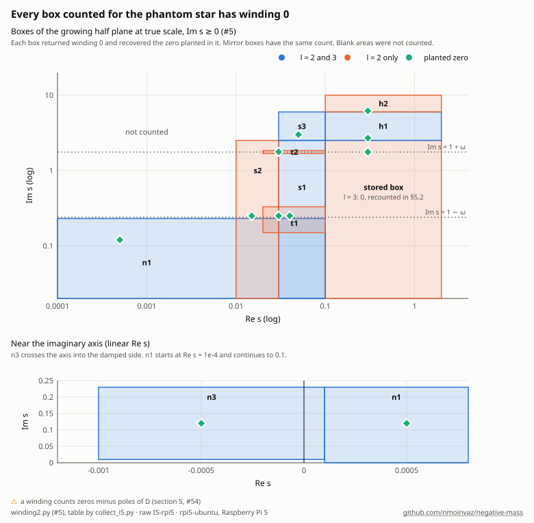

# Non-radial (l ≥ 2) linear stability of the signed-source boson stars

Model as in `../boson_star.py` / `../radial`: sextic complex scalar, λ = 10240, μ = λ²/4.8, m = 1,
G_ab = 8πε T_ab (ε = −1 phantom, ε = +1 canonical), field equation unchanged. Background: the BVP
solver `background.py` (a frozen copy of `../radial/background.py`), so α(∞) = 1 and ω is the physical
frequency. Perturbations go as e^{st}; **a growing mode is s = γ > 0** (or Re s > 0).

**Status:** complete for the scope below (see Caveats).

## 1. Equations

### Polar (even), Regge–Wheeler gauge — `derive_nonradial.py`, `reduce_polar.py`
Setup: h_tt = e^ν H0 Y, h_tr = H1 Y, h_rr = e^λ H2 Y, h_AB = r² K Y γ_AB, δΦ = (F + iG) Y e^{−iωt}.
sympy linearises G_ab − 8πεT_ab and the KG equation from the metric, with ε symbolic, and separates the
angles (m = 0, Legendre). The result:
- the traceless angular equation gives **H2 = H0**;
- (tθ), (tr), (rθ) give first-order equations for H1′, K′, H0′;
- (rr), after eliminating H0″ and K″, still contains G″. It is solved **jointly** with KG_R and KG_I for
  {H0, F″, G″}. H0 is then algebraic.

The closed system is 6th order: y = (H1/s, K, F, F′, G/s, G′/s), y′ = J(r; s²) y. J is **polynomial and
even in s**, so the static limit is regular and J is real for real s. It is code-generated in
`polar_matrix_generated.py`; there is no hand transcription.

Bug caught during this work: a first version solved H0 from (rr) alone and the code generator silently
dropped the G″ that it contained. The resulting matrix failed the residual check below (O(1) residuals)
and was deleted.

Checks:
- **All 8 separated equations** (tt, tr, rr, tθ, rθ, angular trace, KG_R, KG_I) are satisfied on solutions
  of the generated system, on real ε = ±1 backgrounds, l = 2, 3, s ∈ {0.05, 0.7, 5}, 4 radii, random y
  (`verify_polar.py`, `verify_polar_output.txt`). The relative residual is ≤ 7e-7, limited by the
  finite-difference J′. A control with y″ perturbed by 1% gives 1e-5…1e-2. The exact rational check in
  `derive_nonradial.py` gives 0 for (tθ), (tr), (rθ).
- **Vacuum limit** (φ0 = 0, Schwarzschild M of either sign), symbolically: the metric and scalar blocks
  decouple. The metric block is exactly the **Zerilli equation** f(fZ′)′ = (s² + V_Z)Z under the Moncrief
  map
  K = [λ(λ+1)r² + 3λMr + 6M²]/[r²(λr + 3M)] Z + f Z′,
  H1/s = [λr² − 3λMr − 3M²]/[(r − 2M)(λr + 3M)] Z + r Z′.
  The scalar block is the free KG equation. Residuals are 0.
- **ε = +1 against a published QNM** (`mini_bs.py`, `mini_bs_output.txt`): Macedo–Pani–Cardoso–Crispino
  2013 "Mini BS I" (ω = 0.853087, our M = 0.633001 vs the paper's 0.63300). Fundamental l = 2 polar mode:
  **σ = 0.119519 − 5.35×10⁻⁵ i** (paper: 0.1195 − 5×10⁻⁵ i). Same code with Λ = μ = 0 and the outgoing
  Zerilli exterior.

### Axial (odd) — `derive_axial.py`, `axial.py`
h_tφ = h0 sinθ ∂θY, h_rφ = h1 sinθ ∂θY, δΦ = 0. With Q = e^{(ν−λ)/2} h1/r:
  d²Q/dr*² = (s² + V_ax) Q,   **V_ax = e^ν [l(l+1)/r² − 6m/r³ + 4πε(ρ − p_r)]**,  ρ − p_r = 2V(φ0²).
The remaining equation holds identically. At ε = +1 this is the Kojima / Macedo et al. boson-star
Regge–Wheeler potential (their (κ/2)(ρ − p_rad) term with κ = 8π).

## 2. Method for growing modes

- Shooting with a real determinant D(γ) at r_m, the radius where φ0 = 10⁻⁹ (r_m ≈ 24).
- **Interior:** the 3-plane of regular solutions (r^l data at r0 = 10⁻³), integrated with continuous QR
  re-orthonormalisation.
- **Exterior:** vacuum. The metric part is the decaying Zerilli solution, Riccati-integrated inward from
  far out; it matches the flat Bessel K solution to O(M), and the Moncrief map takes it to (H1/s, K). The
  scalar part is the 2-plane of decaying KG solutions (spectral projector), integrated inward with QR.
- D = det[Y | Z] × (phases of the QR diagonals). D is real and continuous for real s, and for complex s
  its argument is that of a holomorphic function, which makes argument-principle counts possible.

## 3. Results: real growth rates (`scan_growing.py`; `scan_*.csv`, `scan_*.log`)

100 log-spaced points, with brentq refinement at any sign change:

| star | l | γ range | sign changes of D |
|---|---|---|---|
| phantom ω = 0.7603, M = −0.014580 | 2 | [1e-3, 300] | **0** (D < 0 throughout) |
| phantom ω = 0.7603 | 3 | [1e-3, 1000] | **0** |
| canonical ω = 0.75, M = +0.014626 | 2 | [1e-3, 300] | **0** |
| canonical ω = 0.75 | 3 | [1e-3, 1000] (30 pts) | **0** |
| phantom ω = 0.70, M = −0.020824 | 2 | [1e-3, 300] | **0** |
| phantom ω = 0.70 | 3 | [1e-3, 1000] | **0** |
| phantom ω = 0.85, M = −0.009745 | 2 | [1e-3, 300] | **0** |
| phantom ω = 0.85 | 3 | [1e-3, 2000] | **0** |

The DG point-mass rate k/(2|M|) is 137 (l = 2) and 686 (l = 3) for the campaign star; both lie inside the scanned
ranges. It scales as 1/|M|, so the ω = 0.85, l = 3 scan goes to 2000.

The ω = 0.70 and 0.85 rows are from #7 (`TAG=_n100`, raw negative-mass-raw I7-win2 at 60553bc). The ω = 0.85, l = 2
scan crashed twice on win2 (access violations, at a different offset each time) and was completed on the Mac (I7-mac
at d766289). Its CSV agrees with win2's serial evaluation of D on the same grid to a relative 7×10⁻⁹ at worst
(`cmp_scan_diag.py`, pass criterion 10⁻⁸). The earlier 30-point l = 2 scans of these stars, `scan_eps-1_w0.7_l2.csv` and
`scan_eps-1_w0.85_l2.csv`, also had no sign change.

**Convergence** (`convergence.py`, `convergence_l2_output.txt`, phantom l = 2, γ ∈ {1e-3 … 137}):
- rtol 1e-12, background R = 90 and r0 = 3e-3 change D by ≤ 2×10⁻⁴ relative, with the sign unchanged;
- moving r_m to 34 (φ0 = 10⁻¹²) rescales D (it is a normalised determinant), and the sign is unchanged.

#7 repeats this for ω = 0.70 and 0.85, l = 2 and 3 (`convergence.py l w`). D is negative in all five variants at every
γ, with a relative spread at the same r_m of at most 1.4×10⁻⁴ (ω = 0.70) and 2.6×10⁻⁴ (ω = 0.85) (I7-win2 at 60553bc).
The ω = 0.85 jobs crashed on win2 before finishing and were completed on the Mac (I7-mac at d766289), with every row
both machines printed identical to the printed digits.

The mode condition q_int = q_ext (interior vs exterior Zerilli log-derivative at r_m) is far from
satisfied at every γ: q_int ≈ +√(γ² + …) and q_ext ≈ −√(γ² + …). The interior solution is the
exterior's growing branch.

## 3a. Polar modes at l = 4, 5, 6 (#4; `scan_growing.py`, `convergence.py`, `kappa_eff.py`)

Phantom campaign star (ω = 0.7603, M = −0.014580, r_m = 24.11), the same code and settings as §3, run in worker pools
(`NPROC`) with resumable partial files. Raw logs, partial files and launchers: negative-mass-raw `I4-win` at b156730.
Code commits on `wip/i4-polar-l456`: scans 05e6394 (l = 4), a1f8eb1 (l = 5), 215936b (l = 6); convergence 73a9e0b,
a1f54d1, 7682c8e; κ_eff 73a9e0b (l = 4), f2ecad0 (l = 5, 6). Every status below is *numerical evidence*.

**Control.** `mini_bs.py` rerun on this machine reproduces σ = 0.119519 − 5.35×10⁻⁵ i. Its output differs from
`mini_bs_output.txt` in 14 lines: the four pre-polish shooting rows differ in ω at about 2×10⁻⁶ and the last
|D| is 1.35×10⁻¹⁵ against 1.45×10⁻¹⁶, with the secant iterates and the target star equal to the printed digits
(`mini_bs_vs_stored.diff` in the raw folder). The coordinator took this as platform noise; the control passes.

**Real-γ scans** (100 log-spaced points on [10⁻³, γ_max], `scan_eps-1_w0.7603_l{4,5,6}.csv`):

| l | k/(2\|M\|) | γ range | sign changes of D | D at γ = 10⁻³ | D at γ_max |
|---|---|---|---|---|---|
| 4 | 2058 | [1e-3, 3000] | **0** (D < 0 at all 100 points) | −9.993e-2 | −4.595e-12 |
| 5 | 4801 | [1e-3, 6000] | **0** | −1.261e-1 | −8.936e-13 |
| 6 | 9602 | [1e-3, 12000] | **0** | −1.542e-1 | −1.596e-13 |

*Numerical evidence*: the scans reach 1.46, 1.25 and 1.25 times the point-mass rate k/(2|M|), as the l = 2, 3 scans
do (§3), and have no sign change. The largest step of ln|D| between neighbouring points is 0.45, 0.47 and 0.49, so
no jump is hidden on the grid (the 100-point caveat of §7 still applies).

`l456_graph.py` draws the scans, the convergence base values and the point-mass rates from these files.


**Convergence** (`convergence_l{4,5,6}_output.txt`): the five variants of §3 (base, rtol 1e-12, φ_cut 1e-12 at
r_m = 34.21, background R = 90, r0 = 3×10⁻³) and the q task at γ ∈ {1e-3, 0.03, 0.3, 1, 3, 10, 40, 137, 300, 1000,
γ_max}.

| l | evaluations done | sign of D | max spread, same r_m | D(r_m = 34)/D_base | rtol 1e-12 at γ_max |
|---|---|---|---|---|---|
| 4 | 66 of 66 | < 0 in all five variants at all 11 γ | 2.1e-4 | 0.67–0.68 at γ ≤ 0.03, 0.50 at γ ≥ 1 | done, 17168 s |
| 5 | 65 of 66 | < 0 in every variant that finished | 2.1e-4 | 0.66–0.67 at γ ≤ 0.03, 0.50 at γ ≥ 1 | **not completed** |
| 6 | 65 of 66 | < 0 in every variant that finished | 2.1e-4 | 0.66 at γ ≤ 0.03, 0.50–0.51 at γ ≥ 1 | **not completed** |

- *Numerical evidence*: D keeps its sign under the same variants as at l = 2, 3, and the spread over the variants at
  the same r_m is at most 2.1×10⁻⁴ (l = 2: 2×10⁻⁴), at each of the 11 γ.
- **Capped rows.** The rtol 1e-12 evaluation at the top γ was stopped, per the 5 h rule of #4, at l = 5 (γ = 6000, after
  18129 s of worker time) and at l = 6 (γ = 12000, after 22599 s, 1 h 16 min past the cap because the worker could not
  be told from the uncapped φ_cut one earlier). At those two γ the verdict rests on base, φ_cut 1e-12, R = 90, r0 and
  the q task, all with D < 0; the integrator-tolerance variant is missing there. It was tested at the ten lower γ at every
  l, and at γ = 3000 for l = 4, where D = −4.59536726×10⁻¹² against the base −4.59536727×10⁻¹². The capped rows are
  marked in the output files and were added with `cap_row.py` from the raw folder, not a repository script.
- The scan's D at γ_max and the convergence base differ by a relative 6×10⁻⁹ (l = 4), 1.8×10⁻⁸ (l = 5) and
  1.2×10⁻⁷ (l = 6), with γ differing by about 10⁻¹⁵ relative. That is evaluation noise, far below the 2×10⁻⁴ spread.
- The mode condition q_int = q_ext stays far from satisfied, q_int ≈ +γ and q_ext ≈ −γ at every γ, as at l = 2, 3.

**κ_eff** (`kappa_eff_l{4,5,6}_output.txt`, `kappa_eff_l{4,5,6}_w0.7603.csv`; 31 log-spaced γ ∈ [10⁻⁴, 150],
R = r_m/|M| = 1653.57, units |M| = 1):

| l | κ_c(R) | −(l+1)/R | min(κ_eff − κ_c), at γ = 10⁻⁴ | min κ_eff | κ_eff at γ = 150 | max(κ_ext − κ_c) |
|---|---|---|---|---|---|---|
| 4 | −3.0264e-3 | −3.0238e-3 | +6.6174e-3 | +3.5910e-3 | +2.18708 | −3.9e-10 |
| 5 | −3.6314e-3 | −3.6285e-3 | +7.8644e-3 | +4.2330e-3 | +2.18708 | −3.2e-10 |
| 6 | −4.2365e-3 | −4.2333e-3 | +9.0782e-3 | +4.8417e-3 | +2.18708 | −2.7e-10 |

- *Numerical evidence*: **κ_eff − κ_c > 0 at all 31 γ for each of l = 4, 5, 6**, so there is no γ and l among those
  tabulated where it fails. It is smallest at the smallest γ and grows with γ. The exterior's own decaying solution has
  κ_ext < κ_c at all 31 γ, as at l = 2.
- Unlike l = 2 (κ_eff crosses 0 at γ ≈ 2.4×10⁻⁴), κ_eff is positive at every tabulated γ for l = 4, 5, 6. The large-R
  threshold κ_c ≈ −(l+1)/R is reproduced to 0.1 %. By the criterion of §4 (unstable iff κ < κ_c for R > r_s) this is
  the stable side.
- Not done for l ≥ 4: the static coefficient c_l of §4 (`love.py`), so the γ → 0 limit is covered only down to
  γ = 10⁻⁴.

### Complex s at l = 4, 5, 6 (#115)

The real-γ scans above leave complex s open. #115 counts the zeros of D (zeros minus poles, see below) in three of the
boxes of §5.1, at l = 4, 5 and 6, with the current `winding2.py` (the step rule of §5.1, guard 1) at rtol 10⁻⁸ for the
phantom campaign star (ω = 0.7603, M = −0.014580). One box was counted a second time with `--guard=all` (below). The
boxes are the stored box of #7 (Re s ∈ [0.1, 2], |Im s| ≤ 2.5), #5's strip
s1 (Re s ∈ [0.03, 0.1], |Im s| ≤ 2.5) and #5's near-axis box n1 (Re s ∈ [10⁻⁴, 0.1], |Im s| ≤ 0.23). Each has a pair
planted in the same cached evaluations, at 0.3 ± 1.76i, 0.04 ± 0.25i and 0.0005 ± 0.12i, so a box passes only if the
count with the pair is 2 higher. Run on rpi5 (Raspberry Pi 5, aarch64, 4 cores shared with another project, `nice -n 10`,
one or two processes, peak rss 90 MB). Every number below is in `i115_boxes_output.txt`, which `collect_i115.py` builds
from the raw logs (negative-mass-raw, folder I115-rpi5 at 832a9ad; the commands are the lines of `jobs.txt` there). From
`phase2/nonradial`, with the raw repository cloned beside the checkout:

```
python collect_i115.py ../../../negative-mass-raw/I115-rpi5 > i115_boxes_output.txt
```

It exits 1, because s1 at l = 5 failed its planted check at the default guard (below). Its guarded rerun is a row of its
own and passes.

**Control.** `control_winding2.py --cachedir=…` on rpi5 prints PASS on both lines: +1.0000 around the Mini BS I QNM
(max step 0.33 rad) and +0.0000 displaced (0.03 rad).

| l | box | guard | winding | max step | min abs(D) | planted pair found | check | wall |
|---|---|---|---|---|---|---|---|---|
| 4 | stored | 1 | -0.0000 | 0.40 | 3.02e-03 | +2.0000 of 2 | PASS | 42 min |
| 4 | s1 | 1 | +0.0000 | 0.40 | 4.43e-03 | +2.0000 of 2 | PASS | 1 h 50 min |
| 4 | n1 | 1 | +0.0000 | 0.40 | 4.17e-02 | +2.0000 of 2 | PASS | 10 min |
| 5 | stored | 1 | -0.0000 | 0.40 | 4.70e-03 | +2.0000 of 2 | PASS | 46 min |
| 5 | s1 | 1 | -0.0000 | 0.40 | 7.21e-03 | **+0.0000 of 2** | **FAIL** | 1 h 44 min |
| 5 | n1 | 1 | -0.0000 | 0.40 | 7.17e-02 | +2.0000 of 2 | PASS | 11 min |
| 6 | stored | 1 | -0.0000 | 0.40 | 6.71e-03 | +2.0000 of 2 | PASS | 52 min |
| 6 | s1 | 1 | +0.0000 | 0.40 | 8.69e-03 | +2.0000 of 2 | PASS | 1 h 58 min |
| 6 | n1 | 1 | +0.0000 | 0.39 | 1.35e-01 | +2.0000 of 2 | PASS | 9 min |
| 5 | s1, rerun | all | -0.0000 | 0.40 | 7.21e-03 | +2.0000 of 2 | PASS | 1 h 8 min |

(The winding is printed as logged, so a rounded zero has either sign. `max step` is the largest phase step in radians and
`min abs(D)` the smallest |D| on the contour, phase-normalised, so only comparable within a row. Wall is from the first
start to the last end in `queue.log`, with one or two processes running, so it is not a clean cost.) The s1 box at l = 6
was the pilot, the hardest case: 241 evaluations, 1 h 58 min, under the 3 h stop condition. **The other eight boxes, and
the counts of §5 and §5.1, were counted with guard 1** (the half-step test at the first two bisection levels, the rule of
#54); only the last row used `--guard=all`. Recounting them with `--guard=all` is not part of #115.

**Acceptance.**

| criterion | verdict |
|---|---|
| the control passes on rpi5 | **Met.** Both lines PASS |
| each box returns its planted zero | **Not met at the default guard:** 8 of 9, s1 at l = 5 returned 0 of 2. **Met by s1 at l = 5 with `--guard=all`:** +2.0000 of 2, max step 0.40. The other eight were not recounted with `--guard=all` |
| each winding reported with max step and min abs(D), or the box where it is not 0 named | **Met.** All nine report 0 (s1 at l = 5 at both guards), max step 0.39 to 0.40, no box has a non-zero winding |
| a count is a count of zeros only where a pole exclusion covers it, and the summary says which boxes | **None covered.** Poles are not excluded in any box (below) |

**The failed check (s1 at l = 5, guard 1).** `winding2.py` exited 1: the count with the planted pair is −0.0000 instead
of +2.0000. **Cause, in one line:** the lost step is 0.1/4 of an edge wide, so it was accepted at bisection depth 2, where
the half-step test of guard 1 does not run. No threshold was changed. The raw folder's `diagnose_plant.py` replays the
counter on the 212 cached points of that box, with no new evaluation of D (`diagnose_s1.log`, `diagnose_all.log` there;
the script is not in this repository).
- It reproduces the logged cumulative phases of D on all three edges and the planted count of −0.0000.
- On the left edge, Re s = 0.03, one accepted step of D times the planted factor, from Im s = 0.25 to 0.1875, measured
  −0.3826 rad. The 14 cached steps of that stretch (15 points, 13 inside it) sum to +5.9006 rad (largest step
  0.73 rad), so the step lost one 2π and the count lost 2. The planted zero is 0.01 from that edge, so its factor turns
  by about π within one step.
  Summed over the whole contour, the dense chain of the cached points gives +6.2832 rad, a count of +2.0000.
- D alone loses nothing in any of the nine boxes. The accepted steps and the dense chain of all cached points on each
  edge give the same phase to 4 decimals (−22.8537, −0.5455, +23.3992 on the three edges for s1 at l = 5, summing to 0),
  and the largest step of the dense chain is 0.40 rad. The only step of the nine boxes where the two differ is the one
  above, in D times the factor.
This is the defect of §5.1 in a new place: one accepted step loses 2π because the 0.4 rad rule and its half-step test
see only principal values, and the test stops at depth 1. The dense chain shares D and its cache with the count, so it
tests the step rule and not D.

**The guarded rerun (s1 at l = 5, `--guard=all`).** `winding2.py` takes `--guard=all` (706b4c4), which applies the
half-step test at every bisection level; the default 1 is the rule of #54. The rerun is `winding2.py -1 0.7603 5 0.03 0.1
2.5 --plant=0.04,0.25 --guard=all` on the same cache and the same planted zero, which was not moved. It was fixed in
advance that the PLANTED line must read +2.0000 within 0.05 with a max step under 0.45 rad, and that the winding of D is
reported whatever it is.
- PLANTED: count with the factor +2.0000, without −0.0000, difference **+2.0000** of 2, max step 0.40 rad, **PASS**. Exit
  0, 1 h 8 min, 363 evaluations at the last edge (the cache goes from 212 to 387 points, none of the 212 changed).
- RESULT: winding −0.0000, max step 0.40 rad, min abs(D) 7.21e-03. The cumulative phases of D on the three edges are
  the same to 4 decimals as at guard 1 (−22.8537, −23.3992, −0.0000), so the guard changed the planted count and not D's.
- The default-guard run `s1_l5.log` stays as it is. It is the mutation that shows the check can fail: the same cache
  and plant give a count of 0 at guard 1 and +2 at guard `all`.
So s1 at l = 5 passes its planted check with `--guard=all`, and the guard leaves D's count there unchanged. The other
eight boxes passed their check with guard 1 and are not recounted here; §5.4 (#126) recounts them with `--guard=all`,
and none changes.

**What the planted check does not test** (coordinator's review of #115). The planted check compares two counts made on
the same accepted steps. Suppose a step loses 2π in D alone, and the planted factor turns little over that step. Then
the step loses 2π in D times the factor as well, and the difference is unchanged. The review removed the cached points
inside the lost stretch from the 212-point copy. D alone then lost 2π there too, and the difference stayed 2. So a
passing planted check shows that the counter finds a pair at s0. It does not show that D's own steps lost nothing; only
the step rule protects D's count. §5.4 (#126) recounts the guard-1 boxes with `--guard=all` and puts that replay in
the repository.

**Controls of the collector.** On a synthetic raw folder built from #5's logs (tags renamed to l = 4, 5, 6) the collector
exits 0, and each of `--mutate=noplant`, `wrongexpect`, `wrongbox`, `shift` and `nocontrol` exits 1. On the real logs
each of the first four lists all ten rows as FAILED, `nocontrol` lists the control and the one real failure, and
`--mutate=wrongguard` (expects guard all everywhere) lists the nine default rows.

**Pole caveat.** Each winding is zeros minus poles of D. D's known pole source is the Zerilli column (1, q/f). Its q has
a pole at each zero of the Zerilli solution at r_m (#54, #121); #122 checks that there is no other source. #121 counted
those zeros in the 21 boxes of §5 and §5.1, and #124 in these nine (§5.3). #124 finds no zero of Z(r_m; s) in any of
the nine, so the Zerilli column gives D no pole there. Each 0 above then counts zeros of D, conditional on that column
being D's only pole source (#122).

**Not covered.** Only the stored box, s1 and n1 were counted. The other boxes of §5.1 (n3, h1, h2, s2, s3 and the
threshold boxes t1 and t2 at two outer radii) are not run for l = 4, 5, 6; Re s < 0.03 for 0.23 < |Im s| ≤ 2.5 and
|Im s| > 2.5 are open, as in §5.1. The real-γ axis at l = 4, 5, 6 is the 100-point scan above, not refined.

Status: *numerical evidence*, conditional on the Zerilli column being D's only pole source (§5.3, #122). Eight boxes
passed their planted check at guard 1; s1 at l = 5 failed it at guard 1 and passed it with `--guard=all`. §5.4 (#126)
recounts the eight, and #124's counts of Z, with `--guard=all`, and none changes. A 2π lost inside a step whose two
halves agree is excluded by neither guard (§5.4).

## 4. Effective surface condition κ_eff (`kappa_eff.py`, `kappa_eff_l2_output.txt`, `love.py`, `love_output.txt`)

Map the regular interior solution, at r_m, to the DG variable Ψ̂ = (∂x − g)Z, with g = ∂x ln ψ0, units
|M| = 1, R = r_m/|M| = 1654. Exact identity (checked with sympy):
  **κ = Ψ̂_x/Ψ̂ = −g + s²/(q − g)**, and **κ_c(R) = −g(R)** (dg_spectrum).
So **κ_eff − κ_c = s²/(q_int − g)**, for any star and any s.

- **s → 0:** κ_eff → κ_c. The intertwiner maps every static Zerilli solution onto φ0, so the static
  limit is degenerate. The sign of the approach is sign(q_int − g), where q_int − g is the decaying
  r^{−l} admixture in the star's static tidal solution, a Love-number-type coefficient c_l. It is
  R-independent to 10⁻⁴…10⁻³ between r_m = 24 and 34, and stable under rtol.

| star | c_2 | c_3 | sign(κ_eff − κ_c) as s → 0 |
|---|---|---|---|
| phantom ω = 0.7603 | −9.27 | −53.9 | **+** |
| phantom ω = 0.85 | −8.30 | −78.9 | **+** |
| canonical ω = 0.75 | +8.64 | +48.4 | − |
| canonical ω = 0.85 | +7.86 | +75.4 | − |

  The phantom stars have κ_eff slightly **above** κ_c (stiffer than critical). The canonical star's sign
  is opposite, but its exterior has M > 0, where κ_c is not an instability threshold (no DG mode exists).
- **All γ > 0 (phantom, l = 2):** κ_eff − κ_c > 0 throughout γ ∈ [1e-4, 150].
  - κ_eff crosses 0 at γ ≈ 2.4×10⁻⁴ (s|M| ≈ 3.5×10⁻⁶) and then grows like +γ|M|.
  - The exterior's own decaying solution has κ_ext ≈ −γ|M| < κ_c.
  - The matter therefore supplies **κ_eff > κ_c (and κ_eff > 0 for γ ≳ 2.5×10⁻⁴)**. By the dg_spectrum
    criterion (unstable iff κ < κ_c for R > r_s), this is the stable side.
  - The large-R threshold κ_c ≈ −(l+1)/R = −1.81×10⁻³ (in 1/|M|) is reproduced: κ_c(R) = −1.817×10⁻³.

## 5. Matter sector

The polar system above already contains the full scalar (matter) sector: F and G couple to the metric,
and a growing matter mode is a zero of the same D. The real-γ scan therefore covers matter modes with
real growth rates as well.

Complex growth rates (oscillatory instabilities, the typical Q-ball-type case) are checked with an
argument-principle count of zeros of D in a rectangle of the right half-plane (`winding.py`).
- D(s̄) = D̄(s), so only the upper half contour is integrated. A zero-free factor e^{sL} that comes from
  normalising at different radii is stripped.
- Validation (`control_winding.py`, `control_winding_output.txt`): around the Mini BS I QNM the winding is
  **+1.0000**; displaced by 0.004i it is **0.0000**.

Production version `winding2.py`:
- the scalar plane is started at an s-independent radius;
- the trivial zero-free phases of the inward/outward exponentials are removed analytically;
- it is restart-safe (per-evaluation cache).

Control (`control_winding2.py`, appended to `control_winding_output.txt`): winding +1.0000 around the
Mini BS I QNM, 0.0000 displaced.

| star | l | box | winding (# growing modes) |
|---|---|---|---|
| phantom ω = 0.7603 | 2 | Re s ∈ [0.1, 2], \|Im s\| ≤ 2.5 | **0.0000** |
| phantom ω = 0.7603 | 3 | same | **0.0000** |
| canonical ω = 0.75 | 2 | same | **0.0000** |
| phantom ω = 0.70 | 2 | same | **0.0000** |
| phantom ω = 0.70 | 3 | same | **0.0000** |
| phantom ω = 0.85 | 2 | same | **0.0000** |
| phantom ω = 0.85 | 3 | same | **0.0000** (§5.2; #7's −2.0000 was the first step rule) |

(`winding2_output.txt` for the first three rows, #7's I7-win2 at 60553bc for the rest; max phase step 0.4 rad; D(x0),
D(x1) have the same sign. §5.2 recounts every row with the corrected step rule, and only the last row changes.)

**Discrepancy (#7), resolved by #54.** #7 counted −2 for ω = 0.85, l = 3. A count of zeros cannot be negative, so this
was read as a net pole of D in the box, with a hypothesis for #54 to test: the Zerilli column (1, q/f) of
`polar_solver.decaying_plane` has a pole wherever the decaying Zerilli solution vanishes at r_m. The recount of §5.2 gives
0, and the −2 was the first step rule losing one 2π on the left edge. The column has such a pole by construction
(q = f Z′/Z), and §5.3 (#121) finds no zero of Z(r_m; s) in any of these boxes, so it gives D no pole there. Each
winding counts zeros minus poles, so the 0 counts are counts of zeros of D, conditional on the Zerilli column being D's
only pole source (the coordinator's reading of `polar_solver.py`, to be checked in #122).

No oscillatory
instability with e-folding time ≤ 10 (code units) and |Im s| ≤ 2.5. This range covers the scalar
frequencies ω ± Im s up to the continuum and beyond.

**Not covered in the table above:** 0 < Re s < 0.1 off the real axis. That strip passes the scalar continuum
thresholds k± → 0 at Im s = ±(1−ω) and ±(1+ω), which makes the integration slow (R_s ∝ 1/Re k). The real axis down to
γ = 10⁻³ is covered by the scan. For the campaign star the strip, the band above |Im s| = 2.5 and the real axis are
counted in §5.1 (#5).

### 5.1 The strip, the band above |Im s| = 2.5 and the real axis (#5)

Counted for the phantom campaign star (ω = 0.7603, M = −0.014580), l = 2 and 3, with the D of §2 on rpi5
(`winding2.py` at rtol 10⁻⁸, `refine_gamma.py` at 10⁻¹⁰). Every number below is in `i5_boxes_output.txt`, which
`collect_i5.py` builds from the raw logs (negative-mass-raw, folder I5-rpi5, at e2ebcdd).

The commands of every run are the lines of `jobs.txt` there. From `phase2/nonradial` with the raw repository cloned beside
the checkout, `python collect_i5.py ../../../negative-mass-raw/I5-rpi5 > i5_boxes_output.txt` rebuilds the file and exits
non-zero if a check failed or a run is missing.

Result: all 17 boxes count 0 (zeros minus poles), each with its planted zero returned by the same code, and the real-γ
axis shows no sign change at 397 points (step ratio 1.032 for l = 2, 1.036 for l = 3). Where the counts stop is under
"Not covered" below.

#### A defect in the counter

The planted zero of the first strip box was not returned. The pair planted at 0.04 ± 0.25i in Re s ∈ [0.03, 0.1],
|Im s| ≤ 2.5 gave a count of 0 instead of 2. On the left edge, one step from Im s = 0.25 to 0 had a true phase change
of 2π − 0.37 for D times the planted factor, because D alone turns by 4.36 and the factor by 1.55. The 0.4 rad rule
saw only the measured angle, −0.37, and accepted the step, losing 2π. Accepting a step only when its two half steps add
up to it did not help, since both half steps wrapped (measured −2.40 and +2.03, sum −0.37). `winding2.py` now accepts a
step of the first two bisection levels only when both half steps are at most 0.4 rad themselves and add up to it, and
`control_winding2.py` does the same. Every count below uses the new rule. The stored box (Re s ∈ [0.1, 2], |Im s| ≤ 2.5,
l = 2) still gives winding +0.0000, with the D(x0), D(x1), max phase step 0.39 and min|D| 6.70×10⁻⁴ of
`winding2_output.txt` (rerun from scratch with the stored script at 478cbd9, then with the new rule).

One such loss shifts the count of a symmetric box by ±2, the size of #7's −2 for ω = 0.85, l = 3. The windings of §5
were computed with the first rule and are recounted in §5.2 (#54), where the −2 turns out to be one such loss.

#### Boxes

```
Im s
 10 ┌──────────┬──────────┬──────────────────────┐
    │          │          │ h2 (l = 2)           │
  6 │ not      ├──────────┼──────────────────────┤
    │ counted  │ s3       │ h1 (l = 2, 3)        │
    │          │ (l = 2,3)│                      │
2.5 ├──────────┼──────────┼──────────────────────┤
    │ s2       │ s1       │ stored box           │
    │ (l = 2)  │ (l = 2,3)│ (§5, l = 2, 3)       │
0.23├──────────┴──────────┤                      │
    │ n1 (l = 2, 3)       │                      │
  0 └─────────────────────┴──────────────────────┘
    0.01      0.03       0.1                      2   Re s
```

Widths are not to scale. s1 and s2 also contain |Im s| ≤ 0.23, where n1 overlaps them, and n1 reaches Re s = 10⁻⁴
there. n3 crosses the axis (Re s ∈ [−10⁻³, 10⁻⁴], Im s ∈ [0.01, 0.23]). The threshold boxes t1 and t2 lie inside s1 and
s2. Each row is one contour, a symmetric box (|Im s| ≤ y1, doubled from the upper half) or an upper box
(Im s ∈ [y0, y1], its mirror has the same count). s3 was added after the first plan, since the strip above |Im s| = 2.5
belongs to both gaps of the issue and to none of the first boxes.

`boxes_graph.py` draws the same boxes at true scale from `i5_boxes_output.txt`, with the planted zeros.



| job | what | Re s | Im s | winding | max step | min abs(D) | planted s0 | planted found | check |
|---|---|---|---|---|---|---|---|---|---|
| rep_l2 | stored box, l = 2 (#7 box of the first scans) | [0.1, 2.0] | abs(Im s) ≤ 2.5 | +0.0000 | 0.39 | 6.70e-04 | 0.3+1.76j | +2.0000 of 2 | PASS |
| s1_l2 | strip, l = 2 | [0.03, 0.1] | abs(Im s) ≤ 2.5 | +0.0000 | 0.40 | 1.00e-03 | 0.04+0.25j | +2.0000 of 2 | PASS |
| s1_l3 | strip, l = 3 | [0.03, 0.1] | abs(Im s) ≤ 2.5 | +0.0000 | 0.40 | 2.49e-03 | 0.04+0.25j | +2.0000 of 2 | PASS |
| n1_l2 | below threshold, right of the axis, l = 2 | [0.0001, 0.1] | abs(Im s) ≤ 0.23 | -0.0000 | 0.33 | 2.82e-03 | 0.0005+0.12j | +2.0000 of 2 | PASS |
| n1_l3 | below threshold, right of the axis, l = 3 | [0.0001, 0.1] | abs(Im s) ≤ 0.23 | +0.0000 | 0.35 | 3.16e-02 | 0.0005+0.12j | +2.0000 of 2 | PASS |
| n3_l2 | below threshold, across the axis, l = 2 | [-0.001, 0.0001] | [0.01, 0.23] | +0.0000 | 0.39 | 2.75e-03 | -0.0005+0.12j | +1.0000 of 1 | PASS |
| n3_l3 | below threshold, across the axis, l = 3 | [-0.001, 0.0001] | [0.01, 0.23] | -0.0000 | 0.38 | 3.66e-02 | -0.0005+0.12j | +1.0000 of 1 | PASS |
| h1_l2 | high Im s, l = 2 | [0.1, 2.0] | [2.5, 6.0] | +0.0000 | 0.38 | 1.05e-04 | 0.3+2.7j | +1.0000 of 1 | PASS |
| h1_l3 | high Im s, l = 3 | [0.1, 2.0] | [2.5, 6.0] | -0.0000 | 0.38 | 2.63e-04 | 0.3+2.7j | +1.0000 of 1 | PASS |
| t1_r40 | threshold 1 - w, outer radius 40, l = 2 | [0.02, 0.1] | [0.15, 0.33] | +0.0000 | 0.38 | 3.73e-03 | 0.03+0.25j | +1.0000 of 1 | PASS |
| t1_r80 | threshold 1 - w, outer radius 80, l = 2 | [0.02, 0.1] | [0.15, 0.33] | -0.0000 | 0.39 | 3.73e-03 | 0.03+0.25j | +1.0000 of 1 | PASS |
| t2_r40 | threshold 1 + w, outer radius 40, l = 2 | [0.02, 0.1] | [1.68, 1.84] | +0.0000 | 0.40 | 9.30e-04 | 0.03+1.77j | +1.0000 of 1 | PASS |
| t2_r80 | threshold 1 + w, outer radius 80, l = 2 | [0.02, 0.1] | [1.68, 1.84] | +0.0000 | 0.35 | 9.30e-04 | 0.03+1.77j | +1.0000 of 1 | PASS |
| s2_l2 | strip, closer to the axis, l = 2 | [0.01, 0.03] | abs(Im s) ≤ 2.5 | +0.0000 | 0.40 | 5.30e-04 | 0.015+0.25j | +2.0000 of 2 | PASS |
| h2_l2 | high Im s, second range, l = 2 | [0.1, 2.0] | [6.0, 10.0] | -0.0000 | 0.31 | 2.57e-05 | 0.3+6.2j | +1.0000 of 1 | PASS |
| s3_l2 | strip above Im s = 2.5, l = 2 | [0.03, 0.1] | [2.5, 6.0] | -0.0000 | 0.39 | 9.90e-05 | 0.05+3j | +1.0000 of 1 | PASS |
| s3_l3 | strip above Im s = 2.5, l = 3 | [0.03, 0.1] | [2.5, 6.0] | -0.0000 | 0.38 | 2.71e-04 | 0.05+3j | +1.0000 of 1 | PASS |

`max step` is the largest phase step in radians and `min abs(D)` the smallest |D| on the contour (phase-normalised, so
only comparable within a row).

Winding is zeros minus poles of D in the box (§5, #54). §5.3 (#121) finds no pole from the Zerilli column in any of
these boxes except `n3_l2` and `n3_l3`, which it does not count (#123). Elsewhere each 0 means no zero, conditional on
that column being D's only pole source (#122).

#### Controls

- **Planted zero.** Each row's last columns give the zero planted in the same cached evaluations, as the factor
  (s − s0)(s − s̄0) in a symmetric box and (s − s0) in an upper box, and what the count returned. The stored box has four
  mutations of the counter, each of which must make the check fail and does: reverse the contour (−2), apply the wrong
  doubling (+1), move the factor's zero out of the box (0) and plant s0 alone in the symmetric box (+1.72).
- **Known QNM, strip geometry.** On the Mini BS I star (l = 2) boxes Re s ∈ [−2×10⁻⁴, 0.1] below the threshold
  Im s = 0.1469 count the zeros of D that `polish_zero.py --mini` finds by a secant on the same D at rtol 10⁻⁸ and 10⁻¹⁰:
  −5.35350×10⁻⁵ + 0.11951908i (the published mode, spread of Re s over rtol 2×10⁻¹⁵) and three more,
  −2.62464×10⁻⁵ + 0.131605i, −1.35809×10⁻⁵ + 0.137308i and −7.7455×10⁻⁶ + 0.140372i. They are the zeros the winding
  returned: Im s ∈ [0.09, 0.125] +1, [0.09, 0.14] +3, [0.1225, 0.14] +2, [0.1225, 0.1285] 0. The same counts come at a
  doubled outer radius (R_s 419, 717 and 454 against 227, 376 and 245). The `reverse` and `shift` mutations make it fail.
  I first expected 1 and 0 in the second and third boxes, since the published mode was the only one I knew, and
  changed the expectation after the run returned +3 and +2. Only the first box and the published value are independent
  of the added zeros, the others compare the counter with a root finder that shares D.
- **Two outer radii.** Near each scalar threshold (t1 around Im s = 1 − ω = 0.2397, t2 around 1 + ω = 1.7603) the count
  is made at R_s = r_m + 40/min Re k and at 80/min Re k with the Zerilli start radius doubled. The counts and the
  min|D| agree (rows t1 and t2).
- **Axis scan, not used.** `axis_scan.py` looked for a dip of |D| on Re s = 0.005, Im s ∈ [0.005, 0.235]. Its control on
  the Mini BS fails (the known zero shows no dip, |D| varies smoothly across it), so the absence of a dip for the
  campaign star says nothing and is not used.

#### Real axis

`refine_gamma.py` starts from the stored 100-point scan and adds the log-midpoints of each level, with D from the same
`PolarProblem.D`. Three stored points recomputed agree to a relative 3.4×10⁻⁹ at worst.

| l | level | step ratio | points | sign changes | ratio of abs(D_i) to the geometric mean of its neighbours |
|---|---|---|---|---|---|
| 2 | 0 | 1.136 | 100 | 0 | not defined |
| 2 | 1 | 1.066 | 199 | 0 | 1.000 to 1.002 |
| 2 | 2 | 1.032 | 397 | 0 | 1.000 to 1.001 |
| 3 | 0 | 1.150 | 100 | 0 | not defined |
| 3 | 1 | 1.072 | 199 | 0 | 1.000 to 1.003 |
| 3 | 2 | 1.036 | 397 | 0 | 1.000 to 1.001 |

Both ranges give no sign change at any level (l = 2: γ ∈ [10⁻³, 300], l = 3: γ ∈ [10⁻³, 1000]).

The planted pair (γ = 0.6035 and 0.6408 for l = 2, 1.115 and 1.184 for l = 3, 6 % apart) lies inside one level-0
interval, is missed there, and is found in the two intervals that contain it at level 1 and level 2. With `--mutate=coarse`
it is missed, with `--mutate=pair` an unplanted pair makes the count change between levels, and with `--mutate=stale`
the recomputed values differ from the stored ones by 1 %, each failing its check as designed. The ratio of |D_i| to
the geometric mean of its neighbours stays within 1.000 to 1.003, so ln |D| is smooth at every grid point. A pair of
roots closer than about 3 % in γ is therefore excluded only by that smoothness, not by a sign change.

#### Not covered

- Re s below the lower edges for 0.23 < |Im s| ≤ 2.5. For l = 2 that is 0 < Re s < 0.01 (the near-axis box n1 reaches
  10⁻⁴ only below Im s = 0.23), for l = 3 it is 0 < Re s < 0.03. R_s grows as 1/Re s (3831 at 0.01), and so does the
  cost of a box, which took 3.7 h at 0.01. A mode that close to marginal is neither shown nor excluded by these counts.
- The strip Re s < 0.03 for 2.5 < |Im s|, and the strip Re s < 0.1 for |Im s| > 6.
- Re s ∈ [0.1, 2] above |Im s| = 10 (l = 2) and 6 (l = 3), and Re s > 2.
- The sliver |Im s| < 0.01 left of Re s = 10⁻⁴.
- Poles of D. Every count is zeros minus poles. §5.3 (#121) excludes the Zerilli column's poles in every box but
  `n3_l2` and `n3_l3` (#123). That the column is D's only pole source is not yet checked (#122).
- l ≥ 4, except the stored box, s1 and n1 at l = 4, 5, 6 (§3a, #115).

Status: numerical evidence, conditional on the Zerilli column being D's only pole source (§5.3, #122), and for `n3_l2`
and `n3_l3` on D having no pole there (#123). Every count here used guard 1. §5.4 (#126) recounts each with
`--guard=all`, and none changes; a 2π lost inside a step whose two halves agree is excluded by neither guard.

### 5.2 Recount of §5's windings with the corrected step rule (#54)

#54 started from #7's winding of −2 for ω = 0.85, l = 3 and the hypothesis that D has a pole there. #5 had found that the
first step rule can lose 2π in one step (§5.1), and one loss shifts a symmetric box's count by ±2. So the boxes of the §5
table were recounted first, with the current `winding2.py` (the rule of §5.1, git 59d26de), each with the zero 0.3 + 1.76i
and its conjugate planted in the same cached evaluations.

Result: all seven boxes count 0. Only ω = 0.85, l = 3 changed, from −2 to 0, and the −2 was the first step rule, not a
pole. The search for a pole (steps 1 to 3 of #54) was therefore not run.

Six boxes were counted on rpi5. The seventh, phantom ω = 0.7603 with l = 2, is #5's `rep_l2` run. The ω = 0.70 and 0.85
counts reuse #7's stored evaluations of D (byte copies of I7-win2's caches) and add the ones the new rule asks for. Every
number below is in `i54_recount_output.txt`, which `collect_i54.py` builds from the raw logs (negative-mass-raw, folders
I54-rpi5 at a0cfa51, I5-rpi5 and I7-win2). From `phase2/nonradial`, with the raw repository cloned beside the checkout:

```
python collect_i54.py ../../../negative-mass-raw > i54_recount_output.txt
```

It exits non-zero if a run is missing, a planted zero is not returned or a winding is not an integer. All boxes are
Re s ∈ [0.1, 2], |Im s| ≤ 2.5. The old values are #7's logs for ω = 0.70 and 0.85 and `winding2_output.txt` for the
others, all made with the first rule.

| star | l | old winding | new winding | max step, old / new (rad) | min abs(D), old / new | planted pair found |
|---|---|---|---|---|---|---|
| phantom ω = 0.85 | 3 | **−2.0000** | **+0.0000** | 0.40 / 0.40 | 1.23e-03 / 1.23e-03 | +2.0000 of 2 |
| phantom ω = 0.85 | 2 | −0.0000 | −0.0000 | 0.40 / 0.40 | 4.93e-04 / 4.93e-04 | +2.0000 of 2 |
| phantom ω = 0.70 | 3 | −0.0000 | +0.0000 | 0.40 / 0.40 | 1.86e-03 / 1.86e-03 | +2.0000 of 2 |
| phantom ω = 0.70 | 2 | −0.0000 | +0.0000 | 0.40 / 0.40 | 7.45e-04 / 7.45e-04 | +2.0000 of 2 |
| phantom ω = 0.7603 | 3 | +0.0000 | +0.0000 | 0.40 / 0.40 | 1.68e-03 / 1.68e-03 | +2.0000 of 2 |
| canonical ω = 0.75 | 2 | +0.0000 | +0.0000 | 0.40 / 0.40 | 6.88e-04 / 6.88e-04 | +2.0000 of 2 |
| phantom ω = 0.7603 | 2 | +0.0000 | +0.0000 | 0.39 / 0.39 | 6.70e-04 / 6.70e-04 | +2.0000 of 2 |

The old and new max step and min abs(D) agree in every row. Every planted pair is returned.

#### The lost step

`replay_old_rule_i54.py` replays the first rule on the stored evaluations of #7's four boxes without evaluating D again
(`i54_replay_output.txt`, from `phase2/nonradial`: `python replay_old_rule_i54.py ../../../negative-mass-raw`).

- It reproduces #7's logged winding, max step and min abs(D) in all four boxes, and asks for exactly the 77, 63, 104 and
  67 points of #7's caches.
- The cached points on each edge, sorted along it, form a dense chain whose steps are all at most 0.40 rad. Its winding
  is 0 in all four boxes, equal to the current rule's.
- Three boxes lose nothing. In ω = 0.85, l = 3 one step lost 2π: the left edge from Im s = 0.25 to 0 at Re s = 0.1. The
  first rule measured −0.200 rad and the true change is +6.083 rad. The 27 stored points of that stretch have |D| between
  2.15×10⁻² and 3.02×10⁻², and all 26 steps between them are positive, 0.199 to 0.397 rad. The old count of −2 is the
  current 0 minus 2 for the lost turn.

The left-edge phase of the three l = 3 boxes is now +13.17 (ω = 0.85), +13.60 (ω = 0.70) and +13.17 (ω = 0.7603). For
ω = 0.85 the first rule gave +6.88. This is a plausibility check on the corrected count, not a test.

#### Controls

- **Planted zero.** Each rerun returns the pair planted at 0.3 + 1.76i (+2.0000 of 2, PASS), with the same code as §5.1.
  Its four mutations were run there on the stored box and not repeated here.
- **Same D on two machines.** #7's evaluations were made on win2 (x86, Windows) and the new ones on rpi5 (aarch64).
  `python check_cache_i54.py ../../../negative-mass-raw/I7-win2` recomputes three stored points of each of the four caches
  on rpi5 with the same D. The worst relative difference is 1.9×10⁻¹¹ (limit 10⁻⁶, `i54_cache_check_output.txt` keeps its
  summary lines). With `--mutate=scale`, which multiplies the recomputed values by 1.001, it exits 1.
- **Mutations of the new scripts.** `replay_old_rule_i54.py --mutate=thr` (threshold 0.3 instead of 0.4) asks for points
  that are not stored and exits 1. `collect_i54.py --mutate=noplant` and `--mutate=wrongexpect` exit 1.
- **What is shared.** The counts, the dense chain and the planted zero all use the same D and the same counter, so they
  test the step rule and not D. The two-machine recomputation tests D at 12 points. The Mini BS I controls of §5.1 are
  independent of the campaign stars.

#### What this settles and what it does not

- Status: numerical evidence that D has winding 0 in each of the seven boxes of §5. The −2 of ω = 0.85, l = 3 was the
  first step rule, located at one step.
- The planted-pole control of #54 (a pole-free column returning +1 for a planted zero and 0 for a planted pole) was not
  run, as it was not needed.
- The hypothesis that the Zerilli column (1, q/f) has a pole where ψ(r_m; s) vanishes is neither confirmed nor refuted.
  Its only evidence was the −2. A winding of 0 is still zeros minus poles, and nothing here searches for poles.
- The passages this recount supersedes were edited by the coordinator at the merge: the §5 table row ω = 0.85, l = 3,
  the paragraph "Discrepancy (#7)", the "Not covered" list of §5.1 and §6 item 2. The "conditional on D having no pole"
  of §5 and of the "Status" line in §5.1 still held, since poles were not searched for. §5.3 (#121) has since counted
  the zeros of Z(r_m; s), and the coordinator narrowed those passages at its merge.

### 5.3 Poles of D (#121)

`polar_solver.decaying_plane` builds the Zerilli column of D as (1, q/f) with q = f Z′/Z at r_m, so D has a pole at each
zero of the decaying Zerilli solution Z(r_m; s), and the windings of §5, §5.1 and §5.2 count the zeros of D minus these.
#121 counts the zeros of Z(r_m; s) in each of those boxes with `zerilli_zeros.py`. It integrates Z inward from a radius
R_z fixed for the box, in WKB-scaled variables with the implicit Radau method, and counts the phase of
y₁(r_m) = Z(r_m; s) exp Ψ(r_m) with the step rule of §5.1. y₁(r_m) is holomorphic in s and has the zeros of Z(r_m; s) for
Re s > 0. The script's docstring has the details.

Result: **all 21 counted boxes have 0 zeros of Z(r_m; s)**, each with its planted zero returned. So the Zerilli column
gives D no pole in any of them, and the zeros of D equal the winding of D, 0, in each. No count is nonzero, so no box
needs a corrected count. Status: numerical evidence.

**What ran.** On win (surface-laptop-4) on 2026-11-20, with the code of `wip/i121-zerilli-zeros` at d801d1e, unmodified.
Each job is `python -u zerilli_zeros.py <arguments> --cachedir=<raw folder>/cache`, with the 25 lines `job|arguments`
that `python collect_i121.py --jobs` prints (21 boxes and 4 controls; raw `jobs.txt`). The four controls ran first, then
the pilot `n1_l3` (the largest R_z, 1.0×10⁶; 225 s in all, 146 s of it the count), then the other 20 boxes, at most two
processes at a time. Each job ran once and none died. Logs, caches and launchers are in negative-mass-raw, folder
`I121-win` at bc19469. From `phase2/nonradial`, with the raw repository cloned beside the checkout:

```
python collect_i121.py ../../../negative-mass-raw/I121-win > i121_zeros_output.txt
```

On Windows with Python 3.14 the redirect needs `PYTHONIOENCODING=utf-8` (the table has ≥ and ≤, and the default code page
raises `UnicodeEncodeError`). The collector exits 0 here. It exits 1 when a log is missing, a check is not as required or a count is not an integer.
Its `--mutate=box` (it expects `s1_l2` at Re s up to 0.2) and `--mutate=control` (it expects `mut_lshift` to pass) each
exit 1, as they should.

| job | § | star, l | Re s | Im s | zeros of Z | max step | min abs(Z) | planted found | winding of D | zeros of D |
|---|---|---|---|---|---|---|---|---|---|---|
| p7603_l2 | 5 | 0.7603, 2 | [0.1, 2] | abs(Im s) ≤ 2.5 | +0.0000 | 0.36 | 5.59e-01 | +2.0000 of 2 | +0.0000 | 0 |
| p7603_l3 | 5 | 0.7603, 3 | [0.1, 2] | abs(Im s) ≤ 2.5 | +0.0000 | 0.29 | 5.59e-01 | +2.0000 of 2 | +0.0000 | 0 |
| c075_l2 | 5 | canonical 0.75, 2 | [0.1, 2] | abs(Im s) ≤ 2.5 | +0.0000 | 0.36 | 5.59e-01 | +2.0000 of 2 | +0.0000 | 0 |
| p070_l2 | 5 | 0.70, 2 | [0.1, 2] | abs(Im s) ≤ 2.5 | -0.0000 | 0.36 | 5.59e-01 | +2.0000 of 2 | +0.0000 | 0 |
| p070_l3 | 5 | 0.70, 3 | [0.1, 2] | abs(Im s) ≤ 2.5 | +0.0000 | 0.28 | 5.59e-01 | +2.0000 of 2 | +0.0000 | 0 |
| p085_l2 | 5 | 0.85, 2 | [0.1, 2] | abs(Im s) ≤ 2.5 | -0.0000 | 0.38 | 5.59e-01 | +2.0000 of 2 | -0.0000 | 0 |
| p085_l3 | 5 | 0.85, 3 | [0.1, 2] | abs(Im s) ≤ 2.5 | +0.0000 | 0.32 | 5.59e-01 | +2.0000 of 2 | +0.0000 | 0 |
| s1_l2 | 5.1 | 0.7603, 2 | [0.03, 0.1] | abs(Im s) ≤ 2.5 | -0.0000 | 0.36 | 6.32e-01 | +2.0000 of 2 | +0.0000 | 0 |
| s1_l3 | 5.1 | 0.7603, 3 | [0.03, 0.1] | abs(Im s) ≤ 2.5 | +0.0000 | 0.35 | 6.33e-01 | +2.0000 of 2 | +0.0000 | 0 |
| n1_l2 | 5.1 | 0.7603, 2 | [0.0001, 0.1] | abs(Im s) ≤ 0.23 | -0.0000 | 0.23 | 2.04e+00 | +2.0000 of 2 | -0.0000 | 0 |
| n1_l3 | 5.1 | 0.7603, 3 | [0.0001, 0.1] | abs(Im s) ≤ 0.23 | -0.0000 | 0.22 | 2.07e+00 | +2.0000 of 2 | +0.0000 | 0 |
| h1_l2 | 5.1 | 0.7603, 2 | [0.1, 2] | [2.5, 6] | -0.0000 | 0.04 | 3.98e-01 | +1.0000 of 1 | +0.0000 | 0 |
| h1_l3 | 5.1 | 0.7603, 3 | [0.1, 2] | [2.5, 6] | -0.0000 | 0.04 | 3.98e-01 | +1.0000 of 1 | -0.0000 | 0 |
| t1_z1 | 5.1 | 0.7603, 2 | [0.02, 0.1] | [0.15, 0.33] | +0.0000 | 0.04 | 1.73e+00 | +1.0000 of 1 | +0.0000 | 0 |
| t1_z2 | 5.1 | 0.7603, 2 | [0.02, 0.1] | [0.15, 0.33] | +0.0000 | 0.04 | 1.73e+00 | +1.0000 of 1 | -0.0000 | 0 |
| t2_z1 | 5.1 | 0.7603, 2 | [0.02, 0.1] | [1.68, 1.84] | -0.0000 | 0.00 | 7.37e-01 | +1.0000 of 1 | +0.0000 | 0 |
| t2_z2 | 5.1 | 0.7603, 2 | [0.02, 0.1] | [1.68, 1.84] | +0.0000 | 0.00 | 7.37e-01 | +1.0000 of 1 | +0.0000 | 0 |
| s2_l2 | 5.1 | 0.7603, 2 | [0.01, 0.03] | abs(Im s) ≤ 2.5 | +0.0000 | 0.31 | 6.33e-01 | +2.0000 of 2 | +0.0000 | 0 |
| h2_l2 | 5.1 | 0.7603, 2 | [0.1, 2] | [6, 10] | +0.0000 | 0.02 | 3.13e-01 | +1.0000 of 1 | -0.0000 | 0 |
| s3_l2 | 5.1 | 0.7603, 2 | [0.03, 0.1] | [2.5, 6] | +0.0000 | 0.00 | 4.08e-01 | +1.0000 of 1 | -0.0000 | 0 |
| s3_l3 | 5.1 | 0.7603, 3 | [0.03, 0.1] | [2.5, 6] | +0.0000 | 0.00 | 4.08e-01 | +1.0000 of 1 | -0.0000 | 0 |

Stars are phantom (ε = −1) unless marked. A box with abs(Im s) ≤ y is symmetric and doubled from its upper half, one with
[a, b] is an upper box (as in §5.1). The winding of D is §5.2's recount (`i54_recount_output.txt`) for the §5 rows and
§5.1's (`i5_boxes_output.txt`) for the others, and zeros of D = winding of D + zeros of Z. `i121_zeros_output.txt` also
has the evaluations, the times and the two check columns. In `t1` and `t2` the start radius is doubled in the second row
(`z2`, #5's outer radii 40 and 80), and the counts and min abs(Z) agree.

The counted function is WKB-scaled, so `min abs(Z)` is its smallest modulus on the contour and is not a distance to a
zero. In the §5 boxes it is 5.59×10⁻¹ for every star and l, which equals |2 + 2.5i|^(−1/2), the WKB amplitude k^(−1/2)
at the far corner, to three digits.
`p7603_l2` shows 67 evaluations and 0 s because `mut_reverse` ran first and shares its cache (the reversed contour of the
same box). Its own 10 s is in `mut_reverse`'s log.

**Checks in every box.** `count`: each count within 0.05 of an integer, max step at most 0.45 rad (largest 0.38), and Z
real with one sign at both ends of a symmetric box. `holo`: Cauchy–Riemann defect at most 10⁻⁶ (worst 1.3×10⁻⁷, `s3_l3`).
`column`: q against `zerilli_q` at most 10⁻⁶ where Re s ≥ 0.03 (worst 1.6×10⁻⁹, `s3_l2`). `plant`: the planted zero
returned. Where Re s < 0.03 the difference in q is reported and not checked, since `zerilli_q` starts at a per-point radius
that leaves a WKB error there: at most 7.0×10⁻⁷ (`n1_l2`, s = 10⁻⁴ + 0.056i).

#### Controls

On the stored box (phantom 0.7603, l = 2, Re s ∈ [0.1, 2], |Im s| ≤ 2.5, planted 0.3 + 1.76i), each with its planted pair:

| job | what | ends | result |
|---|---|---|---|
| `flat` | `--flat`, Mext = 0 | all checks passed | `flat` count 0, `flatq` against r k_l(s r) at most 1.6×10⁻¹², planted +2.0000 of 2 |
| `mut_reverse` | contour clockwise | FAILED: plant | counted −2.0000 of +2 |
| `mut_nonorm` | per-point start without the WKB scaling | FAILED: holo | Cauchy–Riemann defect 1.3×10⁻² to 1.6×10⁻² |
| `mut_lshift` | l + 1 in the potential | FAILED: column | q differs from `zerilli_q` by 7.0×10⁻⁴ to 1.1×10⁻² |

Each mutation fails its own check and no other, and `flat` is a planted-truth run of the same code path (flat space has no
zero of Z with Re s > 0). The collector requires these outcomes. What is shared: `column` compares two integrations of
the same equation (Radau on the linear system, DOP853 on the Riccati one) that share `solve_star` (r_m, M_ext) and the
form of the Zerilli potential (the script has its own copy). The `flat` reference, scipy's modified spherical Bessel
function, shares only r_m. The counter's step rule is a copy of §5.1's, and
the planted zero in every box tests it. The sign with which a pole enters a winding was shown in #54 (a planted pole
counted −2) and was not repeated.

#### #124: poles of D in the l = 4, 5, 6 boxes

#124 counts the zeros of Z(r_m; s) in the nine boxes of §3a (#115: the stored box, s1 and n1 at l = 4, 5 and 6;
phantom ω = 0.7603), each with #115's planted pair. On rpi5 (Raspberry Pi 5,
aarch64, 4 cores shared with another project) on 2026-11-21, with the code of `wip/i124-zeros-l456` at b4c3a0a,
`zerilli_zeros.py` and `collect_i121.py` unmodified, at the script's default step rule as in #121. Each job is
`python -u zerilli_zeros.py <arguments> --cachedir=<raw folder>/cache`, with the 13 lines `job|arguments` that
`python collect_i121.py --jobs --only=3a` prints (nine boxes and four controls; raw `jobs.txt`), at `nice -n 10`, one
thread, at most two processes at a time. The four controls ran first, then the pilot `n1_l6` (R_z = 1.6×10⁶, 197 s in
the script), then the other eight boxes. Each job ran once and none died, and the 13 took 11 min in all. Logs and caches
are in negative-mass-raw, folder `I124-rpi5` at 68d643f. From `phase2/nonradial`, with the raw repository cloned beside
the checkout:

```
python collect_i121.py ../../../negative-mass-raw/I124-rpi5 --only=3a > i124_zeros_output.txt
```

The collector exits 0. Its `--mutate=box` (it expects `s1_l4` at Re s up to 0.2) and `--mutate=control` (it expects
`mut_lshift` to pass) each exit 1, as they should. The controls end as in the table above: `flat` all checks passed
(`flatq` at most 4.6×10⁻¹³), `mut_reverse` FAILED: plant (−2.0000 of +2), `mut_nonorm` FAILED: holo (1.3×10⁻² to
1.6×10⁻²), `mut_lshift` FAILED: column (7.0×10⁻⁴ to 1.1×10⁻²).

| job | l | Re s | Im s | zeros of Z | max step | min abs(Z) | planted found | winding of D | zeros of D |
|---|---|---|---|---|---|---|---|---|---|
| rep_l4 | 4 | [0.1, 2] | abs(Im s) ≤ 2.5 | +0.0000 | 0.27 | 5.59e-01 | +2.0000 of 2 | -0.0000 | 0 |
| s1_l4 | 4 | [0.03, 0.1] | abs(Im s) ≤ 2.5 | +0.0000 | 0.27 | 6.33e-01 | +2.0000 of 2 | +0.0000 | 0 |
| n1_l4 | 4 | [0.0001, 0.1] | abs(Im s) ≤ 0.23 | +0.0000 | 0.22 | 2.10e+00 | +2.0000 of 2 | +0.0000 | 0 |
| rep_l5 | 5 | [0.1, 2] | abs(Im s) ≤ 2.5 | -0.0000 | 0.26 | 5.59e-01 | +2.0000 of 2 | -0.0000 | 0 |
| s1_l5 | 5 | [0.03, 0.1] | abs(Im s) ≤ 2.5 | +0.0000 | 0.27 | 6.34e-01 | +2.0000 of 2 | -0.0000 | 0 |
| n1_l5 | 5 | [0.0001, 0.1] | abs(Im s) ≤ 0.23 | -0.0000 | 0.22 | 2.09e+00 | +2.0000 of 2 | -0.0000 | 0 |
| rep_l6 | 6 | [0.1, 2] | abs(Im s) ≤ 2.5 | +0.0000 | 0.34 | 5.59e-01 | +2.0000 of 2 | -0.0000 | 0 |
| s1_l6 | 6 | [0.03, 0.1] | abs(Im s) ≤ 2.5 | +0.0000 | 0.37 | 6.34e-01 | +2.0000 of 2 | +0.0000 | 0 |
| n1_l6 | 6 | [0.0001, 0.1] | abs(Im s) ≤ 0.23 | +0.0000 | 0.11 | 1.94e+00 | +2.0000 of 2 | +0.0000 | 0 |

`rep` is §3a's stored box, the box of §5's `p7603_l2` at l = 4, 5, 6. The winding of D is §3a's
(`i115_boxes_output.txt`): guard 1 for eight boxes and `--guard=all` for `s1_l5`. Zeros of D = winding of D + zeros of
Z. `i124_zeros_output.txt` also has the evaluations, the times and the two check columns. Planted at 0.3 + 1.76i
(`rep`), 0.04 + 0.25i (`s1`) and 0.0005 + 0.12i (`n1`), each with its conjugate.

**All nine boxes have 0 zeros of Z(r_m; s)**, each with its planted pair returned. So the Zerilli column gives D no pole
in them, and the zeros of D equal the winding of D, 0, in each. No count is nonzero, so no box needs a corrected count
of zeros of D. Status: numerical evidence, with the conditions of the 21 boxes above: that column is D's only pole
source (#122). The counts of Z, and the windings of D except `s1_l5`'s, used guard 1; §5.4 (#126) recounts them with
the half-step test at every level, and none changes. The planted check
compares two counts on the same steps, so it does not see a 2π lost by Z's own steps (§3a). In the three n1 boxes the q
difference at Re s = 10⁻⁴ is reported and not checked (at most 9.3×10⁻¹⁰, `n1_l4`).

`count`, `holo`, `column` and `plant` pass in all nine. Largest max step 0.37 rad (`s1_l6`) on a count and 0.39 rad with
the planted pair (limit 0.45), worst Cauchy–Riemann defect 1.1×10⁻⁸ (`n1_l6`; limit 10⁻⁶), worst `column` difference
1.0×10⁻¹² (`s1_l4`, `s1_l5`; limit 10⁻⁶). `min abs(Z)` is 5.59×10⁻¹ in the three `rep` boxes, as in §5.

| acceptance criterion | verdict |
|---|---|
| each of the nine boxes returns its planted zero, with `count`, `holo`, `column` and `plant` passing | met in all nine |
| `collect_i121.py` exits 0 with the nine rows, and its mutations exit 1 | met: exit 0; `--mutate=box` and `--mutate=control` exit 1 |
| each nonzero count with its box and winding(D) + count(Z) | met; no count is nonzero, so winding(D) + count(Z) = 0 in all nine |

#### Not counted, and what this settles

- `rep_l2` is the first box of §5, `p7603_l2`. `n3_l2` and `n3_l3` cross Re s = 0, where k = √(s² + V) has its cut, so
  y₁(r_m) is not holomorphic there and a count would not be a count of zeros. They need k continued across the axis (#123).
  The 14 boxes of §5.1 counted here, with §5's seven, are the 21.
- #117's larger boxes are not counted here, and #115's nine are #124's (above). Neither are the regions §5.1 lists
  under "Not covered" (Re s below the lower edges, above the upper ones).
- In the 21 boxes the zeros of Z(r_m; s) are absent, so the pole of D that #54's hypothesis and `decaying_plane` allow is
  absent, and each 0 of §5 and §5.1 counts zeros of D. That the Zerilli column is D's only pole source is the
  coordinator's reading of `polar_solver.py` (the regular plane is integrated from the centre, the scalar plane's
  spectral projector is holomorphic away from s = ±i(1 ± ω)). This run did not test that reading, so the "conditional on
  D having no pole" passages are unchanged here. The coordinator narrowed them to that reading at the merge, and #122
  checks it.
- The exterior of the phantom star is nearly flat (r_m = 24.11, M_ext = −0.014580, so 2|M_ext|/r_m = 1.2×10⁻³), and flat
  space has no zero with Re s > 0. All counts are 0, as that suggests.

| acceptance criterion | verdict |
|---|---|
| each §5 box (7) and §5.1 box (17 less 3) returns its planted zero with `count`, `holo`, `column`, `plant` passing | met in all 21 |
| `--flat` passes `flat` and `flatq`; each mutation exits 1 on the stored box | met (table above) |
| counts reported with max step, min abs(Z), star and l from the logs by a collector whose `--mutate=` fails it; each nonzero count with its box and the corrected count of zeros of D | met; no count is nonzero, so zeros of D = 0 in all 21; both mutations exit 1 |
| #115's boxes, added as a second step | moved to #124 (above), met in all nine |

#### Boxes across Re s = 0 (#123)

#121 did not count `n3_l2` and `n3_l3`, the boxes of §5.1 that cross the axis (Re s ∈ [−10⁻³, 10⁻⁴], Im s ∈ [0.01, 0.23],
l = 2 and 3, phantom ω = 0.7603). Its function y₁ = Z exp Ψ has k = √(s² + V) on the principal branch, whose cut is on
Re s = 0, so y₁ is not holomorphic across the axis. #123 counts them with a new option, `zerilli_zeros.py --axis`.

Result: **both boxes have 0 zeros of Z(r_m; s)**, each with a planted zero returned on the left and on the right of the
axis. So the Zerilli column gives D no pole in them, and the zeros of D equal the winding of D, 0, in each. Status:
numerical evidence, with the condition of the 21 boxes above (that column is D's only pole source, #122).

**Method.** The counted function is y₁(r_m) = exp(s r_m*) Z(r_m; s), from y = (Z, f Z′) exp(s r*) with r* the tortoise
coordinate:

```
dy₁/dr = (y₂ + s y₁)/f,   dy₂/dr = ((s² + V) y₁ + s y₂)/f
```

It has no k, and exp(s r*) is entire and zero-free. Z is the Jost solution exp(−s r*) u, u = Σ aₙ r⁻ⁿ → 1. The aₙ follow
from f (f u′)′ − 2 s f u′ = V u by a recursion in 1/r that is singular in s only at s = 0, so the start
y(R_z) = (u, f u′ − s u) is holomorphic in the box. The series is summed until its terms are below 10⁻¹⁸. R_z is #121's
rule, r_m + (40 + 20 l)/|s|_min + 50 (8074.1 for l = 2, 10074.1 for l = 3), and y₁(r_m) does not depend on it. The
Cauchy–Riemann points are at Re s = x₀/2, 0 and x₁/2, so that their stencils lie on both sides of the axis and the limit
h ≤ Re s/2 is dropped; the criterion stays 10⁻⁶.

Two choices differ from the issue's suggestion (start (1, −k_c), integration on the real axis), and I made them after
measuring (negative-mass-raw, `I123-rpi5/explore`). For Re s < 0 the other solution grows inward on the real axis by
exp(−2 Re s (R_z* − r_m*)), e¹⁶ at Re s = −0.001 for l = 2 and e³² with `--zfac=2`, so an error at R_z is amplified
without limit; a start with the principal k is on the wrong branch there (the result at −0.0005 + 0.12i is 9×10³ times
the wanted function). With the Jost start the real-axis Radau solve at −0.0005 + 0.12i agrees with the integration
below to 2.4×10⁻¹³, but the three solves made at that point (two Jost starts, one WKB start) took 229 s, against 3.7 s
for the same three at 10⁻⁴ + 0.12i. So `--axis` integrates along the ray r = r_m − i p, p from R_z − r_m
to 0. For Im s > 0 the wanted solution decays outward there as exp(−Im s p) and the other decays inward, so the
integration is stable over the whole box (1.4 to 2.7 s per point), and its result is the continuation of the decaying
solution of Re s > 0. The count, the checks and the step rule are #121's. The docstring of `zerilli_zeros.py` has the
details.

**What ran.** On rpi5 (Raspberry Pi 5, aarch64, 4 cores shared with another project) on 2026-11-21, with the code of
`wip/i123-axis` at ce624b9 (the option at c4206eb). Each job is `python -u zerilli_zeros.py <arguments> --cachedir=<raw
folder>/cache`, with the lines `job|arguments` of `python collect_i121.py --jobs` (raw `jobs.txt`; the 25 of #121 were not
rerun), at `nice -n 10`, one thread, at most two processes at a time, a second one only while the 15-minute load was
below 4. The pilot `n3_l2` ran alone (246 s in the script, exit 0), then the other 11 jobs. 12 jobs took 50.8 min of
process time in 36.7 min of wall time. Each ran once and none died; the three that exit 1 are the mutations below. Logs and
caches are in negative-mass-raw, folder `I123-rpi5` at e43001a, with #121's logs copied beside them (sources and
sha256 in `sources.sha256`). From `phase2/nonradial`, with the raw repository cloned beside the checkout:

```
python collect_i121.py ../../../negative-mass-raw/I123-rpi5 > i121_zeros_output.txt
```

The collector exits 0, and the 21 rows of #121 regenerate byte for byte. It also exits 1 on a missing log, a tag that does
not match the arguments, a missing planted zero on either side, or a zfac difference above 10⁻⁶ (its `--mutate=axis`,
`oneside` and `zfac`, with `box` and `control`, each exit 1; logs `collect_mutate_*.log`).

| job | l | R_z | planted s₀ | zeros of Z | planted found | max step | min abs(Z) | evaluations | count (s) | winding of D | zeros of D |
|---|---|---|---|---|---|---|---|---|---|---|---|
| n3_l2 | 2 | 8074.1 | −0.0005 + 0.12i | +0.0000 | +1.0000 of 1 | 0.39 | 1.05 | 90 | 131 | +0.0000 | 0 |
| n3_l2_pr | 2 | 8074.1 | 0.00005 + 0.12i | +0.0000 | +1.0000 of 1 | 0.39 | 1.05 | 148 | 0 | +0.0000 | 0 |
| n3_l2_z2 | 2 | 16074.1 | −0.0005 + 0.12i | +0.0000 | +1.0000 of 1 | 0.39 | 1.05 | 90 | 165 | +0.0000 | 0 |
| n3_l3 | 3 | 10074.1 | −0.0005 + 0.12i | −0.0000 | +1.0000 of 1 | 0.39 | 1.11 | 98 | 195 | −0.0000 | 0 |
| n3_l3_pr | 3 | 10074.1 | 0.00005 + 0.12i | −0.0000 | +1.0000 of 1 | 0.39 | 1.11 | 156 | 0 | −0.0000 | 0 |
| n3_l3_z2 | 3 | 20074.1 | −0.0005 + 0.12i | +0.0000 | +1.0000 of 1 | 0.39 | 1.11 | 98 | 195 | −0.0000 | 0 |

The upper box (Im s ∈ [0.01, 0.23]) stands for its mirror, as in §5.1. `_pr` is the planted zero on the right of the axis;
it shares its cache with the left plant, so it shows 148 evaluations (90 counted before, 58 new for the plant's own
steps) and 0 s. `_z2` is `--zfac=2`. All six run at `--guard=all`. The winding of D is §5.1's (`i5_boxes_output.txt`), which
§5.4 recounts at `--guard=all` without change, and zeros of D = winding of D + zeros of Z. `min abs(Z)` is that of
y₁(r_m) = exp(s r_m*) Z, which is not the WKB-scaled function of the rows above. The count's largest step is 0.39 rad
(0.33 to 0.40 with the planted zero, limit 0.45), and the worst Cauchy–Riemann defect is 4.1×10⁻¹⁰ (`n3_l2_z2`; limit
10⁻⁶).

**Controls.** Each fails where it must, and each passes where it must:

| job | what | ends | result |
|---|---|---|---|
| `n3_l2_flat`, `n3_l3_flat` | `--flat` in the n3 box | all checks passed | counts 0, with no root of the reverse Bessel polynomial in the box (nearest −0.0622 ± 0.0359i for l = 2, −0.0763 ± 0.0728i and −0.0963 for l = 3); `flatq` at most 8.6×10⁻¹³ at Re s = 10⁻⁴ and −0.001 |
| `ax_flatzero` | `--flat`, box Re s ∈ [−0.09, −0.03], Im s ∈ [0.01, 0.07], planted −0.045 + 0.055i | all checks passed | counts +1.0000, the root −0.0622 + 0.0359i; `flatq` at most 6.3×10⁻¹³ |
| `ax_flatzero_rev` | the same, contour clockwise | FAILED: flat, plant | counted −1.0000 of +1 |
| `n3_l2_mprincipal`, `n3_l3_mprincipal` | `--mutate=principal`, start (1, −√(s² + V(R_z))) | FAILED: holo | Cauchy–Riemann defect 1.5×10⁻⁵ (1.2×10⁻⁵ for l = 3), then 1.2 and 1.2 at the two points whose stencil crosses the axis; `count` and `plant` still pass |

`ax_flatzero` is a planted-truth run: the zero is a root of a polynomial, at Re s < 0, and the same code counts it. The
principal-branch start makes the function jump across the axis (min abs(y₁) on the contour is 2.5×10⁻¹⁰ against 1.05), and
the count and the planted zero do not see it (they pass), so `holo` is the check that detects the defect of #121's form.
#121's three mutations are unchanged and were not rerun.

**Without `--axis`** the output of `zerilli_zeros.py` is that of 77b0541 (rerun on rpi5 from empty caches for `flat` and
`h1_l2`: identical apart from the times). Against #121's logs the RESULT lines agree except the sign of an exact zero
(`h1_l2` +0.0000 here, −0.0000 there) and the times, and the Cauchy–Riemann defects and `q` differences differ at the
10⁻⁹ level, finite-difference noise on another platform.

**zfac 1 against 2.** The start radius is doubled (8074.1 → 16074.1 for l = 2, 10074.1 → 20074.1 for l = 3). The counts are
equal, and y₁(r_m) at the three contour points of the column check differs by at most:

| box | zeros of Z, zfac 1 | zeros of Z, zfac 2 | largest relative difference of y₁ | at s |
|---|---|---|---|---|
| n3_l2 | +0.0000 | +0.0000 | 1.8×10⁻¹³ | −0.001 + 0.23i |
| n3_l3 | −0.0000 | +0.0000 | 1.4×10⁻¹³ | 0.0001 + 0.05422i |

y₁(r_m) does not depend on R_z, so these are numerical differences; the collector requires at most 10⁻⁶ (a limit I set
before the run).

**`q` against `zerilli_q`** (D's own Zerilli column; not a criterion, since the script checks `column` only where
Re s ≥ 0.03 and none of the three points is there; the line prints 0 of 3). `q` = y₂/y₁ at r_m, relative difference:

| box | points | s | side | difference |
|---|---|---|---|---|
| n3_l2 | contour | 0.0001 + 0.05422i | Re s > 0 | 6.0×10⁻⁷ |
| n3_l2 | contour | −0.001 + 0.23i | Re s < 0 | 7.3×10⁻⁶ |
| n3_l2 | contour | −0.001 + 0.05312i | Re s < 0 | 1.8×10⁻⁵ |
| n3_l2 | Cauchy–Riemann | −0.0005 + 0.076i | Re s < 0 | 8.8×10⁻⁶ |
| n3_l2 | Cauchy–Riemann | 0 + 0.142i | Re s = 0 | 4.0×10⁻⁶ |
| n3_l2 | Cauchy–Riemann | 0.00005 + 0.208i | Re s > 0 | 3.3×10⁻⁶ |
| n3_l3 | contour | 0.0001 + 0.05422i | Re s > 0 | 2.8×10⁻⁸ |
| n3_l3 | contour | −0.001 + 0.23i | Re s < 0 | 1.0×10⁻⁵ |
| n3_l3 | contour | −0.001 + 0.05312i | Re s < 0 | 1.8×10⁻⁶ |
| n3_l3 | Cauchy–Riemann | −0.0005 + 0.076i | Re s < 0 | 1.4×10⁻⁶ |
| n3_l3 | Cauchy–Riemann | 0 + 0.142i | Re s = 0 | 4.0×10⁻⁶ |
| n3_l3 | Cauchy–Riemann | 0.00005 + 0.208i | Re s > 0 | 3.7×10⁻⁶ |

At nearly the same |s| = 0.054 the difference on the left of the axis is 30 times (l = 2) and 64 times (l = 3) that on
the right. `zerilli_q` starts at a per-point radius from the WKB data, so its error from the omitted terms, damped
inward for Re s > 0, is amplified inward for Re s < 0 by exp(2 |Re s| (R_start − r_m)): 22 for R_start = 1578 at
−0.001 + 0.053i. Along the two edges of n3 (12 points, `column_scan_l2.log` and `_l3.log`) the difference is
at most 3.5×10⁻⁶ at Re s = 10⁻⁴ (3.4×10⁻⁶ for l = 3) and at most 8.9×10⁻⁵ at Re s = −0.001 (l = 2, Im s = 0.01; 1.3×10⁻⁵
for l = 3), so D's column on the left is about 10⁻⁴ off at worst, of the order that factor (9×10⁶ there) times the
right-hand difference (5.1×10⁻¹¹ at 10⁻⁴ + 0.01i) gives. This bears on D's own Zerilli column on the left of the axis,
which §5.1's n3 windings used (#122); I did not change it.

**Independent check of `q` at Re s < 0.** Raw `cross_continue_i123.py` reads the `q` of an `--axis` log at its six points
(on both sides of the axis) and compares it with #121's form of the solution, which is stable for Re s > 0, continued
across the axis by a Taylor series (order 8, fitted on 12 points of a circle of radius 0.0018 centred at 0.002 + i Im s).
It shares only the potential, r_m and M_ext with `--axis`: neither the Jost start nor the rotated path. The largest
relative difference is 2.7×10⁻⁹ for `n3_l2` (at −0.001 + 0.05312i) and 2.2×10⁻¹⁰ for `n3_l3` (at −0.001 + 0.23i), against
a limit of 10⁻⁸ set before the run. On the flat log the same run gives 2.7×10⁻⁹ at the same point while the log's `q` is
within 9.4×10⁻¹³ of the exact flat value, so the 2.7×10⁻⁹ is the continuation's own error, not the integration's. With
the series evaluated 10⁻⁴ off (`--mutate=shift`) the check fails (2.7×10⁻³). The first runs of the script missed the point
on the axis (a parser error, kept as `*_first_missed_axis_point.log`) and were rerun.

**Corrected count of zeros of D** = winding(D) + zeros of Z: 0 + 0 = 0 for `n3_l2` and for `n3_l3`. No count is nonzero.

**What this settles and what it does not.** Z(r_m; s) has no zero in either box, on either side of the axis, so the
Zerilli column adds no pole of D there, and the windings of §5.1's `n3_l2` and `n3_l3` (0, with a planted zero at
−0.0005 + 0.12i) count zeros of D, under the condition that column is D's only pole source (#122). The count is of the
analytic continuation of the decaying solution across Re s = 0 at Im s ∈ [0.01, 0.23]; the lower mirror has the same count
by Z(conj s) = conj Z(s), the continuation passing through Re s > 0. A zero of Z with Re s < 0 outside the box is not
excluded (flat space has them at Re s ≈ −0.06). The sliver |Im s| < 0.01 is not covered (§5.1). The checks are
numerical: no interval enclosure and no proof.

| acceptance criterion | verdict |
|---|---|
| a planted zero on each side of the axis is returned in each box | **Met**: −0.0005 + 0.12i and 0.00005 + 0.12i, +1.0000 of 1 in `n3_l2` and `n3_l3` |
| Cauchy–Riemann check at points on both sides of Re s = 0 passes at 10⁻⁶; with the principal-branch k it fails | **Met**: worst 4.1×10⁻¹⁰; `--mutate=principal` fails `holo` (1.2) in both boxes |
| `--flat` counts 0 in each box | **Met**: `n3_l2_flat`, `n3_l3_flat` |
| the count in each box and the corrected count of zeros of D | **Met**: 0 in each, and winding(D) + zeros of Z = 0 |

### 5.4 Guard at every level (#126)

The half-step test of §5.1 and §5.2 runs at bisection depths 0 and 1 only (`--guard=1`, the default). A step accepted at
depth 2 or deeper can lose 2π, and the planted check does not see it when it hits D and D times the factor alike: in
#115, s1 at l = 5 lost 2π in its planted count that way (§3a). #126 counts again at `--guard=all`, which applies the
test at every depth, each box whose count the sections above report at guard 1. Each runs on a copy of its stored cache
with the planted zero of its first run. That is 31 windings of D with `winding2.py` and 30 counts of the zeros of Z(r_m;
s) with `zerilli_zeros.py`, which gained `--guard` for this: §5's 7 boxes, §5.1's other 16 (its `rep` box at l = 2 is
§5's `p7603_l2`), #115's 8 other than s1 at l = 5 (#115 counted that one at guard all), and the 21 and 9 boxes of §5.3.

On rpi5 (Raspberry Pi 5, aarch64, 4 cores shared with another project) on 2026-11-21, 00:49 to 09:35, with the code of
`wip/i126-guard-all` at 37ec4d3. Each job is `python -u <script> <arguments> --cachedir=<raw folder>/cache`, with the 66
lines `job|script|arguments|source folder` that `python collect_i126.py --jobs` prints (raw `jobs.txt`), at nice level
10, one thread, at most two processes at a time and the second only while the 15-minute load was under 4. The five
controls ran first, then the 30 Z boxes, then the pilot `w_s2_l2` (the slowest at guard 1, 3.7 h in #5; stop condition 8
h; it took 2 h 22 min), then the other 30 W boxes, longest expected first. Each job ran once and none died. The second
process started `w_s3_l3` at 02:03 with the 15-minute load at about 6, which the rule does not allow. From 02:37 every
start of a second process waited for the load (`launch_I126_gated.sh`, the waits are in `queue.log`), and the load
stayed above 4 for most of the run, so the W boxes ran mostly on one process. This changes the times and no result. Logs
and caches are in negative-mass-raw, folder `I126-rpi5` at e4323fa. From `phase2/nonradial`, with the raw repository
cloned beside the checkout:

```
python collect_i126.py ../../../negative-mass-raw/I126-rpi5 > i126_guard_output.txt
```

The collector exits 0. **No count changed: all 61 counts at `--guard=all` equal their guard-1 values, 31 windings of D
and 30 counts of zeros of Z, all 0.** Each planted zero is returned (+2.0000 of 2 in the symmetric boxes, +1.0000 of 1
in the upper boxes) and every check passes (for the Z boxes `count`, `holo`, `column` and `plant`). The guard-1 values
are read from `i54_recount_output.txt`, `i5_boxes_output.txt`, `i115_boxes_output.txt`, `i121_zeros_output.txt` and
`i124_zeros_output.txt`. Its five controls end as required: `z_flat` all checks passed, `z_mut_reverse` FAILED: plant,
`z_mut_nonorm` FAILED: holo, `z_mut_lshift` FAILED: column and `w_mut_reverse` PLANTED FAIL. Its mutations
`--mutate=noplant`, `shift` (a count of 0.5), `changed` (a guard-1 value 2 higher), `noguard` (the job list without
`--guard=all`) and `control` (`z_mut_lshift` expected to pass) each exit 1. A copy of the raw folder without
`w_s1_l2.log` also exits 1 ("no result"); that was run once by hand and is not a mutation of the script. The 31 windings
of D:

| job | section | Re s | Im s | guard 1 | guard all | max step (rad) | min abs(D) | evaluations | planted found |
|---|---|---|---|---|---|---|---|---|---|
| p7603_l2 | 5 | [0.1, 2] | abs(Im s) ≤ 2.5 | +0.0000 | +0.0000 | 0.39 | 6.70e-04 | 135 | +2.0000 of 2 |
| p7603_l3 | 5 | [0.1, 2] | abs(Im s) ≤ 2.5 | +0.0000 | +0.0000 | 0.40 | 1.68e-03 | 195 | +2.0000 of 2 |
| c075_l2 | 5 | [0.1, 2] | abs(Im s) ≤ 2.5 | +0.0000 | +0.0000 | 0.40 | 6.88e-04 | 111 | +2.0000 of 2 |
| p070_l2 | 5 | [0.1, 2] | abs(Im s) ≤ 2.5 | +0.0000 | +0.0000 | 0.40 | 7.45e-04 | 134 | +2.0000 of 2 |
| p070_l3 | 5 | [0.1, 2] | abs(Im s) ≤ 2.5 | +0.0000 | +0.0000 | 0.40 | 1.86e-03 | 209 | +2.0000 of 2 |
| p085_l2 | 5 | [0.1, 2] | abs(Im s) ≤ 2.5 | -0.0000 | +0.0000 | 0.40 | 4.93e-04 | 129 | +2.0000 of 2 |
| p085_l3 | 5 | [0.1, 2] | abs(Im s) ≤ 2.5 | +0.0000 | +0.0000 | 0.40 | 1.23e-03 | 205 | +2.0000 of 2 |
| n1_l2 | 5.1 | [0.0001, 0.1] | abs(Im s) ≤ 0.23 | -0.0000 | +0.0000 | 0.33 | 2.82e-03 | 84 | +2.0000 of 2 |
| n1_l3 | 5.1 | [0.0001, 0.1] | abs(Im s) ≤ 0.23 | +0.0000 | +0.0000 | 0.35 | 3.16e-02 | 112 | +2.0000 of 2 |
| n3_l2 | 5.1 | [-0.001, 0.0001] | [0.01, 0.23] | +0.0000 | +0.0000 | 0.39 | 2.75e-03 | 116 | +1.0000 of 1 |
| n3_l3 | 5.1 | [-0.001, 0.0001] | [0.01, 0.23] | -0.0000 | +0.0000 | 0.38 | 3.66e-02 | 124 | +1.0000 of 1 |
| s1_l2 | 5.1 | [0.03, 0.1] | abs(Im s) ≤ 2.5 | +0.0000 | +0.0000 | 0.40 | 1.00e-03 | 180 | +2.0000 of 2 |
| s1_l3 | 5.1 | [0.03, 0.1] | abs(Im s) ≤ 2.5 | +0.0000 | +0.0000 | 0.40 | 2.49e-03 | 233 | +2.0000 of 2 |
| h1_l2 | 5.1 | [0.1, 2] | [2.5, 6] | +0.0000 | +0.0000 | 0.38 | 1.05e-04 | 108 | +1.0000 of 1 |
| h1_l3 | 5.1 | [0.1, 2] | [2.5, 6] | -0.0000 | +0.0000 | 0.38 | 2.63e-04 | 126 | +1.0000 of 1 |
| t1_r40 | 5.1 | [0.02, 0.1] | [0.15, 0.33] | +0.0000 | +0.0000 | 0.38 | 3.73e-03 | 94 | +1.0000 of 1 |
| t1_r80 | 5.1 | [0.02, 0.1] | [0.15, 0.33] | -0.0000 | +0.0000 | 0.39 | 3.73e-03 | 94 | +1.0000 of 1 |
| t2_r40 | 5.1 | [0.02, 0.1] | [1.68, 1.84] | +0.0000 | +0.0000 | 0.40 | 9.30e-04 | 94 | +1.0000 of 1 |
| t2_r80 | 5.1 | [0.02, 0.1] | [1.68, 1.84] | +0.0000 | +0.0000 | 0.35 | 9.30e-04 | 94 | +1.0000 of 1 |
| s2_l2 | 5.1 | [0.01, 0.03] | abs(Im s) ≤ 2.5 | +0.0000 | +0.0000 | 0.40 | 5.30e-04 | 227 | +2.0000 of 2 |
| h2_l2 | 5.1 | [0.1, 2] | [6, 10] | -0.0000 | +0.0000 | 0.31 | 2.57e-05 | 92 | +1.0000 of 1 |
| s3_l2 | 5.1 | [0.03, 0.1] | [2.5, 6] | -0.0000 | +0.0000 | 0.39 | 9.90e-05 | 106 | +1.0000 of 1 |
| s3_l3 | 5.1 | [0.03, 0.1] | [2.5, 6] | -0.0000 | +0.0000 | 0.38 | 2.71e-04 | 106 | +1.0000 of 1 |
| rep_l4 | 3a | [0.1, 2] | abs(Im s) ≤ 2.5 | -0.0000 | +0.0000 | 0.40 | 3.02e-03 | 261 | +2.0000 of 2 |
| s1_l4 | 3a | [0.03, 0.1] | abs(Im s) ≤ 2.5 | +0.0000 | +0.0000 | 0.40 | 4.43e-03 | 289 | +2.0000 of 2 |
| n1_l4 | 3a | [0.0001, 0.1] | abs(Im s) ≤ 0.23 | +0.0000 | +0.0000 | 0.40 | 4.17e-02 | 131 | +2.0000 of 2 |
| rep_l5 | 3a | [0.1, 2] | abs(Im s) ≤ 2.5 | -0.0000 | +0.0000 | 0.40 | 4.70e-03 | 327 | +2.0000 of 2 |
| n1_l5 | 3a | [0.0001, 0.1] | abs(Im s) ≤ 0.23 | -0.0000 | +0.0000 | 0.40 | 7.17e-02 | 128 | +2.0000 of 2 |
| rep_l6 | 3a | [0.1, 2] | abs(Im s) ≤ 2.5 | -0.0000 | +0.0000 | 0.40 | 6.71e-03 | 407 | +2.0000 of 2 |
| s1_l6 | 3a | [0.03, 0.1] | abs(Im s) ≤ 2.5 | +0.0000 | +0.0000 | 0.40 | 8.69e-03 | 433 | +2.0000 of 2 |
| n1_l6 | 3a | [0.0001, 0.1] | abs(Im s) ≤ 0.23 | +0.0000 | +0.0000 | 0.39 | 1.35e-01 | 144 | +2.0000 of 2 |

The 30 Z boxes (`i126_guard_output.txt` has every row) all count 0 at guard 1 and at guard all, with max step 0.00 to
0.38 rad and min abs(Z) 3.13e-01 to 2.10e+00. The largest max step of a D count is 0.40 rad (17 boxes), of a Z count
0.38 rad (`p085_l2`), against the 0.45 limit of the planted check. The smallest min abs(D) is 2.57e-05 (`h2_l2`). The
planted zero is returned in all 30 Z boxes: 21 with +2.0000 of 2 and 9 with +1.0000 of 1.

Evaluations of D are the points each run used: 84 (`n1_l2`) to 433 (`s1_l6`) in the 31 windings. The caches grew from
6922 to 9003 points in 65 files, 2081 new (`summary.txt` in the raw folder has each). The largest increases are
`rep_l6` (205), `s1_l6` (198) and `rep_l5` (159); s1 at l = 5 has no
job here, and its 387 points are #115's. Walls, from `queue.log`: the W boxes took 11.71 h in all, the longest `s2_l2`
(2 h 22 min), `s1_l6` (1 h 41 min) and `s1_l4` (55 min); the Z boxes 17.5 min and the controls 3.2 min. All 66 jobs took
12.06 h of process time in 8.77 h of wall time.

#### The replay

`diagnose_plant.py` replays the step rule of `winding2.py` on a stored cache, without evaluating D, and compares each
accepted step with the dense chain of every cached point on the edge. It was moved here from negative-mass-raw
`I115-rpi5`, where #115 used it, and gained `--expect` and `--mutate`. From `phase2/nonradial`, with the raw repository
cloned beside the checkout:

```
R=../../../negative-mass-raw/I115-rpi5/cache; B=${R}_before_guard; T=winding2_cache_eps-1_w0.7603_l5_0.03_0.1_2.5.pkl
{ echo "# s1 at l = 5, the 212-point cache before the guard-all rerun, guard 1 (the run that failed its planted check)" &&
  python diagnose_plant.py $B/$T 0.03 0.1 2.5 0.04,0.25 --expect=-0.3826,+5.9006 &&
  echo "# s1 at l = 5, the 387-point cache after the guard-all rerun, guard all" &&
  python diagnose_plant.py $R/$T 0.03 0.1 2.5 0.04,0.25 --guard=all --expect=none; } > i115_replay_output.txt
```

- On the 212-point cache of `cache_before_guard`, at guard 1, one step differs from the chain, in D times the factor: t
  in [0.90000, 0.92500] of the edge Re s = 0.03 (s = 0.03000+0.25000i to 0.03000+0.18750i), measured −0.3826 rad against
  the chain's +5.9006 rad over 14 cached steps (largest 0.730), a loss of one turn. The planted difference is then 0
  instead of +2, the failure of #115's first run. D alone has no such step. The check passes, so the replay reproduces
  −0.3826 against +5.9006.
- On the 387-point cache after the rerun, at guard all, no step differs and the chain's largest increment is 0.211 rad;
  D times the factor counts +2.0000 on the steps and on the chain.
- Mutations, each on the 212-point cache and each exit 1 (raw `diagnose_*.log`): `--mutate=sparse` keeps only the
  accepted steps' end points in the chain, so the chain loses the turn too and no step differs; `--mutate=wrongexpect`
  shifts the expected phases by 10⁻³; `--expect=none` at guard 1 finds the one step; `--guard=all` asks for a point the
  cache lacks, (0.1+0.00390625i), and stops, as the cache is not the one of the guard-all run.
- §3a calls the stretch "the 14 cached points". The 14 are cached steps between 15 points, 13 of them inside the
  stretch, the 13 removed in the coordinator's check (#126's description). §3a is unchanged here.

**Dense-chain replay of every box (#128).** `replay_i126.py` runs this replay on the cache of each of the 61 boxes of
this section, at `--guard=all --expect=none` and with the planted zero of its first run. `diagnose_plant.py` gained
`--y0=Y0` for it: with Y0 > 0 the contour is `winding2.py`'s upper box (four edges counterclockwise from (x1, Y0), no
doubling) and the planted factor is (s − s0) alone; Y0 = 0, the default, is the symmetric box as before, and
`i115_replay_output.txt` still regenerates byte for byte with the command above. From `phase2/nonradial`, with the raw
repository cloned beside the checkout:

```
python replay_i126.py ../../../negative-mass-raw/I126-rpi5 > i126_replay_output.txt
```

It exits 0, in about 11 s on rpi5, and prints one row per box (the counted function, the accepted steps of F and of F times
the factor, the chain's points, the replayed counts, the planted zeros found, the chain's largest increments).
**In all 61 boxes (31 of D, 30 of Z) no accepted step differs from the dense chain, in F or in F times the planted factor,
and none fails.** The chains hold 69 to 445 cached points; the largest increment of any chain is 0.314 rad (`z_n1_l2`, Z
times the factor; 0.313 rad for D, `w_s2_l2`), against the limit of 1 rad. The replayed count of F is 0 in all 61 boxes.
The planted zeros are found: +2.0000 in the 41 symmetric boxes and +1.0000 in the 20 upper boxes (11 of D, 9 of Z), which
go through `--y0`. A second script, `cross_replay_i126.py` in raw `I128-rpi5`, orders the cached points of each contour by
arclength, shares only the cache files, `jobs.txt` and the contour's geometry with the replay, and reproduces every row's
chain points and largest increments to 0.0006 rad (its `--mutate=thin` exits 1).

Controls, all in negative-mass-raw `I128-rpi5` at dc61d9d (code at 716ce01):
- Before the real caches, `synthetic_y0.py` ran `--y0` on caches of known functions: the upper box counts +1 and +2 with
  the planted zero inside and +1 and +1 below it, the symmetric box +2 and +4, as the zeros and poles inside it say. A
  function that hides 40 turns per edge from every step of depth 2 or less exits 1, with the dense chain's 40 turns
  printed on all four edges. Its `--mutate=wrongcount` exits 1.
- A `--y0` box replayed without it fails: the symmetric contour starts at (x1, 0), which an upper box's cache lacks, and
  the replay stops on that point. `replay_i126.py --mutate=noy0` stops all 20 upper boxes this way and passes the 41
  symmetric ones.
- `replay_i126.py --mutate=sparse` (passes `--mutate=sparse` to `diagnose_plant.py` on `w_h1_l2`), `noy0`, `misplant` (the
  expected planted zeros of `w_h1_l2` from a zero outside the box), `nocache` and `nojobs` (jobs.txt without `w_p7603_l2`)
  each exit 1 (raw `replay_mutate_*.log`). `diagnose_plant.py --mutate=sparse --expect=none` exits 0 on a normal box: a
  chain cut to the steps' end points agrees with the steps. The replay therefore also requires each chain to hold every
  cached point on its contour, counted from the pickle, and that is what `--mutate=sparse` fires (48 chain points against
  126 on the contour).
- `collect_i126.py --mutate=nolog` reads no log for `w_s1_l2` and exits 1; the unmutated collector still regenerates
  `i126_guard_output.txt` byte for byte.

Status: numerical evidence. The chain shares D and its cache with the count: it tests the step rule on the points the
runs cached, and is no test of D.

| acceptance criterion | verdict |
|---|---|
| in each of the 61 boxes no accepted step at `--guard=all` differs from the dense chain, in F or in F times the factor; each chain's largest increment is below 1 rad | met in 61 of 61; largest increment 0.314 rad |
| the upper boxes go through `--y0`; a `--y0` box replayed without it fails | met: 20 upper boxes with `--y0`; without it each stops on the missing point (x1, 0) |
| `--mutate=sparse` on one box and `collect_i126.py --mutate=nolog` each exit 1 | met for `replay_i126.py --mutate=sparse` (through the chain-points check) and `collect_i126.py --mutate=nolog`; `diagnose_plant.py --mutate=sparse` alone exits 0 under `--expect=none` |

#### What this settles

Status: numerical evidence that the 61 counts of §5, §5.1, §3a and §5.3 do not depend on the depth at which the
half-step test stops. The test compares a step with its two halves, so a loss that survives both halves is not detected
at any depth, and the planted check counts on the same D and the same steps. The dense chain of the replay uses every
cached point and so is a test of the step rule apart from the half-step test. #126 ran it on s1 at l = 5, and #128 on
all 61 boxes (above), where no step differs from it. It sees a loss only between cached points, so a turn hidden between
two neighbouring cached points stays undetected. The Z boxes use the same rule. The other conditions of §5.3 stand as
they are (that the Zerilli column is D's only pole source, #122).

| acceptance criterion | verdict |
|---|---|
| at `--guard=all` each box returns its planted zero, with max step, min abs(D), evaluations; a winding that differs from guard 1 is named with its box | met in all 61 (31 D, 30 Z); none differs, so none is named |
| a collector exits 1 on a failed planted check, a missing log or a non-integer winding, and its mutations exit 1 | met: exit 0 on the real logs; `--mutate=noplant`, `shift`, `changed`, `noguard` and `control` each exit 1; a missing log exits 1 (by hand) |
| the replay reproduces −0.3826 against +5.9006 on `cache_before_guard/` and exits 1 under a mutation | met: PASS on the 212-point cache; `--mutate=sparse`, `--mutate=wrongexpect`, `--expect=none` and `--guard=all` on it each exit 1 |
| the Z boxes of §5.3 recounted at `--guard=all` (added by the coordinator) | met in all 30; none changed |

## 6. Conclusions

1. **Polar, real growth rates.** For the phantom campaign star (ω = 0.7603, M = −0.01458) there is
   **no unstable polar mode with γ ∈ [10⁻³, 300] (l = 2) or γ ∈ [10⁻³, 1000] (l = 3)**. The search used
   100 log-spaced points, and D keeps the same sign under all convergence variants. The point-mass DG
   rates (137 and 686) lie inside these ranges. The canonical star (ω = 0.75) gives the same result
   (expected: it is on the stable branch). The phantom stars ω = 0.70 and 0.85 give the same result for
   l = 2 and 3 (#7).
2. **Polar, complex growth rates.** Argument-principle count (validated on a known QNM): winding **0** in
   Re s ∈ [0.1, 2], |Im s| ≤ 2.5, for phantom l = 2, phantom l = 3 and canonical l = 2, and for ω = 0.70
   and 0.85 (l = 2, 3). #7's −2 for ω = 0.85, l = 3 was an error of the first step rule, and the recount gives 0
   (§5.2). §5.3 (#121) finds no zero of the decaying Zerilli solution at r_m in these boxes, so the 0 counts zeros
   of D, conditional on that column being D's only pole source (#122). At l = 4, 5, 6 the stored box, s1 and n1
   count 0 too (§3a, #115), and #124 (§5.3) finds no zero of the Zerilli solution there, under the same condition.
   Every count used the step rule at guard 1, and the recount at every level gives the same (§5.4, #126).
3. **Axial: stable for all l ≥ 2.** V_ax > 0 everywhere; positivity is exact once V_ax > 0 is checked on
   the grid (r²V_ax/(α² l(l+1)) ≥ 1 − 10⁻⁶).
4. **κ_eff.** κ_eff − κ_c = s²/(q_int − g) exactly, and for the phantom star q_int > g, so the matter
   supplies **κ_eff > κ_c at every γ > 0** (l = 2 tabulated for γ ∈ [10⁻⁴, 150]; l = 2, 3 at γ → 0 via
   c_l). The static limit is degenerate (κ_eff → κ_c as s²). The sign is fixed by a Love-type
   coefficient, c_l < 0 for the phantom stars (c_l > 0 canonical). The large-R requirement κ < κ_c ≈
   −(l+1)/R is **not** met. The phantom matter acts as a stiff (κ > 0 for γ ≳ 2.5×10⁻⁴) surface, so the
   DG negative-mass-vacuum instability is not triggered.

## 7. Caveats

- The real-γ scans of the other stars, and of the campaign star at l = 4, 5, 6, resolve sign changes on a 100-point
  log grid (30 points for canonical l = 3). A pair of nearby roots (an even number between grid points) would be missed
  there. The κ_eff picture (q_int − q_ext ≈ 2γ, far from 0) makes this implausible, but it is not a proof. For the
  campaign star at l = 2, 3 the grid was refined to 397 points (step ratio 1.032 for l = 2, 1.036 for l = 3) with no
  change in the sign count, so a pair closer than about 3 % in γ is excluded there only by the smoothness of ln |D|
  (§5.1).
- Complex s, campaign star, l = 2 (l = 3 where it differs): counted are Re s ∈ [0.1, 2] for |Im s| ≤ 10 (6 for l = 3),
  Re s ∈ [0.03, 0.1] for |Im s| ≤ 6, Re s ∈ [0.01, 0.03] for |Im s| ≤ 2.5 (l = 2 only), and Re s ∈ [−10⁻³, 0.1] for
  |Im s| ≤ 0.23 (§5.1). The rest is listed under "Not covered" there. The other stars have Re s ≥ 0.1, |Im s| ≤ 2.5 only.
  At l = 4, 5, 6 the campaign star has the stored box, s1 and n1 only (§3a).
- Every winding except the rerun of s1 at l = 5 used guard 1, the half-step test at bisection depths 0 and 1 only. In
  #115 a planted count lost 2π at depth 2. The planted check cannot see a loss that hits D and D times the factor
  alike (§3a). §5.4 (#126) recounts every guard-1 count of §3a, §5 and §5.1 to §5.3 with `--guard=all`, and none
  changes. A loss inside a step whose two halves agree is excluded by neither guard. The dense chain of every cached
  point agrees with every accepted step in all 61 boxes (§5.4, #128), so such a loss would have to fall between two
  neighbouring cached points.
- The windings of §5 were computed with a step rule that can lose 2π in one step (§5.1). One loss shifts a symmetric-box
  count by ±2. They were recounted with the current rule in §5.2. Only ω = 0.85, l = 3 changed, from −2 to 0, because the
  old rule lost one 2π there.
- l = 2, 3 for every star, and l = 4, 5, 6 only for the ω = 0.7603 phantom star (§3a, #4), with the real-γ scans,
  convergence variants and κ_eff, windings in three boxes only (the stored box, s1 and n1; eight of the nine returned
  their planted pair at guard 1, s1 at l = 5 did only with `--guard=all`; §3a, #115; no pole of the Zerilli column
  in them, §5.3, #124) and no c_l. The ω = 0.7603, 0.70 and 0.85 stars have the l = 2, 3 real-γ scans, convergence
  variants and windings (0.70 and 0.85 in #7). c_l and axial positivity are also checked at ω = 0.85, and axial
  positivity at 0.70 and 0.90. At l = 5 and 6 the rtol 1e-12 variant is missing at the top γ
  (§3a).
- The windings count zeros minus poles of D. The −2 that suggested a net pole at ω = 0.85, l = 3 was the old step rule
  (§5.2), so no box shows a net pole. §5.3 (#121) finds no pole from the Zerilli column in 21 boxes. That it is D's
  only pole source rests on reading `polar_solver.py` (#122), and `n3_l2` and `n3_l3` are not counted (#123).
- The equations for (tt) and the angular trace are verified numerically (relative residual ≤ 7×10⁻⁷),
  not symbolically. (tθ), (tr), (rθ) are verified exactly.
- Weak-field stars only (|M|/R ~ 3×10⁻³). Nothing here says what happens for compact phantom stars.
- Linear theory, Regge–Wheeler gauge, m = 0 (sufficient by spherical symmetry).

## 8. Files

| file | role |
|---|---|
| `lincommon.py` | shared sympy linearisation of G_ab − 8πεT_ab and KG (ε symbolic) |
| `derive_nonradial.py` (+`_output.txt`) | polar linearisation and separation → `polar_eqs.pkl`; exact check of 3 eqs |
| `reduce_polar.py` (+`_output.txt`) | joint reduction → `polar_matrix_generated.py`; vacuum Zerilli/KG checks |
| `verify_polar.py` (+`_output.txt`) | numerical check of all 8 equations |
| `derive_axial.py`, `axial.py` (+outputs) | axial master equation, positivity of V_ax |
| `background.py` | frozen copy of `../radial/background.py` |
| `polar_solver.py` | determinant D(s), exterior Zerilli/KG, κ_eff helper |
| `scan_growing.py`, `scan_*.csv/log` | real-γ scans |
| `convergence.py` (+`convergence_l2_output.txt`) | robustness of D |
| `scan_eps-1_w0.7603_l{4,5,6}.csv` | l = 4, 5, 6 real-γ scans of #4 (§3a); raw logs in negative-mass-raw `I4-win` |
| `convergence_l{4,5,6}_output.txt` | l = 4, 5, 6 convergence variants (§3a), capped rows marked |
| `kappa_eff_l{4,5,6}_output.txt`, `_w0.7603.csv` | l = 4, 5, 6 κ_eff against κ_c (§3a) |
| `winding2.py`, `winding2_output.txt`, `control_winding*.py` | complex-s argument principle + controls (`winding.py` = first version). `winding2.py` takes `--y0`, `--rsmult`, `--zfac`, `--nseg`, `--cachedir`, `--plant`, `--guard` (§3a, #115) and `--mutate` (§5.1) |
| `refine_gamma.py` | real-γ refinement by halving the scan step, with a planted pair and mutations (§5.1) |
| `polish_zero.py` | secant polish of a zero of D near the axis, with the Mini BS I control |
| `axis_scan.py` | \|D\| on a vertical line; its Mini BS control fails, not used (§5.1) |
| `collect_i5.py`, `i5_boxes_output.txt` | the table of §5.1 from the raw logs (negative-mass-raw, I5-rpi5) |
| `collect_i54.py`, `i54_recount_output.txt` | the recount table of §5.2 from the raw logs (I54-rpi5, I5-rpi5, I7-win2) |
| `collect_i115.py`, `i115_boxes_output.txt` | the table of §3a's complex-s subsection from the raw logs (I115-rpi5); exits 1 because s1, l = 5 failed at guard 1; its `--guard=all` rerun is a row of its own |
| `replay_old_rule_i54.py`, `i54_replay_output.txt` | the first step rule replayed on #7's stored boxes, and the lost step (§5.2) |
| `check_cache_i54.py`, `i54_cache_check_output.txt` | stored D values recomputed on a second machine (§5.2) |
| `zerilli_zeros.py` | zeros of the decaying Zerilli solution Z(r_m; s) in a box, the poles of D's Zerilli column (§5.3) |
| `collect_i121.py`, `i121_zeros_output.txt` | the job list and table of §5.3 from the raw logs (negative-mass-raw, I121-win) |
| `i124_zeros_output.txt` | the table of §5.3's #124 paragraph, the nine boxes of §3a, from the raw logs (I124-rpi5), built by `collect_i121.py --only=3a` |
| `collect_i126.py`, `i126_guard_output.txt` | the recount of §5.4 at `--guard=all`, 61 boxes and 5 controls, from the raw logs (negative-mass-raw, I126-rpi5) |
| `diagnose_plant.py`, `i115_replay_output.txt` | the replay of a lost step on a cached box, and its two runs on #115's s1 at l = 5 before and after the guard-all rerun (§5.4) |
| `replay_i126.py`, `i126_replay_output.txt` | the dense-chain replay of §5.4's 61 boxes at `--guard=all` on the caches of negative-mass-raw `I126-rpi5` (`diagnose_plant.py --y0` for the upper boxes); exits 1 when a box fails (§5.4, #128) |
| `l456_graph.py` → `l456_mode_condition.svg` | the figure of §3a |
| `boxes_graph.py` → `complex_s_boxes.svg` | the figure of §5.1 |
| `data_graphs.py` | SVG drawing primitives of both figures, vendored unchanged (its docstring names the canonical copy) |
| `kappa_eff.py`, `kappa_eff_l2_*`, `love.py`, `love_output.txt` | κ_eff vs κ_c; static Love-type coefficient |
| `mini_bs.py`, `mini_bs_output.txt` | validation against Macedo et al. 2013 Mini BS I polar QNM |
| `check_bg.py`, `matter_sv.py` | background / denominator sanity checks; scalar-sector SVD diagnostic (not run) |
