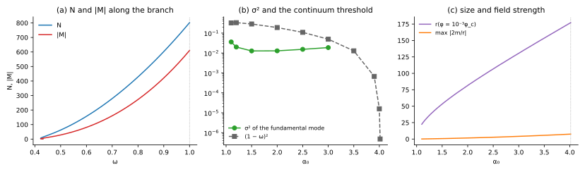

# Radial (l = 0) stability of the signed-source sextic boson stars

Model as in `../boson_star.py` (Shirokov arXiv:2608.24577): λ = 10240, μ = λ²/4.8, m = 1, G_ab = 8πε T_ab,
ε = +1 canonical, ε = −1 phantom. Perturbations ∝ e^{iσt}; **σ² < 0 is unstable**.
Throughout, **ω is the physical frequency** (α(∞) = 1), and N is the Noether particle number
N = ∫ 4π r² ω φ² (a/α) dr, which does not depend on ε.

## 1. Equations (`derive_radial.py`, output in `derive_radial_output.txt`)

Metric e^{ν}, e^{λ} perturbed by n(t,r), l(t,r). Field Φ = [φ₀ + F + iG] e^{−iωt}, and everything ∝ e^{iσt}
(F → A, G → B, n → N_, l → L). sympy builds G_ab − 8πεT_ab and the KG equation from the metric, linearizes
them, and reduces as follows:

- background: reproduces the `boson_star.py` equations exactly (residual 0). The θθ equation follows from Bianchi.
- (tr) constraint: L = 8πε [r φ₀' A − ω (a/α) Ψ / r]
- Ψ (the perturbation of the enclosed charge) is defined by iσΨ = r²(α/a)(φ₀B' − φ₀'B). With the
  gauge invariant G̃ = iσB + ωφ₀N_/2, the imaginary KG equation (current conservation) integrates to
  Ψ' = r²(a/α) φ₀ (G̃ − ωφ₀L/2 − 2ωA)
- (rr) constraint: N_' is algebraic in (A, A', G̃, Ψ), with no undifferentiated N_ (gauge).
- the Ψ definition becomes −σ²Ψ = r²(α/a)(φ₀G̃' − φ₀'G̃ − ωφ₀²N_'/2)
- the real KG equation gives A'' = (…) − σ² (a/α)² A + …, linear in σ².

The result is a closed 4th-order system for (A, A', G̃, χ = Ψ/φ₀) that contains σ only as σ², with ε kept
symbolic. **Check:** with the reduced system substituted back, the residuals of all six linearized equations
(tt, tr, rr, θθ, KG_R, KG_I) simplify to exactly 0. The full expressions are printed in
`derive_radial_output.txt`. `radial_rhs_generated.py` is generated from them, so no hand transcription is
involved. The structure (one Noether-charge function, one gauge-invariant phase, metric removed by the two
constraints) matches Gleiser–Watkins/Jetzer/Kain. I did not compare against their printed equations term by
term. The symbolic residual check is the validation of the derivation.

## 2. Numerical method

**Background (`background.py`).** The shooting stars of `boson_star.py` are trustworthy only to r ≈ 23. I
re-solve each star as a two-point BVP (`scipy.solve_bvp`, tol 1e-9, R = max(60, 30/√(1−ω²))) in the variables
ψ = ln φ, u = φ'/φ, m, ν:
- regular series at r₀ = 1e-3;
- decaying Yukawa tail u(R) = −√(1−ω²) − 1/R;
- Schwarzschild matching for ν(R), which normalizes α(∞) = 1.

The log variable keeps the exponentially small tail well conditioned (φ(R)/φ_c ~ 1e-20). Families are
continued in ω, in N with ω free (this passes ω-folds), or in α(0) with ω free (this passes N-extrema). At
the campaign stars the BVP reproduces `boson_star.py`: M = +0.014626 at ω = 0.75 and M = −0.014580 at
ω = 0.7603.

**Eigenproblem (`radial_modes.py`).** I used shooting with the compound-matrix (bivector) method:
- the 2-plane of regular solutions is integrated from r₀ (A₀, G̃₀ free; χ = O(r³));
- the 2-plane of decaying solutions is integrated inward from R. It starts on the spectral projector of the
  far-field matrix in the variables (A, A', G̃, χ/r²), whose eigenvalues reproduce ±√(1−(ω±σ)²) (checked);
- the two planes are matched at r_m (where φ = 10⁻³ φ_c);
- D(σ²) is the normalized wedge product, and eigenvalues are its zeros.

Why this method: plain 2-column shooting failed. The two decaying solutions have different rates, so their
span collapses numerically and D jumped by orders of magnitude. The bivector method keeps the plane
orthonormal. Bound modes exist only for σ² < (1−ω)², the threshold of the continuum.

**Independent check (`fd_check.py`, `complex_check.py`).** This is a second-order box-scheme finite-difference
discretization of the same first-order system on a stretched grid. It gives a generalized pencil
(K₀ + σ²K₁)y = 0, which I solve by dense QZ (cond K₀ ~ 1e22 defeats sparse shift-invert). It shares only the
derived equations with the shooting code. It also returns **complex** σ², which shooting along the real
σ²-axis cannot see. One spurious exact σ² = 0 eigenvector appears; it is localized in the outer tail, where
φ₀ underflows, and is discarded.

## 3. Validation on the canonical family (ε = +1)

Scan (`scan_canonical.py`, `scan_eps+1.json`):

| ω | M | N | lowest σ² |
|---|---|---|---|
| 0.750 | +0.0146260 | 0.0159284 | none in [−4, (1−ω)²) → stable |
| 0.800 | +0.0114777 | 0.0118555 | none (stable) |
| 0.850 | +0.0094304 | 0.0093676 | none (stable) |
| 0.880 | +0.0086225 | 0.0084324 | none (stable) |
| 0.900 | +0.0082617 | 0.0080267 | +9.462e-3 (just below threshold 1.0e-2) |
| 0.910 | +0.0081437 | 0.0078962 | +6.205e-3 |
| 0.920 | +0.0080761 | 0.0078223 | +2.376e-3 |
| 0.925 | +0.0080647 | 0.0078099 | +3.448e-4 |
| 0.930 | +0.0080709 | 0.0078166 | **−1.685e-3** |
| 0.935 | +0.0080974 | 0.0078450 | −3.638e-3 |
| 0.940 | +0.0081478 | 0.0078988 | −5.431e-3 |
| 0.950 | +0.0083413 | 0.0081034 | −8.177e-3 |
| 0.960 | +0.0087168 | 0.0084964 | −9.236e-3 |

Fine scan with 17 stars on ω ∈ [0.923, 0.931] (`crossing.py`, `crossing_p.txt`), using polynomial fits:

| | ω |
|---|---|
| dM/dω = 0 | 0.92584446 |
| dN/dω = 0 | 0.92584446 |
| σ² = 0 | **0.92584444** |

**The zero crossing of the fundamental mode coincides with the extremum of M and N to 2×10⁻⁸ in ω.** The
extremum is a minimum of M. The stable side is ω < 0.9258, where dM/dω < 0 and dN/dω < 0, as expected.
The first law dM = ω dN holds to ~5×10⁻⁵ by finite differences, which independently checks the background
and the M/N extraction.

Convergence (`convergence.py`, `convergence_output.txt`). The eigenvalue changes by ≤ 2×10⁻¹⁰ (relative
≤ 3×10⁻⁷) under each of the following:
- integrator rtol 1e-10 → 1e-12;
- r_m × 0.7 or × 1.4;
- eigen-solver R − 15;
- background tol 1e-9 → 1e-10;
- background R + 30.

For example, ω = 0.94 gives σ² = −5.4314738e-3 in every variant. The FD check gives σ² = −5.449e-3 at
n = 300, consistent with O(h²) (more resolutions are in `fd_check_output.txt`, see §6). FD finds no complex
eigenvalue with |σ²| < 0.3 at ω = 0.75 or 0.94 (n = 300 and 600).

Canonical low-ω / strong-field part (`lowscan.py`, `strongfield.py`; `low_p.txt`, `strong_p.txt`,
`strong_p_turn.txt`).
- Along the canonical family **N and M keep growing down to ω ≈ 0.200, where N peaks at ≈ 42.73
  (M ≈ 11.93, max 2m/r ≈ 0.66)**. The value "ω_min = 0.316" corresponds to N ≈ 9.2, not to a turning point.
- At the 11 values of N from 0.3 to 42.6 in `low_p.txt` (160 + 160 grid points, §6) the fundamental σ² is
  positive, falling from 8.57e-2 to 4.04e-5.
- The fundamental σ² stays positive and drops toward 0 as that maximum is approached:

| α(0) | ω | N | M | σ²₀ |
|---|---|---|---|---|
| 0.9 | 0.3812 | 2.017 | 0.872 | 2.25e-2 |
| 0.8 | 0.3286 | 7.048 | 2.632 | 7.57e-3 |
| 0.7 | 0.2949 | 13.95 | 4.776 | 3.48e-3 |
| 0.6 | 0.2671 | 21.97 | 7.025 | 1.73e-3 |
| 0.5 | 0.2426 | 30.30 | 9.146 | 8.49e-4 |
| 0.4 | 0.2210 | 37.79 | 10.88 | 3.59e-4 |
| 0.35 | 0.2116 | 40.638 | 11.4994 | 1.96e-4 |
| 0.30 | 0.20353 | 42.4079 | 11.86739 | 6.59e-5 |
| 0.28 | 0.200834 | 42.69442 | 11.925379 | +2.00e-5 |
| 0.27 | 0.199631 | 42.72676 | 11.931862 | **−2.01e-6** |
| 0.26 | 0.198538 | 42.67740 | 11.922043 | **−2.36e-5** (past the maximum, N falling) |

**The second turning point also reproduces the criterion.** A rescan from α₀ = 0.280 to 0.262 in steps of
0.001 (`strong_p_turn.txt`, #9 on win2, raw `I9-win2` at 30241af) has one sign change of σ₀², between
α₀ = 0.271 (+1.68e-7, ω = 0.199746) and 0.270 (−2.01e-6, ω = 0.199631). `strong_refine.py`
(`strong_refine_output.txt`) puts σ₀² = 0 at α₀ = 0.270923 and the maxima of N and M at 0.270924, from
parabolas through the largest row and its neighbours. They agree to 1.3×10⁻⁶ in α₀, against the 0.001 step.
Beyond it the star is unstable.
(The value "ω_min = 0.316" corresponds to N ≈ 9.2, not to a turning point; the family continues to ω ≈ 0.199.)

## 4. Phantom family (ε = −1)

High-ω scan (`scan_eps-1.json`):

| ω | M | N | lowest σ² |
|---|---|---|---|
| 0.7500 | −0.0154193 | 0.0168547 | none (stable) |
| **0.7603 (campaign)** | **−0.0145805** | **0.0157438** | **none in [−4, 0.0575) → stable** |
| 0.8000 | −0.0119681 | 0.0123897 | none (stable) |
| 0.8500 | −0.0097452 | 0.0096881 | none (stable) |
| 0.9000 | −0.0084615 | 0.0082156 | none (stable) |
| 0.9200 | −0.0082351 | 0.0079664 | +3.597e-3 |
| 0.9250 | −0.0082129 | 0.0079424 | +1.603e-3 |
| 0.9275 | −0.0082081 | 0.0079372 | +5.801e-4 |
| 0.9300 | −0.0082078 | 0.0079369 | **−4.501e-4** |
| 0.9350 | −0.0082222 | 0.0079523 | −2.494e-3 |
| 0.9400 | −0.0082593 | 0.0079919 | −4.446e-3 |
| 0.9500 | −0.0084205 | 0.0081623 | −7.705e-3 |
| 0.9600 | −0.0087488 | 0.0085059 | −9.475e-3 |

Fine scan (`crossing_m.txt`):

| | ω |
|---|---|
| dM/dω = 0 | 0.92890838 |
| dN/dω = 0 | 0.92890838 |
| σ² = 0 | **0.92890846** |

The crossing coincides with the extremum to 8×10⁻⁸. The phantom first law is **dM = εω dN = −ω dN**, which
holds to ~8×10⁻⁵. The extremum is a maximum of M, i.e. a minimum of |M|. Because dM = εω dN, M and N always
have their extrema at the same ω, for either sign of ε.

For the campaign star there is no sign change of D on σ² ∈ [−4, (1−ω)²) at two tolerances
(`deep_negative_output.txt`, `convergence_output.txt`). That excludes real growth rates up to |σ| = 2 in code
units (e-folding time ≥ 0.5) and beyond. The FD complex-spectrum check for ε = −1 finds no complex eigenvalue; see §6.

Low-ω / strong-field phantom (`lowscan.py` via N-continuation, `strongfield.py` via α(0); `low_m.txt`,
`strong_m.txt`):
- The phantom family has a **fold in ω (ω_min ≈ 0.42226 at N ≈ 5.6)**. N and |M| are monotone through it,
  and ω turns back up.
- The fundamental σ² stays positive and smooth across the fold. No mode crosses there.

| α(0) / N | ω | N | M | σ²₀ |
|---|---|---|---|---|
| N = 0.3 | 0.4947 | 0.30 | −0.171 | 1.02e-1 |
| N = 1 | 0.4477 | 1.00 | −0.496 | 5.23e-2 |
| α₀ = 1.10 | 0.4313 | 2.04 | −0.950 | 3.59e-2 |
| α₀ = 1.15 | 0.4228 | 4.34 | −1.932 | 2.49e-2 |
| α₀ = 1.17 (fold) | 0.42226 | 5.46 | −2.404 | 2.25e-2 |
| α₀ = 1.20 | 0.4230 | 7.33 | −3.193 | 1.99e-2 |
| α₀ = 1.25 | 0.4269 | 10.92 | −4.718 | 1.72e-2 |
| N = 12 | 0.4284 | 12.00 | −5.181 | 1.66e-2 |
| α₀ = 1.30 | 0.4328 | 15.07 | −6.502 | 1.55e-2 |
| α₀ = 1.40 | 0.4479 | 24.91 | −10.84 | 1.36e-2 |
| α₀ = 1.50 | 0.4653 | 36.65 | −16.20 | 1.27e-2 |

Over the whole range reached (max |2m/r| ≈ 0.4 at α₀ = 1.5), no extremum of N or M was found on the
phantom low-ω side, and no unstable radial mode.

## 5. Conclusions

1. **Canonical:** reproduced the textbook result at both turning points of the family. The fundamental
   mode crosses σ² = 0 at the weak-field extremum of M and N (ω = 0.925844), to 2×10⁻⁸. It crosses again
   at the strong-field maximum of N and M (ω ≈ 0.1997, N ≈ 42.727), to 1.3×10⁻⁶ in α₀. The stable
   side is dN/dω < 0 between them.
2. **Phantom:** the campaign star ω = 0.7603 is **radially (l = 0) linearly stable**.
   - The family is stable for ω ≲ 0.9289 and unstable above it. The instability sets in exactly at the
     common extremum of M and N (minimum of |M|).
   - **For this family the turning-point criterion carries over to ε = −1, if it is stated in N:**
     instability onset at dN/dω = 0, stable side dN/dω < 0. Stated in M, the sign of the stable-side
     inequality flips, since dM/dω = −ω dN/dω > 0 there. The "dM/dω < 0" rule is not ε-invariant; the
     N-rule is.
   - Plausible reason, not proven here: at dN/dω = 0, ∂_ω(background) is a σ = 0 solution with δN = 0. That
     argument is kinematic and does not use the sign of the energy functional. Which side is stable is not
     given by that argument. Here it was found numerically.
   - The ω-fold of the phantom family (ω ≈ 0.4223) is **not** a stability change, as expected: neither M nor
     N is extremal there.
3. **Physical caveat on the high-ω result.** At ω ≈ 0.93 the stars have |M|/R ~ 10⁻³. The instability there
   is essentially the flat-space Vakhitov–Kolokolov (Q-ball) instability, dN/dω > 0, and gravity is a
   perturbation. That is why the two signs give almost the same numbers: σ² crosses at 0.92584 vs 0.92891.
   It is a weak test of how ε enters. The strong-field phantom branch (|2m/r| up to ~0.4) is the more
   meaningful test, and it is stable with no turning point within the range reached.

## 6. Caveats / open items

- **Root grids.** `lowest_modes` brackets roots on a fixed σ² grid, so a pair of roots between two grid
  points is lost. #9 (win2, raw `I9-win2` at 30241af) ran `lowscan.py` at 16 + 16, 80 + 80 and 160 + 160
  points. The 80 and 160 point rows agree root for root in all 14 rows (`cmp_lowscan.py`). The 16-point
  grid missed the lowest root at ε = +1, N = 3 (1.637e-2, where it listed 1.749e-1) and at ε = −1, N = 12
  (1.661e-2, where it listed 1.379e-1), and higher roots in 7 more rows. No row has a negative root at any
  grid. `low_p.txt` and `low_m.txt` hold the 160-point rows. The grids of `scan_canonical.py` (16 + 16),
  `crossing.py` (8 + 8, first root only) and `strongfield.py` (24 + 40 on [−0.2, 0.1]) are not yet
  rechecked (#56). They are log-dense near 0, where the sign question lives. **Negative σ² can still be
  missed only if an even number of roots sits between grid points.** The stronger statement for the
  campaign stars, "no root on [−4, 0)", comes from 40 log-spaced points plus the FD spectrum.
- **FD and complex-spectrum checks** (the cells a container restart cut off were completed by #9):
  - FD lowest σ² converge under n = 250/400/550 and agree with shooting: ε=+1 ω=0.94 −5.437e-3 (shooting
    −5.431e-3); ε=−1 ω=0.94 −4.4599e-3, −4.4514e-3, −4.4487e-3 (shooting −4.446e-3); ε=−1 ω=0.9275
    +5.816e-4 (shooting +5.801e-4); ε=−1 ω=0.7603 no bound mode (lowest FD value 0.05844 sits above the
    continuum threshold 0.05746).
  - Complex spectrum (|σ²| < 0.3): none for ε=+1 ω=0.75, 0.94 and ε=−1 ω=0.7603, 0.85, 0.94 at n = 300 and
    600. At ε=−1 ω=0.94 the real bound σ² is −4.456e-3 (n = 300) and −4.448e-3 (n = 600), matching shooting
    −4.446e-3.
- The FD pencil is extremely ill-conditioned because coefficients carry φ₀ ~ e^{−kr}. Eigenvalues are
  stable under refinement where checked, but the dense solve limits n to ≈ 1200.
- Masses here are true ADM masses; the +2 % difference from the paper is the paper's 5 %-radius mass
  convention (see ../mass_check/RESULTS.md). Does not affect the stability statements.
- Only l = 0. The phantom star could still be unstable to l ≥ 1 or to non-linear perturbations.
- The full (unfolded) phantom family beyond α₀ = 1.5 and whether it develops an N-extremum: checked in §7 (#10),
  to where the solver stops at ω → 1. Still not checked: l ≥ 1, non-linear perturbations, and anything past ω = 1.

## 7. Phantom family beyond α₀ = 1.5, to ω = 1 (#10, rpi5)

**N and |M| rise strictly along the whole branch, from the ω-fold at α₀ = 1.172 to where the solver stops, and there is
no extremum of N.** The solver stops where ω reaches 1 (ω = 0.99994 at α₀ = 4.017906, N = 801.96, M = −610.49). That is
a limit of the boundary condition, not of the star: with a tail condition that has no k the star continues smoothly
through ω = 1, at N = 802.084, M = −610.617. The turning-point rule therefore predicts no change of radial stability on
this branch, and none of the ten stars scanned has a negative σ² (status: *numerical evidence*).

Raw output is in `negative-mass-raw/I10-rpi5` (commit 2feb44d), the code is `phantom_follow.py`,
`phantom_checks.py`, `phantom_modes.py`, `phantom_converge.py`, `phantom_fd.py`, `phantom_stop.py` and
`phantom_graph.py`, all written on rpi5 (one process at a time, `nice -n 10`). The table `phantom_family.txt` and the
figure `phantom_family.svg` are made from `follow.jsonl` and `modes.jsonl` by `phantom_graph.py`.

### Reruns first

`fold_scan.py` was rerun over its stored range before anything was extended (`fold_rerun_check.py`, raw
`fold_rerun_p.log`, `fold_rerun_m.log`).
- ε = +1, `fold_scan.py 1 0.33 43` against `fold_p.txt`: all 40 rows equal to the printed digits (the mesh node counts
  differ
  in every row, by 1 to 152 nodes), and the same final failure ("maximum number of mesh nodes", N = 42.7327).
- ε = −1, `fold_scan.py -1 0.5 40`, against the 11 stored phantom rows of `strong_m.txt` and `low_m.txt`, interpolated in
  ln N: worst relative difference 1.4×10⁻⁵ (the printed precision).
- σ² of the lowest mode at α₀ = 1.10, 1.20 and 1.50 against `strong_m.txt`: worst relative difference 1.2×10⁻⁵ (the
  5 printed digits), though R is now 60, 64 and 87 instead of 60.

### The branch (`phantom_follow.py`, 295 stars)

The family is continued in the central lapse α₀ with ω free (as `strongfield.py` does), from α₀ = 1.10, with the outer
radius R = rs + 30/k at every star (rs where φ = 10⁻³φ_c, k = √(1−ω²)). `strongfield.py` kept R = 60, which leaves
R − rs = 6.7 at α₀ = 1.5 and none beyond. Every star has BVP tolerance 1×10⁻⁸ and a maximum rms residual below 1.0×10⁻⁸ on
2000 to 5400 mesh nodes. The star is a thin-wall bubble: φ ≈ φ_c = 0.0187 inside and a wall a few units wide at r_half
(r_half = 158 at the end).

| α₀ | ω | N | M | max abs 2m/r | rs | R |
|---|---|---|---|---|---|---|
| 1.10 | 0.431253 | 2.0373 | −0.9504 | 0.110 | 22.5 | 60 |
| 1.17 (fold) | 0.422264 | 5.4600 | −2.4039 | 0.200 | 29.5 | 62 |
| 1.30 | 0.432827 | 15.0674 | −6.5015 | 0.381 | 39.9 | 72 |
| 1.50 | 0.465340 | 36.6533 | −16.1991 | 0.690 | 53.3 | 87 |
| 2.00 | 0.564546 | 120.1487 | −59.4357 | 1.614 | 81.6 | 117 |
| 2.50 | 0.670180 | 240.1079 | −133.7659 | 2.751 | 106.7 | 147 |
| 3.00 | 0.777898 | 393.2877 | −244.9464 | 4.099 | 130.6 | 178 |
| 3.50 | 0.886646 | 578.1103 | −399.0392 | 5.659 | 153.6 | 217 |
| 3.90 | 0.974103 | 748.1340 | −557.3624 | 7.060 | 171.8 | 299 |
| 4.00 | 0.996015 | 793.6764 | −602.2265 | 7.432 | 176.3 | 446 |
| 4.015 | 0.999304 | 800.6119 | −609.1458 | 7.488 | 177.0 | 678 |
| 4.0179 (last) | 0.999941 | 801.9588 | −610.4921 | 7.499 | 177.1 | 1919 |

(`phantom_family.txt` has every tenth star.) ω has the one fold, ω_min = 0.42226 at α₀ = 1.172 (`phantom_checks.py` C4),
and then rises monotonically to 1, with dω/dα₀ ≈ 0.22 throughout the last stretch. dN/dα₀ rises from 40 (α₀ = 1.1) to
464 and is positive on every step (C2). dM = −ω dN holds on every step to 1.1×10⁻⁵ of |dM| (C3, limit 1×10⁻⁴).

**No horizon.** m < 0 throughout, so a² = 1/(1 + |2m/r|) ≤ 1, and g_rr = 0.12 at the largest field (|2m/r| = 7.5).

### Where the solver stops, and why

`phantom_follow.py` stops at α₀ = 4.017906 (k = 0.0109, R = 1919): the next solve (R = 2933) reports "A singular Jacobian
encountered when solving the collocation system" (scipy status 2, not the node limit). An earlier run of the same
code on a different step sequence stopped at α₀ = 4.018025, k = 0.0082, R = 3851, with the same message, so the point
depends on the steps and not on the star. `phantom_stop.py` (raw `stop.log`) tells the cause apart from the alternatives:

| test | result | verdict |
|---|---|---|
| S1 ω(α₀) over the 8 rows with k < 0.15 is a quadratic (residual 7×10⁻¹⁰), and reaches 1 at α₀* = 4.0181766 | the stop is 2.7×10⁻⁴ below α₀* | PASS |
| S2 the last star on R = 600 instead of R = 1919 | ω, N, M differ by 1×10⁻¹¹, 2×10⁻¹⁰, 3×10⁻¹⁰ | PASS |
| S3 Yukawa tail on a fixed R = 600 goes on to α₀ = 4.0181764 (ω = 0.99999997, k = 2.5×10⁻⁴), N = 802.0840, M = −610.6174 | fails 1.5×10⁻⁷ below α₀*, where ω ≥ 1 has no real k | PASS |
| S4 a tail u(R) = −κ − 1/R with κ = a√(1 − ω²/α²) (no k) agrees with the Yukawa star at α₀ = 4.0 to 3×10⁻¹⁰, and goes on through ω = 1 to ω = 1.0026 | N rising, second differences ≤ 5×10⁻⁴ of the first; N(ω=1) = 802.0841, M(ω=1) = −610.6175 | PASS |

The mutation of S1 (ω shifted by 0.05) and of S4 (the Yukawa condition put back) each fail, and the S1 planted family
recovers its α₀* to 10⁻⁹ (`phantom_stop.py --selftest`).

So the cause is the loss of the Yukawa branch of the far field at ω = 1:
- The tail condition u(R) = −k − 1/R has k = √(1 − ω²), which has a square-root branch point at ω = 1, and the rule
  R = rs + 30/k then sends R to infinity. The collocation Jacobian becomes singular at R of a few thousand (S1, S3).
- It is not stiffness (mesh below 5400 nodes, residuals at tolerance on all 295 stars, S3 reaches k = 2.5×10⁻⁴ on
  R = 600) and not a horizon (m < 0).
- It is not the star: N, M and ω are independent of R to 3×10⁻¹⁰ at k = 0.011 (S2), and the core is smooth through ω = 1
  (S4). A wrong-sign κ in the tail condition gives the same star, because the BVP core does not feel its outer condition.
- The family of bound stars does end at ω = 1: for ω > 1 the field oscillates at infinity, so no static decaying star
  exists there, and N and M have finite limits (802.084, −610.617) at ω = 1. Reasoning, not checked: with m < 0 the
  tail κ² = 1 − ω²/α² stays positive at ω = 1, so the exact ω = 1 star decays like e^{−2√(2|M|r)}, and the end of the
  bound family is the mass threshold, not a loss of normalizability.

### Radial stability along the branch (`phantom_modes.py`, raw `modes.jsonl`)

Same `lowest_modes` as `strongfield.py`, on σ² ∈ [−0.2, (1−ω)²) with 24 points below 0 and 32 above (57 grid points).

| α₀ | ω | (1−ω)² | σ² roots | R / rm |
|---|---|---|---|---|
| 1.10 | 0.431253 | 3.235e-01 | 3.5940e-02, 1.4917e-01 | 60 / 23 |
| 1.20 | 0.422999 | 3.329e-01 | 1.9926e-02, 7.6515e-02, 1.7287e-01 | 64 / 32 |
| 1.50 | 0.465340 | 2.859e-01 | 1.2704e-02, 4.2725e-02, 9.3272e-02 | 87 / 53 |
| 2.00 | 0.564546 | 1.896e-01 | 1.2843e-02, 3.7466e-02, 7.8791e-02 | 117 / 82 |
| 2.50 | 0.670180 | 1.088e-01 | 1.5289e-02, 4.0335e-02, 8.2368e-02 | 147 / 107 |
| 3.00 | 0.777898 | 4.933e-02 | 1.8685e-02, 4.5649e-02 | 178 / 131 |
| 3.50 | 0.886646 | 1.285e-02 | none | 217 / 154 |
| 3.90 | 0.974103 | 6.707e-04 | none | 299 / 172 |
| 4.00 | 0.996015 | 1.588e-05 | none | 446 / 176 |
| 4.015 | 0.999304 | 4.850e-07 | none | 678 / 177 |

No root is negative (C5). The fundamental σ² stays between 1.27×10⁻² and 1.87×10⁻² from α₀ = 1.5 to 3.0 and then meets
the falling continuum threshold between α₀ = 3.0 and 3.5, after which the star has no discrete mode below the
continuum. So the **criterion at an N-extremum is vacuous: N has none, and the fundamental σ² does not cross 0 anywhere
on the branch**, which is what the rule asks (stated for the sampled stars, not between them).

Checks on this scan:
- Planted data: `phantom_modes.py --selftest` and `--compare` (raw `modes.log`); the root at α₀ = 1.10, 1.20 and 1.50
  agrees with the stored one to 1.2×10⁻⁵ (limit 6×10⁻⁵, the print precision), and a 10⁻³ shift fires.
- Root grids: α₀ = 3.0 and 4.0 rerun on 113 grid points (48 below 0, 64 above) against 57: the same roots to 10⁻⁸ and
  no extra root, none below 0 (`phantom_modes.py --grids`, raw `modes_grids.log`; the mutations drop and shift of the
  finer grid's lowest root fail it). As in §6, a pair of roots between grid points would still be missed; the stars
  of α₀ ≥ 3.5 have no sign change of D anywhere on [−0.2, (1−ω)²).
- Independent discretization (`phantom_fd.py`, `fd.json`; dense QZ of the first-order system, which shares only the
  derived equations): no negative real and no complex σ² with |σ²| < 0.3 at n = 250 and 550 for α₀ = 2.0 and 3.0 (F2,
  PASS). The lowest FD root converges to the shooting root from above, as a second-order scheme should (plain differences
  21%, 9.6%, 5.4% at n = 250, 400, 550 for α₀ = 2.0, and 19%, 9.7%, 5.6% for α₀ = 3.0). After Richardson extrapolation
  in n the difference is 6.0×10⁻³ at α₀ = 2.0 (limit 1×10⁻², PASS) and **1.04×10⁻² at α₀ = 3.0 (limit 1×10⁻², FAIL by
  a hair)**. The α₀ = 1.5 star, whose root is known from shooting, extrapolates to 2.2×10⁻³, and the ε = +1 mutation on
  that star fires (extrapolated value 37% off). The order of the three FD values on a thin wall is below 2 (1.44 at α₀
  = 2.0, 1.09 at α₀ = 3.0), so the
  extrapolation is not reliable to 1%: extrapolating with the fitted order gives 2.0% and 4.2% below shooting, so the
  shooting root lies between the two extrapolations at both stars. The FD check supports "no instability" and cannot
  confirm σ₀² better than a few percent at α₀ ≥ 2.
- Background convergence (`phantom_converge.py`, raw `converge.log`): at α₀ = 1.5, 2.5, 3.5, 4.0, 4.015 the same star
  on R × 1.5 differs by at most 5×10⁻¹⁰ in ω, N and M, and at tolerance 1×10⁻⁹ and 1×10⁻¹⁰ by at most 1.8×10⁻⁸
  (the BVP's own tolerance), against a limit of 1×10⁻⁷ set before the run. The mutation (the ν(R) matching dropped)
  does not converge and fails the check, and the planted star at α₀ = 1.3 passes it.

### Discrepancies and changes to checks

- **§4 and §5.3 say "max |2m/r| ≈ 0.4 at α₀ = 1.5"; the value is 0.690** (0.381 at α₀ = 1.3, where it is about 0.4). The
  phantom star at α₀ = 1.5 is already as strong as the canonical turning point (0.66), and the field here grows to 7.5.
  Not edited in §4 and §5, for the coordinator.
- The first run of the first-law check (C3) failed at the first step (2.0×10⁻⁴, limit 1×10⁻⁴). The cause was the
  trapezoid rule in the check (error (ΔN)² ω_NN / 12 where ω(N) bends near N = 2), not the stars, so the integral is now
  a cubic through four rows, with the limit unchanged. The result is 1.1×10⁻⁵.
- The FD criterion F1 was changed after the α₀ = 1.5 selftest from "the plain FD value at n = 550 within 3×10⁻²"
  (3.9×10⁻² there) to the extrapolated one above, before the α₀ = 3.0 result was seen. The plain verdicts stay in
  `fd.json`
  as `F1_plain`. The extrapolated limit of 1×10⁻² was set at that time; α₀ = 3.0 misses it.
- The mutation "κ with the wrong sign" in the WKB tail did not fire (the star does not feel its outer condition), and
  was replaced by putting the Yukawa condition back.

## Files
| file | role |
|---|---|
| `derive_radial.py` → `derive_radial_output.txt`, `radial_eqs.txt`, `radial_rhs_generated.py` | sympy derivation + verification + codegen (~45 s) |
| `background.py` | BVP stars; continuation in ω, N, α(0) |
| `radial_modes.py` | compound-matrix shooting eigen-solver |
| `fd_check.py`, `complex_check.py` | independent FD discretization, complex spectrum |
| `scan_canonical.py` (both ε) → `scan_eps±1.json`, `fine_*.txt` | high-ω scans |
| `crossing.py` → `crossing_eps±1.json`, `crossing_*.txt` | σ² = 0 vs dM/dω = 0 vs dN/dω = 0 |
| `convergence.py` → `convergence_output.txt` | tolerance/radius convergence |
| `deep_negative.py` → `deep_negative_output.txt` | no real growth rate up to \|σ\| = 2 at the campaign stars |
| `fold_scan.py` → `fold_p.txt` | N-continuation of the families (folds) |
| `lowscan.py` → `low_p.txt`, `low_m.txt` | low-ω spectra: `python lowscan.py 1 0.3,1,3,6,9.2,15,25,35,40,42,42.6 160 160` and `python lowscan.py -1 0.3,1,12 160 160` |
| `strongfield.py` → `strong_*.txt` | strong-field spectra; `strong_p_turn.txt` is `python strongfield.py 1 0.280,0.279,0.278,0.277,0.276,0.275,0.274,0.273,0.272,0.271,0.270,0.269,0.268,0.267,0.266,0.265,0.264,0.263,0.262` |
| `cmp_lowscan.py` | compares the roots of two `lowscan.py` outputs (`--selftest`) |
| `strong_refine.py` → `strong_refine_output.txt` | σ₀² = 0 against the maxima of N and M: `python strong_refine.py ../../../negative-mass-raw/I9-win2/strongfield_eps+1.json --selftest` |
| `fold_rerun_check.py` | a `fold_scan.py` rerun against the stored rows: `python fold_rerun_check.py p fold_p.txt <rerun.log>`, `python fold_rerun_check.py m <rerun.log> strong_m.txt low_m.txt`, `--selftest` |
| `phantom_follow.py` | phantom family in α₀ beyond 1.5 with a moving R: `python phantom_follow.py --alpha-start 1.1 --alpha-stop 20 --out follow.jsonl --snap-dir snap --targets 1.10,1.15,...` |
| `phantom_checks.py` | C1 to C5 on `follow.jsonl` and `modes.jsonl`, `--table`, `--selftest`, `--mutate=bump\|eps\|fold\|sigma` |
| `phantom_modes.py` | σ² of the snapshot stars, `--compare` with `strong_m.txt`, `--grids`, `--selftest` |
| `phantom_converge.py`, `phantom_fd.py`, `phantom_stop.py` | R and tolerance convergence, independent FD spectrum, the reason for the stop; each has `--selftest` and `--mutate=...` |
| `phantom_graph.py` → `phantom_family.txt`, `phantom_family.svg` | the table and figure of §7 |
